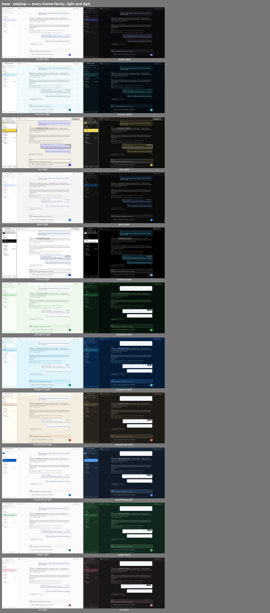
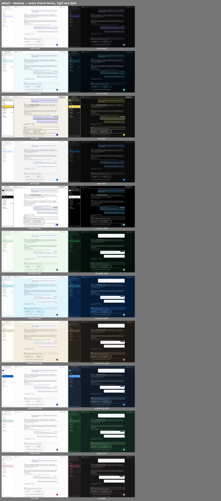
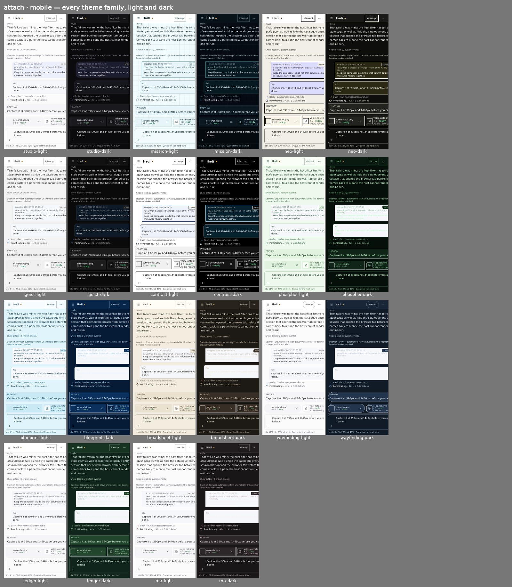
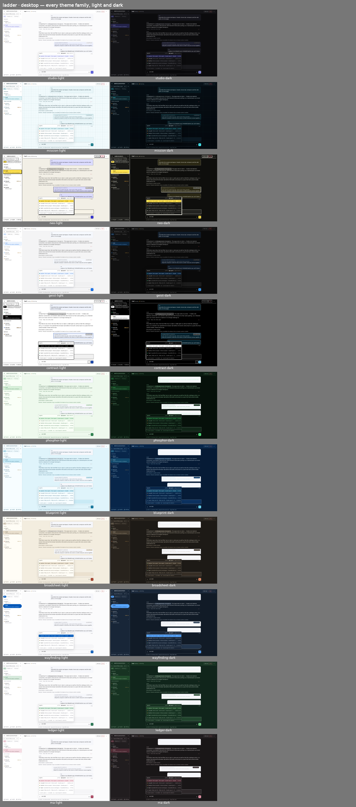
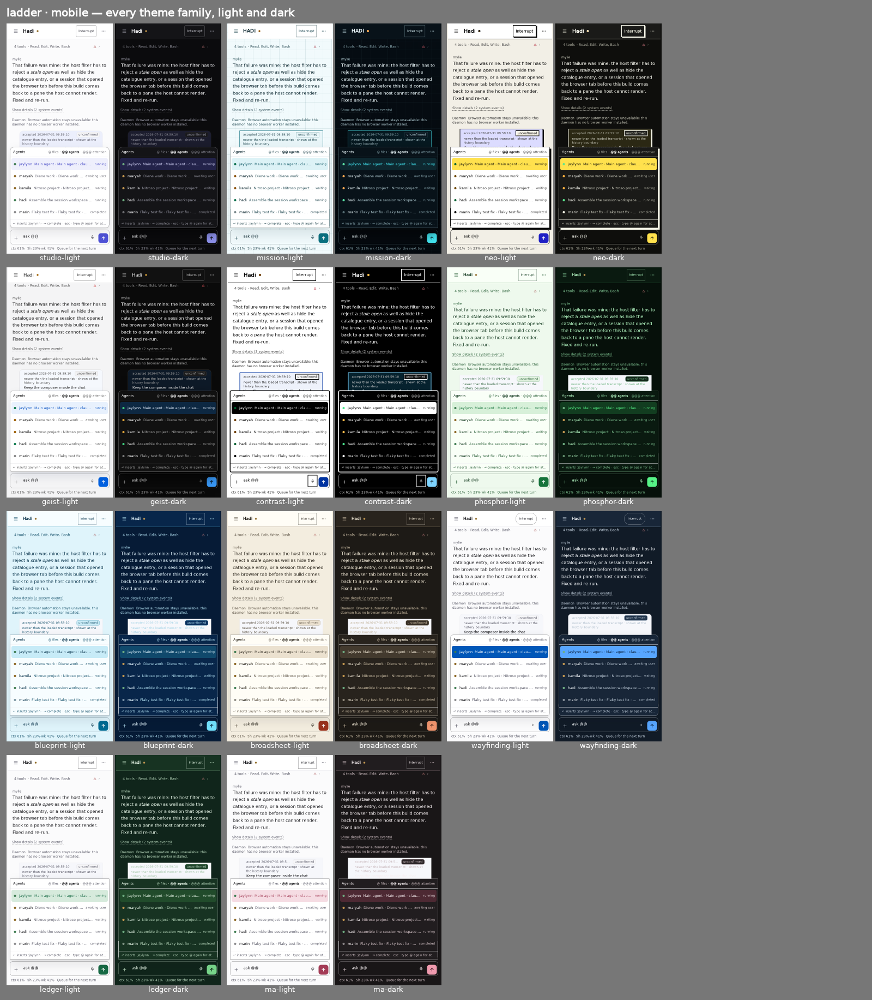
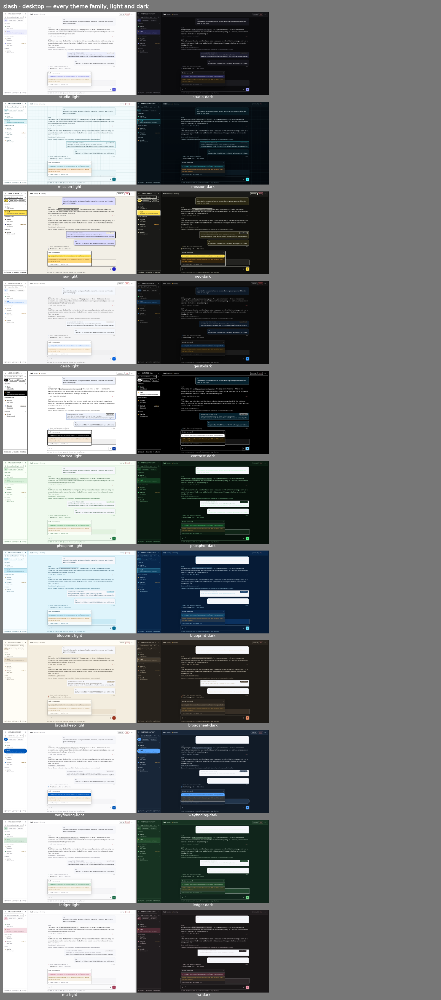
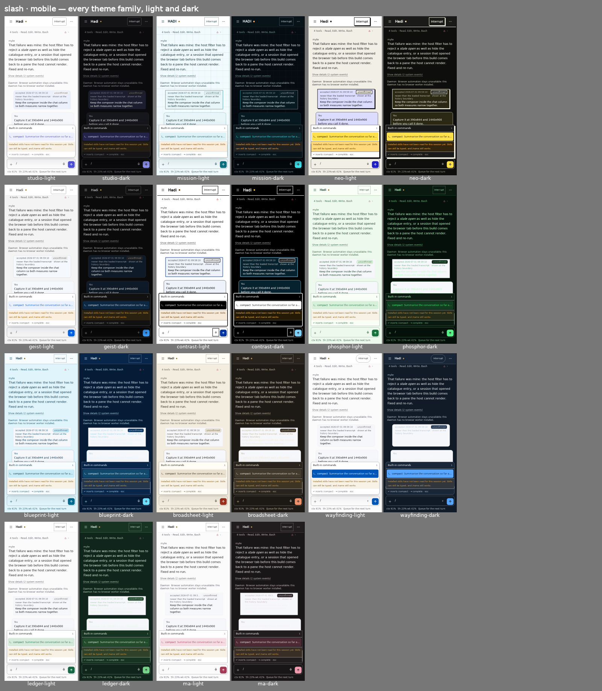

# Session page — PR B (conversation + composer) screenshots

Captured from the PWA harness (`#session-workspace`) on the PR head. Phone frames are 390 px with a
phone user agent; desktop frames are 1440 px. Every contact sheet shows all 11 theme families, light
and dark. `frames/` holds the Studio frames at full size.

Scenes:

- **base** — clean transcript (reasoning/usage behind "Show details", opened here), tool calls as one
  collapsed row, the live activity line (`Pontificating… 42s · ↓ 3.1k tokens`, read off the pane), and
  the compact composer: ＋ · one growing line · 🎙 · ↑, status line `ctx · quota · hint` underneath.
- **attach** — an image and a voice note attached through ＋ (drag-drop and paste use the same path),
  previews above the line.
- **ladder** — `@@` opens Agents: the ladder in the header with the current tier marked, status dots,
  one-line hints, and the key hint footer ("↵ inserts :jaylynn · type @ again for attention").
- **slash** — `/` opens commands and skills.

## base

## attach

## ladder

## slash

