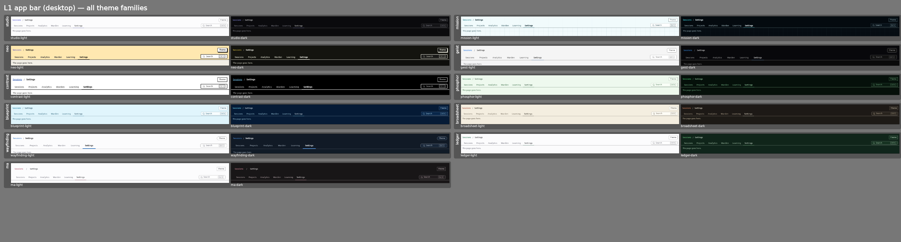
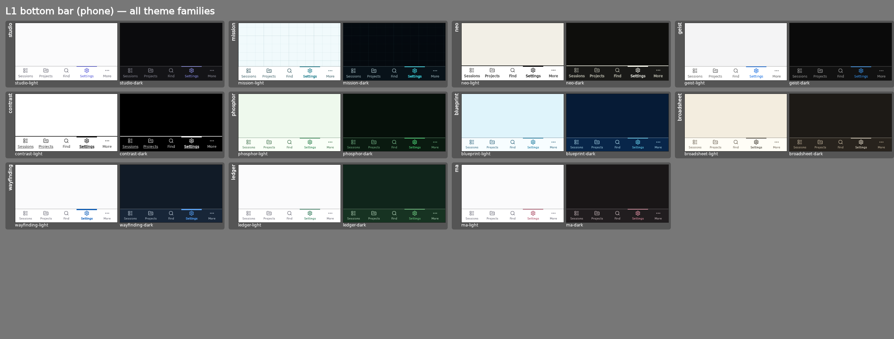
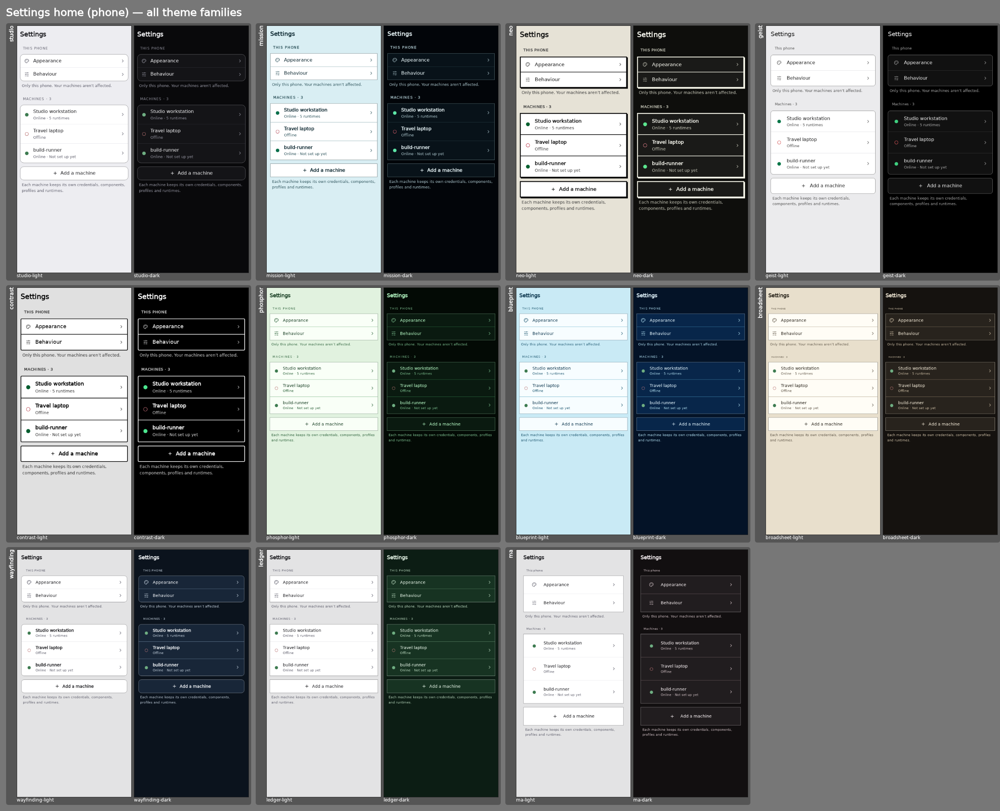
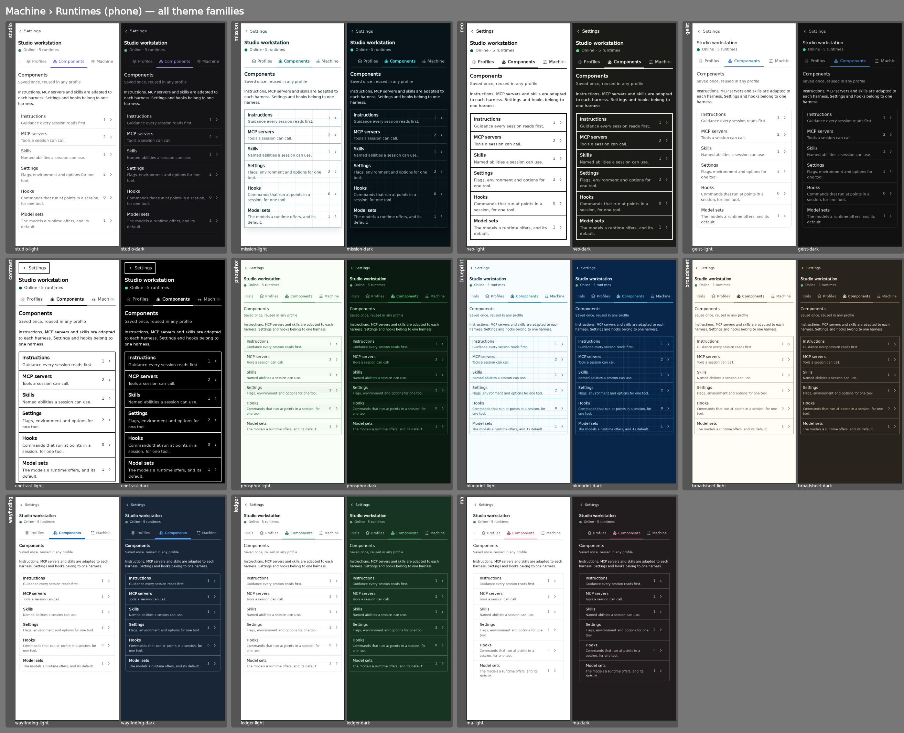
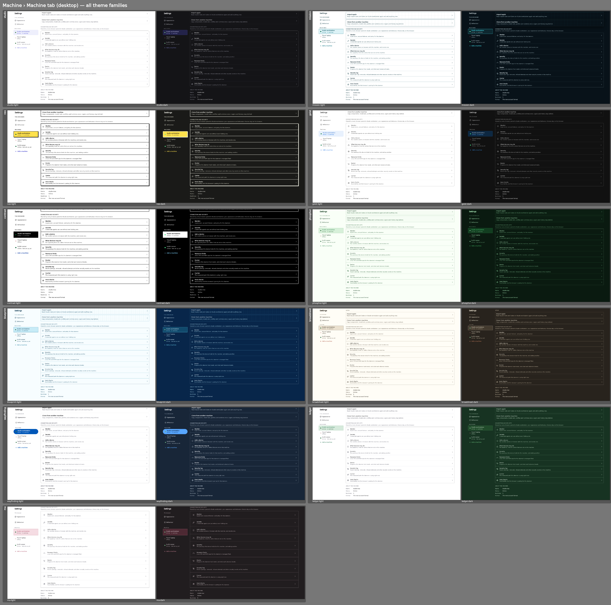
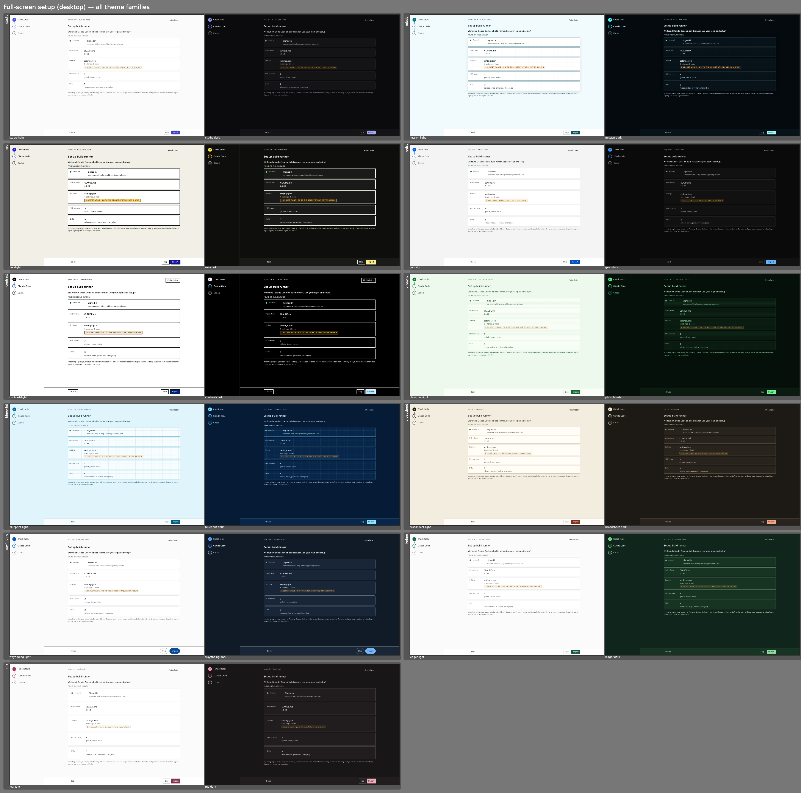
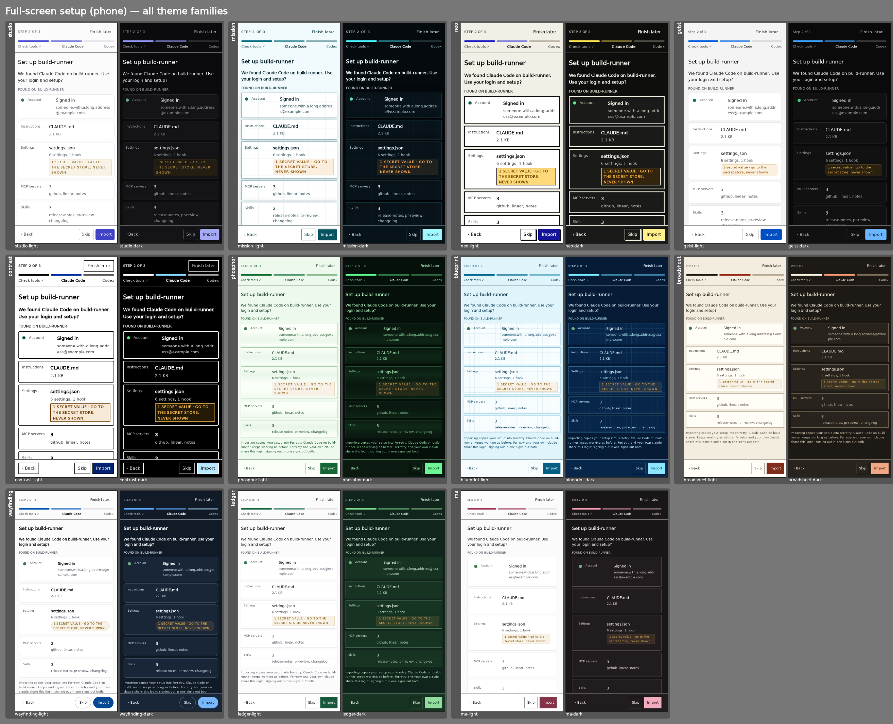

# Navigation + setup redesign — screenshots

Evidence for the PR on `feat/ux-hierarchy`. Captured from the PWA harness on the PR head.

- `sheets/` — one contact sheet per changed screen, **every theme family, light + dark** side by side
  (studio, mission, neo, geist, contrast, phosphor, blueprint, broadsheet, wayfinding, ledger, ma).
- `themes/` — the individual frames behind the sheets: `<screen>--<family>-<mode>.png`
  (390 px phone frames are `*-mobile`, 1440 px desktop frames are `*-desktop`).
- `walk/studio-{dark,light}/` — every frame of the CI Settings walk (`scripts/ci/pwa-screenshot-proof.sh`)
  at 390 px and 1440 px: Settings home, sections, every machine tab, every Machine-tab panel, every
  inline flow, and every step of the full-screen setup (`setup-*`).

## Contact sheets

### L1 — app bar (desktop): text links, current page underlined, Find as a search box

### L1 — phone bottom bar: Sessions · Projects · Find · Settings · More

### L2 — Settings home on a phone: grouped cards on a recessed ground

### L2 + L3 — Settings sidebar (selected pill, no side bar) and underlined machine tabs (desktop)

### L3 — phone tab strip scrolled to the current tab, with an edge fade

### Machine tab — Daemons merged in as "Connection and security"

### Full-screen setup (desktop): numbered, named steps; actions pinned to the bottom

### Full-screen setup (phone): segments + step names; Back / Skip / Import pinned above the home indicator

### Inline stepper inside Settings (Add a runtime)

