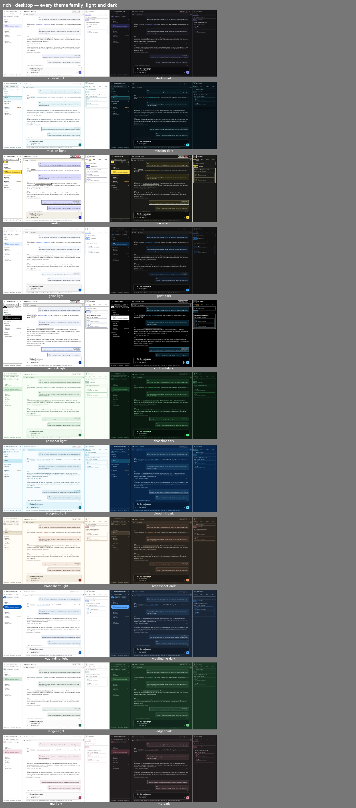
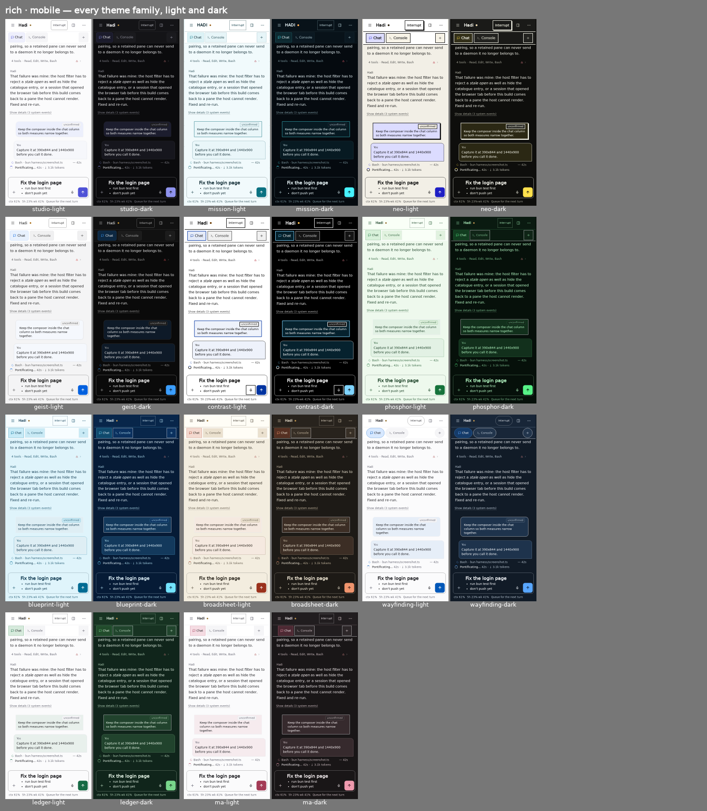
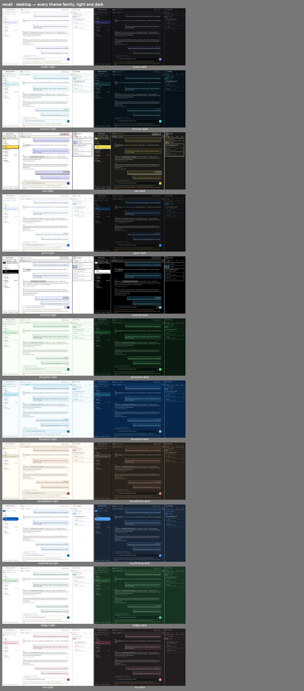
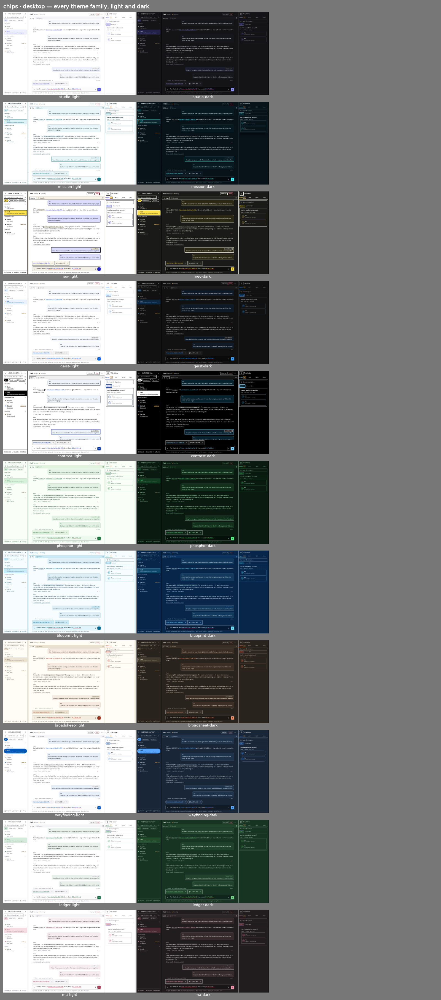

# Session page: PR B3 screenshots

These come from the PWA harness, run against the PR head. Phone frames are 390 px wide with a phone
user agent. Desktop frames are 1440 px wide. Each contact sheet shows all 11 theme families in light
and dark. `frames/` holds the full-size Studio frames.

- **rich**: the new **Rich text** editor style. `# Fix the login page` shows as a real heading, and
  the list below it is a real list. The draft is still markdown, and markdown is what gets sent.
- **recall**: a message is sent while the agent works, so it is queued. Then **↑** is pressed in the
  empty box. The box gets a copy of that message back, and a note says the original is still in the
  agent's queue.
- **chips**: a reference chip in the composer. A proven `%terminal:` chip is a link, and it opens the
  terminal tab exactly as the same link does in the transcript. `@CLAUDE.md` stays plain text because
  the harness never proves that file.
- **behaviour**: Settings › Editor style now offers Markdown, Notion-style · Rich text · Plain text box.

## rich

## recall

## chips

## behaviour

