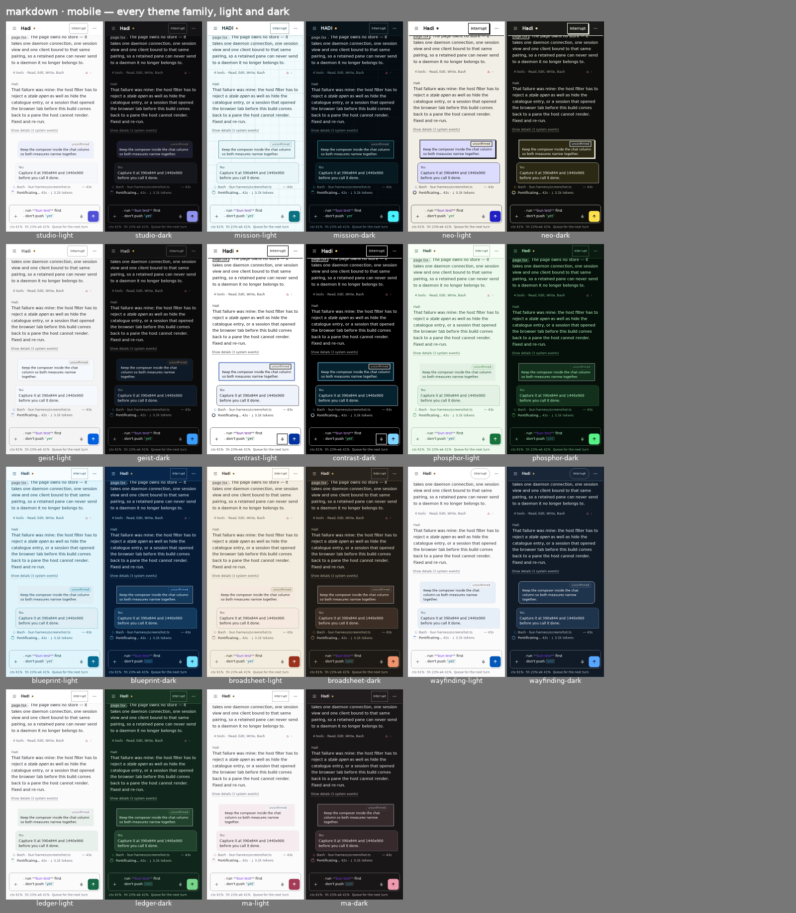
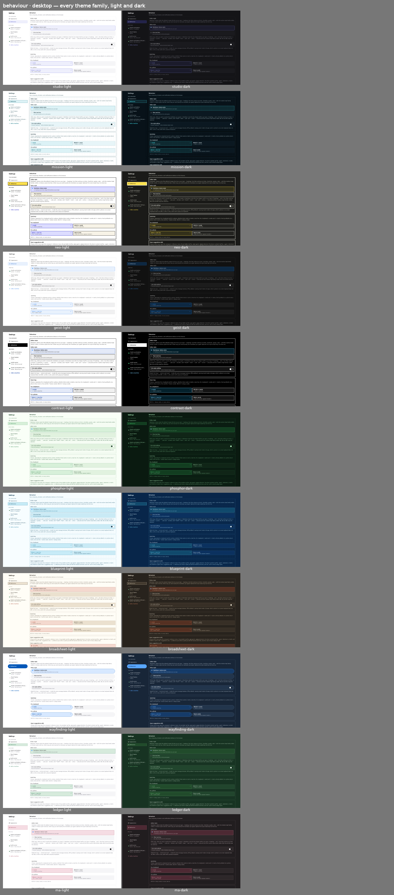
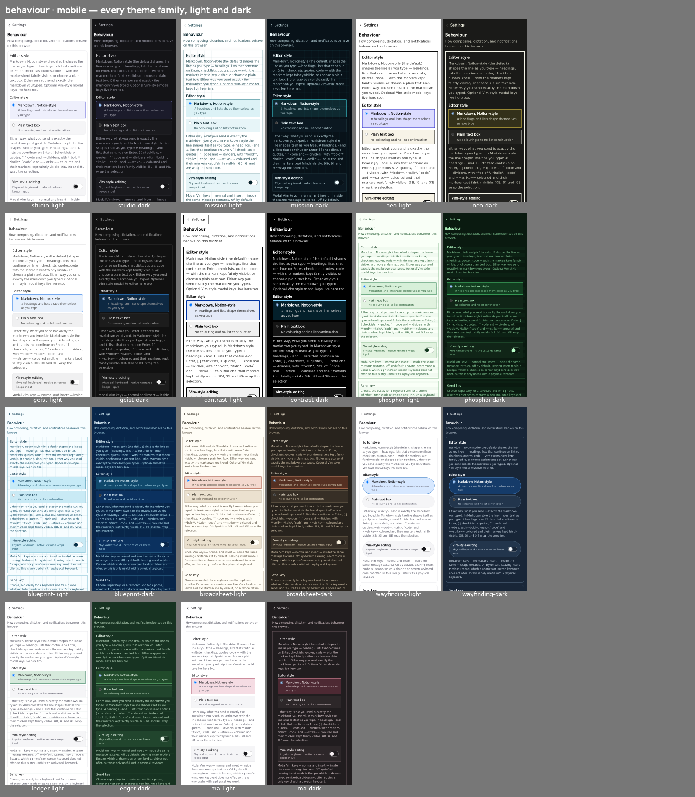
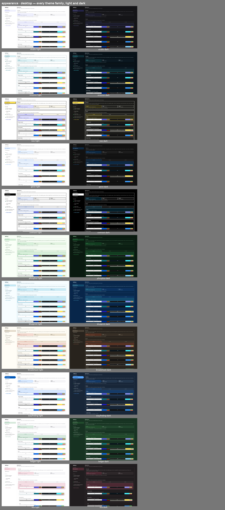
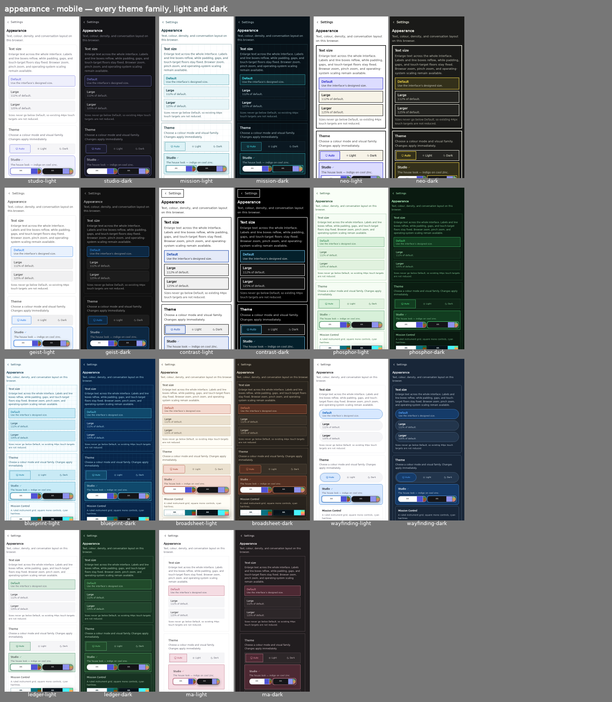

# Session page — PR B2 (composer settings + review fixes) screenshots

Captured from the PWA harness on the PR head. Phone frames are 390 px with a phone user agent; desktop
frames are 1440 px. Every contact sheet shows all 11 theme families, light and dark. `frames/` holds
the Studio frames at full size.

- **base**: assistant rows are labelled with the agent's name (Hadi), not the runtime account. Daemon
  notices fold behind "Show details". The queued message has one small state chip, with when-accepted
  and history placement moved to its tooltip. There is no PREVIEW box. On phones the ＋/🎙/↑ buttons
  are 44 px. The user bubble now uses each family's own colours in the dark modes of
  Phosphor/Blueprint/Broadsheet/Wayfinding/Ledger/Ma.
- **markdown**: the Notion-style editor (the default). `# heading` is coloured, a `- list` continues on
  Enter, and `**bold**` and `` `code` `` are coloured with their markers kept faint. What is sent is the
  markdown typed.
- **behaviour**: Settings › Behaviour: Editor style (Markdown, Notion-style · Plain text box), Send key
  (one choice for a keyboard and one for a phone), Open suggestions with.
- **appearance**: Settings › Appearance: Text size, Theme, Motion, Density, Conversation width
  (Comfortable · Wide · Full), Show details.

## base

## markdown

## behaviour

## appearance

