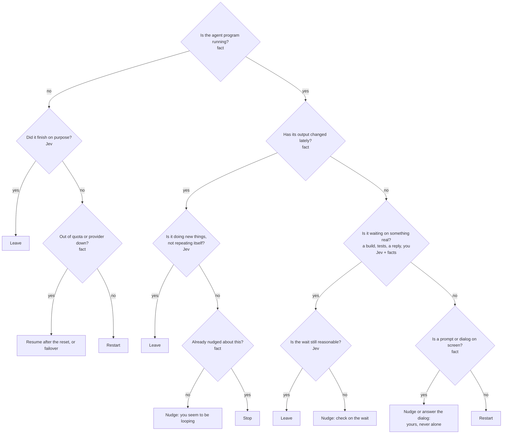

# Configuration files

A machine's settings are **human-editable YAML files** under `<FY_HOME>/config/`, one per building
block. The files are the source of truth: the app, `fy` and agents are all editors of them, and the daemon
watches the directory, checks every file, and keeps the last good version of a file in effect while a newer
one is broken. This page is the design note; the code is `@ferretry/fleet`'s `config-files/` (pure),
`packages/daemon/src/lib/config-files/` and `packages/protocol/src/lib/config-files.ts` (the layout and the
wire).

## Layout

| File                            | Holds                                                                                                                                                                                                                                                                                                                                                                                                                                                                                                                                                                                                                                                                                                                                                                                                                                                                                                                                                                                                                                                                                                                                                                                                                                                                                                                                                   |
| ------------------------------- | ------------------------------------------------------------------------------------------------------------------------------------------------------------------------------------------------------------------------------------------------------------------------------------------------------------------------------------------------------------------------------------------------------------------------------------------------------------------------------------------------------------------------------------------------------------------------------------------------------------------------------------------------------------------------------------------------------------------------------------------------------------------------------------------------------------------------------------------------------------------------------------------------------------------------------------------------------------------------------------------------------------------------------------------------------------------------------------------------------------------------------------------------------------------------------------------------------------------------------------------------------------------------------------------------------------------------------------------------------- |
| `machine.yaml`                  | Agent permissions, the default runtime, what agents may control, Browser mode ([browser-mode.md](browser-mode.md)), Browser proxy (`browserProxy`: [browser-proxy.md](browser-proxy.md); a new or re-aimed proxy is held for the owner), Browser ports (`browserPorts`: `random` by default, `per-user` for ports derived from the user id, or explicit `cdp`, `relay` and `vnc` ports; [browser-mode.md](browser-mode.md#loopback-ports)), the loopback firewall failure policy (`browserFirewallFailure`: `warn` by default, or `refuse` to decline starting the browser on a fixed port while this account's firewall check shows `failed`), Auto-resume after restart (`autoResume`, on by default: ferrets that were running when the host went down are resumed when the daemon boots), the agenda check (`attentionNudge`, on by default: [agenda.md](agenda.md)), Agenda mode for new ferrets (`agendaMode`, on by default; not a loosening: [notifications.md](notifications.md#agenda-mode)), the public usage feed (`publicUsageFeed`, off by default: `GET /usage` and `GET /metrics` answer 404 until it is on, and switching it on is held for the owner; [multi-user-host.md](multi-user-host.md)), conversations (Keep in sync), the owner's `timeZone` that login budgets count days in ([budgets.md](budgets.md)), the advanced block |
| `logins/<id>.yaml`              | one login (a credential): `harness`, `store`, `label`, `env`, `disabled` ([disabling.md](disabling.md)), `budget` ([budgets.md](budgets.md))                                                                                                                                                                                                                                                                                                                                                                                                                                                                                                                                                                                                                                                                                                                                                                                                                                                                                                                                                                                                                                                                                                                                                                                                            |
| `components/<kind>/<name>.yaml` | one component; `<kind>` is `instructions`, `mcp`, `skills`, `settings`, `hooks` or `modelSets`                                                                                                                                                                                                                                                                                                                                                                                                                                                                                                                                                                                                                                                                                                                                                                                                                                                                                                                                                                                                                                                                                                                                                                                                                                                          |
| `profiles/<name>.yaml`          | `contents:` — components and other profiles, in order; a later entry overrides an earlier one                                                                                                                                                                                                                                                                                                                                                                                                                                                                                                                                                                                                                                                                                                                                                                                                                                                                                                                                                                                                                                                                                                                                                                                                                                                           |
| `runtimes/<name>.yaml`          | one runtime: `credential`, `profile`, `agent`, `disabled` ([disabling.md](disabling.md))                                                                                                                                                                                                                                                                                                                                                                                                                                                                                                                                                                                                                                                                                                                                                                                                                                                                                                                                                                                                                                                                                                                                                                                                                                                                |
| `warden.yaml`                   | the Warden: on, its layers (rules always; Jev and LLM opt-in) and their caps — see [The Warden](#the-warden)                                                                                                                                                                                                                                                                                                                                                                                                                                                                                                                                                                                                                                                                                                                                                                                                                                                                                                                                                                                                                                                                                                                                                                                                                                            |
| `learning.yaml`                 | lessons: `passiveDefault` for new ferrets, and the scan miner ([learning.md](learning.md))                                                                                                                                                                                                                                                                                                                                                                                                                                                                                                                                                                                                                                                                                                                                                                                                                                                                                                                                                                                                                                                                                                                                                                                                                                                              |
| `pack.yaml`                     | Pack mode: on/off, who picks a sub-ferret's model (`agent` or `jev`), the sub-ferret `limits`, the start `probe`, Jev's cap ([pack-mode.md](pack-mode.md))                                                                                                                                                                                                                                                                                                                                                                                                                                                                                                                                                                                                                                                                                                                                                                                                                                                                                                                                                                                                                                                                                                                                                                                              |
| `models-guide.yaml`             | the routing prompt: `prompt`, plain words naming which model runs which kind of sub-task (at most 1,200 characters), read by the asking ferret and by Jev alike; absent means the one built from the catalogs ([pack-mode.md](pack-mode.md#the-routing-prompt))                                                                                                                                                                                                                                                                                                                                                                                                                                                                                                                                                                                                                                                                                                                                                                                                                                                                                                                                                                                                                                                                                         |
| `account-defaults.yaml`         | which account a sign-in card offers first: `sites`, `projects` and `folders` map a place key (a site's host, or `tool@host`) to an account handle — see [Default accounts](#default-accounts)                                                                                                                                                                                                                                                                                                                                                                                                                                                                                                                                                                                                                                                                                                                                                                                                                                                                                                                                                                                                                                                                                                                                                           |
| `voice.yaml`                    | who cleans up dictated text (provider, style, your own prompts, conversation context), and `defaultEngine` — the speech engine (`parakeet` or `browser`) a device uses until it picks its own ([voice.md](voice.md)); transcription always runs on the device                                                                                                                                                                                                                                                                                                                                                                                                                                                                                                                                                                                                                                                                                                                                                                                                                                                                                                                                                                                                                                                                                           |
| `presets/<id>.yaml`             | a provider preset of this machine's own, or one replacing a built-in ([provider-presets.md](provider-presets.md))                                                                                                                                                                                                                                                                                                                                                                                                                                                                                                                                                                                                                                                                                                                                                                                                                                                                                                                                                                                                                                                                                                                                                                                                                                       |

Every file Ferretry writes starts with `# yaml-language-server: $schema=…`, pointing at
`config/.schema/<kind>.json`, which the daemon writes from the same zod schemas it checks with
(`fy config schema <kind>` prints one). `config/daemon.json` and `config/routing.json` live in the same
directory and are not configuration files in this sense: they are the daemon's own documents. The shell
terminals open is one of them (`terminals.shell`, [terminals.md](terminals.md)).

`fy config path`, `check`, `schema` and `guide` need no daemon. `status`, `show`, `write` and `confirm` ask it:
`fy config write <file> [--if-match <etag>]` reads the text from stdin and is refused whole unless it checks.

## How a file is read

Each file is checked on its own — YAML syntax, then the raw-secret detector, then its schema — and the
fleet's files are then assembled into one account model and checked together (a profile naming a component
that is not there). Three rules, in order:

1. **Last good wins.** A file that fails a check is reported with its path, line, column and a plain fix
   (`GET /v1/config/status`, `fy config check`, the daemon log, the app's Files panel), and the version the
   daemon accepted before stays in effect. Nothing half-applies. When the fleet does not assemble, every
   fleet change of that round is held back and the machine keeps the fleet it had.
2. **Loosening waits for the owner.** An edit that loosens what the machine may spend or what agents may do
   is HELD and the tighter version stays in effect: a Warden layer that spends switched on (Jev, LLM),
   a cap raised, something it may now do alone, its concurrency raised or its cadence shortened; lesson mining turned on or its caps raised; Pack mode switched on, Jev choosing sub-ferret models, a sub-ferret limit or depth raised; an agent control turned on (Ferretry
   settings and Page scripts included); Agent permissions set to `skip`; the public usage feed switched on; dictated text sent to a provider; a login's budget limit raised or removed, a budgeted login deleted or a runtime moved off one, or `timeZone` set or changed ([budgets.md](budgets.md)). Tightening always
   applies at once. Deleting a file is an edit to its defaults and is judged the same way. The owner confirms
   a held edit by its etag — at the machine with `fy config confirm <file>`, in the app with a passkey
   proved for that act (`loosen-config`), or by answering **Allow** on the agenda card a ferret raised with
   `fy agenda add --confirms <file>` ([agenda.md](agenda.md#confirming-a-configuration-change)) — so a
   confirmation can never put into effect an edit nobody saw. The same card's **Discard change** drops a held
   edit: the file goes back to the version in effect, or is removed when it never was in effect.
3. **The daemon's own writes are acknowledged.** A reviewed fleet change, a first-run import, a clone and
   the Warden settings form record the text they write as accepted before writing it, so the owner's own
   act is never held as if somebody else made it. **A save never discards a held edit:** while an edit to
   `warden.yaml` waits for confirmation, a save from the Warden settings form makes the owner's change to
   BOTH versions — the held edit, changed, stays in the file and stays held; the version in effect, changed,
   is what is recorded as accepted — and the form sends only the keys that changed, never a whole section.
   (On 2026-10-29 a save of the daily caps rendered the version in effect over the file and put a held price
   correction, $2 → $0.042, back to $2 a minute after it was written.)

What is in effect is recorded in the state home (`state/config-accepted.json`), file by file with its text,
so a last good version survives a restart and a confirmed loosening is not asked about again. A missing or
unreadable record reads as empty — every file judged against the defaults — which holds back any loosening
until it is confirmed again.

The watcher reads a fingerprint of the tree (size, modification time and inode per file) when one of the
tree's directories reports a file event, and every 30 seconds anyway for an event the platform lost — once
a second where there are no file events — and loads after a 300 ms quiet period. Every directory is
watched on its own, because a platform watcher that follows a tree misses a file created in a new
directory, and a missed save is a broken file nobody is told about.

Readers that run on a timer — the fleet and credential catalogues, presets, model catalogs, the usage
feed, the Warden — answer from the last load and never scan the directory themselves. A load happens on
their first read, after a file event in the tree (which marks the last load stale at once, before the
watcher's debounce), when the watcher settles on a change, and after this daemon's own writes and
confirmations (a reviewed fleet change loads as soon as it is applied). Decisions about authority still
load first: an agent-control switch, Pack mode's limits, a launch, and judging a reviewed change stale —
so a tightening is in effect the moment it is saved and an edit made just before an apply is never missed.

A link is never followed — not by the daemon, not by `fy config check`. `GET /v1/config/file` returns a
file's text to a caller off the machine, so a link planted in the directory would otherwise read any file
the user can. A link, or a file over 256 KiB, is reported as unreadable and keeps its last good version.

## Secrets never go in a file

A secret lives in the secret store (`fy secret set NAME`) and a file names it as `${secret:NAME}`
([secrets.md](secrets.md)). A file holding anything that looks like a raw key — a known provider prefix
(`sk-`, `sk-ant-`, `sk-or-`, `AKIA…`, `ghp_`, `github_pat_`, `xox…-`, `gsk_`, `csk-`, `AIza…`, `glpat-`)
anywhere, or a high-entropy value under a key ending `KEY`, `TOKEN`, `SECRET`, `PASSWORD` or `CREDENTIALS`
— is refused like a file that does not parse, and the issue never repeats the value.

## Editing

Every program that writes a file computes the value it wants and edits the existing text with the `yaml`
package's Document API: only the keys whose value changes are rewritten, a removed key is deleted, a list is
edited item by item, and the owner's comments and key order survive. A default the file leaves out stays
left out.

| Editor                           | How                                                                                   |
| -------------------------------- | ------------------------------------------------------------------------------------- |
| Any text editor                  | edit, then `fy config check`                                                          |
| A script                         | `fy config show <file>` for the etag, then `fy config write <file> --if-match <etag>` |
| The app                          | Settings › a machine › **Files**: status, issues, Open file path, **Edit as YAML**    |
| `fy component\|profile\|login …` | reviewed fleet changes, written into the files                                        |
| An agent                         | the `config_read`, `config_validate` and `config_write` Ferretry tools                |

## Routes

| Route                       | Grant                                                                           | Does                                                   |
| --------------------------- | ------------------------------------------------------------------------------- | ------------------------------------------------------ |
| `GET /v1/config/status`     | `fleet.use`                                                                     | every file, its state, every issue, every held edit    |
| `GET /v1/config/file?path=` | the file's capability, `use`                                                    | one file (or the starter a new one begins with) + etag |
| `PUT /v1/config/file`       | the file's capability, `configure`; `If-Match: <etag>`                          | write a file that checks; a loosening may be held      |
| `POST /v1/config/confirm`   | the file's capability, `configure`; fresh passkey remotely                      | confirm one held edit by its etag                      |
| `PUT /v1/accounts/defaults` | `secrets.configure`, and the file's `configure` (fleet); fresh passkey remotely | the owner sets or clears one default account line      |
| `POST /v1/agent/config`     | the agent's session credential; Ferretry settings on                            | the `config.*` tools                                   |

The file's capability is `warden` for `warden.yaml` and `fleet` for everything else. A loosening `PUT` is in
effect at once only for somebody at the machine or a device that proved a passkey for the act; anyone
else's is written and held. An agent never confirms. The agenda's Allow
([agenda.md](agenda.md#confirming-a-configuration-change)) is a third door to the same act and asks exactly
what `POST /v1/config/confirm` asks: one rule, `heldEditRefusal` in `runtime/mounts/config-files.ts`.

## Default accounts

`account-defaults.yaml` says which account a sign-in card offers first, for a place where more than one account
could sign in. Three maps, each from a **place key** (a site's host such as `app.clickup.com`, or `tool@host` for a
terminal) to an **account handle**:

```yaml
sites:
  app.clickup.com: CLICKUP_A # every session on this machine
projects:
  ferretry: # a project's id, or its exact name
    app.clickup.com: CLICKUP_B
folders:
  ~/Workspace/personal/scratch: # an absolute folder, or ~/…, for a session on no project
    github.com: GITHUB_WORK
```

The daemon feeds this file to the card and to `account_hint` ([which account is first](input-requests.md#which-account-is-first-and-why)):
the project is the asking session's board project and the folder its recorded working directory (Unfiled only), both
read by the daemon and never given by a ferret. A site line also accepts a place named by an account's `match` hosts.
Changing a line is one queued read-modify-write step, so two changes made at once cannot lose one.

The card chooses by the ferret's own hint, then the project line, then the folder line, then the site line, then
the only sign-in matched ([input-requests.md](input-requests.md#the-next-time-one-tap)). A default only ever
chooses among the sign-ins the daemon already matched; it never adds one.

**Every change is the owner's.** (Honest-client until the ferret wall RF-2/RF-5: a ferret that calls the admin-token
routes without its session id is treated as the owner at the machine, and could also write `state/config-accepted.json`
directly. The held rule is a wall for the `config.write` door and the owner's route for a paired device.) Adding, changing or removing a line is a loosening in the sense of rule 2 — it
changes which account the owner is offered first, in the owner's name — so a ferret's `config.write` to this file
is only ever a **held suggestion** ("changes which account a card offers first for `<key>` in <scope>"), and the
version in effect stays as the owner last confirmed it. The owner sets one line with `PUT /v1/accounts/defaults`
(`{ scope, within?, key, account }`; `account: null` clears it): at the machine it is direct, from a paired device
it asks the passkey step-up that confirming a held edit asks. That one write goes through the comment-keeping
editor, is in effect at once, and **does not confirm anything else** — a ferret's other held lines stay held. A
defaults file that does not check is never written over; fix it first (`409 defaults_file_invalid`). A line for an
account that does not exist, or has no sign-in on that key, is refused (`409 no_sign_in_here`); clearing a line is
always allowed. The answer is the lines actually in effect after the write.

**Lines follow the accounts.** An account's rename rewrites its lines to the new handle, its delete removes them,
and a merge points the merged account's lines at the one that kept the sign-ins (the kept account's own line for
the same place wins) — all in the owner's same act. A handle that is created, or renamed to, also has any line
already naming it dropped first, so **a new account never inherits a default left behind for an old account of
the same handle** (the account's immutable key, not its handle, says whether it is the same account). Whatever the
file on disk says — a ferret's held suggestion that lacks the line, a held deletion of the file, even a file that does
not check — the version in effect is corrected in the same act, so a deleted account's line never stays in effect; a
file that does not check is left as it is for the owner to fix.

**What the daemon cannot see is a warning, not an error.** `fy config check` fails only the shape (an unknown map, a
bad host, a lower-case handle, a relative folder). The daemon adds warnings to `GET /v1/config/status` for a line
in effect that names an account that does not exist, an account with no sign-in on that key, or a project that is
not registered (or named by two). Such a line is ignored.

## The Warden

`warden.yaml` decides how the supervisor watches every ferret and what it may spend. A flag passes through
**layers**, cheapest first:

| Layer             | Key          | What it does to a flag                                                                   | Spends         |
| ----------------- | ------------ | ---------------------------------------------------------------------------------------- | -------------- |
| Rules             | — (always)   | deterministic checks raise it; what nothing settles reaches you as a Warden notification | nothing        |
| Jev               | `layers.jev` | Jev answers first: leaves it, acts on it alone when sure enough, or hands it on          | Jev            |
| LLM investigation | `layers.llm` | a read-only investigation (an assigned warden), rotated across `accounts`, as kteam does | investigations |

The rules always run while `enabled` is on. Jev and the LLM investigation are switched on independently, and
both are off on a new machine. A flag Jev did not clear — or every flag, with Jev off — goes to an
investigation while `layers.llm` is on, and **to you** while it is off: never to a spend you did not switch on.
Jev is asked once about a flag and remembered for as long as that flag stands in the same status, so a flag
waiting for you is not paid for every sweep.

**Older files.** A `warden.yaml` from before the layers says `triage:`. It is still read: `rules` is both
layers off, `llm` is `layers.llm` alone, and `jev` is both on (Jev in front of an investigation). An explicit
`layers:` wins over it field by field, and the next write leaves `triage` out.

**Jev is the first responder, and it answers yes/no questions.** Instead of picking one act from seven
with one confidence — which spread its confidence so thin it was rarely sure of any — Jev walks a short
**decision tree** (`packages/daemon/src/lib/warden/jev-tree.ts`). The daemon answers every **fact**
question itself, from what it already observes, and never asks Jev; Jev answers only the **judgement**
questions, each a yes or a no with its own confidence. Each leaf is one act:



Where each fact comes from:

| Fact (node id)                                        | Answered from                                                                                                                                  |
| ----------------------------------------------------- | ---------------------------------------------------------------------------------------------------------------------------------------------- |
| Is the agent program running? (`running`)             | the daemon holds a live monitor on its pane, and its status is neither finished nor a turn the harness cut off (`interrupted`, `rate_limited`) |
| Out of quota or provider down? (`quota_or_provider`)  | `rate_limited`, a recorded quota reset, a quota-reset or provider flag; a reset that has passed means **resume**, otherwise **failover**       |
| Has its output changed lately? (`output_changed`)     | the transcript, the token counter or the meaningful pane moved within `susThinkingSeconds`                                                     |
| Already nudged about this? (`already_nudged`)         | a nudge that took — Jev's or an investigation's — on this ferret for this kind of flag in the last day (the Warden's Recent actions)           |
| Is a prompt or dialog on screen? (`dialog_on_screen`) | the ferret is parked on a question or permission prompt (`needs-input`, or an `awaiting_*` status)                                             |

"Is it waiting on something real?" is Jev's, but it is shown the facts that bear on it — how long a
command has run, a declared wait, its condition and whether it is overdue, the peer it waits on.

**One call per flag.** The facts settle every branch up to Jev's first question, so a flag leaves at most
two of Jev's questions open (waiting on something real, and whether the wait is reasonable). They go in
**one** request, each its own yes/no question phrased to stand alone, so no answer leans on another, and
the cost is what one answer cost before. When the open branches can end in a nudge Jev may send, the same
request asks which of that leaf's messages fits ("a command you started has run a long time with no
output…"); no message, no nudge. The daily and hourly Jev caps and the provider back-off apply as before.

**Acting.** An act is carried out only when **every** Jev answer on the path is at least as sure as the bar
of the leaf it reaches — the act's own `jevActs` bar, or `guard.threshold` (0.30–0.95, default 0.70) for a leave
— and the rest of the gates still hold: only the acts that fit the flag are offered (a stuck or frozen
ferret may be nudged, restarted or stopped, one whose quota came back resumed; a question waiting for you,
a finished ferret or a fault of the daemon is never acted on), an act must be allowed alone, and Jev acts
on one situation once. A dialog on screen is **always yours**: Jev's nudge there is only a recommendation.

| Jev's answers on the path                                         | What happens                                                              |
| ----------------------------------------------------------------- | ------------------------------------------------------------------------- |
| a leave, every answer at or above `guard.threshold`               | the flag is cleared, exactly like an investigation's LEAVE                |
| an act, every answer at or above its `jevActs` bar, allowed alone | **done at once**, through the same remedies as an investigation           |
| an act it is sure of but you keep for yourself, or a dialog       | handed on; shown to you as _Jev recommends …_ if no investigation follows |
| failover                                                          | handed on — Jev cannot name the login to move to                          |
| any answer below the bar                                          | handed on, **naming that question** ("Is the wait still reasonable?")     |
| any failure, or a reply that left a question unanswered           | handed on                                                                 |

Every check records its **path** — each node, who answered it, yes or no, and Jev's confidence — on the Jev
check (`warden/jev-checks/<day>.jsonl`), on what an investigation says Jev did first, and on the
hand-on the owner's notification is written from. A notification for a flag Jev was not sure of says which
question it could not answer, what the daemon saw for itself, and every answer Jev gave.

**Handed on** means an investigation while `layers.llm` is on and under its cap, and otherwise **you**, as a
Warden notification (below).
Every failure hands on — no key, a timeout, a refusal, an answer it cannot read, the Jev cap, a provider
back-off, an act that did not take — so an unsure or broken Jev costs money or your time and never acts on
noise or hides a stuck ferret. An investigation that fails tells you, as a Warden notification.
Without a Jev key every flag is handed on.

**When the Warden needs you, it sends a notification** from "Warden" — a plain notification in your Inbox
(a notice — an agenda-route item marked `notice` — with `ping` so the phone buzzes), on the machine the ferret lives on, so
the Inbox shows every paired machine's. It is sent whenever a standing flag is yours to decide: an
investigation's explicit `Verdict: NEEDS_HUMAN`, a confident act held for your yes, an investigation that
finished without a readable verdict, a flag Jev handed on with no investigation to follow (the layer is off,
capped or has no login), or one nothing could look at. It is **one per ferret and kind of trouble**
(`warden:ask:<kind>`, on that ferret, so a tap opens its chat), refreshed while it is open rather than
repeated; a fault that names several ferrets — a daemon or liveness monitor that watches none, a provider
outage — is **one for the machine** (`warden:ask:fleet:<kind>:<key>`). It says which ferret on which machine,
what was seen, why now ("Jev could not answer “Is the wait still reasonable?” surely enough", "today's investigation budget is spent") and the recommended
remedy in plain words ("The Warden recommends a nudge"); it has no answers — you act from the ferret's chat.
**It is sent once per episode**: reading it clears it, and the Warden remembers it told you
(`notified` in its state) for as long as the flag keeps a reason, so it says nothing more until the flag
clears and comes back. It clears itself the moment the flag clears, the ferret finishes, or the Warden is
handling it again (blessed, investigating), and none is sent while the Warden is off. **Before notifications**,
an explicit NEEDS_HUMAN verdict wrote a durable item (`warden:<kind>`); the first sweep after upgrading
resolves any still open, with a note, and tells you as a notification instead. Insights › Warden links to the
Inbox's Warden notifications; nothing else lists them.

**How sure Jev must be to act alone** is `jevActs`, one bar per act, from 0.30 to 1, default 0.70 for
`nudge`, `resume` and `restart` and 0.80 for `stop`, a notch higher because it is the most disruptive. **`1` means Jev never does that act
alone.** A bar is only half the permission: the matching `mayActAlone` must be on too, and `stop` is off by
default, so out of the box a confident stop is a recommendation, not an act. Lowering a bar lets Jev act on
less certainty, so an edit that lowers one is held until you confirm it, like any loosening.

**One try per situation.** Jev acts on a ferret once per situation. The act is given its rung of the backoff
(`assignedCooldownMinutes` the first time, at least 10 minutes) to land, and meanwhile **nothing on that
ferret** is acted on, looked at or shown to you — whatever kind of flag it is. After that, the same kind of
trouble on that ferret is not put to Jev again: on the same **subject** (see below) for as long as the ferret
lives, and on a new one for a day — an act changes the subject by its own effect (a nudge starts a new turn),
so a ferret that stalls again soon after Jev's act needs someone stronger, not the same act again. It goes to
an investigation, or to you. Jev does not touch a ferret an assigned warden is investigating or waiting to.
An act that did not settle its flag is taken back out of the savings line.

**What leaves the machine.** With Jev on, a short summary of the flagged ferret — the anomaly, the sweep's
one sentence, its recent transcript lines and the tail of its screen — is sent to TypeSafe AI (Jev). Every
string in it passes the vault redactor first, the same one every operator read uses, and a snapshot that
cannot be redacted is never sent (that flag is passed on instead). The Jev key itself is spent only
through the outbound holder ([docs/secrets.md](secrets.md)); `guard.endpoint` cannot move it to another host.
Investigations run on your own login and read the transcript, pane, diffs and CI. The rules send nothing.

**What may act on a ferret: an investigation, and Jev when it is sure enough.** An investigation's explicit
`Verdict:` line is what acts — never prose — and, like Jev, only as far as `mayActAlone` allows: `nudge`,
`resume`, `restart` and `failover` default on, **`stop` defaults off**.
(The one rule that acts without an investigation, `closeLeftovers`, closes a leftover browser and never
touches the ferret — see below.)
`restart` relaunches a dead or frozen process with its conversation intact — the resume path, replacing a
pane that still looks alive — when the report recommends `RESTART`; a file that names `resume` but not
`restart` gives `restart` the same answer. An act it may not
do alone is held, and a Warden notification tells you what it recommends. Every act, every hold and every Jev leave is
listed under Recent actions and in the journal with who decided it — Jev's with how sure it was and why.

**Which login investigates.** `accounts` is the order of logins, head first, and `failover.policy` says how
they share the work: `fallback` uses the first and moves on only when it is unhealthy, `round_robin` takes
turns — across logins on different providers too. A login that fails to start an investigation hands it to
the next one within the same sweep (at most three tries), and each failure still counts against its login.
Ferretry compiles no login in: a file that leaves `accounts` out (or sets it to `[]`) runs investigations on
this machine's **default runtime** — whatever `machine.yaml` names when the investigation starts — and never
writes that name back, so changing the default moves the Warden with it. A machine with neither has **no
investigation login**: the LLM layer is off, the status says `no_login`, and Settings › Warden asks you to
choose one (Jev needs no login). A login named here that this machine does not have — a `warden.yaml` copied
from another machine — is shown as **unknown login '‹name›' — choose one** and is skipped; the file is never
rewritten to hide it. A login is always spelled by its **runtime name** (`claude-default`), never by the opaque id the fleet manifest keeps for it: a file that stored an id, or a name the runtime had before, is read as the runtime's current name and written back as that name on the next save.

**Caps, per UTC day, per layer.** `caps.jevUsdPerDay` (default $0.50) is Jev's and
`caps.investigationUsdPerDay` (default $2) the investigations'; `caps.maxInvestigationsPerHour` (default 6)
spaces investigations. A cap that is reached turns off **only its own layer** until midnight UTC — with the
Jev cap hit, flags go straight to an investigation; with the investigation cap hit, Jev still clears what it
can and the rest wait for you — and the Warden page says so (_Jev paused: daily cap reached_).

**Paced through the day.** No layer may spend more than **a quarter of its daily cap in one UTC hour**
($0.125 of Jev's default $0.50, $0.50 of the investigations' $2), so one burst of flags cannot spend the
day before most of it has happened. A layer that reaches its share is off until the top of the next hour —
the status lists it in `spend.capsPaced` with `pacedUntil`, and the Warden page says _Jev paused until 07:00 UTC — new flags go to a full check_
rather than _until midnight_. An investigation it holds back is queued, never dropped; a flag Jev is not
asked about is passed on as it would be with the cap hit. Jev is priced at
`guard.usdPerMillionInputTokens` (default **$0.042** per million input tokens, output free, per docs.typesafe.ai/models.md as of 2026-10-29; a setting because the price can change). An investigation is
priced from its own transcript once analytics has read it; until then it counts at the average priced
investigation, for the cap only. The status's savings line — (Jev's leaves + the acts it did alone) × that
average, minus Jev's own cost — appears only once an investigation has been priced. The caps are unchanged by
Jev acting: an act costs the one Jev answer it came from.

**Daily history, and who acted.** The state keeps a rollup per UTC day (`daily`, the last 14 days; the status's
`history` is the last 7, oldest first, today last, and only days the daemon recorded). Each action is counted as
it is recorded, under what became of the flag — **moved** (a nudge, resume, restart or failover), **cleared**
(a bless), **stopped**, or **asked** (anything held for you) — and under who acted: **auto** (a rule: the liveness
reflex, a leftover browser) · **jev** (Jev acting alone) · **llm** (an investigation's verdict) · **owner** (_Leave it
longer_). A failed attempt and a closed leftover browser count as none. Each day also counts **Jev's checks** (`jev`, below)
as they happen. Flags raised, Jev's decisions and spend, and
investigations and their cost are folded in from the counters above, and a number only ever goes up, so a record
pruned from the capped list does not take a day's count down. A cost priced the next day lands on the day its
investigation started. An action that came from an investigation also names it (`investigator`).

**Every Jev check is kept and counted.** A flag Jev was not sure of and handed on is in none of the outcomes
above — on 2026-10-29 Jev answered 102 flags, handed every one to an investigation, and the Warden page said it
did nothing. So each check is written beside the reports, one JSON line in
`warden/jev-checks/<UTC day>.jsonl` (owner-only; the last **30 days** kept, older days dropped on the next
write): the ferret, the flag, the verdict — **healthy** (left), **acted** (done alone), **handed on** (to an
investigation or to you: not sure, below the bar, the act is yours, the call failed, the act did not take) or
**skipped** (not asked, because the day's cap or this hour's share of it is spent) — with why, where the flag
went, how sure Jev was and what the call cost. **No text**: never Jev's reason, a transcript line or the
screen. A check is written once per standing flag, and a skip once while the flag stands. A call that was never
made (a back-off, a snapshot that could not be masked) is no check. The day counts them as `jev`: `checks`
(= healthy + acted + handed on), each verdict, and `skippedForCap`; the status carries the newest 50 as
`jevChecks`. The Warden page reads them: the Flagged tile says _Jev checked N_, Jev's line spells out the
checks (_6 checks: 1 healthy · 0 acted · 5 handed on_) and says **Jev paused: daily cap reached** while it is,
the chart draws Jev's bar as its checks, and Recent actions lists every check that settled nothing as a
_Handed on_ or _Skipped_ row of Jev's. A day from before this has no `jev` and reads as it did.

**Beside every LLM result, what Jev did first.** Jev being on does not mean Jev ran: its cap may be spent,
the flag may be one it never judges, the run may be forced. So the Warden keeps Jev's last word on each
standing flag it did not settle (`jevBefore` in its state) and an investigation records it when it starts, as
`jev` on the investigation and on every act its verdict leads to: **handed on** (with why, the act Jev
chose if any, how sure it was, what the call cost and the check's time — which, with the ferret and the flag,
names its line in the check record), **skipped** (the cap), **not asked** (the owner asked for it, a forced
run, a kind Jev never judges, a back-off, a snapshot that could not be masked, Jev's own earlier act on the
same trouble) or **off**. An investigation queued before this was kept says **no record**; a fleet triage
carries one answer only when Jev said the same about every flag it covers. Still no text. The Warden page
puts it as one line under every LLM row in Recent actions, every investigation and the report —
_Jev: not sure (21%) · $0.0041 → investigated_, _Jev: skipped — daily cap spent → investigated_, _Jev: off_ —
and says today's spend at a glance (_Today: Jev $0.0055 · LLM $1.20 · together $1.21_; an amount under a
cent is shown to four places, never rounded to $0.00), what one Jev check costs, and each day's Jev and LLM
spend in the chart.

**Investigators are named `warden-000001` … `warden-FFFFFF`**, from a counter in `warden/state.json`
(`investigatorSequence`) that wraps to 1 and skips a name a live session still holds — never from the first-name
pool, which is for real ferrets. The name is stored lowercase and shown with its digits uppercase
(`warden-00002A`) in the status, notifications, logs, and the report's provenance sidecar. If the name is taken by
the time the session starts, the next free one is tried once, without counting against the account.

**A cleared flag stays quiet until its situation changes.** Every flag on a ferret carries a **subject** —
which episode of trouble it is: its turn and the moment the episode began (the transcript last grew, the
ferret froze, it went idle), and for a stuck command that process itself, across turns. When Jev or an
investigation clears a flag, that kind of flag on that ferret is left alone **until its subject changes** —
the ferret moves and stalls again, a different command is the stuck one — for 24 hours at most, however its
status flickers meanwhile; a different kind of trouble on the same ferret
is never covered. The `blessMinutes` blessing (default 15, doubling per re-clear up to 4 hours) still
records the clear for the Warden page and _Leave it longer_, and still ends at once when the ferret changes
status — but it is no longer what keeps a cleared ferret from being looked at again.

**Each look at the same situation waits longer.** An investigation that did not clear its flag (a nudge, a
recommendation it held for you, a report it could not finish) is not repeated on a timer either: the next
automatic look at the same subject waits `assignedCooldownMinutes` (default 30), then four times that, then
sixteen, then a day — **30 min → 2 h → 8 h → 24 h**. A new subject starts again at once, so a new situation
is never hidden behind an old answer; the owner's own _Investigate_ and a forced run are never held. The
looks are remembered in `warden/state.json` (`backoff`), so a restart does not re-investigate the fleet.

**Leave it longer.** On a flagged or cleared ferret, Insights › Warden offers _Leave it longer_: an hour,
four, or until its status changes (at most a week). It covers the kinds flagged or cleared there now, never
shortens a quiet stretch already in force, takes the ferret out of the investigation queue, and counts into
no streak. It is `POST /v1/warden/leave {sessionId, duration}` — `warden.configure`, because it switches the
Warden's supervision of that ferret off for a while ([grants.md](grants.md)).

**The liveness check.** Every 30 s the Warden looks at each working ferret — a digest of its screen and
of its transcript tail, the work counters its harness paints, and which processes run under its pane — and
keeps a per-ferret ledger of when each last moved. That ledger is what the long-think and stuck-command
rules (`susThinkingSeconds`, `susSubprocessSeconds`) read, and a working ferret that **three on-time looks in a
row** could not see is flagged `dead_monitor`. It is counted in looks, not minutes: a ferret started since the
last tick has missed no look, and a tick the host starved (one that started or finished well late) or one
blind to every ferret at once is the monitor's failure, not the ferrets' — when no tick has seen anything for
five minutes (ten ticks) the sweep raises **one** `dead_monitor` for the whole daemon (`daemon:liveness-stalled`) instead
of one per ferret. Jev is never asked about `dead_monitor`: it is a fact about the daemon that no transcript
can confirm, so it goes straight to an investigation or to you. A ferret with no sign of life of any kind for its
`nudgeAfterSeconds` (default 300) is nudged once — only while `mayActAlone.nudge` is on — and one with no
transcript, counter or subprocess sign for its `killAfterSeconds` (default 900; read as "frozen", since the
Warden never kills) after that is flagged **frozen**: a restart candidate that goes through the layers like
any other flag. A ferret parked with `signal waiting`, an interactive ferret, or a tick that ran late on a
starved host is never nudged or flagged. The ledger is kept in memory: a restarted daemon starts every
clock again rather than judging silence it did not see — the long-think and stuck-command rules measure
silence from no earlier than the daemon's **first look** at the ferret, so a restart never flags a ferret on
the last-output time its documents carried over from before it.

**What counts as a running command.** Only a **tool command**: what the harness runs for the agent through
a shell (`zsh -c …`, `bash -c …`), and everything under it. The harness's own **helpers** — `fy mcp serve`,
an MCP or language server, Codex's app server, and anything they start (a Chrome an MCP server drives) — are
not, however long they live; nor is a server the agent left **listening** on a port (a dev or board server),
nor a **browser**. Only processes under the ferret's own pane are ever looked at, so another session's
process or the daemon's own tmux reader can never be blamed on it. A different command running is a new
episode, so one short command after another never reads as one long one.

**Waiting on you is never investigated.** While a ferret's turn is over (`your-turn`) with no command of
its own still running, or it is parked on a question or permission prompt (`needs-input`), no long-think or
stuck-command flag is raised — and it is never nudged — because the next move is yours; a question nobody
answers is `unattended_question`, which reaches you as a Warden notification unless its board already asks you. Detection resumes by itself once it works again. A
turn that ended while a command it started still runs is **not** waiting on you: it is waiting on that
command, and a command that can never finish is exactly what the stuck rule is for.

**Stuck mid-turn.** `sus_subprocess` is raised when a tool command has run for `susSubprocessSeconds`
(default **600**, 10 min) **and nothing moved for that long**: no transcript growth, no token advance, and no
screen change once the harness's own spinner, elapsed clocks and status line are masked out. The old rule
fired on any child process alive for 15 min, so it needed the slack; requiring every progress signal to be
flat is what makes the shorter time safe — a build that prints, a watch loop that refreshes, a ferret
writing about what it is doing all count as moving. Climbing tokens still exempt a long think.

**Leftover browsers are closed by rule.** A ferret whose turn is over (or whose done marker is written),
with no command of its own running, whose pane has had a browser it launched for 10 minutes since the turn
ended, gets that browser closed — the browser only, never the ferret, and the pane's processes are read again at the moment
of closing. No Jev, no investigation, nothing spent. It is `mayActAlone.closeLeftovers` (default **on**);
with it off the Warden lists the recommendation once under Recent actions instead. Every close is listed
there too, and journalled as `fleet.warden_leftover_closed`.

### Moving a ferret that hit a limit

**Off by default.** With `autoMigrate.enabled`, a ferret whose login runs out is moved to another login — the
same session, the same chat, the same card and lineage; only the login changes. It is the migration `fy migrate`
makes, through the same safety check, never with a smaller context window, and the turn the ferret is handed
opens with why, drawn as Ferretry · Warden. A rule: no Jev, no investigation, nothing spent.

```yaml
autoMigrate:
  enabled: true
  when: [rate_limited, budget_exceeded] # a usage limit; the login's hard spend budget
  targets: [] # empty: any ready login of the same harness and provider; or runtimes, in order
  forceStopBackground: false
  waitMinutes: 10 # how long the ferret has to stop its own background jobs
  maxMovesPerHour: 1 # 1 to 6, per ferret
  minHeadroomPercent: 20 # 0 to 90: a target must have at least this share of its quota left
```

- **When.** `rate_limited`: the sweep finds the ferret waiting on a usage limit. `budget_exceeded`: the budget
  check ([budgets.md](budgets.md)) offers the ferret to the Warden before it would stop it.
- **Where.** Only a login of the same harness that `fy recommend` calls ready: an agent runtime, its CLI
  installed, signed in, not switched off, not holding spend, not out of quota — and never the login that ran out,
  or another runtime on it. `targets: []` stays within the provider (a catalog's provider, the harness's own for
  a native login; a hand-made environment login is its own provider) and takes the one with most headroom. A
  named list is tried in order and is the only way a move crosses to another provider. When nothing qualifies
  the owner is told once, in one line naming every login tried and why it was refused.
- **Never** while the ferret has an input card open, a sign-in waiting on your phone, a plan card waiting for you,
  holds a secure copy, handed a terminal or browser to the owner, or waits on a permission prompt or a dialog; never a Warden or anything a Warden started; never more than
  `maxMovesPerHour` times an hour.
- **Headroom.** A target with less than `minHeadroomPercent` of its tightest window left is refused, with the
  reason, so a ferret is never moved onto a login that is about to run out too. A login whose usage is unknown
  is not refused on this rule. The same check applies to a login the Warden's Jev names for a move.
- **Jev's `MIGRATE`.** When the Warden's Jev decides a ferret should move, the login it names goes through the
  same rules as a rule-made move: ready, same harness, enough headroom. A named login that fails them is
  replaced by the best candidate, and the action says so; with no candidate, the move is refused with the
  reason. The sweep prompt lists every candidate with the reason it was or was not usable. When no
  mover is wired in, the move is refused, never done unchecked.
- **Background jobs.** Off (`forceStopBackground: false`): the ferret is asked, with `fy migrate`'s own message,
  to stop the jobs in the way, and given `waitMinutes`; still running after that, the owner is told and the
  ferret stays. A budget stop does not wait. On: the Warden stops only the jobs the ferret started from its own
  tool shell, under its own tmux pane — children first, SIGTERM then SIGKILL. Each one is followed by its pid and
  start time wherever it goes (a child its dying shell left behind included), and signalled only while it is
  still the same process, so a reused pid is never hit; init, the daemon and its parent are never signalled. Any
  job that survives keeps the ferret where it is. **The move is never forced**: after the jobs are stopped the
  migration's safety check reads the pane afresh, and anything else in the way — work it cannot see, a blocker
  that is not one of the ferret's jobs — still keeps the ferret where it is. The ferret is told the stopped jobs'
  commands; your notice and Recent actions name only their pids and programs, since a command line can carry a
  credential. **A command you run yourself in the ferret's pane with the harness's `!` shell escape looks exactly
  like one of the ferret's jobs, and is stopped too.**
- **Held for the owner:** switching it on, switching `forceStopBackground` on, adding a trigger or a target
  (including a named target where any login was allowed, or going back from a list to any login), raising
  `maxMovesPerHour`, and lowering `minHeadroomPercent`.

Every move, hold and failure is a `failover` under Recent actions by `auto`, with the login it left and the one
it went to, and is counted in Insights › Warden. The moves are kept in the Warden's own `auto-migrate.json`, which the sweep and the budget stop
share under one lock, so the hourly limit counts every move however the two meet. The ferret's own log gets `warden.auto_migrated`,
`warden.auto_migrate_asked` or `warden.auto_migrate_stopped_jobs`.

### Auto-revive

**A ferret that died abnormally is started again by rule.** No Jev, no investigation, nothing spent. A ferret is
revived only when it is `failed` and its last ending was `session.exited` with status `failed`: its terminal
disappeared, it was killed by a signal, or it exited non-zero. A non-zero exit is revived **once ever** per ferret.

**Never revived:** one that was stopped (by anyone), one that completed, one that failed to start or failed a
revive, one that exited 0, a Warden investigator, or a ferret whose lead was stopped.

**How it is paced.**

- Only deaths from the last `windowMinutes` (15); at most once per ferret per `cooldownMinutes` (30), kept across restarts.
- 3 or more deaths within 10 s are a fleet-wide death ("the tmux server crashed"): the Warden waits until the
  tmux server answers, then revives in waves of `waveSize` (max 3), at least `waveGapSeconds` (min 10) apart.
  Interactive ferrets and leads go first; children of a revived lead go in a later wave.
- **Circuit breaker:** if a revived ferret dies abnormally again within 2 minutes, or more than half of a wave
  does, all auto-revives stop for `breakerMinutes` (30) and you get one notice. Open and close are journalled
  (`fleet.warden_revive_breaker_opened` / `_closed`).

**What the ferret is told.** An automatic ferret is told why in plain words and to re-read its last turn file and
continue. An interactive one gets only a notice ("Ferretry started your terminal again: it ended because ...") and
its turn, with no instruction to act. Each ferret's own log gets `warden.revive_planned`, `warden.revived` or
`warden.revive_refused` (`stopped`, `cooldown`, `breaker_open`, `too_old`, `parent_stopped`, `refused:<reason>`);
each revive is a row under Recent actions and a `fleet.warden_revived` line.

**GAP — no out-of-memory data.** Nothing records whether the kernel's OOM killer ended a process, so the Warden
never says "out of memory"; an OOM kill shows as a signal (SIGKILL). Archived ferrets are not yet excluded by a
flag of their own. A death refused by the breaker is not retried when it lapses.

**Turn it off:** `revive: { enabled: false }` in `warden.yaml`. It is also off whenever `mayActAlone.resume` is
`false`: a revive is a resume of a dead agent, so a Warden that may not resume alone may not revive alone. Other keys: `windowMinutes`, `cooldownMinutes`,
`waveSize`, `waveGapSeconds`, `breakerMinutes`.

**When it sweeps.** Every `intervalMinutes` (1, 2, 5, 10 or 15; default 2), and also soon after a turn ends,
a question is waiting or a pane dies (`events.turnEnd`, `events.question`, `events.paneDied`), at most one
extra sweep a minute.

```yaml
# yaml-language-server: $schema=.schema/warden.json
enabled: true
layers: { jev: true, llm: true }
guard: { threshold: 0.7 }
jevActs: { nudge: 0.7, resume: 0.7, restart: 0.7, stop: 0.8 }
caps: { jevUsdPerDay: 0.5, investigationUsdPerDay: 2 }
mayActAlone: { stop: false }
investigation: { effort: low }
failover: { policy: round_robin }
blessMinutes: 15
accounts:
  - agent: claude-default
    model: claude-haiku-5-5
  - agent: codex-default
```

`POST /v1/warden/investigate {sessionId, note?}` is the owner asking for an investigation: it skips Jev
and the blessing, joins the queue ahead of the sweep's own flags, and still waits for a slot and counts
against today's cap — even with the LLM layer off, because the owner asked. `GET /v1/warden/attention` (the Warden's notifications route, renamed in a later release) is
a thin read of the Warden's own open notifications on this machine's live ferrets — never a second list —
with a degraded banner when a board, the reports or the sweep could not be read.

## Copy and Export

Because the files are the settings, moving settings between machines is moving files — minus secrets, which
no file holds and no route returns.

- **Copy settings from another machine** (Settings › a machine › Machine › Setup, and New machine setup's
  _Start from_ step) runs in the browser, which holds both pairings. It reads `warden.yaml`, `learning.yaml`
  and `voice.yaml` from the source with `GET /v1/config/file` and writes each here with `PUT /v1/config/file`
  against this machine's current etag, so the loosening rule applies exactly as to any other editor: a copied
  file that loosens (a Warden that turns on the Jev guard) is written and **held** until the owner confirms
  it. Profiles, components, runtimes and logins travel as the reviewed `clone.import` change, and agent
  controls and the default runtime as one `machine.settings` change — `machine.yaml` is not copied whole,
  because its `advanced` block names this machine's own paths. Before anything is written the preview lists
  every secret and sign-in the copied settings need (`${secret:NAME}` references, the Jev, Groq or Cerebras key
  a copied Warden or voice setting spends, a login that arrives empty), each marked when this machine already
  holds it, with a field to store it through `POST /v1/secrets`. The keys of the copied API-key logins and
  settings are not left to that field: they travel sealed, for one passkey on the source, in the same Copy
  ([secrets.md](secrets.md#sign-ins-are-not-copied-api-keys-are)); a sign-in never does.
- **Export settings** zips every file `GET /v1/config/status` lists, read one by one, under `config/`. A file
  the daemon refused is **left out and named**: a pasted key is exactly what makes a file invalid, and an
  invalid file is still on disk as typed.

## Agents

"What agents may control › **Ferretry settings**" decides whether an agent may use the `config.*` tools. It
is **off by default**, and turning it on from another device needs a passkey like the other controls. It is a
kill switch, not a boundary: an agent with plain file access can edit the files too. The real guard is rule
2 — an agent's loosening waits for the owner either way.

The built-in **Set up Ferretry** skill teaches any agent the layout, the schemas, the commands and the rules.
Every agent runtime's system prompt carries its short form (where the files are, no secret values,
`fy config check` after every edit, a loosening waits for the owner) and points at `fy config guide`, which
prints the whole skill as a `SKILL.md` to drop into any skills directory.

## Live changes

An open app never needs a reload to see a change made somewhere else. The daemon counts every change to
what a screen shows as configuration, from **any** source, and tells every open app which kinds moved:

| Source                                                                      | How the daemon notices                                                                   |
| --------------------------------------------------------------------------- | ---------------------------------------------------------------------------------------- |
| A hand edit, `fy`, an agent, the app, another device                        | the next load finds a file different (the watcher loads within about a second of a save) |
| A reviewed fleet change applied                                             | its apply route, at once                                                                 |
| Check now, a speed-up key or test, a secret, a tool install, an MCP sign-in | the route that made it (`ANNOUNCED_ROUTES`)                                              |
| A harness sign-in finishing in the background                               | the sign-in flow completing                                                              |

`GET /v1/events?topic=config` (a WebSocket, like the session feed) sends where the revision stands first, then
one frame per change: `{ kind: "config", epoch, revision, kinds }`, `kinds` drawn from `files`, `machine`,
`credentials`, `components`, `profiles`, `runtimes`, `speedups`, `warden`, `learning`, `voice`, `presets`.
Announcements within 100 ms are merged into one revision. A quiet stream sends an `idle` proof every thirty
seconds. The frame carries kinds and a counter, never a value from a file.

The app keeps one stream for the machine on screen and re-reads only the screens whose kinds moved, keeping
what is shown until the new answer lands; an unsaved edit in a form or the file editor is kept. Nothing is read
on a timer. The revision is per boot (`epoch`), and it is how the app learns what it missed: the stream reopens
whenever the app returns to the foreground or the network comes back, and if the first frame's revision moved —
or names another boot — every screen reads again.

## Declared gaps

- The fleet's own files apply as written; a component or profile change is not judged for loosening,
  because it changes what an agent runs with, which every editor may already change.
- A reviewed change in the app is made against the configuration IN EFFECT. If `machine.yaml` holds a
  loosening that is waiting, a change saved from the app rewrites that file from the version in effect,
  which drops the waiting edit — confirm or revert it first.
- There is no back-compat: a `fleet/config.yaml` is refused by sentence ([account-model.md](account-model.md)).
- Live changes ([above](#live-changes)) cover the screens that show configuration. The session page's
  "This folder" rail reads its MCP sign-ins when it opens, not when one changes elsewhere.
- A login's status that moves on its own — a token refreshed or expired by the harness, with no route
  or sign-in in between — is not announced; it shows at the next read or Check now.
