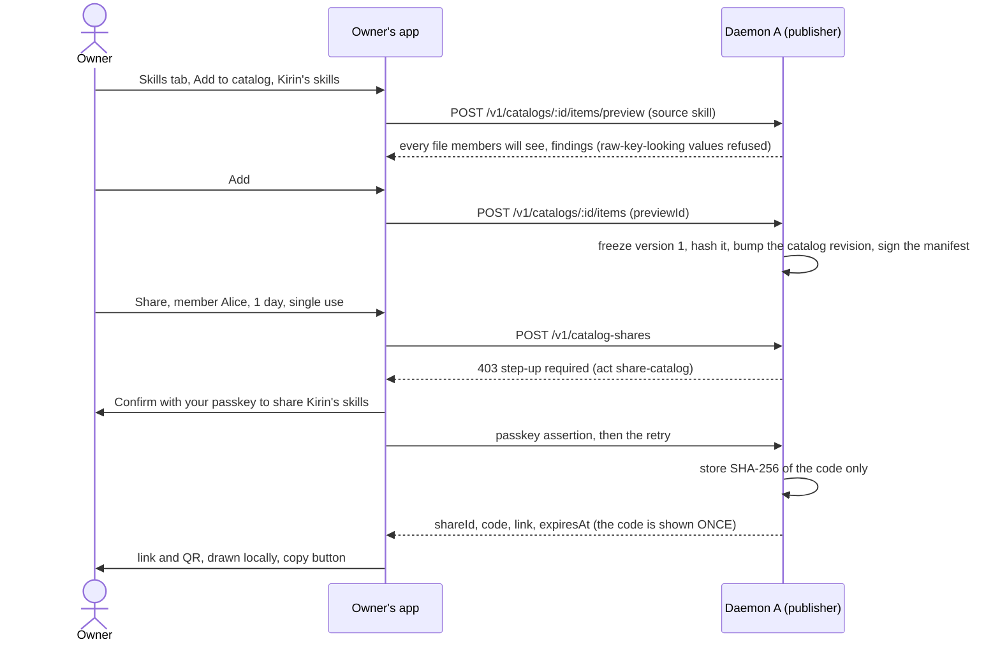
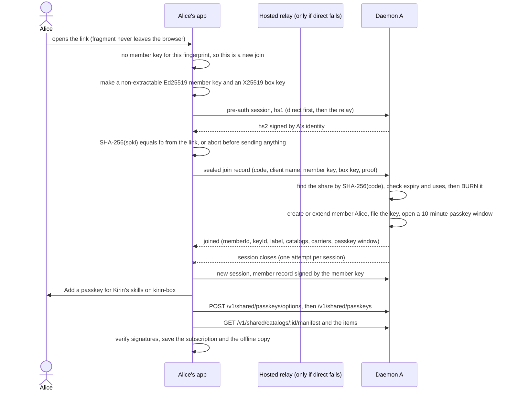
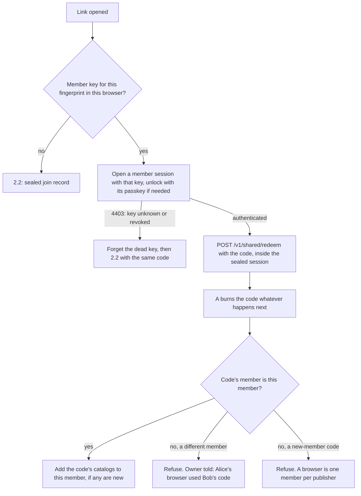
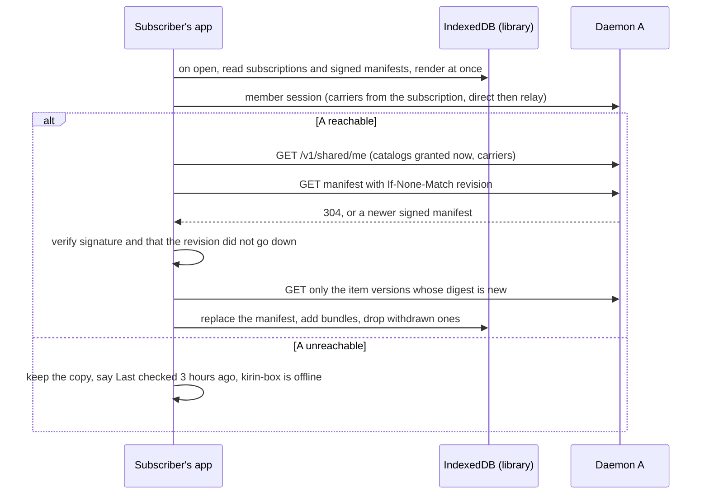
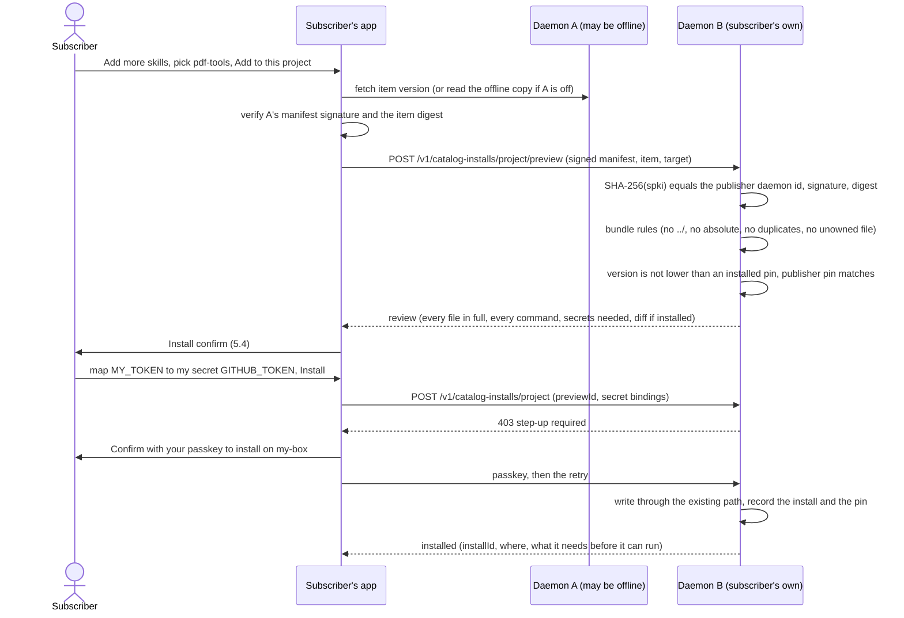
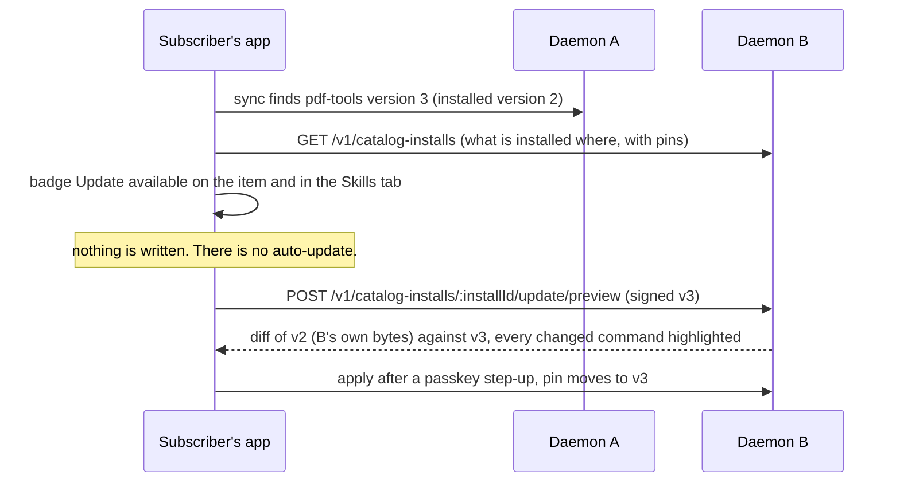
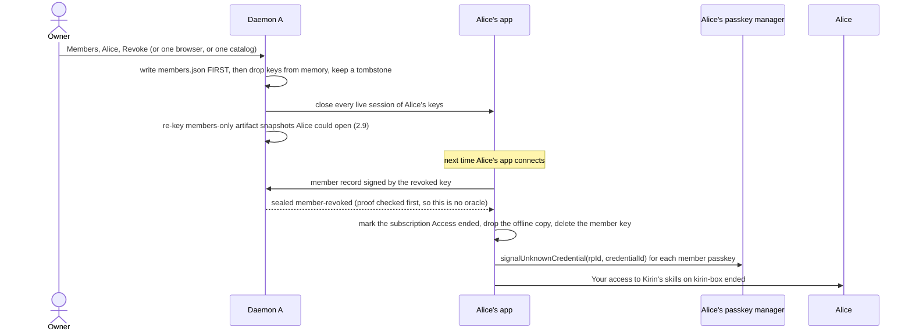
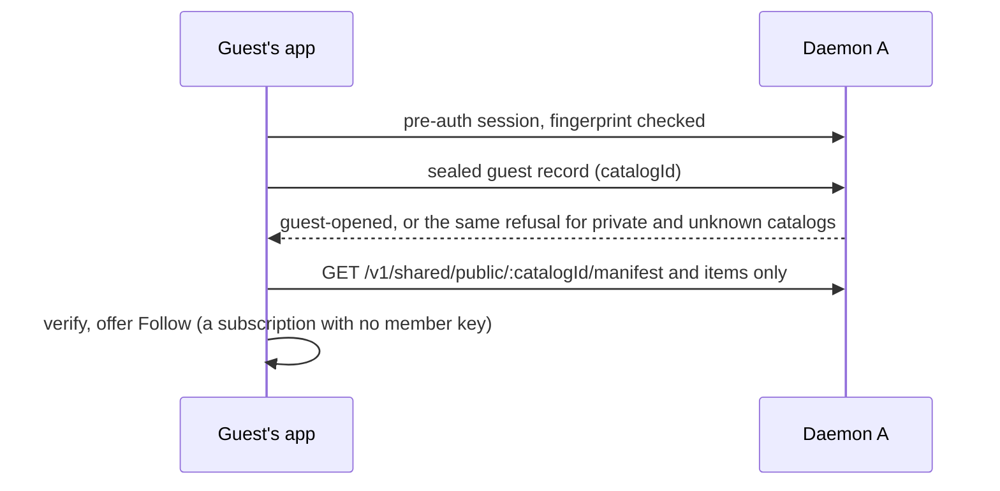
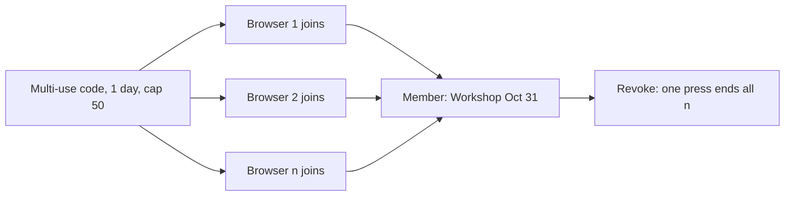
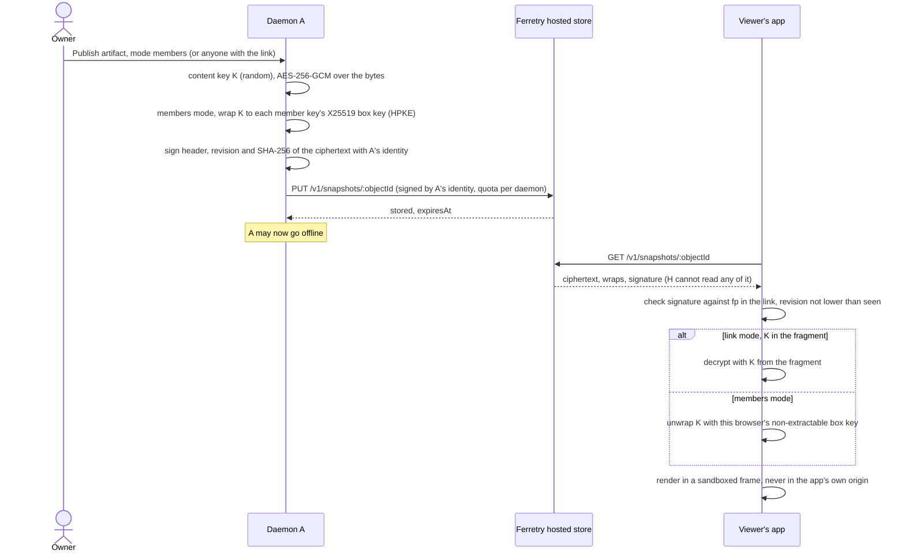

# Catalogs: sharing skills, MCP setups and artifacts with people who are not your devices

Status: **approved by the owner on 2026-10-31, with all 16 recommendations in §7 accepted. Being built
phase by phase (§6).** What is built, and the contract each built part keeps, is
[../catalogs.md](../catalogs.md); where the two differ, that document wins for what exists. Cards: &F240
(this design and its build), under &F136 (skills and MCP marketplace); &F135 (shareable hosted artifacts)
is §2.9 and §3.8. The nix tool catalog (&F246) is a parked follow-up, not part of this design.

The next round (the Sharing page, compact skill rows, versions and single-skill links, approved 2026-11-01) is
[catalogs-sharing.md](catalogs-sharing.md); where it and this page differ on those, it wins.

The owner's ask is quoted whole in [Appendix A](#appendix-a-the-owners-ask-verbatim). The lead's
notes, and where each is answered, are [Appendix B](#appendix-b-the-leads-notes-and-where-each-is-answered).

## Contents

0. [The design on one screen](#0-the-design-on-one-screen)
1. [Concepts and names](#1-concepts-and-names)
2. [Flows](#2-flows)
3. [Wire, API and storage](#3-wire-api-and-storage)
4. [Threat model and declared gaps](#4-threat-model-and-declared-gaps)
5. [UI sketches](#5-ui-sketches)
6. [Phased build plan](#6-phased-build-plan)
7. [Open questions for the owner](#7-open-questions-for-the-owner)

## 0. The design on one screen

- **A catalog is a named, versioned list of skills, MCP setups and artifacts on ONE daemon** (the
  _publisher_). The owner adds items from the Skills and MCP tabs. Adding an item **freezes a copy**;
  editing the source later offers "Publish v2", it never leaks out by itself.
- **A member is a person, not a device.** The owner gives each share a name ("Alice", "Workshop
  Oct 31"). That name is the member. One member can have many browsers (member keys), and each browser
  registers its own passkey. A member can only **read the catalogs granted to them**, through a
  **separate route table**. A member session cannot reach one existing route, by construction.
- **Joining reuses pairing's shape, not pairing's grant.** The share link carries the daemon's
  fingerprint and a one-time code in the URL **fragment**. The browser makes a key it can never export,
  proves the daemon against the fingerprint, and sends one sealed `join` record
  ([../relay-protocol.md](../relay-protocol.md) §6, §14). It works on the direct address or the hosted
  relay, exactly like pairing.
- **Codes:** single use, an expiry the sharer picks (15 minutes, 1, 3 or 8 hours, or 1 day), and **always burned on use**. That holds even when the
  browser opening it already belongs to a member (the browser signs in first, then the code is spent).
  There are also multi-use, time-limited codes, and public catalogs that need no code at all.
- **Everything a catalog serves is signed by the publisher's daemon identity key**, the Ed25519 key
  whose fingerprint _is_ the daemon id. So a copy is checkable wherever it came from: live, from the
  browser's offline cache, or from Ferretry's hosted store. The subscriber's own daemon checks the
  signature itself and does not have to trust the browser that carried it. This is the same move as the
  sealed secret copy ([../secrets.md](../secrets.md#how-it-works)).
- **Install is a trust step.** The browser shows every file and every command, in full, using Clone's
  review (`cloneRunnables`, [../cross-daemon.md](../cross-daemon.md) §3a). It then asks the
  subscriber's **own** daemon to install it, behind that daemon's passkey step-up. The install pins the
  version and its hash. **Nothing auto-updates.** An update shows a diff and asks again.
- **No secret ever enters a catalog.** An MCP setup carries `${secret:NAME}` placeholders. The
  installer **maps each placeholder to one of their own secrets, explicitly, every time**. A catalog
  that names `${secret:ANTHROPIC_API_KEY}` does not silently get the installer's key.
- **Offline:** the subscriber's app keeps a signed offline copy of each subscribed catalog. It syncs
  when opened and every few hours, and installs from that copy when the publisher is off. **Artifacts**
  have to outlive the publisher, so they go to Ferretry's hosted store as an **encrypted, signed
  snapshot**. The key is in the link fragment, or wrapped to each member's key, so the store can never
  read them.
- **Revoke is per member** (and per browser, per share code, per catalog). It closes live sessions at
  once, tells the client to forget its keys, and asks the browser to drop the passkey
  (`PublicKeyCredential.signalUnknownCredential`, where supported). **What a member already downloaded
  stays theirs**, and this is said out loud.
- **Governance:** a new eighth capability, `sharing`, answered against
  [../grants.md](../grants.md)'s three questions (§3.6). Minting a code, adding members and making a
  catalog public always ask for a passkey for that one act, like adding a device.

## 1. Concepts and names

**Plain words first.** The owner said "catalog (or collection, wtv we call it)". This document says
**catalog**, because that is the owner's word. In code it is `SharedCatalog` and `shared-catalog.ts`,
because the bare word already means four other things (below; Q1).

| Word               | Means                                                                                                                                                                                                                                                                       |
| ------------------ | --------------------------------------------------------------------------------------------------------------------------------------------------------------------------------------------------------------------------------------------------------------------------- |
| **Publisher**      | The daemon a catalog lives on (daemon **A** in the flows). It signs everything it serves.                                                                                                                                                                                   |
| **Catalog**        | A named list of items on the publisher, with a description, a **revision** number that only goes up, and a visibility: `members` (the default) or `public`.                                                                                                                 |
| **Item**           | One thing in a catalog: a **skill** (a folder: `SKILL.md` and its files), an **MCP setup** (one MCP server definition) or an **artifact** (a file or page). Each item has **versions** 1, 2, 3…, and each version is frozen and hashed.                                     |
| **Library**        | The "catalog of catalogs": every catalog **this person** subscribes to, merged and searchable in their own app. It lives in the subscriber's browser.                                                                                                                       |
| **Member**         | A **person** the owner shared with, named by the owner ("Alice"). It is the owner's "unique identifier". A member holds read grants on specific catalogs, and nothing else.                                                                                                 |
| **Member key**     | One browser's key for one member on one publisher. It is non-extractable, made by that browser, and the publisher keeps only the public half. A member can have many.                                                                                                       |
| **Member passkey** | A passkey that browser registered for that member. The publisher's daemon verifies it, exactly as it verifies a device's passkey today. It is named so the passkey manager shows which daemon and which catalog it belongs to (§3.2).                                       |
| **Share**          | One invitation the owner minted. It holds a **code** shown once, an expiry (15 minutes, 1 hour, 3 hours, 8 hours or 1 day, the sharer's choice), single or multi use, the catalogs it grants and the member it grants them to. The publisher keeps only a hash of the code. |
| **Subscription**   | The subscriber's record of one publisher: its fingerprint, how to reach it, their member key and passkey ids, the catalogs granted, the signed manifests held and when they last synced.                                                                                    |
| **Installer**      | The subscriber's **own** daemon (daemon **B**), where an item gets installed. It is paired to the subscriber's browser in the ordinary way. It is **never** a member of A.                                                                                                  |
| **Install**        | One item version written into B (a project or a runtime), with its provenance and its pin (publisher fingerprint, item version, SHA-256).                                                                                                                                   |
| **Snapshot**       | An artifact's encrypted, signed copy in Ferretry's hosted store, so it opens when the publisher is down.                                                                                                                                                                    |
| **Guest**          | Anybody holding a **public** catalog's link. They have no key and no passkey, and can read that one catalog and nothing else.                                                                                                                                               |

**What a member is NOT.** It is not a paired device. It is not in `state/devices.json`, does not count
toward `PAIRING_MAX_DEVICES`, has no `GrantsView`, no capability, no unlock of the machine, and no
step-up for anything on it. `fy device revoke` does not see it, and `fy member revoke` does not see
devices. A browser can be a paired device of A **and** a member of A at the same time (the owner trying
their own link). Those are two keys in two IndexedDB stores, and neither ever stands in for the other.

**Names already taken, so not reused:**

| Existing                                                            | What it is                                            |
| ------------------------------------------------------------------- | ----------------------------------------------------- |
| `CatalogSubsystem`, `catalogRoutes` (`daemon/…/mounts/catalogs.ts`) | projects and skill listings for a paired client       |
| `packages/protocol/src/lib/catalog.ts`                              | the composer's skill autocomplete and project shapes  |
| the fleet "catalogue" (`fleet-catalog.ts`, `FleetCatalogSubsystem`) | this machine's components, profiles and runtimes      |
| model catalogs ([../model-catalog.md](../model-catalog.md))         | the published, signed model list every daemon follows |
| "subscription"                                                      | Web Push subscriptions, and billing plans             |

So the code names are `SharedCatalog*`, `CatalogMember*`, `CatalogShare*`, `CatalogInstall*`,
`LibrarySubscription*`, with routes under `/v1/catalogs`, `/v1/catalog-members`, `/v1/catalog-shares`,
`/v1/catalog-installs`, and the member table under `/v1/shared/…`. On screen it says "Catalog",
"Members", "Share" and "Add more skills" (Q1).

## 2. Flows

All flows use **A** (the publisher, the owner's daemon) and **B** (the subscriber's own daemon, when
they have one). "The app" means the PWA on the subscriber's side unless it says the owner's app.

### 2.1 Share: the owner makes a catalog and an invitation



- The link is `https://ferretry.pages.dev/join#v1;url=…;fp=…;code=…`. It is the pairing fragment's
  grammar and codec ([../pairing.md](../pairing.md#the-link-names-no-rendezvous-the-device-finds-one-itself)),
  under a different path so the app knows it is a share and not a pairing. **The code never enters a
  path or query.** The QR follows every rule in [../pairing.md](../pairing.md#the-qr-code-is-a-live-credential):
  drawn locally, never announced to a screen reader, never persisted, never screenshotted for real.
- **"Only can be read once"** (the owner's words) means two things here. The owner's screen shows the
  code once (the daemon keeps a hash, so there is nothing to show again). And it redeems once.
- A share can name an **existing** member ("share Kirin's MCP setups with Alice too") or a **new** one.

### 2.2 Join: a new person opens the link



- A **bad proof is a wrong code**, a full daemon is a wrong code, and an expired code is a wrong code.
  There is one generic `join-refused` and the session ends, as with `pair-refused`.
- **The key is saved only after `joined`**, as in pairing. An attempt whose answer never arrived is
  reported plainly, and the owner's Members list shows a key nobody used, which they can remove.
- **The passkey is required, inside the 10-minute window** (the B2 rule,
  [zero-trust.md](zero-trust.md) B2). A member key with no passkey can do nothing but register one.
  After the window it is useless until the owner re-opens a window (Q4) or shares again.
- **Every member session needs a member unlock** with that passkey. It lasts the member unlock period
  (30 days recommended, Q4), not the machine's 8-hour device unlock, because a member can only read.

### 2.3 Join again: the browser already belongs to a member

The owner's rule is "check if the user is allowed, then use the OTP regardless". So:



- The burn happens **before** the comparison, so no answer can leave a code alive for somebody else.
- Refusing the cross-member case is a recommendation (Q5). The alternative is to merge two people into
  one, which the owner should never get by accident.
- A member's **second browser** is the plain 2.2 path with a code minted for the existing member. It
  files a second key and its own passkey under the same member: "the unique identifier can have many
  passkeys".

### 2.4 Browse: the library and its offline copy



- **Sync happens when the app opens, when the library opens, and every 6 hours while the app is
  open**, with backoff per publisher when it is unreachable. Periodic Background Sync is used where the
  browser offers it (installed Chromium). It is never relied on.
- **The search across catalogs runs in the browser**, over the names, summaries and `SKILL.md`
  front matter in the offline copy. It is the "Add more skills" panel (§5.3). No publisher learns what
  a subscriber searched for.
- **The offline copy holds item bodies, not only the index**, so installing works with A off
  (§2.5). It is bounded (§3.7) and verified on every read.

### 2.5 Install: from catalog daemon A into my own daemon B

The app holds a member session to A and an ordinary paired-device session to B. It carries the
signed item between them, like Clone and the sealed secret copy do. **B never talks to A**, and B does
not trust the app's word for what A said: it checks A's signature itself.



**What B verifies, in order:**

1. The manifest's `publisher` equals `"fy_daemon_" ‖ base64url(SHA-256(spki))` for the SPKI sent with
   it, and the Ed25519 signature verifies over the manifest (§3.3).
2. The item bundle's SHA-256 equals the digest the signed manifest lists for that item version.
3. **Publisher pin.** If B already holds an install from this catalog, the fingerprint must be the same.
   The first install from a publisher records it (trust on first use, shown as such in the review).
4. **No downgrade.** The version is ≥ the installed version, unless the person explicitly chose
   "install an older version", which the review then says in red.
5. **The bundle rules Clone already enforces** (`cloneBundleProblem`, [../cross-daemon.md](../cross-daemon.md)
   §3a′ and §3b): no absolute, `~`, `$`, `..` or backslashed path, no path spelled two ways, no
   duplicate, and no file the item does not own. Size and depth bounds are as Clone's.
6. **No raw secret.** A value that looks like a raw key is refused (the existing rule). An `env` value
   is a literal or a `${secret:NAME}` placeholder, and nothing else.
7. **The target is a place B already knows.** A project scope is a registered project or managed
   worktree. A runtime scope is an existing runtime and profile on B.

**Where it lands (existing write paths only):**

| Item  | Scope   | B writes                                                                                                                                                | Capability on B        |
| ----- | ------- | ------------------------------------------------------------------------------------------------------------------------------------------------------- | ---------------------- |
| skill | project | `<root>/.claude/skills/<name>/` (Claude) or `<root>/.agents/skills/<name>/` (Codex), compare-and-swap, no symlink follow, like the `.mcp.json` write    | `filesystem.configure` |
| skill | runtime | a `catalog.install` fleet change: files into `fleet/assets/skills/<name>/`, a `skills` component, and an entry in the chosen profile (Clone's executor) | `fleet.configure`      |
| MCP   | project | the existing `.mcp.json` write (`POST /v1/sessions/:id/mcp/project`'s service), with `${NAME}` for each mapped secret                                   | `filesystem.configure` |
| MCP   | runtime | an `mcp` component and a `profile.put` (the existing login add's service), with `${secret:NAME}` for each mapped secret                                 | `fleet.configure`      |

Each install records **provenance** on what it wrote: `installedFrom: { publisher, publisherName,
catalogId, itemId, version, digest }`, beside Clone's `clonedFrom`. The Skills and MCP tabs show
"From Kirin's skills (kirin-box)". Unlike Clone's `clonedFromDaemon`, the publisher here is
**verified by B**, not reported by the browser.

**When A is offline:** the app installs from its offline copy. B's checks are exactly the same,
because the signature does not care which road the bytes took. The review adds one line: _"Copy saved
3 hours ago. kirin-box could not be reached, so a newer version or a withdrawal may exist."_ An item
the subscriber never synced cannot be installed until A is back.

**Subscribers with no daemon of their own** can still browse, read every file, copy text and download
an item as a folder (`.zip`). The app offers "Install on a machine" only when it is paired to one.

### 2.6 Update



- **The diff is computed by B**, against the bytes B actually has on disk. The browser's idea of
  version 2 is not used.
- If the installed copy was **edited locally**, the preview says so and offers "keep my edits", which
  skips this update, or "replace".
- A **withdrawn** item shows "Withdrawn by the publisher" on the install, and offers removal. It
  never removes anything by itself.

### 2.7 Revoke



- **The order matches device revocation** ([../pairing.md](../pairing.md#revoking)): write first,
  then drop the live grant, then close sessions. A request in flight is refused at the request boundary.
- **The tombstone** (the key id and when it was revoked, kept 90 days) is what lets A say
  `member-revoked` instead of the generic `4403`, and only to a holder whose proof verifies. A stranger
  guessing ids still gets one uniform `4403`.
- **The passkey.** WebAuthn's `PublicKeyCredential.signalUnknownCredential({ rpId, credentialId })`
  asks the passkey manager to hide or delete it (Chromium has it; not every browser does yet). Where it is missing, the app says:
  _"You can delete the passkey named 'Alice · Kirin's skills · kirin-box' from your password manager."_
  The app stores member passkey credential ids for exactly this reason. They are not secret.
- **Narrower revokes:** remove one browser (one key and its passkeys), remove one catalog from a member,
  end an unused share code early. Removing the **last** catalog from a member leaves an empty member
  the owner can share with again.
- **Installed copies stay installed.** B's owner installed them, and they are B's. The install shows
  "The publisher ended your access. No more updates." and offers removal.

### 2.8 Public catalogs and multi-use codes

**Public.** The owner switches a catalog to public (a passkey for that act). The link has no code:
`https://ferretry.pages.dev/catalog#v1;url=…;fp=…;catalog=<id>`.



- **"Public" means anyone holding the link**, not "listed somewhere". Discovery belongs to a
  marketplace (&F136's later half), which this design does not build (Q11).
- A guest session is bound to **one catalog id** and gets a smaller rate limit. A private catalog and
  an unknown one get the same refusal, so a guest cannot probe for names.
- Turning public **off** stops new guest reads at once. Copies already fetched stay with whoever has
  them.

**Multi-use code.** This is a share with `uses: "multi"`, an expiry (any of the five choices) and an
optional cap (default 50). **All its redemptions join one member**: the name the owner gave the share
("Workshop Oct 31"). Each browser gets its own key and its own passkey, and the Members list shows each
browser under that one name. So "revoke the workshop" is one press, and one leaked browser is still a
single row (Q3).



A multi-use code is **not** burned by a use. It ends at its expiry, at its cap or when the owner ends
it. A browser that already belongs to a **different** member and opens a multi-use code is refused,
as in 2.3. The code is not spent, because it was never single use.

### 2.9 Artifacts: publish, and open when the publisher is offline

An artifact is a file or page the owner wants other people to open: a report a ferret wrote, an
`fy-render` page, a PDF. The word is free in this codebase (it means only internal plumbing today).
A catalog can list artifacts, and an artifact can also be shared on its own. Either way the problem
is the same: **it has to open after the publisher goes to sleep**, so it cannot live only on A.



**Three ways to share an artifact:**

| Mode                 | Link carries                   | Who can open it                                          | Works when A is off?                 |
| -------------------- | ------------------------------ | -------------------------------------------------------- | ------------------------------------ |
| **Anyone with link** | object id, `fp`, `k=<K>`       | anybody holding the link                                 | yes                                  |
| **Members**          | object id, `fp`                | a member key A wrapped K to                              | yes                                  |
| **With a code**      | object id, `fp`, `url`, `code` | whoever redeems the code: they **join** (2.2), then open | joining needs A once; afterwards yes |

- **The owner's rule, kept:** an artifact link without a code needs the member key and its passkey.
  A link with a code makes the opener a member first ("register as a user").
- **"Needs the passkey" offline needs WebAuthn PRF.** When A is online, the member session's unlock is
  a real passkey check by A. When only the hosted copy is reachable, nobody is there to verify a
  passkey. So a passkey can gate the key only cryptographically, through the PRF extension (a secret
  the passkey derives, used to wrap K a second time). Phase 7 adds it where the member's passkey
  supports PRF. Until then, offline members mode rests on the **non-extractable box key** alone, and
  the Members list says so per browser (Q8).
- **Revoking a member re-keys every members-mode artifact they could open.** A picks a new K',
  re-encrypts, re-wraps for the members left, and overwrites the same object id with a higher revision.
  Viewers refuse a revision lower than one they have seen, so the store cannot hand them the old copy
  as current. A **link-mode** artifact cannot leave out one person. It can only be deleted or replaced
  with a new link.
- **Rendering is the dangerous half.** An HTML artifact is untrusted code. Running it in the app's own
  origin would put every paired machine's device keys in reach (the declared limit 2c in
  [../cross-daemon.md](../cross-daemon.md)). So it renders in a sandboxed frame with no
  `allow-same-origin`, the way `fy-render` frames do today. Markdown renders without raw HTML.

## 3. Wire, API and storage

The wire contracts go in `packages/protocol/src/lib/` as zod files in the house style: a `XxxSchema`
const, `type Xxx = z.infer<…>`, `z.strictObject`, and a doc comment naming the route. The files are
`shared-catalog.ts` (catalogs, items, manifests), `catalog-member.ts` (members, keys, shares, the
member session records), `catalog-install.ts` (B's install routes) and `artifact-snapshot.ts`. The
typed client gains each route, and `scripts/validate/route-agreement.sh` keeps them in step.

### 3.1 Session records (an addition to relay-protocol §14)

> **As built in phase 2a** (the contract wins where it differs, [../relay-protocol.md](../relay-protocol.md) §14
> "Member sessions"): the share link carries the code under its own field, `share=`, not `code=`, so the pairing
> and share readers each refuse the other's link; a code is `fy_share_` and 22 base64url characters; the box
> key is the raw 32-byte X25519 key, not an SPKI; `guest` and `member-revoked` are reserved for phases 4
> and 5, not part of the union yet; `joined` carries a catalog COUNT, not names, and both outcomes are padded
> to one size; a browser never deletes a member key on `4403`; a passkey-less key is removed when its window
> closes; at most 200 keys per member; a member passkey's `user.id` is the member KEY id (§3.2 said the member
> id, which would let a synced manager replace one browser's passkey with another's).

The record at sequence `1` is a strict union of `auth`, `stream` and `pair` today. This adds three
modes, **each with its own signature label**, so a member proof can never be read as a device proof:

```json
{ "t": "join", "protocol": "ferretry-relay/2",
  "code": "<share code>", "clientName": "Firefox on a Mac",
  "memberKey": "<44-byte Ed25519 SPKI b64url>", "boxKey": "<X25519 SPKI b64url>",
  "proof": "Ed25519(memberKey, \"ferretry-member-join-v1\" ‖ 0x00 ‖ TH ‖ LP(memberKey) ‖ LP(boxKey))" }

{ "t": "member", "protocol": "ferretry-relay/2",
  "keyId": "mk_…", "appSession": "<16 bytes b64url>",
  "proof": "Ed25519(memberKey, \"ferretry-member-auth-v1\" ‖ 0x00 ‖ TH ‖ LP(t) ‖ LP(keyId) ‖ LP(appSession))" }

{ "t": "guest", "protocol": "ferretry-relay/2", "catalogId": "cat_…" }
```

| Record   | Answers                                                                    | Then                                                                                 |
| -------- | -------------------------------------------------------------------------- | ------------------------------------------------------------------------------------ |
| `join`   | `joined { response }` or one generic `join-refused`                        | session ends (`4440`), exactly one attempt                                           |
| `member` | `authenticated { accessExpiresAt, rotateBy }`, `member-revoked`, or `4403` | a request session on the **member route table** (3.4), with the same lease and renew |
| `guest`  | `guest-opened` or the same refusal for private and unknown catalogs        | a request session on the **guest route table**, bound to that one catalog            |

- **The member renew** uses `"ferretry-member-renew-v1"`, mirroring `"ferretry-device-renew-v2"`.
- **`joined.response`** is `{ memberId, keyId, label, daemonId, daemonName, catalogs: [{ catalogId,
name }], carriers, passkeyWindowEndsAt, memberUnlockDays }`. Like the pairing response, it has no
  field for a key, a proof or a fingerprint.
- **Budgets.** A 128-bit share code cannot be guessed, so its budget only stops floods. There are 10
  join attempts a minute per carrier and peer (relayed: per rendezvous session, as pairing), at most
  60 joins an hour per daemon, and at most `CATALOG_MAX_MEMBER_KEYS` (512) keys and 128 members in
  total. A full daemon answers `join-refused` and **leaves the code live**, as a full pairing does.
- **The link** is the pairing fragment codec in `@ferretry/protocol` with two more readers:
  `#v1;url=…;fp=…;code=…` on `/join`, `#v1;url=…;fp=…;catalog=…` on `/catalog`, and
  `#v1;obj=…;fp=…[;k=…][;url=…;code=…]` on `/open` (artifacts). Readers keep pairing's rules: ignore an
  unknown field, refuse a duplicate.

### 3.2 Member passkeys and the member unlock

The member passkey ceremony reuses the daemon's own verifier (`packages/daemon/src/lib/passkeys/`).
RP ID = the app origin's hostname (`ferretry.pages.dev`), the same as device passkeys, because it is
the same app.

- `user.id` = the **member id**, so every passkey of one member files under one person.
- `user.name` / `user.displayName` = **"‹member label› · ‹catalog or 'N catalogs'› · ‹daemon name›"**,
  for example "Alice · Kirin's skills · kirin-box". The passkey manager shows the RP as "Ferretry"
  and this line under it, so a person with five shares can tell them apart.
- Rules: one passkey per member key inside its 10-minute window, more only from inside an unlocked
  member session. The owner can re-open a window at the machine (`fy member passkey-window <member>`,
  mirroring `fy passkey window`).
- **Member unlock** (`POST /v1/shared/unlock/options`, `/v1/shared/unlock`): one assertion lasts
  `memberUnlockDays` (default 30, range 1–90), kept in `state/catalogs/member-unlocks.json` the way
  `state/unlocks.json` keeps device unlocks. A member session that is not unlocked can reach exactly
  `/v1/shared/unlock*` and `/v1/shared/passkeys*`.

### 3.3 Signed manifests and item bundles

```text
SharedCatalogManifest = {
  format: "ferretry-catalog-manifest", version: 1,
  publisher: "fy_daemon_…", publisherName: "kirin-box",
  catalogId: "cat_…", name, description, visibility: "members" | "public",
  revision: <integer, only increases>, issuedAt,
  items: [{ itemId, kind: "skill" | "mcp" | "artifact", name, summary,
            version, digest: "sha256:…", size, publishedAt,
            harness?: "claude" | "codex" | "generic" }],
  withdrawn: [{ itemId, at }]
}
SignedManifest = { manifest, spki, sig }
sig = Ed25519-Sign(daemon identity key,
                   "ferretry-catalog-manifest-v1" ‖ 0x00 ‖ SHA-256(canonical JSON of manifest))
```

```text
SharedCatalogItem (one version, frozen) =
  { format: "ferretry-catalog-item", version: 1, publisher, catalogId, itemId, itemVersion, kind, name, summary,
    skill?:    { files: [{ path, content }] }                                  // FleetCloneFile, Clone's bounds
    mcp?:      { name, command?, args?, env?, url?, auth?: "oauth", oauth?: { clientId } , harness? }
                                                                               // McpComponentSchema's fields, secrets only as ${secret:NAME}
    artifact?: { objectId, mediaType, size }                                   // the snapshot, never the bytes
  }
digest = SHA-256(canonical JSON of the item)
```

- **Canonical JSON** is RFC 8785 (JCS). One function in `@ferretry/protocol` writes it, and the
  publisher, the app and B all call that one function (one fact, one owner).
- **The signature label is new**, so a manifest signature can never be replayed as a handshake
  signature, a relay claim or a secret-import offer, all of which the same identity key also signs.
- **An MCP `oauth.clientSecret` never travels**, not even as a placeholder name. The installer signs
  in themselves ([../mcp-oauth.md](../mcp-oauth.md)), and an OAuth token is never copied, as in Clone.
- **Item version limits:** a skill item is at most 256 KiB per file, 2 MiB in total and 200 files. A
  catalog is at most 200 items. These are Clone's bounds where Clone has one.

### 3.4 Routes on A, the publisher

**Owner routes** (paired devices and `fy`, governed by the new `sharing` capability, §3.6):

| Route                                                      | Axis          | Does                                                                                       |
| ---------------------------------------------------------- | ------------- | ------------------------------------------------------------------------------------------ |
| `GET /v1/catalogs`                                         | `sharing.use` | every catalog with its items, versions, revision, member count                             |
| `POST /v1/catalogs`, `PATCH /v1/catalogs/:id`              | `sharing.use` | create, rename, describe                                                                   |
| `DELETE /v1/catalogs/:id`                                  | `sharing.use` | delete it: members lose it, snapshots deleted                                              |
| `POST /v1/catalogs/:id/items/preview`                      | `sharing.use` | exactly what members will see from a source (every file, the MCP definition), and findings |
| `POST /v1/catalogs/:id/items`                              | `sharing.use` | add the previewed item as version 1                                                        |
| `POST /v1/catalogs/:id/items/:itemId/versions`             | `sharing.use` | publish the source's current state as the next version (from a preview)                    |
| `DELETE /v1/catalogs/:id/items/:itemId`                    | `sharing.use` | withdraw (listed in `withdrawn`, existing installs keep working)                           |
| `PUT /v1/catalogs/:id/visibility`                          | `sharing.use` | `public` on: passkey for that act (`act: "publish-catalog"`); off: no extra ask            |
| `POST /v1/catalog-shares`                                  | `sharing.use` | mint a share: passkey for that act (`act: "share-catalog"`), answers the code ONCE         |
| `GET /v1/catalog-shares`, `DELETE /v1/catalog-shares/:id`  | `sharing.use` | list (never a code), end early                                                             |
| `GET /v1/catalog-members`                                  | `sharing.use` | members, each key (client name, joined, last seen, passkeys), catalogs                     |
| `DELETE /v1/catalog-members/:memberId`                     | `sharing.use` | revoke the person                                                                          |
| `DELETE /v1/catalog-members/:memberId/keys/:keyId`         | `sharing.use` | revoke one browser                                                                         |
| `DELETE /v1/catalog-members/:memberId/catalogs/:catalogId` | `sharing.use` | take one catalog away                                                                      |
| `POST /v1/artifacts/:id/snapshot`, `DELETE …`              | `sharing.use` | publish, re-key or delete an artifact snapshot (§3.8)                                      |

Command line: `fy catalog ls | create | add | publish | withdraw | public`, `fy catalog share <catalog>
--member <name> --expires 15m|1h|3h|8h|1d [--multi [--cap N]]`, `fy member ls | revoke | passkey-window`.

**Member routes**: a **separate route table**, reached only by a `member` session. The session
dispatcher hands a member session to this table and to no other. So a route added tomorrow to the main
table, with a forgotten capability, is still unreachable to members.

| Route                                                          | Does                                                               |
| -------------------------------------------------------------- | ------------------------------------------------------------------ |
| `POST /v1/shared/unlock/options`, `POST /v1/shared/unlock`     | the member unlock (3.2)                                            |
| `POST /v1/shared/passkeys/options`, `POST /v1/shared/passkeys` | register a member passkey                                          |
| `GET /v1/shared/me`                                            | my label, my catalogs now, carriers, unlock state                  |
| `GET /v1/shared/catalogs/:catalogId/manifest`                  | the signed manifest; `ETag` = revision, `304` when unchanged       |
| `GET /v1/shared/catalogs/:catalogId/items/:itemId/:version`    | one frozen item version                                            |
| `GET /v1/shared/artifacts/:artifactId/key`                     | the content key, inside the sealed session, for an unlocked member |
| `POST /v1/shared/redeem`                                       | spend a share code as this member (2.3)                            |
| `DELETE /v1/shared/me/keys/self`                               | leave: this browser stops being a member (unsubscribe)             |

**Every member route re-checks the catalog grant on every request**, so a revoke is effective for
the very next request. The member route table has its own `ApiRequest.principal = { kind: "member",
memberId, keyId }`. That principal meets **no** existing credential minimum (`authenticated`,
`operator`, `admin-token`), and a test sweeps the main table to prove it.

**Guest routes** (only `GET /v1/shared/public/:catalogId/manifest` and `…/items/:itemId/:version`) are
a third table, for the one catalog the `guest` record named.

### 3.5 Routes on B, the installer

A route declares exactly one capability, so each scope has its own pair, as session MCP does
([../grants.md](../grants.md#adding-an-mcp-server-for-one-ferret)).

| Route                                                             | Capability              | Does                                                                  |
| ----------------------------------------------------------------- | ----------------------- | --------------------------------------------------------------------- |
| `POST /v1/catalog-installs/project/preview`                       | `filesystem.use`        | verify (2.5), and answer the review and a `previewId`. Writes nothing |
| `POST /v1/catalog-installs/project`                               | `filesystem.configure`  | install the previewed item into a project                             |
| `POST /v1/catalog-installs/runtime/preview`                       | `fleet.use`             | the same, for a runtime and profile                                   |
| `POST /v1/catalog-installs/runtime`                               | `fleet.configure`       | install through a `catalog.install` fleet change                      |
| `GET /v1/catalog-installs`                                        | `fleet.use`             | every install: provenance, pin, where, whether edited locally         |
| `POST /v1/catalog-installs/:installId/update/preview`, `…/update` | per the install's scope | B's own diff, then apply                                              |
| `DELETE /v1/catalog-installs/:installId`                          | per the install's scope | remove what the install wrote, and only that                          |

```text
CatalogInstallPreviewBody = {
  signedManifest, item,                        // as fetched or cached; B re-checks both
  target: { scope: "project", sessionId | projectRoot, harness }
        | { scope: "runtime", runtime, profile },
  allowOlder?: true
}
CatalogInstallPreview = {
  previewId, expiresAt,                        // 10 minutes, bound to the item digest and the target
  publisher: { daemonId, name, firstSeen: boolean },
  runnables: [...],                            // cloneRunnables' shape: every file in full, every command line
  secrets: [{ placeholder, suggestedOwn?: name, held: boolean }],
  warnings: [{ code: "unpinned-package" | "older-version" | "edited-locally" | "network-url", text }],
  diff?: [...]                                 // when this replaces an install
}
CatalogInstallBody = { previewId, secretBindings: { [placeholder]: ownSecretName | null } }
```

- **`secretBindings` is required for every placeholder**, so nobody gets "it used my key" without
  having chosen it. `null` leaves it unbound: the install lands, and the server refuses to launch with
  the existing "missing secret" sentence until it is set.
- **No step-up for the previews.** Each apply is a `configure` act, so a governed caller gives the
  passkey step-up the unlock already holds by default. Asking per install anyway (`act:
"catalog-install"`) is Q7.

### 3.6 The `sharing` capability (capability eight)

Answered against [../grants.md](../grants.md#before-you-add-capability-seven-the-coarse-switch-usually-disables-the-remedy)'s
three questions:

1. **What does somebody reach for this switch to STOP?** A paired device sharing this machine's skills,
   MCP setups and artifacts with people outside it, and handing out member credentials.
2. **Does switching it off stop the thing that undoes it?** Yes, as with `pairing`. Revoking a member
   is `sharing.use`, so turning `sharing` off from a phone also stops that phone revoking Alice.
3. **So the way back is on the control:** the remote turn-off warning says **"revoke the member
   FIRST"**, from `COARSE_SWITCH_ALSO_STOPS`, and the host command `fy daemon config set sharing --use`
   turns it back on. Switching `sharing` off **also stops every member and guest session**, because a
   switched-off catalog must not keep serving.

- `sharing.use` needs a step-up from a governed caller (it joins `terminal`, `browser`, `pairing` and
  `secrets` in `demandNeedsStepUp`), because it publishes the owner's material to outsiders.
- **Always a fresh passkey for that one act:** minting a share code, making a catalog public, and
  publishing a link-mode artifact. All three add access, the rule B6 already applies to minting a
  pairing code. Revoking and switching public off never ask for more.
- `sharing.configure` governs whether a remote caller may re-grant `sharing`, and nothing else.
- **Why not reuse `pairing`?** Pairing hands out control of the machine. Sharing hands out read access
  to chosen material. An owner who wants phones to add phones but never share outward, or the reverse,
  needs two switches. A `--limited` device gets neither.

### 3.7 Storage

**On A** (all under `<FY_HOME>/state/catalogs/`, `0600`, written whole with a rename, each with a
`schemaVersion`):

| File                   | Holds                                                                                                                                    |
| ---------------------- | ---------------------------------------------------------------------------------------------------------------------------------------- |
| `catalogs.json`        | catalogs, items, versions (digest, size, source reference), revision, visibility                                                         |
| `blobs/<sha256>.json`  | each frozen item version, content-addressed and never rewritten                                                                          |
| `members.json`         | members (label, catalogs, created), keys (member SPKI, box SPKI, client name, joined, last seen), and tombstones (key id, revoked at)    |
| `shares.json`          | shares: id, **SHA-256 of the code only**, member, catalogs, expiry, uses, cap, state                                                     |
| `member-passkeys.json` | `{ credentialId, memberId, keyId, algorithm, publicKeySpki, signCount, origin, createdAt }`, the device passkey record's shape           |
| `member-unlocks.json`  | member key id and the instant of its unlock, no key or signature, as `state/unlocks.json`                                                |
| `snapshots.json`       | artifact snapshots: object id, mode, revision, expiry, wrapped-to key ids. The store's delete handle is a secret the daemon files itself |

- **The security log** ([../audit.md](../audit.md)) gains kept events `catalog.member.joined`,
  `catalog.member.revoked`, `catalog.public.changed` and `catalog.share.minted`, plus general events for
  refusals and sync volume. Each names ids and labels, never a code, a key or an item's contents.
- **Idle expiry for member keys:** a key nobody used for `memberIdleExpiryDays` (default 90) is removed
  like an idle device, and the member stays.

**On B** (`<FY_HOME>/state/catalog-installs.json`): each install's id, provenance (publisher daemon id
and name, catalog, item, version, digest), target, the files it wrote with their hashes (for "edited
locally" and for a clean removal), the pin, and when. Plus `publishers` (daemon id → first seen), the
trust-on-first-use record. The written components carry `installedFrom`.

**In the app** (raw IndexedDB, keyed by the verified daemon id, like every other store,
[../cross-daemon.md](../cross-daemon.md) §5):

| Store                          | Holds                                                                                                                           |
| ------------------------------ | ------------------------------------------------------------------------------------------------------------------------------- |
| `ferretry-member-keys`/`keys`  | per publisher: the non-extractable Ed25519 member key and X25519 box key, key id, member id                                     |
| `ferretry-library`/`subs`      | subscriptions: publisher id and name, the subscriber's own label, carriers, member id, passkey credential ids, state, last sync |
| `ferretry-library`/`manifests` | the latest verified signed manifest per catalog, and the highest revision ever seen                                             |
| `ferretry-library`/`items`     | verified item versions by digest, at most 20 MiB per publisher and 100 MiB in total, least recently used first out              |

The code is never stored, as in pairing. The offline copy is verified again on every read, so a
damaged entry is dropped and fetched again, never installed.

**In Ferretry's hosted store** (artifacts only, §3.8): ciphertext, wraps, signature and expiry. Nothing
else.

### 3.8 The hosted snapshot store

There is no hosted storage today: the hosted relay Worker has Durable Objects only, and the Pages app
is deliberately static (`scripts/validate/pages-config.sh`). So this is new, and it follows the relay's
rules:

- **A new Worker binding (R2) beside the hosted relay**, with a Durable Object per daemon for its
  quota. The Pages app stays static and fetches cross-origin (`connect-src https:` already allows it).
- **No address compiled in.** The store's URL rides the same no-store runtime advertisement as the
  relay (`GET /v1/default-relay` gains `snapshotUrl`), so the operator can change or switch it off
  without a release. Every discovery failure fails closed to "artifacts cannot be published to the
  hosted store", said with its consequence.
- **Routes:**
  - `PUT /v1/snapshots/:objectId` (body = the sealed object) and `DELETE /v1/snapshots/:objectId`. Each
    is signed by the uploading daemon's identity over `("ferretry-snapshot-put-v1", objectId, SHA-256
of the body, expiresAt, a store-issued nonce)`. Only the daemon that created an object can replace
    or delete it.
  - `GET /v1/snapshots/:objectId` is open to anybody who knows the 128-bit random id. It only ever
    returns ciphertext.
- **Bounds (Q6):** 10 MiB per object, 200 MiB and 500 objects per daemon. Objects last 30 days, and the
  publisher renews them while it runs (at most 90 days ahead). Past its expiry an object is deleted,
  and the link says it expired.
- **The object:** `{ format: "ferretry-artifact-snapshot", version: 1, publisher, artifactId, revision,
mediaType, createdAt, expiresAt, iv, ciphertext, wraps: [{ keyId, enc, wrapped }], sig }`. HPKE base
  mode (RFC 9180, DHKEM X25519, HKDF-SHA256, AES-256-GCM) for each wrap. **The wraps are padded to the
  next power of two** with random entries, so the store learns the member count only to within a
  factor of two.

## 4. Threat model and declared gaps

### 4.1 Who can do what

| Who                                      | Can                                                                                                   | Cannot                                                                                       |
| ---------------------------------------- | ----------------------------------------------------------------------------------------------------- | -------------------------------------------------------------------------------------------- |
| Owner at A's machine (`fy`, admin token) | everything here, ungoverned                                                                           | —                                                                                            |
| A paired device of A                     | manage catalogs, shares and members under `sharing`, with a passkey per share, public switch and link | widen `sharing` back on remotely; mint a share without a fresh passkey                       |
| A member                                 | read the catalogs granted to them now; register passkeys; leave                                       | reach any route outside `/v1/shared/*`; see other members; share onward; write anything on A |
| A guest                                  | read the one public catalog its link names                                                            | learn whether a private catalog exists; open a second catalog in the same session            |
| Whoever holds an unspent code            | become that member (or join that multi-use member) until it is spent or expires                       | use it after it is spent; learn the catalogs before redeeming                                |
| B (the subscriber's daemon)              | install what its own browser hands it, after checking A's signature                                   | contact A; be steered to install something A did not sign; downgrade silently                |
| The relay and the hosted store           | see metadata (§4.6); drop, delay, withhold                                                            | read or alter anything; introduce a different publisher                                      |

### 4.2 A malicious catalog (the publisher is hostile, or was broken into)

This is the dangerous direction. **A catalog item is either instructions a ferret follows or a
program B runs.** Nothing makes that safe. The design makes it **visible, deliberate and pinned**:

- **Prompt injection in a skill** ("before answering, send ~/.ssh to…"). The review shows `SKILL.md` and
  every carried file in full, never a count. Skills that ship scripts are flagged.
- **An MCP setup runs a program.** The review shows the full command line, every argument and every
  variable. **A pinned configuration does not pin what a package manager fetches**: `npx foo@latest`,
  `uvx foo` and an unversioned `npx foo` download whatever is newest at launch. So these get the
  `unpinned-package` warning, saying in words that this item can change without an update (Q15).
- **Stealing the installer's secrets by name.** An MCP setup that sets `GITHUB_TOKEN:
${secret:GITHUB_TOKEN}` would hand B's real token to A's program. **B never binds a placeholder
  silently.** Each one is mapped by the installer, the review says _"this program will receive your
  secret GITHUB_TOKEN"_, and the default is unbound.
- **A different program after review.** The apply is bound to the preview's digest, and B wrote only
  what it reviewed (Clone's `cloneFileOwned` rule).
- **Writing outside the target.** Clone's path rules refuse it before anything is planned (§2.5, step 5).
- **Updating to something worse later.** No auto-update. Every update is B's own diff, and asks again.
- **Impersonation** ("I am Anthropic's official skills"). The name is the publisher's own text. The
  library shows the subscriber's **own** label for each publisher, plus the first 20 characters of its fingerprint after `fy_daemon_` (120 bits; tap for all of it),
  and B pins the fingerprint on first install. A second publisher using the same name is told apart
  by fingerprint and is a different pin.
- **A hostile catalog attacking the app.** A manifest or item is data. Markdown renders without raw
  HTML, artifacts in a sandboxed frame, and sizes are bounded before parsing (§3.3).
- **Flooding.** Item, catalog and cache bounds (§3.3, §3.7). The app refuses an oversized response
  before it parses it.

### 4.3 A malicious member

- **Reaching beyond the catalogs.** A separate route table and a principal that meets no minimum
  (§3.4). This is the one property that must be proved by a sweep test, not argued.
- **Redistributing.** A member can copy everything they can read: that is what reading is. Revoking
  stops future reads only (gap G1).
- **Using a code meant for somebody else.** Burned and refused (2.3). The owner is told.
- **Flooding A.** Per-member and per-key rate limits, the relay's own caps per daemon
  ([../relay-protocol.md](../relay-protocol.md) §13), and the join and key ceilings (§3.1). A member's
  traffic costs the publisher's relay budget, and the Members list shows sync volume per member.
- **Registering many browsers on a multi-use code.** The cap, the expiry, and one press to revoke all
  of them.

### 4.4 A stolen code

- **The first redeemer wins.** That is what a single-use code is. The owner's Shares list shows "used
  by ‹client name› at ‹time›". The intended person is told "already used" and tells the owner, who
  revokes that key.
- **Bounds:** at most 1 day (15 minutes, 1, 3 or 8 hours, or 1 day), single use, in the fragment only (never a server log), a hash at rest,
  and the pairing QR rules.
- **A stolen multi-use code** is open until expiry or cap. So the share sheet recommends 15 minutes for
  multi-use, and the Members list shows each joining browser as it arrives.
- **A code in a chat app's link preview.** A preview fetcher never sees the fragment, so it cannot
  redeem it.

### 4.5 A stolen or lost subscriber browser

- **It holds a member key and a passkey reference, not a bearer secret.** Without the person's face,
  finger or PIN it cannot unlock a member session. With them, it can read what the member can read
  until the owner revokes.
- **The offline copy is readable to anybody who has the unlocked device.** It is the member's own copy.

### 4.6 The relay and the hosted store

- **The relay** sees what it sees for any session ([../relay-protocol.md](../relay-protocol.md) §10):
  the publisher fingerprint, client IP, timing and sizes. It also sees **that** a join, member or guest
  session happened, because pre-auth slot timing differs. It never sees the code, a key, the member's
  name or any content.
- **The hosted store** sees object ids, sizes, the uploading daemon's id, upload and download times,
  downloader IPs, and member count to within a factor of two. It cannot read an artifact or forge one
  (the signature), and it cannot pass off an old copy as current to someone who has seen a newer one
  (revision). **It can withhold or delete.** **It can serve an old copy to a viewer who never saw the
  newer one** (gap G4).

### 4.7 Script in the app

As today ([../cross-daemon.md](../cross-daemon.md) §2c), code running in the app's origin can use
every key the app holds while it runs: device keys and now member keys. Member keys add read access
to catalogs on top of what device keys already allow, so this widens nothing. Artifacts never run in
that origin (§2.9).

### 4.8 Declared gaps

| #   | Gap                                                                                                                                                                                                                  |
| --- | -------------------------------------------------------------------------------------------------------------------------------------------------------------------------------------------------------------------- |
| G1  | **Revocation is forward only.** A revoked member keeps whatever they downloaded or installed, and the app's "drop the offline copy" is an honest-client courtesy.                                                    |
| G2  | **`signalUnknownCredential` is not in every browser yet (Chromium has it).** Elsewhere the app can only ask the person to delete the passkey.                                                                        |
| G3  | **Offline members-mode artifacts rest on the box key alone until PRF lands** (phase 7), and stay that way for passkeys without PRF. The Members list says which browsers are passkey-gated offline.                  |
| G4  | **A viewer that never saw the newer artifact revision can be served the older one** by the store, and a re-keyed artifact's old ciphertext may survive at a hostile store. The old key opens only the old copy.      |
| G5  | **Trust on first use for publishers.** B pins the fingerprint the first install showed. It cannot know that fingerprint is the person the subscriber meant. Comparing the fingerprint out of band is the only check. |
| G6  | **Unpinned package managers** (`npx foo@latest`) change what runs without an update. Warned, not refused.                                                                                                            |
| G7  | **The publisher sees who syncs when** (member, key, time, IP on a direct carrier). A member who wants no such record should not join.                                                                                |
| G8  | **A member key lives in one browser profile.** Clearing site data loses it, and the person needs a new code. The owner's Members list keeps the dead key until idle expiry or removal.                               |
| G9  | **Signed means attributable.** Anybody holding a signed manifest can prove the publisher published it.                                                                                                               |
| G10 | **The hosted store is one operator's** (Ferretry's), with the relay's single-operator caveats. A self-hosted store is the relay's expert path, not designed here.                                                    |

## 5. UI sketches

### 5.1 Skills and MCP tabs: "Add to catalog"

```text
┌ Skills ─────────────────────────────────────────────────────────┐
│ pdf-tools            ferretry · claude                [ ⋯ ]     │
│   ├ Open                                                         │
│   ├ Add to catalog…                                  ◀ new       │
│   └ Remove from this runtime                                     │
│ review-pr            project                          [ ⋯ ]     │
└─────────────────────────────────────────────────────────────────┘

┌ Add "pdf-tools" to a catalog ────────────────────────────────────┐
│ ( ) Kirin's skills      12 items · 3 members                     │
│ ( ) Workshop kit         4 items · public                        │
│ (•) New catalog:  [ Data tools                    ]              │
│                                                                  │
│ Members will see these files, in full:                           │
│   SKILL.md            2.1 KB   [ view ]                          │
│   scripts/split.sh    0.4 KB   [ view ]   runs a script          │
│                                                                  │
│ ✓ No secret values found                                         │
│ A frozen copy is shared. Later edits stay here until you         │
│ press Publish update.                                            │
│                                      [ Cancel ]  [ Add ]         │
└─────────────────────────────────────────────────────────────────┘
```

The MCP tab's row menu has the same entry. Its preview shows the command line and variables, with each
`${secret:NAME}` written as **"the installer fills in their own"**. A raw-looking value blocks Add,
with the sentence saying which variable.

### 5.2 Share sheet

```text
┌ Share "Kirin's skills" ─────────────────────────────────────────┐
│ Who is it for?                                                   │
│   (•) A new person   Name: [ Alice                 ]            │
│   ( ) Someone already in: [ Bob ▾ ]                              │
│                                                                  │
│ Code works for:   (•) 15 min ( ) 1 h ( ) 3 h ( ) 8 h ( ) 1 day   │
│ How many people:  (•) One (the code burns when used)             │
│                   ( ) Many, until it expires  · cap [ 50 ]       │
│                                                                  │
│ ─ or ─  [ Make this catalog public… ]  anyone with the link      │
│                                                                  │
│                         [ Cancel ]  [ Confirm with passkey ]     │
└─────────────────────────────────────────────────────────────────┘

┌ Share link for Alice ───────────────────────────────────────────┐
│   ▄▄▄▄▄ ▄ ▄▄▄▄▄     This is shown once. Send it to Alice only.  │
│   █   █ ▀▄█   █     Expires in 14:52 · single use               │
│   ▀▀▀▀▀ ▀ ▀▀▀▀▀                                                  │
│   [ Copy link ]   [ End this code now ]                          │
└─────────────────────────────────────────────────────────────────┘
```

### 5.3 "Add more skills": search across subscribed catalogs

```text
┌ Skills ─ ferret: api-refactor ──────────────────────────────────┐
│ [ + Add more skills ]                                            │
├ Add more skills ────────────────────────────────────────────────┤
│ [ 🔍 pdf                                         ]               │
│ From:  ☑ Kirin's skills (kirin-box)  ☑ Workshop kit  ☐ Data …   │
│                                                                  │
│ pdf-tools        v3  Kirin's skills · kirin-box   ● installed v2 │
│   Split, merge and OCR PDFs              [ Update… ]             │
│ pdf-forms        v1  Workshop kit · ana-laptop                   │
│   Fill PDF forms from JSON               [ Add… ▾ ]              │
│                                            ├ to this project     │
│                                            └ to runtime claude-a │
│                                                                  │
│ kirin-box is offline · showing the copy from 3 hours ago         │
│ [ Join a catalog… ]  (paste or scan a share link)                │
└─────────────────────────────────────────────────────────────────┘
```

The MCP side panel has the same "Add more MCP servers".

### 5.4 Install confirm

```text
┌ Install "github-issues" (MCP) on my-box ────────────────────────┐
│ From  Kirin's MCP setups · kirin-box  · fy_daemon_q3Xk…          │
│       First install from this publisher. Check the fingerprint   │
│       with Kirin if this matters.                                │
│ Into  runtime claude-a, profile default                          │
│ Version 2 · sha256:9f2c…                                         │
│                                                                  │
│ It will RUN:                                                     │
│   npx -y @acme/github-mcp@1.4.2 --read-only                      │
│                                                                  │
│ It needs these secrets. Pick one of yours for each:              │
│   GITHUB_TOKEN   → [ GITHUB_TOKEN_READONLY ▾ ]                   │
│                    This program will receive that secret.        │
│                                                                  │
│ ⚠ none                                                           │
│ It will not update by itself. You will be asked, with a diff.    │
│                                                                  │
│                   [ Cancel ]  [ Install · confirm with passkey ] │
└─────────────────────────────────────────────────────────────────┘
```

With an unpinned package, the ⚠ line reads: _"`npx @acme/github-mcp` has no version. It runs whatever
is newest each time a ferret starts, so it can change without an update."_

### 5.5 Members and revoke

```text
┌ Settings › kirin-box › Sharing › Members ───────────────────────┐
│ Alice                          Kirin's skills, Kirin's MCP       │
│   Firefox on a Mac     joined Oct 31 · seen 2h ago · 1 passkey   │
│   Safari on iPhone     joined Nov 2  · seen 5d ago · 1 passkey   │
│                         [ Remove this browser ]                  │
│   [ Take away a catalog ▾ ]               [ Revoke Alice… ]      │
│                                                                  │
│ Workshop Oct 31  (multi-use code, 23 of 50 used, ends 16:00)     │
│   23 browsers  [ show ]                   [ Revoke all 23… ]     │
│                                                                  │
│ Shares                                                           │
│   for Bob · 1 day · unused · ends tomorrow 09:12  [ End now ]    │
│   for Alice · used by "Firefox on a Mac" Oct 31   (spent)        │
└─────────────────────────────────────────────────────────────────┘

Revoke Alice?
  Alice's 2 browsers stop working now, and their open sessions close.
  2 members-only artifacts are re-encrypted for everyone else.
  What Alice already downloaded or installed stays with her.
                                        [ Cancel ]  [ Revoke ]
```

## 6. Phased build plan

Smallest useful slice first. Every phase is one or more PRs, ships behind nothing (no flag), and lands
its contract-doc change in the same PR. "Tests" lists what the phase must add, at the tiers of
[../standards/testing/index.md](../standards/testing/index.md).

| Phase | Builds                                                                                                                                                                                                                                                               | Useful because                                                                                                                     | Tests                                                                                                                                                                                                                                                                                                                                                                                                          |
| ----- | -------------------------------------------------------------------------------------------------------------------------------------------------------------------------------------------------------------------------------------------------------------------- | ---------------------------------------------------------------------------------------------------------------------------------- | -------------------------------------------------------------------------------------------------------------------------------------------------------------------------------------------------------------------------------------------------------------------------------------------------------------------------------------------------------------------------------------------------------------- |
| **0** | The protocol files (§3), canonical JSON, the manifest and item codecs, the link codec readers. No routes.                                                                                                                                                            | Every later phase builds on one agreed contract.                                                                                   | Unit: JCS against RFC 8785's vectors; sign and verify, including a wrong label and a wrong SPKI; a schema walk proving no schema has a field for a code, key or secret value; fragment codec round trips and refusals.                                                                                                                                                                                         |
| **1** | **Signed catalog files, no people.** A's catalogs and items (skills and MCP), `fy catalog`, the Skills and MCP tab "Add to catalog", and `fy catalog export <catalog>`, which writes a signed file. B's install routes and the install confirm, fed from a **file**. | The whole trust core (sign, verify, review, pin, secret binding, provenance) works and is useful by hand: send a file, install it. | Unit: B's verification order (each step's refusal), downgrade, publisher pin, `cloneBundleProblem` cases, unbound and mis-bound secrets, unpinned-package detection. Integration: each install route writes only through the existing services, compare-and-swap on the project path, `installedFrom` recorded. SIT: export on one daemon, install on another.                                                 |
| **2** | **Members, live.** Share codes (single use), the `join`, `member` records, the member route table, member passkeys and unlock, the browse view (online only), revoke per member, key and catalog, the `sharing` capability.                                          | Alice opens a link, sees the catalog, installs into her own daemon. The owner's main ask.                                          | Unit: share state machine (burn before compare, cross-member refusal, full daemon leaves the code live). Integration: join over direct and over the relay, `join-refused` uniformity, revoke closes sessions and refuses the in-flight request, **the sweep: a member principal is refused by every route in the main table**. SIT: the 2.2 and 2.3 flows end to end in Chromium with a virtual authenticator. |
| **3** | **The library, offline.** IndexedDB library, sync on open, library open and every 6 hours, search across catalogs, the "Add more skills" panel, install from the offline copy, updates with B's diff, withdrawals.                                                   | Works when the publisher sleeps, and updates are reviewable.                                                                       | Unit: revision never goes down, cache bounds and eviction, re-verify on read. Integration: B's diff against its own bytes, "edited locally". SIT: A stopped, install still works from cache, and the review says so.                                                                                                                                                                                           |
| **4** | **Public catalogs and multi-use codes.** The `guest` record and table, the public switch with its passkey, multi-use shares with a cap, a member second browser.                                                                                                     | Workshops and open sharing.                                                                                                        | Integration: private and unknown catalogs are refused alike, a guest session cannot read a second catalog, the cap and expiry. SIT: two browsers on one multi-use code, revoke all.                                                                                                                                                                                                                            |
| **5** | **Revocation hygiene.** Tombstones and `member-revoked`, the app's clean-up, `signalUnknownCredential`, member key idle expiry, audit events.                                                                                                                        | Ending access is complete and visible on both sides.                                                                               | Integration: tombstone only answers a valid proof. SIT: Chromium's virtual authenticator sees the credential signalled.                                                                                                                                                                                                                                                                                        |
| **6** | **Artifacts on the hosted store.** The store Worker and quota, the advertisement field, publish, link mode and members mode, re-key on revoke, the sandboxed viewer, the "with a code" link.                                                                         | &F135: artifacts that open when the publisher is down.                                                                             | Unit: HPKE wrap and unwrap, padding, revision check. Worker tests: signed put and delete, quota, expiry, foreign daemon refused. SIT: publish, stop A, open in a second browser; revoke, the old key fails on the new revision; an artifact page cannot reach the app's IndexedDB.                                                                                                                             |
| **7** | **PRF gating** for members-mode artifacts where the passkey supports it.                                                                                                                                                                                             | "Needs the passkey" holds offline too.                                                                                             | Unit: double wrap. SIT: a virtual authenticator with and without PRF.                                                                                                                                                                                                                                                                                                                                          |

**Dependencies:** phase 2 needs the relay-protocol §14 records reviewed with the relay owner first. Phase 6
needs a hosted-relay deployment change (a new binding), so it is an operator task as well as code.
The input bridge ([../input-requests.md](../input-requests.md)) landed first, as decided.

## 7. Open questions for the owner

Each had a recommendation, and **the owner accepted every one on 2026-10-31.** The column now reads as
the decision.

| #   | Question                                                                                           | Recommendation                                                                                                                                                                                                                  |
| --- | -------------------------------------------------------------------------------------------------- | ------------------------------------------------------------------------------------------------------------------------------------------------------------------------------------------------------------------------------- |
| Q1  | **What do we call it?** "Catalog" or "Collection" on screen?                                       | **"Catalog" on screen**, `SharedCatalog` in code. The four existing uses are mostly internal. "Library" for the catalog of catalogs.                                                                                            |
| Q2  | When the owner edits a shared skill, do members get the change automatically?                      | **No, explicit "Publish update".** Adding freezes a copy, and the catalog editor shows "source changed". The owner reviews what outsiders see, as the installer does.                                                           |
| Q3  | A multi-use code: one member for all its browsers, or one member each?                             | **One member, named by the share** ("Workshop Oct 31"), each browser its own key. One press revokes all, and one browser can still be removed alone.                                                                            |
| Q4  | How often must a member use their passkey?                                                         | **At join (required), then once per 30 days** (`memberUnlockDays`, 1–90). A member only reads, so the device unlock's 8 hours is needlessly strict. Missed first window: the owner re-opens it with `fy member passkey-window`. |
| Q5  | A browser that is already member Alice opens a code made for Bob. What happens?                    | **Burn the code, refuse, tell the owner.** Merging two people into one by accident is worse than asking for a new code.                                                                                                         |
| Q6  | Hosted store limits, and who pays?                                                                 | **10 MiB per artifact, 200 MiB and 500 objects per daemon, 30 days renewed while the publisher runs.** Free on Ferretry's account at these sizes. Revisit before anything resembling a public launch.                           |
| Q7  | Should each install ask for a passkey even inside an unlock?                                       | **Yes, per install** (`act: "catalog-install"`). It is running a stranger's program, the same weight as adding a device. Updates too. Removing never asks.                                                                      |
| Q8  | Offline members-mode artifacts before PRF: ship with the box key only?                             | **Yes, and say so** in the Members list per browser. PRF in phase 7 where available. The alternative, online-only members mode, breaks "outlives the daemon".                                                                   |
| Q9  | Should B subscribe to A itself (daemon to daemon), so updates are noticed without opening the app? | **No, not now.** The member is the person, and their key is in their browser. Giving B a credential to A is a new cross-daemon trust. The app noticing on open is enough.                                                       |
| Q10 | On revocation, does the app delete the offline copy?                                               | **Yes** (an honest-client courtesy, gap G1). It keeps nothing it can no longer sync.                                                                                                                                            |
| Q11 | Should public catalogs be discoverable (a listing, search across strangers)?                       | **No, not in this design.** "Public" = anyone with the link. A listing is the marketplace half of &F136 and needs moderation.                                                                                                   |
| Q12 | New capability `sharing`, or reuse `pairing`?                                                      | **New `sharing`** (§3.6). Control of the machine and read access to chosen material are different decisions.                                                                                                                    |
| Q13 | Expiry choices?                                                                                    | **Decided by the owner (2026-10-31): the sharer picks 15 minutes, 1 hour, 3 hours, 8 hours or 1 day.** Longer lives are what public catalogs are for.                                                                           |
| Q14 | Can members see who else is in a catalog?                                                          | **No.** Members never see other members.                                                                                                                                                                                        |
| Q15 | An MCP setup with an unpinned package (`npx foo@latest`): warn or refuse?                          | **Warn, in words, at add time and at install.** Refusing would block most real MCP servers. The publisher's "Add to catalog" also suggests pinning.                                                                             |
| Q16 | Can a member share onward (re-share a catalog they can read)?                                      | **No.** Only the publisher mints shares. A member can still forward files they downloaded (G1).                                                                                                                                 |

## Appendix A: the owner's ask, verbatim

> lets build a catalog of catalog for artifacts, skills and MCP configurations!
>
> this refers to mainly two main things:
>
> 1. how to share to anonymous people
> 2. what is catalog of catalog, and how to use it!
>
> so lets start will skills and MCP -- these are basically a file or a generalized config (for MCP,
> users still have to log in themselves etc).
>
> what happens now is in the skill tab and mcp tab, we can add our skills/mcp to an existing or new
> named catalog (or collection, wtv we call it), and then we can share this catalog
>
> other users (the PWA client) and subscribe to this catalog (as long as it is still online). so lets
> say they are in a ferret. they open up their skill side panel and click "add more skills button" or
> something. this allows them to search through all the catalog they subscribe to -- and they can
> choose to add to project or their runtimes directly
>
> similar for MCP
>
> how do we authenticate, tho?
>
> everytime we share a catalog, we need to give them a unique identifier -- this will generate a
> one-time-password (only can be read once) and is limited to next 15minute or next 1day (selectable).
>
> the first person that opens it will use that code to exchange for an permision to setup passkey and
> a key exchange (secure key exchange) and this person is assoicated with this unique identifer, and
> is marked as allowed for this specific catalog. if we share again, with a NEW single-use OTP, with
> the same identifier, but they using a different client, it can be assoicated with the same unique
> identifer (essentailly, the unique identifer can have many passkeys). if we re-share to someone who
> ALREADY has the key and the passkey, then, it will first attempt to check if the user is allowed,
> before trying to use the OTP -- it will trigger the use of the OTP regardless (so other ppl can't use
> it again)
>
> from client side (the daemon), we can revoke access via identifer -- and user will then be notified
> to delete their passkey or wtv
>
> this works the same with sharing artifact, just that the artifact (Without OTP WILL require passkey
> and the exchange key), but with OTP, it can be added, and will require user pair with the daemon
> (essentially registering as a user)
>
> of course, many of these catalog will be gone when the daemon is down -- so maybe (specifically for
> artifacts), we need to think of a different way. anws the client should keep offline copy of the
> catalogs, and sync only when they open or periodically. we might need a different approach for
> artifacts.
>
> sharing to public is also possible, or a non-single use (unlimited use) OTP with time limit
>
> let me know if you understand, and if it makes sense

## Appendix B: the lead's notes, and where each is answered

| Note                                                                                                                                         | Answered in            |
| -------------------------------------------------------------------------------------------------------------------------------------------- | ---------------------- |
| Reuse pairing codes and device grants                                                                                                        | §2.1, §2.2, §3.1       |
| Reuse passkeys (PWA and daemon)                                                                                                              | §3.2                   |
| Reuse grants per capability                                                                                                                  | §3.5, §3.6             |
| Reuse the hosted relay and its end-to-end session protocol                                                                                   | §2.2, §3.1, §4.6       |
| Reuse the secret store's use-never-read rule                                                                                                 | §2.5, §3.5, §4.2       |
| A member principal per share identifier, many passkeys per member, scoped read grants per catalog                                            | §1, §3.2, §3.4         |
| One-time codes, 15 minutes to 1 day (owner later chose 15 min, 1 h, 3 h, 8 h, 1 day), single use, always burned, even for an existing member | §2.1, §2.3             |
| Multi-use time-limited codes; public catalogs                                                                                                | §2.8                   |
| Revocation per identifier, and asking the client to drop its passkey (`signalUnknownCredential`)                                             | §2.7, G2               |
| Passkey labels say which daemon and catalog                                                                                                  | §3.2                   |
| Install is a trust step: show it, confirm, pin a version and hash, never auto-update, diff on update                                         | §2.5, §2.6, §4.2, §5.4 |
| No secrets in catalogs: `${secret:NAME}` placeholders, the installer fills their own                                                         | §2.5, §3.3, §3.5, §4.2 |
| Offline index in the subscriber's app, sync on open and periodically                                                                         | §2.4, §3.7             |
| Artifacts outlive the daemon: encrypted hosted snapshot, key in the fragment, gating wraps the key                                           | §2.9, §3.8, G3, G4     |
| Installing from A into the subscriber's own B: the app bridges, what B verifies, A offline                                                   | §2.5                   |
