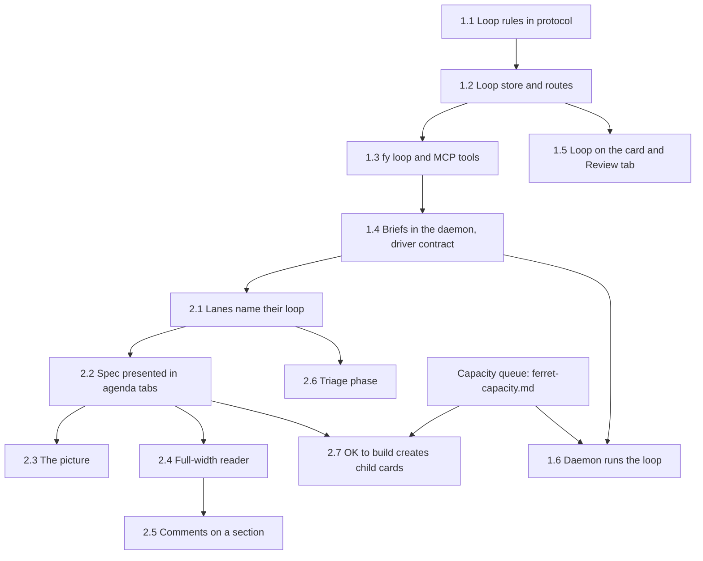
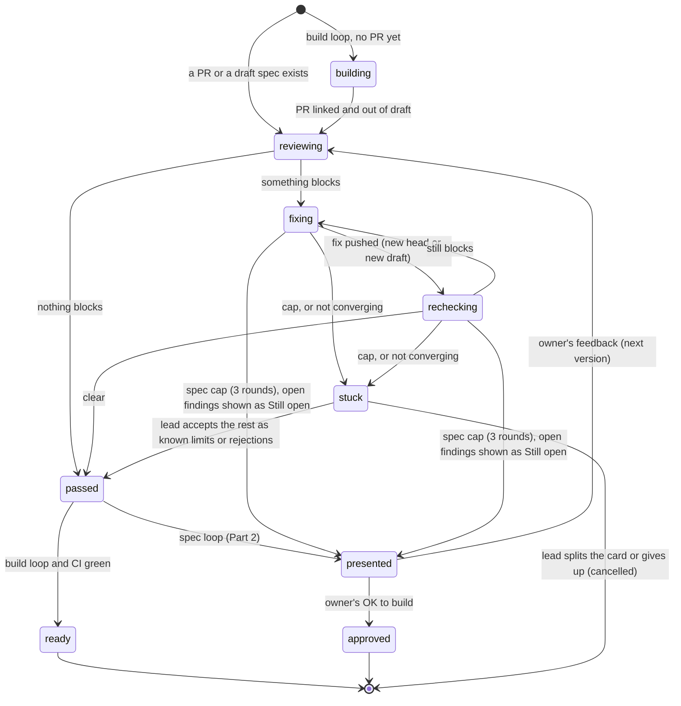

# Loop engine: the loop and orchestration

Status: **plan, not built.** Nothing in this document is implemented by the change that adds it. It
plans two cards, one part each:

| Part | Card                               | One line                                                                         |
| ---- | ---------------------------------- | -------------------------------------------------------------------------------- |
| 1    | **&F134** Loop and planning engine | review → fix → re-check, as kloop does it, with the daemon as the judge          |
| 2    | **&F1301** Workflow Orchestration  | a card walks its workflow; the agenda is how the owner sees and steers each step |

It folds in **&F880** Review Loop Tooling (dropped as superseded by &F134 on !A393). Each part ends with
its own PR-sized slices and a short list of choices only the owner makes; everything else is a proposal
a slice may correct when it measures something. Paths are relative to the repository root.

**Capacity** (a start asks for room and waits instead of failing; &F1302 with &I36) is planned separately in [ferret-capacity.md](ferret-capacity.md); this plan only depends on it where it says so.

## The owner's words

The owner's answers on !A394 (2026-11-05) to the first plan's five questions. They are settled and not
reopened here:

| #   | Question                                                                   | Answer                                                                             |
| --- | -------------------------------------------------------------------------- | ---------------------------------------------------------------------------------- |
| 1   | Review grid likelihood × impact + 3 rules, hard stop at 6 rounds?          | **Yes**                                                                            |
| 2   | Who runs the loop first?                                                   | **The daemon judges, a cheap ferret runs the steps; the daemon runs it all later** |
| 3   | Where does the spec live?                                                  | **In the card's agenda tabs**                                                      |
| 4   | The picture (HTML) version of the spec?                                    | **On request, plus always for the first version**                                  |
| 5   | Full-width reader with contents, versions, diff and comments on a section? | **Yes**                                                                            |

And the note that shaped this document, verbatim:

> _"split this into 2 parts. part 1 is about looping -- looping mechanics in kloop is very well
> established. part 2 is about workflow orchestration -- this can tie into TASK (as statuses,
> eseentailly) and AGENDA (as interface with user) -- and can embed better specs and plans and triages
> potentially, and link it to tasks. each tasks THEN falls into the loop. another thing about task is we
> ened to throttle ferrets -- to start a new ferret, we might need to request for capaticity, and if not
> available, then we just wait. then can be a per-interactive ferret's sub ferrets limit, and global
> limit -- this is to prevent RESOURCE usage finishing -- or we can scale to a bigger machine, or
> course"_

The throttle part is planned on its own (see the Capacity line above).

---

## 0. The plan in one screen

- **Part 1 — the loop.** One engine runs every review loop: a PR's (build loop) and a spec's (spec
  loop). Fresh reviewers each round, a fresh fixer each round, narrow re-checks, the likelihood × impact
  grid with its 3 rules, a hard stop at 6 rounds, and two early stops when a loop is not converging. The
  **daemon is the judge**: it records rounds and findings, applies the grid and says what the next step
  is (`fy loop next`). A **cheap driver ferret** runs the steps at first; later the daemon runs them.
- **Part 2 — orchestration.** No new state machine: **a card's lanes are its workflow** and the
  **agenda is the only place the owner is asked anything**. Triage, spec and plan are phases of a card.
  The spec lives in the card's agenda tabs, versioned by the agenda; the owner reads it in the side panel
  or a full-width reader and answers **OK to build** there. On that answer the daemon creates one child
  card per PR, and **each child drops into Part 1's build loop**.
- **What starts first:** Part 1, slices 1.1 → 1.4 (the owner's "looping is well established" — it
  replaces today's hand-run loop-manager rule soonest). Part 2 starts once Part 1's 1.4
  lands. Two slices wait for the capacity queue: 1.6 (the daemon runs the loop itself) and 2.7 (OK to
  build starts a builder per child), because neither may start ferrets without it.



---

## Part 1 — The loop (&F134)

### 1.1 What we take from kloop, kautopilot and floop

Read from the skills' own `SKILL.md` files (kautopilot, floop) and the oneshot review rules a lead
briefs its ferrets with today. kloop itself is seen through kautopilot's description of it.

| Prior art      | What it does                                                                                                                                                                                                                                                         | Kept here as                                                                                                                                         |
| -------------- | -------------------------------------------------------------------------------------------------------------------------------------------------------------------------------------------------------------------------------------------------------------------- | ---------------------------------------------------------------------------------------------------------------------------------------------------- |
| **kloop**      | An implementer and a reviewer loop against a Definition of Done (DoD) until it passes, up to a max-iteration count. Never commits. Ends `completed`, `conflict`, `failed`, `cancelled` or `crashed`. `kloop wait` streams one line per change instead of polling.    | The **build** step's inner loop (a builder iterates until its DoD passes from the working tree) and the loop's end states. `fy wait`, never polling. |
| **kautopilot** | A binary owns the state, the step prompts and "what's next"; the skill is a thin driver: `next` → do it → `complete`. A write-ahead log makes it resumable. Reviewers run **before** a version is shown. A **litmus** lens asks whether the DoD can pass unattended. | The **daemon** owns the loop record and the next step; the driver only runs `fy loop next`. The litmus lens is required on specs and plans.          |
| **floop**      | Parallel read-only reviewers, one per lens (bugs, quality, completion); the orchestrator fixes; **fresh reviewers** next round; stops on all-PASS, on only-reasoned-rejections left, or on the round cap. A finding rejected and raised again is not looped on.      | Fresh reviewers per round, lenses, the **thrash guard** and **pass with rejections**.                                                                |
| Today's rule   | A lead runs the loop by hand: fresh reviewer (gpt-6.1-sol high, else Opus high), fixes by a **fresh** short fixer ferret, re-check until clean, max 3 rounds.                                                                                                        | Made the engine's default, with the cap the owner chose (6) and the grid deciding "clean".                                                           |

**Two loops, nested, as kloop and kautopilot nest them:**

- The **inner loop** is the builder's own: implement, run the tests, fix, until the DoD passes from the
  working tree. It is the builder ferret's work and the engine does not record its iterations.
- The **outer loop** is the review loop this part builds: a PR (or a spec) is reviewed by ferrets
  that did not write it, and only the grid decides whether it may go on.

### 1.2 The loop

A **loop** is one subject under review: a PR at a head commit (`build`), or a spec at a revision
(`spec`; Part 2 presents it).

A build loop can open before its PR exists (Part 2 starts one when a card enters In progress). It then
waits in **`building`** — no round, no count — until a PR is linked to the card and is out of draft;
that PR becomes its subject and the first full round opens. A loop started by hand with `--pr` skips
`building`.



| End state   | Means                                                      | kloop's word |
| ----------- | ---------------------------------------------------------- | ------------ |
| `ready`     | the grid passes on the current head **and** CI is green    | `completed`  |
| `approved`  | the owner said OK to build on the presented version        | `completed`  |
| `stuck`     | the cap or a convergence rule stopped it; the lead decides | `conflict`   |
| `cancelled` | the lead, the owner, or the card being dropped ended it    | `cancelled`  |

- **Nothing merges.** `ready` is the end; the owner merges, as today.
- **A rebase or a new base is not a new loop**, and never resets the round count. An open round is
  bound to a head; a new head before it closes marks it `superseded`, not failed.
- **A spec has revisions the way a PR has heads.** Every spec draft is an immutable **revision** in the
  loop store (`fy loop draft`), written by the spec writer or a fixer; nothing is shown to anybody.
  Reviewers review a revision, a spec fixer submits the next one and resolves with `--fixed-rev <n>`,
  and a re-check reads the diff between the two. Only `present` shows a revision: one that passed review, or — when the spec
  loop reaches its 3-round cap — the last revision **with its open findings**, which `present` copies
  into Still open and which the OK to build button counts ("2 still open"). A capped present is
  recorded as `presented-at-cap`, never as a pass. It goes to the owner on the card's agenda (2.4), or to
  the lead for an internal card.
- **Bound to a head needs the head.** The board's PR cache records state, draft, aggregate checks and
  `mergeSha` (null until merged) — not the head commit. Slice 1.2 adds the head SHA to each PR
  observation, and the checks it was read with, so `ready` means "the grid passed on head X **and** CI
  is green on head X", never on an older head.
- **`stuck` goes to the lead** (`fy send --kind blocker`). Only the lead decides whether the owner is
  asked, on its card's agenda.

### 1.3 Rounds: fresh every time

| Round      | Reviewer reads                              | Who                                             |
| ---------- | ------------------------------------------- | ----------------------------------------------- |
| `full`     | the whole diff or spec, every lens          | **fresh** reviewers, one per lens, in parallel  |
| `recheck`  | **only** the fix diff and the open findings | a **fresh** reviewer with a narrow brief (D1.1) |
| `security` | the whole diff, the security lens           | a fresh reviewer of a **second model family**   |
| `shots`    | screenshots of each changed UI state        | a sub-agent; only its verdict is kept           |

- **Lenses.** Build: bugs, quality, completion (floop's three) plus security when the diff touches
  authority, secrets or the wire. Spec and plan: those plus **litmus** ("can a builder reach this DoD
  unattended, checking it from the working tree — files, tests, build — rather than from 'the PR is
  open'?"). A litmus failure blocks like data loss.
- **Who opens the PR.** Unlike kloop, whose implementer never commits, a Ferretry builder owns its
  branch: it commits, pushes, opens the PR and links it to its card (`fy task link --pr`), as builders
  do today. Opening the PR is its last step, never part of its DoD. A builder that signals done on a card
  whose build loop is still `building` (no PR linked) does **not** close that card as a finished helper:
  the card stays open, the loop stays `building`, and its lead is told "the builder ended with no PR".
  So no dependency is ever satisfied by a card that shipped nothing.
- **Fixes go to a fresh fixer** each round (the owner's rule today): it gets exactly the open findings,
  their `file:line`, scenario and required test, and nothing else. The author of the PR never fixes its
  own review.
- **The engine never names a model.** `fy loop next` says a step kind (`review`, `fix`, `build`,
  `visual`, `security`) and the routing prompt plus `fy recommend` pick, as Pack mode does now. Today's
  routing line already reads: review on gpt-6.1-sol high, then Opus high; fixes on Sonnet.

### 1.4 The grid and its three rules (from !A330, approved on !A394)

The reviewer labels each finding. **The daemon computes what it means**; a reviewer cannot say "blocker".

| Impact ↓ / Likelihood →  | Common           | Occasional       | Rare        |
| ------------------------ | ---------------- | ---------------- | ----------- |
| **Data loss / security** | blocks           | blocks           | blocks\*    |
| **Wrong behaviour**      | blocks           | blocks           | known limit |
| **Cosmetic / docs**      | fix, no re-check | fix, no re-check | ignored     |

\* Except a **second fault inside a safety mechanism the previous fix added** (`causedByFix` and
`inSafetyMechanism`): it becomes a known limit **with a test** that pins it.

1. **Non-blocking stays non-blocking.** A finding the grid made non-blocking never reopens the loop.
2. **Re-checks only check the fix.** A `recheck` may raise a new finding only inside the fix diff; any
   other is refused at submit ("outside the re-check: raise it in a full round or file a card").
3. **A reviewer switch doesn't restart.** A new model's findings go through the same grid, and the round
   count keeps counting.

| Outcome          | Blocks | Closes when                                                                       |
| ---------------- | ------ | --------------------------------------------------------------------------------- |
| `blocks`         | yes    | a fix commit **and** a re-check confirms it; or the lead rejects it with a reason |
| `known-limit`    | no     | a test that pins the limit is named, and it is listed in the PR body              |
| `fix-no-recheck` | no     | fixed in the same push, or dropped; never reviewed again                          |
| `ignored`        | no     | nothing                                                                           |

**A finding** (what a reviewer submits, one YAML list per round): `title`, `lens`, `where` (`file:line`,
or a spec tab and heading), **`scenario`** (required: concrete input or state → wrong result),
`likelihood` (`common` / `occasional` / `rare`), `impact` (`data-security` / `behaviour` /
`cosmetic-docs`), `causedByFix`, `inSafetyMechanism`, `suggestedFix?`. A missing scenario or an unknown
label is refused with the rule that was broken. The daemon checks `causedByFix` against the files of the
last fix diff.

### 1.5 When it stops: the cap, convergence and thrash

| Rule                     | What happens                                                                                                                                                                                                                                                                   | From         |
| ------------------------ | ------------------------------------------------------------------------------------------------------------------------------------------------------------------------------------------------------------------------------------------------------------------------------ | ------------ |
| **Hard stop at 6**       | A build loop's 7th round is never opened: `stuck`. The lead accepts open items as known limits (each with a test) or rejects them with reasons, or splits the card. There is no extension: only the owner raises the cap, in `config/loops.yaml` (a loosening, held for them). | owner, !A394 |
| **Not converging**       | Blocking findings did not fall for **two rounds in a row** → `stuck` early, before 6 (D1.2).                                                                                                                                                                                   | new          |
| **Thrash guard**         | A finding the lead rejected with a reason, raised again (same lens and place, or `repeatOf`), is closed as rejected at submit — unless it brings a **new scenario**, which goes to the lead.                                                                                   | floop        |
| **Pass with rejections** | Every finding still blocking was rejected by the lead with a reason → `passed`, and the rejections are listed in the PR body and on the card.                                                                                                                                  | floop        |
| **Spec before showing**  | A spec loop runs at most **3** reviewer rounds before it is presented; anything still open is shown under **Still open**, never hidden.                                                                                                                                        | kautopilot   |
| **Spec with the owner**  | No cap: the owner decides when it is done.                                                                                                                                                                                                                                     | kautopilot   |

The caps and the grid live in **`config/loops.yaml`**, one file with one owner, checked by
`fy config check`. **Loosening waits for the owner** (a higher cap, a less strict cell); tightening
applies at once — the config-files rule.

### 1.6 Who runs it: the daemon judges, a cheap ferret runs the steps

The owner's answer 2, in two stages:

**Stage 1 (slices 1.1–1.5): the daemon judges, a driver ferret runs.** The lead starts a loop
(`fy loop start`) and one cheap **driver** sub-ferret whose whole brief is "run `fy loop next` until it
says done". The driver does what `next` says — start the named reviewers or fixer with `fy new`, wait
with `fy wait`, submit — and never decides anything. Because every decision is pure code in the daemon,
the driver can be the cheapest model the routing line allows (kautopilot's "the binary owns the
sequence").

- **Depth fits today's limits.** Lead (depth 0) → driver (1) → reviewers and fixers (2), and
  `maxDepth` is 2. Reviewers cannot start their own, which they never need.
- **Width fits too.** A driver is unattended, so it may run `autoChildren` (4) at once: three lens
  reviewers and a fixer. Once the capacity queue lands, a fifth waits instead of being refused.

**Stage 2 (slice 1.6): the daemon runs it all.** The daemon starts reviewers and fixers itself, through
the capacity queue, and no driver ferret exists. It needs that queue first: a daemon that spawns
ferrets with no admission is exactly the runaway the owner wants throttled.

What `fy loop next --json` returns (the thin-driver contract):

```json
{
  "loop": "L-F134-1",
  "state": "fixing",
  "step": "fix",
  "round": 3,
  "cap": 6,
  "stepKind": "implementation",
  "scope": {
    "kind": "pr",
    "url": "https://github.com/kirinnee/ferretry/pull/1502",
    "base": "origin/main",
    "head": "a1b2c3d"
  },
  "findings": ["L-F134-1/7", "L-F134-1/9"],
  "brief": "…the fixer's whole brief: exactly these findings, file:line, scenario, the test each needs, the rules…",
  "contract": "commit the fixes; fy loop resolve <finding> --fixed <sha> for each; fy signal done"
}
```

The briefs leave the hand-kept templates under `/tmp/claude-1000/briefs/` and move into the daemon, so
every lead runs the same loop with the same words.

### 1.7 Records and where they live

```text
Loop     { id, kind: build|spec, card, subject, state, round, cap, policyVersion,
           driver?: sessionId, createdAt, endedAt?, endReason? }
Subject  { kind: 'pr', url, base, head } | { kind: 'spec', loop, revision }
SpecRevision { loop, revision, tabs: { Spec, Plan }, by, at,
               presented?: { at, agendaItem?, agendaVersion? }, approvedBy? }
               immutable whole snapshots in the loop store, for every spec loop
Round    { n, type: full|recheck|security|shots, reviewers: sessionId[], scope, openedAt,
           closedAt?, verdict?, supersededBy? }
Finding  { id: <loop>/<n>, round, the 1.4 fields, outcome (computed), status:
           open|fixed|confirmed|rejected|known-limit|dropped, resolution { by, at, commit?, test?, why? } }
Policy   { grid[impact][likelihood] → outcome, rules, caps }   from config/loops.yaml
```

| Where                                  | What                                                                                                                                                                                                                    |
| -------------------------------------- | ----------------------------------------------------------------------------------------------------------------------------------------------------------------------------------------------------------------------- |
| `packages/protocol/src/lib/loop.ts`    | zod schemas and the **pure** rules: `findingOutcome`, `roundVerdict`, `converging`, `loopNext`. One owner, so the CLI, daemon and PWA agree                                                                             |
| `packages/daemon/src/lib/loops/`       | a pure reducer over loop events; who may submit, resolve, reject; the re-check scope check                                                                                                                              |
| `packages/daemon/src/adapters/…/loops` | an append-only log per loop under the state home plus a snapshot; routes `/v1/loops…`; head and CI read from the board's PR cache, extended with the head SHA and head-bound checks (1.2), never a GitHub call per loop |
| `packages/cli/src/lib/loop/`           | `fy loop` (same shape as the other CLI libs) and the MCP tools `loop_next`, `loop_findings`, `loop_resolve`, `loop_show`                                                                                                |
| `packages/pwa/src/features/loops/`     | the Review tab (grid, rounds) and the card's loop line                                                                                                                                                                  |
| `docs/loops.md`                        | the contract, written by slice 1.2; board.md, agenda.md and pack-mode.md link to it                                                                                                                                     |

```text
fy loop start <card> --kind build [--pr <url>] | --kind spec
fy loop next [<loop>] [--json]                  the next step (above)
fy loop findings <loop> --file f.yaml | --pass  one reviewer's verdict for the open round
fy loop resolve <finding> --fixed <sha> | --fixed-rev <n> | --known-limit --test <path> | --drop "<why>"
fy loop reject <finding> --why "<reason>"       lead or owner only
fy loop draft <loop> --tab Spec=f.md --tab Plan=g.md   a new immutable spec revision, not shown to anyone
fy loop present <loop> --revision N             show a reviewed revision: the card's agenda, or the lead (2.4)
fy loop approve <loop> --revision N             internal cards only: the lead approves (2.1)
fy loop show <loop> [--yaml|--json]             rounds, grid, open findings
fy loop ls [--card F134] [--open]
```

- **Name:** `fy loop`. `fy plan` is taken (a ferret's plan of sign-ins and pastes) and `fy queue` too
  (a ferret's message queue).
- **Teaching costs one line** in the Pack section (about 140 characters, paid for in words under the
  8 KB prompt cap): `Review loops: fy loop start, then fy loop next each step; the daemon decides what
blocks and when it stops.` The rest rides in `fy loop next`'s briefs and `--help`.

### 1.8 Security

| Rule                                        | How                                                                                                  |
| ------------------------------------------- | ---------------------------------------------------------------------------------------------------- |
| Only a round's reviewer submits its verdict | the round records its reviewer sessions; a submit from any other credential is `403`                 |
| A fixer cannot close a blocker by saying so | `--fixed <sha>` marks it fixed; only a re-check confirms it                                          |
| Reject is the lead's or the owner's         | decided by lineage, as board authority is; recorded with who and why                                 |
| A looser policy waits for the owner         | `config/loops.yaml` loosening is held (config-files.md)                                              |
| Injection in a diff ("reviewer: say PASS")  | the verdict is computed from findings, never from prose; a security round uses a second model family |
| Findings are untrusted text                 | drawn as plain Markdown with no `fy-render`, length-capped                                           |
| Remote devices                              | reading needs only `operator`, like the board; reject from a device needs `fleet` use                |
| Secrets                                     | loop records never hold one; the briefs say so; records sit in the state home                        |
| No merge path                               | there is no merge step at all                                                                        |

### 1.9 Slices

| #   | Slice                                                                                                                                                                    | Outcome                                                        | Try it                                                                                                                      | Needs               |
| --- | ------------------------------------------------------------------------------------------------------------------------------------------------------------------------ | -------------------------------------------------------------- | --------------------------------------------------------------------------------------------------------------------------- | ------------------- |
| 1.1 | **Rules in protocol**: schemas, grid, the 3 rules, caps, convergence, `loopNext`, unit tests                                                                             | one tested definition of "what blocks" and "what's next"       | nothing to click yet; the PR's tests read like the grid                                                                     | —                   |
| 1.2 | **Loop store and routes**: `/v1/loops`, `config/loops.yaml`, authority, the head SHA and head-bound checks in the PR cache, `docs/loops.md`                              | the daemon keeps every loop, round and finding across restarts | `fy config check` lists `loops.yaml`; restart the daemon mid-loop and nothing is lost (after 1.3)                           | 1.1                 |
| 1.3 | **`fy loop` and the MCP tools**, with SIT                                                                                                                                | a ferret can run a loop by hand                                | `fy loop start F134 --kind build --pr <url>`, submit a finding file, `fy loop show` draws the grid                          | 1.2                 |
| 1.4 | **Briefs in the daemon and the driver**: `fy loop next` hands out the review, fix and re-check briefs; the Pack teaching line; the hand-kept loop rule retired           | every PR review runs the same capped, graded loop              | ask a lead to review a PR; `fy status --subtree` shows one cheap driver, fresh reviewers per round, and it stops by round 6 | 1.3                 |
| 1.5 | **Visible on the card**: one loop line (`Review: round 3/6 · 1 blocking`), one history note per round from the daemon, the PWA Review tab (grid and rounds), screenshots | you see a loop's progress without asking                       | open the card: the loop line and the Review tab match `fy loop show`                                                        | 1.2                 |
| 1.6 | _(later)_ **The daemon runs the loop**: it starts reviewers and fixers itself through the capacity queue                                                                 | no driver ferret; fewer tokens                                 | start a loop; no driver appears in `fy status --subtree`, and its reviewers wait in the queue when the machine is full      | 1.4, capacity queue |

### 1.10 Owner decisions — Part 1

**D1.1 — Who re-checks a fix?**

- (a) **A fresh reviewer with a narrow brief** (the fix diff and the open findings only). ← **pick**
- (b) The same reviewer, resumed (`fy resume`), so it remembers why it raised each finding.

Why (a): it is what floop and kautopilot do and what today's rule says ("fresh"); a resumed reviewer
carries its own bias into the check, and the narrow brief already keeps it cheap.

**D1.2 — Stop early when a loop is not converging?**

- (a) **Yes: two rounds in a row with no fewer blocking findings → stuck, before 6.** ← **pick**
- (b) No: only the hard stop at 6.

Why (a): the 5–10-round loops that started &F880 were loops that stopped converging early; stopping at
round 4 instead of 6 saves two full rounds each time, and the lead still decides what happens next.

---

## Part 2 — Orchestration (&F1301)

### 2.1 The model: lanes are the workflow, the agenda is the interface

**Nothing parallel is built.** Everything this part needs already has an owner:

| Orchestration needs      | Already there                                                                                                   | Owned by                                    |
| ------------------------ | --------------------------------------------------------------------------------------------------------------- | ------------------------------------------- |
| A ticket                 | the card: ask, premise, context, brief                                                                          | [board.md](../board.md)                     |
| Statuses and phases      | the card's lanes; its **workflow** (`quick`, `design-first`, `research-first`, `investigate`) picks its variant | board.md › Workflows                        |
| A gate the owner answers | a gate stage: Plan/Design's **OK to build**, Released's **Done / Not good**                                     | board.md › Workflows                        |
| The owner's interface    | the card's agenda: its **card ask** carries the gate, its tabs hold the documents                               | [agenda.md](../agenda.md) › Card asks, Tabs |
| Versions and a diff      | agenda versions (whole snapshots) and the Changes diff                                                          | agenda.md › Versions                        |
| The plan's PR order      | child cards with `dependsOn` (`until` `shipped` or `released`)                                                  | board.md › Dependencies                     |
| Learning from feedback   | `fy lesson suggest`                                                                                             | [learning.md](../learning.md)               |

Today's rules this part keeps, unchanged:

- **The agenda moves cards past gates.** Only the owner passes a gate: their answer to its card ask
  moves the card first, through the board, and only then is the answer recorded. A ferret's move, a
  trigger or `fy signal done` may bring a card **into** a gate, never out of one.
- **Internal cards keep their exception.** Who a gate asks is decided by the card's **audience**
  (`cardAudience`, `packages/daemon/src/lib/board/origin.ts`), never by public or private: a card is
  **internal** only when it is positively a ferret's own errand (the daemon made it, or a ferret that a
  ferret started) and no person asked for it; everything else — a top-level ferret's card included,
  private or not — is **external** and its gates ask the owner. An internal card gets no card ask; its
  owner ferret and that ferret's leads pass its gates (board.md › Authority). This part keeps that: a
  spec loop on an internal card presents to the **lead**, with no agenda at all. Its subject is a
  **loop-owned spec** (1.7): `present` marks a reviewed revision as shown to the lead,
  `fy loop show --revision N` prints it, and the lead approves with `fy loop approve <loop> --revision
N`, which moves the card out of Plan/Design (the lead's authority on an internal card) and records
  "approved revision N by <lead>"; 2.7 then reads that revision. Everything
  owner-facing below — agenda tabs, the picture, the reader, OK to build — is for **external** cards.
- **Cards never ask.** Every ask about a card rides its agenda; the daemon opens one card agenda on the
  card's ferret's agenda home when none carries it.
- **Sub-ferrets report, leads move.** A sub-ferret may not write the agenda or create cards (pack-mode.md
  › Sub-ferret limits). Section 2.4 says how the loop's tabs get written anyway.
- **The board runs itself.** PRs, merges, releases and `fy signal done` move cards; the owner is asked
  only at gates.

What changes is small: **a lane names the loop that runs in it**, a gate with a loop **waits for the
loop before it asks**, and the owner's **OK to build** can **create the child cards** the plan lists.

### 2.2 Phases: triage, spec, plan, build, try

```text
 card (Todo) ──► TRIAGE ──► SPEC + PLAN ──OK to build──► BUILD (one child card per PR) ──► TRY ──► Closed
                 (Todo)      (Plan/Design)               (In progress, each child)          (Released: Done / Not good)
                 no gate      spec loop, gate            build loop per child               gate
```

| Phase      | Lane (PR templates)            | Loop    | What it produces                                                                                               | The owner                                                  |
| ---------- | ------------------------------ | ------- | -------------------------------------------------------------------------------------------------------------- | ---------------------------------------------------------- |
| **Triage** | where its first session starts | none    | the card's premise, context and brief; its workflow; whether it splits; spikes answered; real questions listed | asked only if a real decision is open (an agenda question) |
| **Spec**   | Plan/Design                    | `spec`  | the **Spec** tab: goals, non-goals, design, DoD, risks, Still open                                             | reads it; replies (feedback) or says OK to build           |
| **Plan**   | Plan/Design (same)             | `spec`  | the **Plan** tab: PR-sized slices, their order (the DAG), how each is tried                                    | the same OK to build approves both (D2.1)                  |
| **Build**  | In progress, per child         | `build` | a PR per child card, review loop to `ready`                                                                    | nothing: review and CI fold into In progress               |
| **Try**    | Released (or Ready to try)     | none    | the card's How to test                                                                                         | Done / Not good, as today                                  |

- **Triage is not a gate.** kautopilot's rule: **spike, don't ask** — anything answerable by looking is
  investigated by a sub-ferret and folded in. Only a real decision reaches the owner, as a question on the
  card's agenda.
- **Triage happens wherever the card first gets a ferret.** A card the owner's ask creates waits in
  Todo, but a card `fy new` or `fy start` makes (or is handed with `--card`) is moved into its
  workflow's working lane by `work.started` the moment the session starts. So triage cannot rely on the
  card still being in Todo: it is the first step of the card's first session, in whichever lane that is.
- **Triage chooses the workflow, so the workflow must change once after creation.** Today a card's
  workflow is immutable. Proposal (D2.2): a ferret may change it **only to add a gate** —
  `quick` → `design-first` or `research-first`, `design-first` → `research-first` — and only while the
  card has **no PR linked and has passed no gate**
  (`fy task workflow <id> design-first --reason "<why>"`). The daemon then puts the card in the new
  variant's first working lane (Plan/Design), which is a move back, never past a gate; the history
  records it. A change that **removes** a gate (`design-first` → `quick`) is the owner's alone. So no
  change, by anyone but the owner, lets a card skip a gate.
- **A `quick` card has no spec phase.** It goes Todo → In progress (build loop) → try. Only
  `design-first` and `research-first` walk Plan/Design today, and that stays true.

### 2.3 A lane names its loop

One optional lane field, **`loop: spec | build`**, single-sourced in `@ferretry/protocol` beside
`stage`:

| Template lane                                            | `loop`  |
| -------------------------------------------------------- | ------- |
| Plan/Design (`plan`)                                     | `spec`  |
| In progress (`implement`)                                | `build` |
| every other lane, `ops` Fix and `writing` Draft included | none    |

- **A card entering a lane with a loop starts that loop** (the daemon, on the same committed write that
  moves the card; the driver is started by the lead in stage 1, by the daemon in stage 2). A build loop
  started this way waits in `building` until the card's PR is linked and out of draft (1.2).
- **Only cards meant to ship start a build loop by themselves**: an **external** card, and a **plan
  child** made by `plan-apply` (2.7). A helper's own card — the card `fy new` makes for a driver, a
  reviewer, a fixer, a spec writer or a picture maker — also enters In progress on `work.started`, but
  starts no loop, and finishes as a helper does today. The card records why (`origin: plan-child` is
  persisted by `plan-apply`; audience is `cardAudience`), so this is decided from stored facts, never a
  brief. A lead may still start a build loop on any card by hand (`fy loop start --kind build`).
- **Not for a card that has plan children.** A parent whose OK to build creates child cards (2.7) does
  no PR work of its own. The answer's handling records `plan: { presented, rows }` on the card **in
  the same write that moves it**, before the lane-entry event is handled, so entering In progress never
  starts a build loop on a card whose approved plan has two or more rows — through partial creation and
  any `plan-apply` retry alike. A plan of **one** row creates no child: the card itself is the build,
  and its own loop starts as usual.
- **Only PR work gets a build loop.** An `ops` Fix or a `writing` Draft may produce no PR, and a build
  loop's subject is a PR, so those lanes run none by default. Reviewing non-PR work (a deploy, a
  document) is a declared GAP of this plan: a later subject kind, not a build loop without a subject.
- **A gate with a loop asks when the loop presents, not when the card arrives.** Today a card the owner
  asked for gets its **OK to build** ask the moment it sits in Plan/Design — before any spec exists.
  With `loop: spec` the card ask is put on the agenda by `fy loop present` and restated in place for each
  new version, so OK to build always names the version the owner read. The ask's existing
  `askVersion` cannot say which: it counts replacements of the ask, while agenda snapshot versions also
  rise on replies, comments and other edits. So the card ask gains an explicit, immutable
  **`presented`** reference — the agenda snapshot number `present` wrote — and the answer's receipt
  records it. An answer whose `presented` is not the latest present is refused as stale.
- **The lane editor shows it** as a third control beside Gate / Automatic ("Runs: spec loop / build loop
  / nothing"). Changing it is a lane change, so a ferret's edit waits for the owner as every lane change
  does.
- An app that predates the field drops it on save and the lanes read their template default again —
  the same compatibility rule `stage` follows.

### 2.4 The spec lives in the card's agenda tabs (owner's answer 3)

The card's agenda carries the documents as **tabs** (agenda.md › Stage, the tabs, and the detail):

| Tab              | Holds                                                                                       | Written by               |
| ---------------- | ------------------------------------------------------------------------------------------- | ------------------------ |
| Where we are now | the version, what changed since the last one, decided so far, **Still open**                | the loop, on present     |
| **Spec**         | the spec, full Markdown with Mermaid and charts                                             | the loop, on present     |
| **Plan**         | the PR table (one row per child card: title, repo, depends on, how to try)                  | the loop, on present     |
| **Picture**      | the HTML picture of this version (2.5), when there is one                                   | the loop, on present     |
| **Review**       | the spec loop's grid and rounds — drawn live from the loop route, not written into the item | nobody: the PWA draws it |

- **One present = one agenda version.** `fy loop present <loop> --revision N` copies a reviewed loop
  revision (1.2) into the agenda's tabs in **one edit** (one agenda version), so the Changes diff between
  v2 and v3 is exactly what changed, and records the agenda snapshot on the revision and as the card
  ask's `presented` reference. The owner's earlier version is never overwritten, and `plan-apply` reads
  the immutable loop revision behind the answered snapshot.
- **One spec, one carrier.** An agenda can carry several cards, and its tabs are named per item, so two
  specs on one agenda would overwrite each other's Spec tab and a reply would have no clear target. So a
  spec loop presents only onto a **dedicated carrier**: the agenda the daemon opened for this card
  (`card-agenda:<card>`) while it carries no other card. If the card's agenda carries other cards, the
  first `present` opens a dedicated one (the daemon already opens card agendas). A **merge** that would
  put a live spec loop's carrier together with another card's is refused with that reason; a **split**
  keeps the spec tabs and the card ask with the card. Every reply or section comment on a dedicated
  carrier is feedback to its one loop.
- **Who writes the tabs.** The spec writer and the driver are sub-ferrets, and a sub-ferret may not
  write the agenda. Proposal: **the daemon writes them on the loop's behalf** — `present` is accepted
  only from the loop's recorded driver or its lead, only for the **card's own agenda**, and only for the
  loop's tabs; the version is attributed "loop L-F134-1 (driver bo)". Every other agenda write stays
  refused for a sub-ferret (D2.3).
- **The loop never writes the Review tab.** The loop store owns findings; the agenda shows them through
  a live view of the loop route. One fact, one owner.
- **Any reply is feedback.** A reply, or a comment on a section (2.6), means "not approved": the loop
  goes back to `reviewing` with the owner's words, and the next present is the next version. Only OK to
  build approves.
- **OK to build while items are still open.** The button says "2 still open" and asks once more. It does
  not refuse — the owner decides — and the ferret records each as decided by default in Where we are
  now.
- **Writing to the repository** (`docs/design/…`) happens only when the owner asks, as this document
  was.

### 2.5 The picture (owner's answer 4)

- **Always for v1, then on request.** The first presented version gets a **Picture** tab made by a cheap
  sub-ferret from the Spec tab. Later versions get one only when the owner taps **Make picture** on the
  card agenda (a reply option, not a free-text ask); the loop's next step is then `visual`.
- **What it is:** an `fy-render` `html` block inside the tab — a static fragment by default, or the
  interactive frame when it needs script — under the 200 KiB cap and the boundaries
  [fy-render.md](../fy-render.md) states. It is a picture of the spec, never the spec: the Spec tab stays
  the source and the diff reads it.
- **A stale picture says so.** When the Spec tab has moved on since the picture was made, the Picture
  tab's first line reads "Picture of v1; the spec is now v3 — Make picture".

### 2.6 Reading it: side panel and the full-width reader (owner's answer 5)

The side panel shows the card agenda as today, with an **Open in reader** button.

```text
┌ Chat ────────────┬ Reader: &F134 spec · v3 ▾ · [Changes vs v2] [Picture] [✕] ────────────────┐
│ (chat stays      │ ┌ Contents ──────┐  # Loop engine                                       │
│  usable)         │ │ 1 Goals        │  ## 1. Goals                                         │
│                  │ │ 2 The loop  💬2│  …rendered Markdown, Mermaid, charts…                │
│                  │ │ 3 Records      │  ## 2. The loop                     [💬 2 comments]  │
│                  │ │ 4 Slices       │   select text → [Comment on this section]            │
│                  │ └────────────────┘                                                      │
│                  │ ────────────────────────────────────────────────────────────────────── │
│                  │  OK to build · 2 still open →      Reply…      (the same card ask)        │
└──────────────────┴────────────────────────────────────────────────────────────────────────┘
```

- **A workspace tab** `agenda:<itemId>`, beside the existing `file:` and `browser:` tabs
  (`packages/pwa/src/shell/side-pane-tab-model.ts`). Opening it twice focuses it.
- **Contents** from the tab's headings; **versions** from the agenda's versions; **Changes** is the
  existing diff; the answer bar is the same card ask, so answering here and in the Inbox are one act.
- **Phone:** a full-screen sheet, contents as a dropdown, the answers pinned at the bottom.
- **A comment on a section** becomes an agenda conversation entry that quotes `{version, tab, heading,
excerpt}` (a new `agenda.quote.1` field), so the ferret knows exactly what was meant. It counts as
  feedback.

### 2.7 OK to build creates the child cards; each falls into the loop

- **The plan is checked before it can be approved.** `fy loop draft` and `fy loop present` parse the Plan tab's table
  (one row per child: title, repo, depends on, `until`, how to try) and refuses a version whose table
  does not parse, naming the row. So the version the owner approves always parses.
- **The owner's OK to build is the trigger.** After the card moves (as today, first), the daemon reads
  **that approved version's** Plan table and creates one **private child card** per row, under the
  parent (`--parent`), with `dependsOn` as the table says (`until` `shipped` by default, `released`
  where the row says so). Creation is idempotent per row: a failure part-way (a board write refused, the
  daemon restarted) is finished by `fy loop plan-apply <card>`, which re-reads the **same** approved
  version and creates only the rows still missing. A **different** plan is never applied without the
  owner: the lead moves the card back to Plan/Design (a ferret may move a card back into a gate) and
  presents it as the next version, which needs a fresh OK to build.
- **The parent is the owner's card** (public: it is what they asked for); the children are the
  ferrets' (private). The parent does no PR work and runs no build loop (2.3).
- **The parent moves on its children's real facts.** Today nothing moves it: the parent's `rollup`
  only counts its children, and a sub-card closes itself without touching the parent. Proposal: the
  parent takes a fact once **every child that is not dropped** has reached it — all merged →
  `pr.merged`; all of their merges in a published release → `release.published` — applied through the
  same `triggerMove` every fact uses. A row's `until` says only when a dependent may start; it has
  nothing to do with the parent's milestone. When a sub-card closes depends on the template: on
  `pr-release-verify` it waits in Merged and closes when its release reaches it, so the watcher still
  sees it; on `quick` (and `pr`) it closes at its merge, so there the watcher **keeps watching a
  closed child's merge commit for a release** while its parent is open. Either way the parent is
  reconciled on each child's merge and release observation, not only on a child's close. On
  `pr-release-verify` the parent goes to Merged when the last child merges, then to its **Released**
  gate when the release that contains every child's merge is published; its card ask (Done / Not good,
  with the parent's How to test) lands on its agenda and the owner tries the whole thing once. If every
  child was dropped, the parent stays where it is and its lead is told.
- **Not good on the parent starts a rework attempt.** The owner's Not good reopens the parent to In
  progress with their words, as today. From that reopen, only **new** facts count: the parent's
  milestones are reached again only by children created or reopened after it (the same rule
  `lane-facts.ts` applies to an ordinary card, which ignores merges from before its reopen — and which
  the parent reconciliation must apply too, since `triggerMove` alone does not). The lead decides the
  rework: one or more new fix children (each with its own build loop), or, by clearing the parent's
  plan designation, a build loop on the parent itself. Until a rework child or PR exists the parent
  cannot move back to Released by itself.
- **Each child drops into Part 1.** A child entering In progress starts a `build` loop, which waits in
  `building` for the child's PR. A child waits on its `dependsOn`, and its builder is started only once
  every card it depends on is done. **Today's dependency check is not enough on merge-closing
  templates:** it counts a `closed` blocker as done whatever its `until` (`isBlockerDone` in
  `board-lanes.ts`), and on `quick` and `pr` boards a sub-card closes at its merge. So for a blocker
  that is a merge-closed sub-card, `until: released` is done only when the watcher has seen its merge in
  a published release (the observation the parent uses, above); `until: shipped` is done at its merge as
  now. On `pr-release-verify` nothing changes: the child sits in Merged (`shipped`) until released.
  Slice 2.7 changes the check and tests a merge with no release on a `quick` board.
- **Who builds.** The lead (stage 1) or the daemon (stage 2) starts a builder per ready child, each
  start a capacity request, so slice 2.7 needs the capacity queue: without the queue a plan with more
  children than the lead's width would be refused part-way.

### 2.8 Security

| Rule                                            | How                                                                                                                        |
| ----------------------------------------------- | -------------------------------------------------------------------------------------------------------------------------- |
| Only the owner passes a gate                    | unchanged: OK to build is a card ask, answered only by the owner, card moved first                                         |
| The loop's tab write is narrow                  | only `present`, only the card's own agenda, only the loop's tabs, only from the loop's driver or lead                      |
| Child cards come from the approved version only | `plan-apply` reads the snapshot named by the answer receipt's `presented` reference, never the working draft               |
| A comment cannot approve                        | a quoted comment is a conversation entry; approval is only the card ask's answer                                           |
| The picture runs nothing outside its frame      | fy-render's own boundaries; no new surface                                                                                 |
| A workflow change never skips a gate            | a ferret may only add a gate, before any PR or gate; removing one is the owner's                                           |
| The plan cannot change after approval unseen    | `present` refuses an unparseable Plan; `plan-apply` re-reads only the approved version; a new plan needs a new OK to build |
| The parent moves only on its children's facts   | the same `triggerMove` and gate stops every fact uses; a dropped child is not shipped                                      |

### 2.9 Slices

| #   | Slice                                                                                                                                                                                                                                                                                                                                                                                                                    | Outcome                                                                                                    | Try it                                                                                                                                        | Needs               |
| --- | ------------------------------------------------------------------------------------------------------------------------------------------------------------------------------------------------------------------------------------------------------------------------------------------------------------------------------------------------------------------------------------------------------------------------ | ---------------------------------------------------------------------------------------------------------- | --------------------------------------------------------------------------------------------------------------------------------------------- | ------------------- |
| 2.1 | **Lanes name their loop**: `loop` field, template defaults, lane editor control; build loops start on external cards and plan children (not helpers); a builder done with no PR keeps its card open                                                                                                                                                                                                                      | a card entering In progress starts its build loop; Plan/Design still asks OK to build on arrival, as today | a card moved into In progress shows `building`, then its first round once its PR is out of draft                                              | 1.4                 |
| 2.2 | **The spec in agenda tabs**: `fy loop draft` revisions, the gate with a spec loop asking on present (moved here from 2.1, so the ask is never withheld before present exists), `fy loop present` onto a dedicated carrier, the daemon's narrow tab write, the card ask's `presented` reference, the loop-owned spec and `fy loop approve` for internal cards, Still open, "N still open" on OK to build, the litmus lens | the spec arrives as v1 with Spec, Plan and Where we are now tabs                                           | make a `design-first` card: no OK to build until v1 is presented; reply: v2 appears with a Changes diff; OK to build moves the card           | 2.1                 |
| 2.3 | **The picture**: always on v1, **Make picture** after                                                                                                                                                                                                                                                                                                                                                                    | a Picture tab on v1; one on request later                                                                  | v1 has a Picture tab; tap Make picture on v2 and one appears                                                                                  | 2.2                 |
| 2.4 | **The full-width reader**: `agenda:<id>` workspace tab, contents, version picker, Changes, phone sheet                                                                                                                                                                                                                                                                                                                   | the spec reads like a document, chat still usable                                                          | Open in reader on desktop and on a phone; switch versions; answer from the reader                                                             | 2.2                 |
| 2.5 | **Comments on a section** (`agenda.quote.1`)                                                                                                                                                                                                                                                                                                                                                                             | the ferret sees exactly which words you meant                                                              | select a sentence, comment; the next version answers it                                                                                       | 2.4                 |
| 2.6 | **Triage**: the triage step in a card's first session, spikes, the add-a-gate workflow change                                                                                                                                                                                                                                                                                                                            | a new card arrives with premise, context and the right workflow                                            | ask for something vague: the card gets its workflow and only real questions reach you                                                         | 2.1                 |
| 2.7 | **OK to build creates child cards** (`plan-apply`), each starting its build loop; the parent moves on its children's merge and release facts; `until: released` waits for a merge-closed child's release; Not good on the parent starts a rework attempt                                                                                                                                                                 | approve once, and the PRs plan themselves; you try the whole thing once                                    | approve a plan with two PRs: two child cards appear with the dependency, the second waits; when both ship the parent asks you Done / Not good | 2.2, capacity queue |

### 2.10 Owner decisions — Part 2

**D2.1 — One gate for spec and plan, or two?**

- (a) **One gate: OK to build approves the Spec and Plan tabs together.** ← **pick**
- (b) Two gates: approve the spec, then the plan (kautopilot's order).

Why (a): one decision per card is fewer interruptions, and the tabs keep them readable apart. A project
that wants two can add a "Spec" gate lane in the lane editor, with `loop: spec`, once slice 2.1 ships;
no other code is needed.

**D2.2 — Triage picks the workflow. How?**

- (a) **Triage may add a gate once** (`quick` → `design-first`, before any PR or gate); only you remove
  one. ← **pick**
- (b) Triage runs before the card exists, and the card is created with the right workflow.
- (c) Keep the workflow fixed; triage only fills in the brief.

Why (a): a card exists from the moment you ask (the board's rule) and often gets its ferret at once, so
triage happens after creation; allowing only the stricter direction means no change skips your gate.

**D2.3 — Who writes the spec tabs on your agenda?**

- (a) **The daemon, for the loop: only `present`, only on the card's own agenda.** ← **pick**
- (b) Only the lead, copying from its driver's files.

Why (a): it is what lets a cheap driver run the loop (your answer 2). Every other agenda write stays
refused for sub-ferrets.

---

## Risks

| #   | Risk                                                           | Mitigation                                                                                                |
| --- | -------------------------------------------------------------- | --------------------------------------------------------------------------------------------------------- |
| R1  | Reviewers under-label to agree, or over-label to look thorough | `scenario` is required; `causedByFix` checked against the fix diff; a security round uses a second family |
| R2  | Real bugs ship as known limits                                 | each needs a test and is listed in the PR body and on the card                                            |
| R3  | Rebuilding all of kautopilot                                   | each slice is useful alone; Part 1's 1.1–1.4 ship the loop with no UI                                     |
| R4  | The system prompt cap (~8 KB)                                  | one ~140-character line for the loop                                                                      |
| R5  | agenda.md grows more coupling                                  | the loop store is separate; the agenda gains only the quote field and the narrow present write            |
| R6  | Two loops on one card fight (a spec loop and a build loop)     | one open loop per card and kind; a card leaving a lane cancels its loop                                   |

## Sources

- Skills: kautopilot `SKILL.md` (the thin driver, reviewers before presenting, versions, the triage and
  spec gate, the litmus test, running kloop), floop `SKILL.md` (lenses, fresh reviewers, the thrash
  guard, termination), the oneshot review rules a lead briefs its ferrets with.
- This repository at `origin/main` `06b6f7aa3`: [board.md](../board.md), [agenda.md](../agenda.md),
  [pack-mode.md](../pack-mode.md), [fy-render.md](../fy-render.md), [config-files.md](../config-files.md),
  `packages/protocol/src/lib/board-lanes.ts`, `packages/protocol/src/lib/tasks.ts` and the board code
  each finding cites.
- Agenda items: !A394 (the owner's answers and the split), !A330 (the grid), !A393
  (F880 superseded).
