# Ferretry redesign — one language, a small core, plugins for everything else, clean slate

**Status: PROPOSED (design only). Changes no production code.**
**Measured on `origin/main` @ `557a6d3dd` (release 4.291.5), 2026-11-06.**
**Supersedes, once agreed:** [daemon-plugins.md](daemon-plugins.md) §3–§10 (its measurements stay valid history).
**Owner-facing summary:** [redesign-owner/](redesign-owner/) (six short pages for agenda tabs).

The owner asked (2026-11-06, verbatim):

> we dont need no more converts -- please just start everything from fresh -- i want clean slate
> can the bounded context, modules and UL for this project be defined? so we speak the same language, with non-load
> bearing words? and we can split the project into boiunded contexts, that are isolated? and design a plugin system?
> so that we can easily modify the daemon without edit the main file?

and decided on the clean slate (A452): one carry-over prompt outside the product; sign-ins, secrets and paired phones
are re-done by hand; the point is a compressed codebase without backward compatibility (§9.1). Two owner rounds and
six reviews shaped this version (Appendix A).

## 0. The answer in twelve lines

(Version 4, after review r6, 2026-11-06. One consistent version: Appendix A says where each earlier finding and owner
ask now lives; Appendix I resolves review r6.)

1. **A small core of five pieces** (§2.2): Kernel, Gate, Vault, Ferrets (identity only), Asks. Each stays core only
   because a missing, broken or switched-off plugin in its place would open a named security hole.
2. **Everything else is a plugin** (§2.3), 26 in all: Access, Connections, Updates, Terminals, Browsers, Claude
   Code, Codex, Logins, Runtimes, Accounts, Conversation, Agenda, Projects, Board, Packs, Warden, Usage, Lessons,
   Voice, Catalogs, MCP, Skills, Shells, Layouts, Onboarding, Tidy. They are on by default and you can turn any off.
3. **One precise plugin spec** (§3): a package with one manifest, in two forms. **Code plugins** (ours, compiled in)
   have daemon, app and CLI halves. **Data plugins** (YAML and markdown, no code) can be written and shared by anyone.
   No feature ever needs a core edit.
4. **Fourteen plugin kinds** (§4) say what a plugin can add: commands, instructions, harnesses (Claude Code and
   Codex are the two main ones), logins, runtimes, runners, tools (terminal, browser; computer and app use
   designed), carriers, items (MCP servers, skills, shells, recipes, layouts, themes), views, layouts, onboarding
   steps, session modes and hooks.
5. **The whole app layout is data** (§5): `fy layout set sidebar right` or `fy layout use compact` changes it,
   on one device or all of them.
6. **Onboarding with almost no keys** (§6.1): zero keys if a harness is already signed in on the machine, one QR
   scan and one passkey tap to pair a phone; everything else is asked the first time it is needed.
7. **Importing a conversation is a link** (§6.2): instant, read on demand; the costs of a link are spelled out.
8. **Words** (§1): one meaning per word; each subsystem's words sit under it; ferrets correct a wrong word gently,
   once. **progress** is one card's now/done/next; **sitrep** is a ferret's whole status.
9. **Today's security machinery is kept** (§7): the route descriptor and `RouteContext` field for field, a core
   contract through which Access and Catalogs answer for the credentials they issue, masking before anything is
   matched or stored, one synchronous final check per response and frame, and holds whose evidence no reset can drop.
10. **Every guarantee** of the five security contracts is listed in Appendix D with its owner, its real enforcer and
    the test named after it: 1,158 kept, 26 split (the older-peer part removed), 31 removed (compatibility only).
11. **Clean slate** (§9): zero compatibility, one carry-over prompt.
12. **About one week** (§10): day 1 the spine and a skeleton of every plugin, days 2–4 about 31 ferrets port in
    parallel, day 5 integrate, day 6 you try it and 5.0.0 ships, day 7 buffer. If it slips, leaf plugins leave the
    release scope, smallest first.

## 1. Ubiquitous language

### 1.1 The rules

1. **One word, one meaning, everywhere**: app, `fy`, docs, code, routes, logs, and what ferrets say.
2. **Single words win.** Two words only where no single word is clear (`sign-in`, `take over`).
3. **Every word has one owner.** A subsystem's own words are listed under it (§2.2, §2.3) with what they replace.
   Only the cross-cutting words below are shared. The `words` check (§7.9) refuses a word owned twice.
4. **No synonyms.** A word in an "instead of" column is never used for that idea again; the `glossary` check
   refuses it in owner-facing text.
5. **Code follows the words** in each port (§10). A new word enters only through a manifest's `words`.
6. **Ferrets correct the user** (§1.3).

"Subsystem" is the owner word for a DDD bounded context. A subsystem is either a **core** piece or a **plugin**.

### 1.2 Shared words

| Word               | Means                                                            | Instead of                   |
| ------------------ | ---------------------------------------------------------------- | ---------------------------- |
| **machine**        | one computer                                                     | box, host, server            |
| **daemon**         | Ferretry running for one user on a machine, with its own home    | machine (for this), server   |
| **user**           | a person using a daemon                                          | —                            |
| **owner**          | the user a daemon belongs to                                     | operator                     |
| **developer**      | someone who builds Ferretry or a plugin                          | —                            |
| **app**            | the Ferretry web app on a phone or computer                      | PWA                          |
| **fy**             | the command line                                                 | —                            |
| **ferret**         | one AI agent at work                                             | session, agent, teammate     |
| **parent / child** | who started whom, at any depth                                   | spawner                      |
| **lead**           | a ferret with no parent: the top of a pack                       | —                            |
| **helper**         | any ferret in a pack that is not its lead                        | sub-ferret, worker           |
| **pack**           | a lead and every ferret below it                                 | subtree, fleet               |
| **core**           | the five pieces every daemon has and cannot turn off             | —                            |
| **plugin**         | everything else: a package with one manifest that adds a feature | module, extension            |
| **kind**           | a kind of thing a plugin can add (a harness, a tool, a layout …) | extension point (owner text) |
| **hook**           | a named point where plugins plug in                              | —                            |

- **machine ≠ daemon.** A machine can run several daemons, one per user, each with its own home. Per-daemon facts
  (devices, secrets, ferrets) belong to one daemon; per-machine facts (the installed binary, the loopback firewall
  rule) need the machine's administrator, and plugins say so instead of acting.
- **progress ≠ sitrep** (owner, A452): **progress** is one card's now, done and next, written by its ferret
  (Board's word). **sitrep** is a ferret's whole status: what it is doing across its cards, its turn state and its
  blockers (Ferrets' word). Plugins add lines to a sitrep through the `sitrep.lines` hook (§3.5); the Board adds
  one line per card, from that card's progress.
- **parent/child ≠ lead.** Parent/child is the relation at any depth; a lead has no parent; "sub-ferret" is retired.

### 1.3 Ferrets correct wrong words

- Every manifest carries its `words` (term, meaning, the words it replaces). After build, the kernel joins them
  into one glossary in the post-build snapshot and serves it at `GET /v1/glossary` (`minimum: 'authenticated'`,
  `caller: 'any'`, `guard: { none: 'public vocabulary' }`).
- The launch prompt carries the rule and the compact glossary (from the same snapshot, §7.4). When the user uses
  a replaced word, the ferret answers and adds one line, **once per word per conversation**: "You said _status_; in
  Ferretry that's the ferret's **sitrep**." It never refuses or lectures, and never corrects quotes, code or names.
- The app shows the same hint once per word per device, as a dismissible line under the composer.
- `fy words [word]` prints a word, its owner and what it replaced. A data plugin's words join the glossary too.

### 1.4 The commands follow the words

No aliases (Q11). Every verb below comes from a plugin's manifest; the `fy` shell owns only `fy plugin`,
`fy words`, `fy doctor`, `fy daemon` and `fy ask`.

| Today                          | After                                                                                                                                                                                     |
| ------------------------------ | ----------------------------------------------------------------------------------------------------------------------------------------------------------------------------------------- |
| `fy task …`                    | `fy card …` (`fy card progress` writes a card's progress)                                                                                                                                 |
| (new)                          | `fy sitrep [ferret]`                                                                                                                                                                      |
| `fy credential(s)`, `fy login` | `fy login …` (Logins)                                                                                                                                                                     |
| `fy account …`                 | `fy account …` (Accounts)                                                                                                                                                                 |
| `fy harness …`                 | `fy harness …` (one per harness plugin: `fy harness claude-code update`)                                                                                                                  |
| `fy learning …`, `fy lesson …` | `fy lesson …`                                                                                                                                                                             |
| `fy status --subtree`          | `fy pack`                                                                                                                                                                                 |
| `fy migrate`                   | `fy ferret move`                                                                                                                                                                          |
| `fy notify … --ping`           | `fy notify … --buzz`                                                                                                                                                                      |
| `fy import conversations`      | `fy link …` (§6.2)                                                                                                                                                                        |
| `fy component …`               | one verb per item kind: `fy mcp …`, `fy skill …`, `fy shell …`, `fy instruction …`, `fy profile …`, `fy runtime …`, `fy model-set …`, `fy harness claude-code settings …` and `… hooks …` |
| (new)                          | `fy plugin …`, `fy layout …`, `fy theme …`, `fy words`                                                                                                                                    |
| HTTP `/v1/sessions/…`          | `/v1/ferrets/…`                                                                                                                                                                           |

### 1.5 Developer words (never in owner text)

| Word                              | Means                                                                                                                                                                                                                                           |
| --------------------------------- | ----------------------------------------------------------------------------------------------------------------------------------------------------------------------------------------------------------------------------------------------- |
| **context**                       | a bounded context; the developer word for a subsystem                                                                                                                                                                                           |
| **contract**                      | a subsystem's public half: wire schemas, port, events, hook types, ids, fakes                                                                                                                                                                   |
| **manifest**                      | a plugin's one declaration (§3.3)                                                                                                                                                                                                               |
| **code plugin** / **data plugin** | a plugin with TypeScript halves (ours, compiled in) / a plugin made only of YAML, markdown and assets, which runs no code (§3.1)                                                                                                                |
| **half**                          | a code plugin's daemon, app or CLI implementation of its manifest                                                                                                                                                                               |
| **skeleton**                      | the day-1 halves of every plugin: they compile, declare everything, and answer `unavailable` (§10.3)                                                                                                                                            |
| **slot**                          | a named place in the app where a plugin may put UI (§5.2)                                                                                                                                                                                       |
| **port**                          | a typed interface a subsystem offers, with its token                                                                                                                                                                                            |
| **event**                         | a wake-up a subsystem publishes after its write landed (§7.4)                                                                                                                                                                                   |
| **kernel**                        | the core host: boot, dispatch, plugin loader, hooks, store, config, jobs, the local listener and the session layer                                                                                                                              |
| **session layer**                 | the kernel's end-to-end sealed session protocol; carriers move its frames and session modes answer its pre-auth exchanges (§4.13)                                                                                                               |
| **session mode**                  | a pre-auth exchange on the session layer (`device`, `pair`, `member`), provided by one plugin per mode (§4.13)                                                                                                                                  |
| **credential provider**           | a plugin that answers, through the Gate's `credentials` hook, for the credentials it issued: Access (`device`), Catalogs (`member`) (§7.1)                                                                                                      |
| **release scope**                 | the packages `release.json` builds into a release; a plugin cut from it is not compiled (§10.6)                                                                                                                                                 |
| **act runner**                    | the kernel function every tool act goes through; it asks `InputHolds` inside the target's own queue right before the act (§4.7)                                                                                                                 |
| **post-build snapshot**           | the immutable record, frozen after every build, of each plugin's metadata: instructions, words, nav, doctor checks, onboarding steps. Readers take it from the kernel, not through a hook, so it adds no start-order edge (review r5 finding 6) |
| **kernel-bound port**             | a port only core provides and the kernel binds: `Admission` (Gate), `InputHolds`, `OutputGuard` and `Redaction` (Vault), `WorkFolders` (Ferrets)                                                                                                |
| **read-scoped redaction**         | `Redaction.read(fn)`: opens the vault's values for one read, masks inside it (text, structured terminal cells, search matches, stored output) and drops them when it returns; nothing is cached (§7.3)                                          |
| **guarded publication**           | the final check: `late` and `finalised` per response, `permit` per frame, re-asked when a carrier takes the frame (§7.3)                                                                                                                        |
| **worker**                        | a Bun worker thread only; "service worker" and "relay worker" are spelled out                                                                                                                                                                   |
| **caller class**                  | how a call authenticated: admin token, device, ferret, warden token                                                                                                                                                                             |
| **format**                        | a stored file's version number; every file starts at `1`; a reader accepts exactly one (§9.3)                                                                                                                                                   |
| **policy ref**                    | a branded string naming a capability, remedy or audit kind; Gate owns the vocabulary, plugins add their own entries                                                                                                                             |
| **gate entry**                    | one entry of a card into a gate lane, with its own id                                                                                                                                                                                           |
| **obligation**                    | what an ask is about: `{ source, ref, entry }`; `raise` is idempotent by obligation                                                                                                                                                             |
| **damaged**                       | a subsystem whose state could not be read; it fails closed until the owner repairs it (§9.3)                                                                                                                                                    |

**Retired outright:** mount, seam, legacy, migration, stage, phase, attention, fleet, sub-ferret, Setup (split into
Logins, Runtimes, MCP, Skills, Shells and the harness plugins), Machine (split into Updates and Tidy),
`MountedSubsystems`, `DaemonWorld`, `LateBound`, `ProjectRoots` (replaced by `WorkFolders`).

## 2. Core and plugins

### 2.1 The isolation rule

> **A subsystem imports another only through that subsystem's `contract`.** Its daemon, app and CLI halves are
> imported by nobody but the generated registries (§7.5).

A code plugin (and each core piece) is one workspace package. The workspace globs and the generator's discovery globs
are the same three, defined once in the root `package.json` (`"workspaces": ["packages/*", "packages/core/*",
"packages/plugins/*"]`) and read by the generator from there (review r6 finding 10):

```text
packages/plugins/board/            (core pieces live in packages/core/<id>/)
├── package.json      "ferretry": { "id": "board", "manifest": "./manifest.ts" }; "exports": { "./contract", "./manifest" }
├── manifest.ts       the one declaration (§3.3), pure data
├── contract/         wire schemas (zod), port + token, events, hook types, ids, policy refs, fakes + conformance suite
├── daemon/           index.ts (implements the manifest) · lib/ (pure) · adapters/ (IO)
├── app/              index.ts (screens, panels, renderers, actions)
├── cli/              index.ts (its `fy` verbs)
└── tests/            unit · integration · fixtures named after the guarantees they keep
```

A data plugin is one folder or one file (§3.1). `@ferretry/protocol` and `@ferretry/fleet` dissolve into the
contracts of the subsystems that own each fact.

**What a `contract/` file may import:** `zod`, `@ferretry/std`, `@ferretry/kernel/contract` (the leaf: `definePort`,
`defineEvent`, `defineHook`, `defineState`, `defineConfig`, the generic descriptor, `PolicyRef`, `PROTOCOL`), and
another subsystem's contract for a schema or id it reuses. A **core** contract never imports a plugin's contract
(the Asks contract carries a generic source envelope, §7.4). The contract graph must be
acyclic (§2.4) and is checked separately from the start-order graph.

**Shared code that is not a subsystem:** `@ferretry/std` (no Ferretry noun), `@ferretry/kernel` (the plugin SDK,
the test host, the daemon host), `packages/cli` (the `fy` shell: router, terminal ports, the generated command
registry), `packages/app` (the app shell: router, layout engine, slots, theme tokens, the sealed session client, the
reference grammar, the generated surface registry). None holds a feature.

### 2.2 The core: five pieces, and why each cannot be a plugin

(Owner round 2: "a much smaller core; almost everything a plugin".) The test for every piece: **would a missing,
broken or switched-off plugin in its place open a hole?** Only these five fail the test, so only these five are core.
They cannot be turned off, and only they may provide a kernel-bound port or offer a security-path `decide` hook.

| Piece       | The hole a plugin would open                                                                                                                  | What it is not                                                   |
| ----------- | --------------------------------------------------------------------------------------------------------------------------------------------- | ---------------------------------------------------------------- |
| **Kernel**  | none: it is what loads plugins                                                                                                                | not a feature                                                    |
| **Gate**    | off, routes would be served with no check; a broken one could pass anything                                                                   | not pairing, devices or passkeys (Access)                        |
| **Vault**   | off, live holds would drop and values already on screen would be unmasked: a ferret could read a password it just watched being typed         | not accounts, saved sign-ins, rules or 2FA (Accounts)            |
| **Ferrets** | a plugin owning identity could say any caller is any ferret, and "a ferret touches only its own; a lead also its helpers'" would mean nothing | not starting or stopping (harness plugins), not the conversation |
| **Asks**    | answering is owner-only and a ferret must never answer its own secret ask; a plugin-defined answer path could open that                       | not the inbox (Agenda)                                           |

**Plain answers to the owner's questions** (repeated on the owner pages):

- **Can Agenda be a plugin?** Yes. "Agendas are just data": the core keeps the asks and answers (**Asks**), and the
  Agenda plugin is the inbox you see. Off: asks still work through `fy ask` and each plugin's own screen.
- **Can Secrets be a plugin?** Half of it. The **Vault** stays core for the hole above; everything about website
  accounts (saved sign-ins, one-tap, 2FA codes, rules, recipes) is the **Accounts** plugin.
- **What is Connections?** How your phone or browser reaches a daemon when it is not on the same machine: straight
  over your network (direct), through Ferretry's meeting point on the internet (relay), or through your own
  Cloudflare tunnel. Messages are sealed end to end by the core; a carrier only moves sealed bytes. **A plugin.** Off:
  only this machine reaches the daemon.
- **What is Access?** Who else may come in: pairing a phone with a QR invite, the list of devices, passkeys, the
  unlock, and what each device may do. **A plugin.** A device holds **no token**: each session it proves its own key, the
  kernel tells the Gate which device that was, and Access answers for that device through the Gate's `credentials`
  hook (§7.1); grants only narrow; the
  Gate does the checking. Off: no device can come in.
- **What are Updates?** The daemon updating itself to a new release when no ferret is busy, and the app telling you
  when a daemon is older than the app. **A plugin.** Off: you run `fy update`.
- **Terminals and Browsers** are plugins (§4.7). Their acts go through the kernel's act runner, which asks the
  Vault's holds right before each act, so a tool cannot skip a hold.
- **Projects** is plain data (a list of folders with names) kept by a small **code** plugin, because it has state, a
  port and commands (review r6 finding 11). Which folder a ferret may work in is checked by the core (`WorkFolders`,
  §7.7), so turning Projects off removes no protection.

#### Kernel

- **Does:** Runs the daemon: loads plugins, wires hooks, keeps state and config, runs jobs, and listens on this machine.
- **Why core (the hole a plugin would open):** Not optional by definition: it is what loads plugins.
- **Owns:** boot, plugin loader and graph, hooks engine, store (state files with formats), config files, jobs, events, roots and the fence, `decideHome`, the daemon identity key, the local listener (Unix socket + loopback port), the session layer (sealing and per-frame permits).
- **Needs:** nothing.
- **Offers:** `carriers` (provide), `session.modes` (provide), `doctor.checks` (contribute).
- **Today:** `runtime/`, `config-files`, `storage`, `journal`, `state-home`, `paths`, `layout.ts`, `ports.ts`, the session layer of `relay`.

| Word         | Means                                   | Instead of                       |
| ------------ | --------------------------------------- | -------------------------------- |
| **home**     | the folder a daemon keeps everything in | state home, FY_HOME (owner text) |
| **data**     | what a plugin keeps in its folder       | store, db                        |
| **job**      | background work a plugin runs           | timer, loop                      |
| **identity** | the daemon's own signing key            | fingerprint (owner text)         |

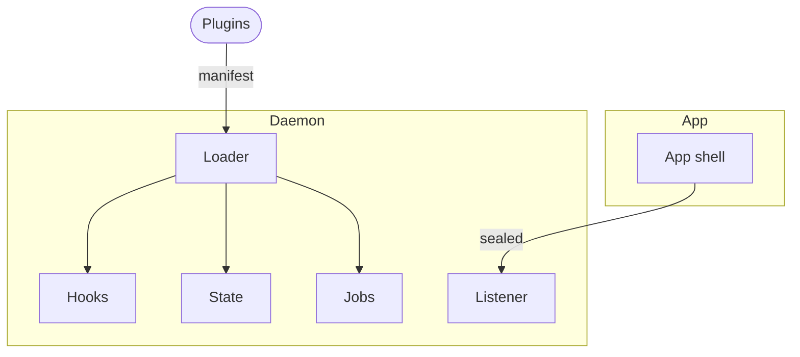

#### Gate

- **Does:** Checks every call before it runs: who is calling, from where, and whether this route allows it.
- **Why core (the hole a plugin would open):** If the check were a plugin and it were off, routes would be served with no check at all.
- **Owns:** admission (the route descriptor and `RouteContext`), the bearer classes it checks itself by hash (local admin token, warden token, ferret token; there is no device or member bearer), the kernel-stamped principal of a proved device or member session, the `credentials` hook through which Access (`device`) and Catalogs (`member`) answer for the holders they enrolled, "local" decided only by the kernel's own listener, the policy vocabulary, step-up plumbing, the audit log, fail-closed default.
- **Needs:** Kernel.
- **Offers:** `credentials` (provide), `step-up` (provide).
- **Today:** `api/` route/capability/http/socket, `audit`, `security`, `step-up` plumbing.

| Word      | Means                                       | Instead of            |
| --------- | ------------------------------------------- | --------------------- |
| **call**  | one request to the daemon                   | request (owner text)  |
| **local** | arrived through this machine's own listener | loopback (owner text) |
| **audit** | the record of security acts                 | security log          |

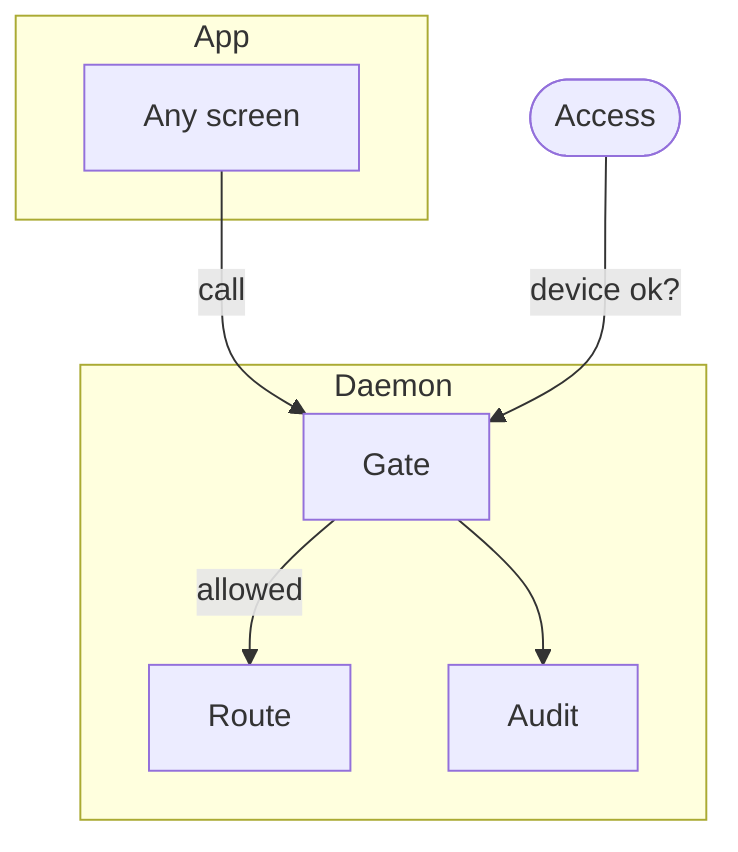

#### Vault

- **Does:** Keeps secrets ferrets use but never see; types values you give into a terminal or page; hides them everywhere afterwards.
- **Why core (the hole a plugin would open):** If it were a plugin and turned off, live holds would drop and values already on screen would be unmasked, so a ferret could read a password it just watched being typed.
- **Owns:** the sealed store and key, `${secret:NAME}` use, the output guard (`OutputGuard`), input holds (`InputHolds`), input requests and typing through a tool's `input.targets` adapter, the redaction window.
- **Needs:** Kernel, Gate, Asks.
- **Takes:** `ask.sources:input` (Asks).
- **Offers:** `input.targets` (provide).
- **Today:** `secrets` (vault half), `input-requests`, `security` redactor.

| Word       | Means                                                                        | Instead of          |
| ---------- | ---------------------------------------------------------------------------- | ------------------- |
| **secret** | a value ferrets use by name and never see                                    | credential, env var |
| **input**  | a card asking you to type a value                                            | input request       |
| **hold**   | a short time a terminal or page is closed to ferrets after you typed into it | quarantine, lock    |
| **mask**   | hiding a secret in text                                                      | redact, scrub       |

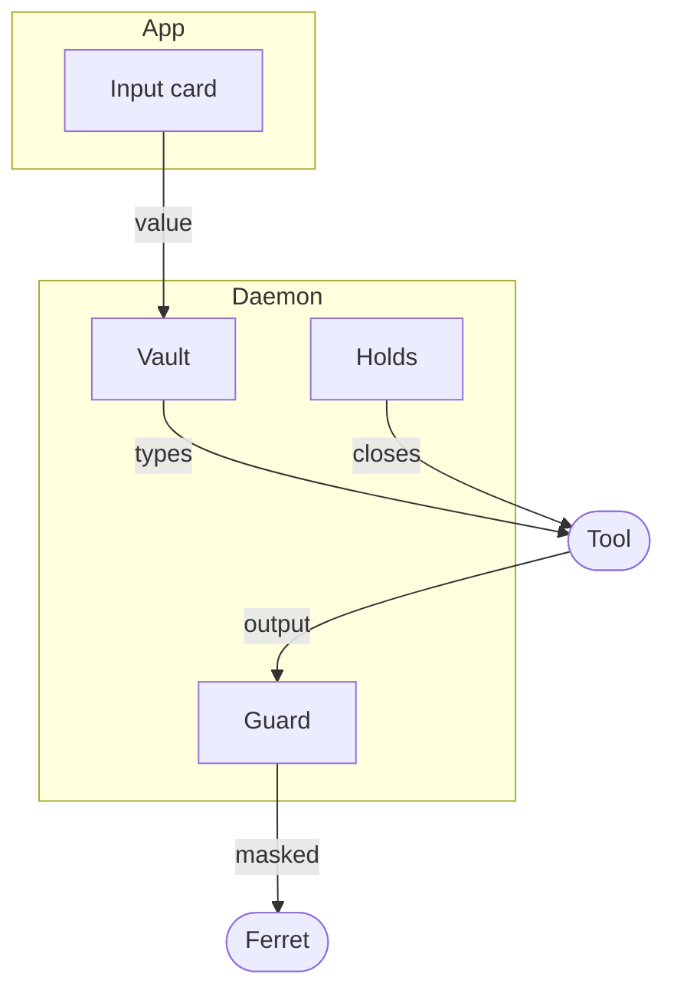

#### Ferrets

- **Does:** Knows who each ferret is: its name, its parent, its pack, its token and its state. Starting and stopping are done by a harness plugin.
- **Why core (the hole a plugin would open):** If identity were a plugin, a plugin could say any caller is any ferret, and "a ferret touches only its own" would mean nothing.
- **Owns:** ferret ids, names, parent/child, packs, ferret tokens, the state machine, the work folder a ferret may open (`WorkFolders`), the launch pipeline that asks plugins for instructions, tools, shell and login, the sitrep (its blocker lines come from the Asks port directly; plugins add the rest through `sitrep.lines`).
- **Needs:** Kernel, Gate, Vault, Asks.
- **Offers:** `harnesses` (provide), `runners` (provide), `logins` (provide), `launch.parts` (contribute), `start.decide` (decide), `sitrep.lines` (contribute), `ferret.changed` (observe).
- **Today:** `session` (identity half), `names`, `fleet`, `sub-ferret` lineage.

| Word       | Means                                                                              | Instead of        |
| ---------- | ---------------------------------------------------------------------------------- | ----------------- |
| **sitrep** | a ferret's whole status: what it is doing across its cards, its turn, its blockers | status            |
| **start**  | bring a ferret up                                                                  | spawn, launch     |
| **stop**   | end a ferret's process; it can resume                                              | kill              |
| **state**  | starting, working, idle, stopped                                                   | status (for this) |

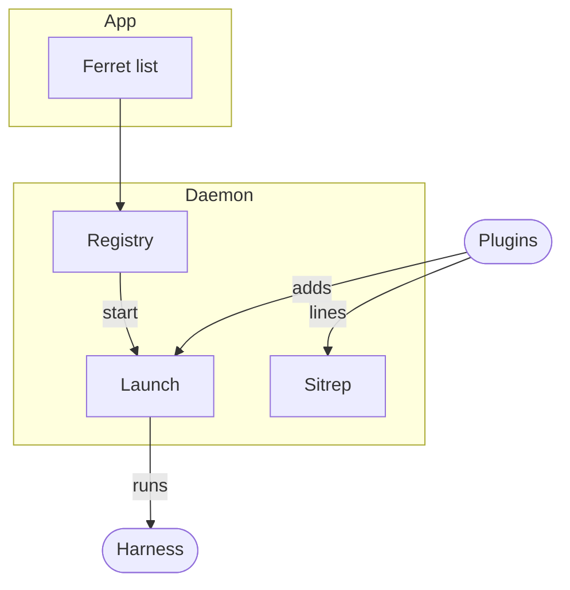

#### Asks

- **Does:** Holds every question for you and your answers. The Agenda plugin is how you see them.
- **Why core (the hole a plugin would open):** Answering is a security act (only you may answer; a ferret must never answer its own secret ask). If answering were a plugin, one could open that path.
- **Owns:** asks, notices, answers (each with its own id), obligations, owner-only answering, the `ask.sources` hook.
- **Needs:** Kernel, Gate.
- **Offers:** `ask.sources` (provide).
- **Today:** `agenda` (store and answer half).

| Word       | Means                                | Instead of              |
| ---------- | ------------------------------------ | ----------------------- |
| **ask**    | something you must decide or do      | attention, request      |
| **notice** | something you should know; no answer | notification (for this) |
| **answer** | your reply to an ask                 | response                |

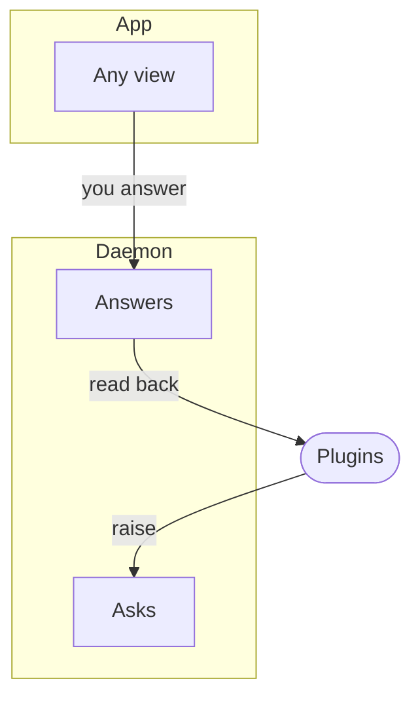

### 2.3 The plugins

Twenty-six plugins, in five groups, all on by default (Q13). Every "Needs", "Uses if on", "Takes" and "Offers" line
below is **generated** from the one manifest list that also generates §2.4, §3.5, §8 and §9.2.

#### Reach

##### Access

- **Does:** Lets your other devices in: pairing, devices, passkeys, unlock and what each device may do.
- **Why a plugin (what happens when it is off):** Off: only this machine can reach the daemon. It can only enrol device keys, and grants only narrow, so a missing or failing Access shuts devices out instead of letting them in.
- **Owns:** pairing codes, devices and their public keys (no device bearer exists), the `device` and `pair` session modes, passkeys, the unlock, grants per device, push subscriptions.
- **Needs:** Gate.
- **Takes:** `credentials:device` (Gate), `step-up:device` (Gate), `session.modes:device` (Kernel), `session.modes:pair` (Kernel).
- **Today:** `pairing`, `passkeys`, `grants`, `step-up`, `push`.

| Word        | Means                                     | Instead of                |
| ----------- | ----------------------------------------- | ------------------------- |
| **device**  | your phone or browser, paired to a daemon | client                    |
| **invite**  | the QR code that pairs a device           | pairing code (owner text) |
| **grant**   | what one device may do                    | permission                |
| **unlock**  | proving it is you before a sensitive act  | operator password         |
| **passkey** | your fingerprint or face check            | WebAuthn                  |

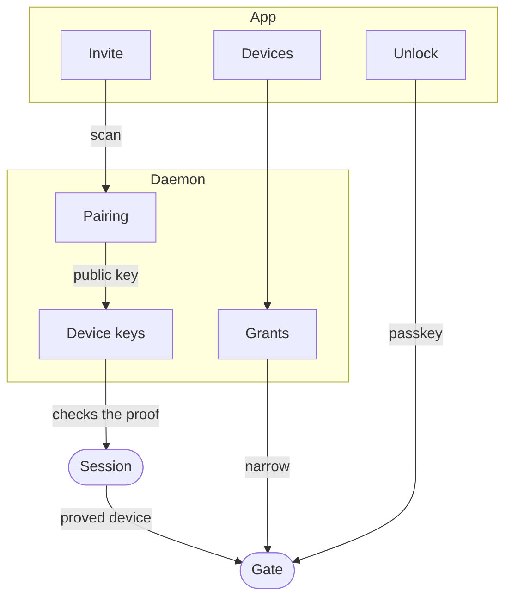

##### Connections

- **Does:** Carries the app's sealed messages to a daemon from anywhere: direct on your network, through the relay, or through a tunnel.
- **Why a plugin (what happens when it is off):** Off: only this machine. Carriers move sealed frames only; the last permit check runs in core when a carrier takes a frame; a carrier can never mark a call as local.
- **Owns:** the carriers (direct, relay, tunnel, WebRTC) and their adapters (the relay link, `cloudflared` supervision), relay discovery, the Cloudflare Worker package; the identity key and the sealed session are the Kernel's.
- **Needs:** nothing.
- **Takes:** `carriers:direct` (Kernel), `carriers:relay` (Kernel), `carriers:tunnel` (Kernel), `carriers:webrtc` (Kernel).
- **Today:** `relay` (carrier half), `tunnel`, `webrtc`, `runtime/carriers*`.

| Word        | Means                                                                       | Instead of |
| ----------- | --------------------------------------------------------------------------- | ---------- |
| **carrier** | one way a device reaches a daemon                                           | transport  |
| **direct**  | straight over your network                                                  | LAN        |
| **relay**   | through Ferretry's meeting point on the internet; it sees only sealed bytes | proxy      |
| **tunnel**  | through a Cloudflare tunnel you own                                         | —          |

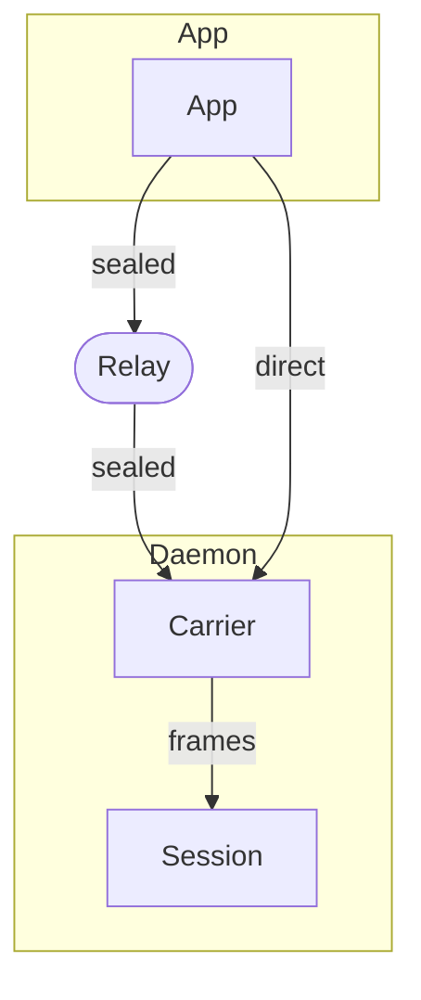

##### Updates

- **Does:** Keeps the daemon current: checks for a release, installs it when no ferret is mid-turn, restarts, and tells the app when a daemon is behind.
- **Why a plugin (what happens when it is off):** Off: you update by hand with `fy update`.
- **Owns:** update checks, update-when-idle, the "daemon is behind" notice; on a shared machine it asks the machine's administrator instead of installing.
- **Needs:** Ferrets.
- **Takes:** `ferret.changed` (Ferrets).
- **Today:** `update`, `harness-update` (daemon half).

| Word       | Means                              | Instead of        |
| ---------- | ---------------------------------- | ----------------- |
| **update** | moving a daemon to a newer release | upgrade           |
| **behind** | a daemon older than the app        | out of date, skew |

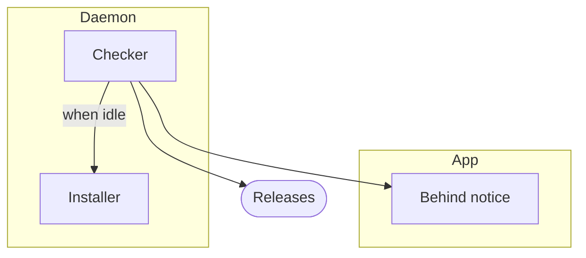

#### Ferret parts

##### Claude Code

- **Does:** Lets a ferret be Claude Code: start, stop, resume, fork, send a message, read its transcript and its usage.
- **Why a plugin (what happens when it is off):** A harness. Off: no Claude Code ferrets; Codex ones still run.
- **Owns:** the `claude` harness: binary discovery and update, its home layout, how it takes instructions, MCP and skills, transcript and usage reading, dialogs.
- **Needs:** nothing.
- **Takes:** `harnesses:claude-code` (Ferrets).
- **Needs at run time:** a `runners` provider (no build edge; without one it reports why it cannot start).
- **Today:** `agent-files`, `harness-update`, `transcript` (Claude half), `session-mcp` (Claude half).

| Word           | Means                                      | Instead of     |
| -------------- | ------------------------------------------ | -------------- |
| **harness**    | the program a ferret runs in               | agent CLI      |
| **transcript** | the harness's own record of a conversation | jsonl, history |

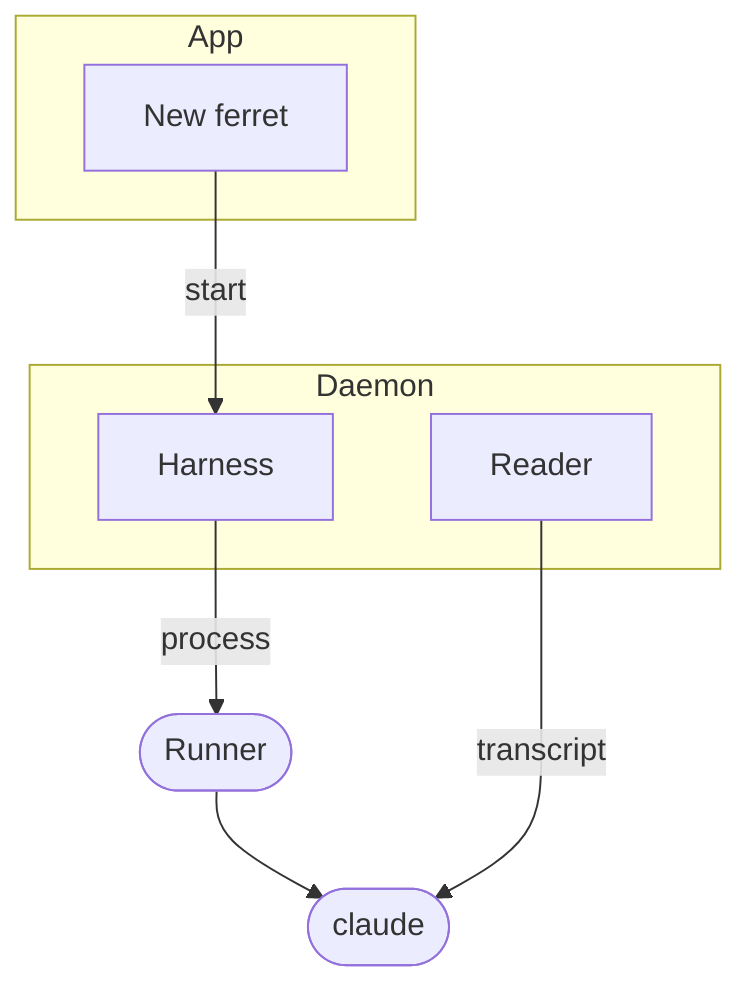

##### Codex

- **Does:** Lets a ferret be Codex, the same way.
- **Why a plugin (what happens when it is off):** A harness. Off: no Codex ferrets.
- **Owns:** the `codex` harness, as for Claude Code.
- **Needs:** nothing.
- **Takes:** `harnesses:codex` (Ferrets).
- **Needs at run time:** a `runners` provider (no build edge; without one it reports why it cannot start).
- **Today:** the Codex halves of the same modules.

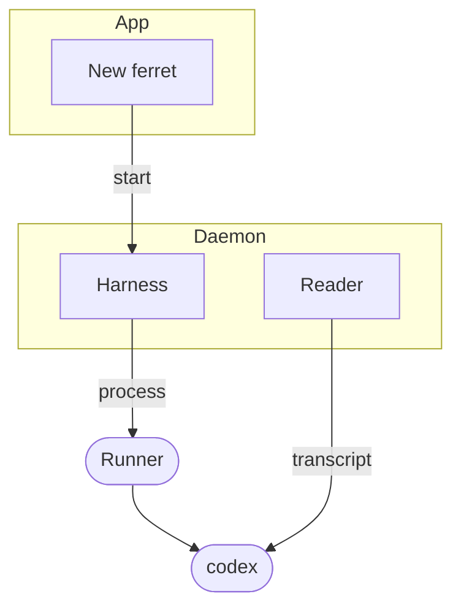

##### Logins

- **Does:** The logins ferrets spend: AI provider sign-ins, API keys, proxies, and any OpenAI-compatible endpoint.
- **Why a plugin (what happens when it is off):** Off: ferrets use whatever their harness is already signed in with.
- **Owns:** login kinds (`anthropic`, `openai`, `api-key`, `proxy`, `endpoint`), sign-in flows, refresh, quota reading; secrets live in the Vault.
- **Needs:** Vault.
- **Takes:** `logins:anthropic` (Ferrets), `logins:openai` (Ferrets), `logins:api-key` (Ferrets), `logins:proxy` (Ferrets), `logins:endpoint` (Ferrets).
- **Today:** `fleet-login`, `provider-probe`, `models`, `local-models`, MCP OAuth.

| Word         | Means                                         | Instead of           |
| ------------ | --------------------------------------------- | -------------------- |
| **login**    | an AI provider sign-in or key a ferret spends | AI login, credential |
| **provider** | the company or server behind a login          | vendor               |
| **model**    | which AI model a ferret uses                  | —                    |

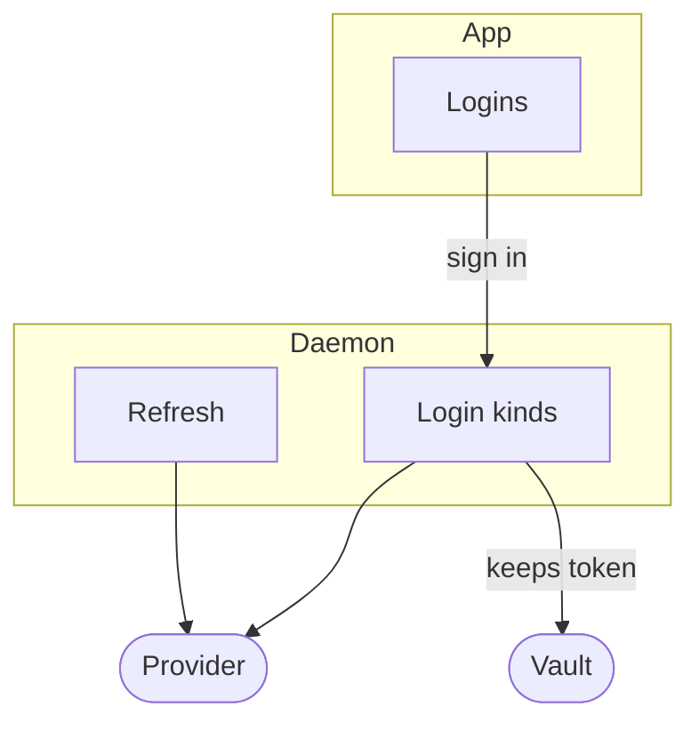

##### Runtimes

- **Does:** Named ways to start a ferret: which harness, login, model, shell and tools.
- **Why a plugin (what happens when it is off):** Off: you pick each part when you start a ferret.
- **Owns:** runtimes and profiles (named combinations), defaults per project.
- **Needs:** Ferrets.
- **Today:** `fleet` setup, profiles, runtimes, presets.

| Word        | Means                                                                  | Instead of |
| ----------- | ---------------------------------------------------------------------- | ---------- |
| **runtime** | a named way to start a ferret: harness + login + model + shell + tools | preset     |
| **profile** | a reusable set of instructions, MCP servers and skills                 | —          |

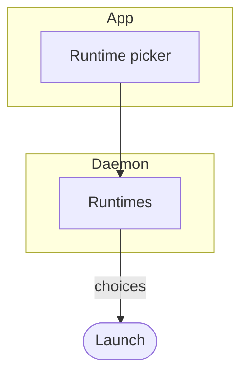

#### Tools

##### Terminals

- **Does:** Gives ferrets terminals to drive, lets you watch them, and is the default place ferrets run.
- **Why a plugin (what happens when it is off):** A tool and a runner. Off: no terminals, and no ferret can start unless another runner is on. Its acts go through the core's act runner, so it cannot skip a hold.
- **Owns:** tmux, terminals, the `terminal` tool and its `input.targets` adapter, the `tmux` runner, the viewer stream.
- **Needs:** nothing.
- **Takes:** `input.targets:terminal` (Vault), `runners:tmux` (Ferrets).
- **Today:** `terminal`, `tmux`, `cgroups`, `processes`.

| Word         | Means                                 | Instead of |
| ------------ | ------------------------------------- | ---------- |
| **terminal** | a shell a ferret or you can type into | pane, tty  |
| **runner**   | where a ferret's process runs         | —          |

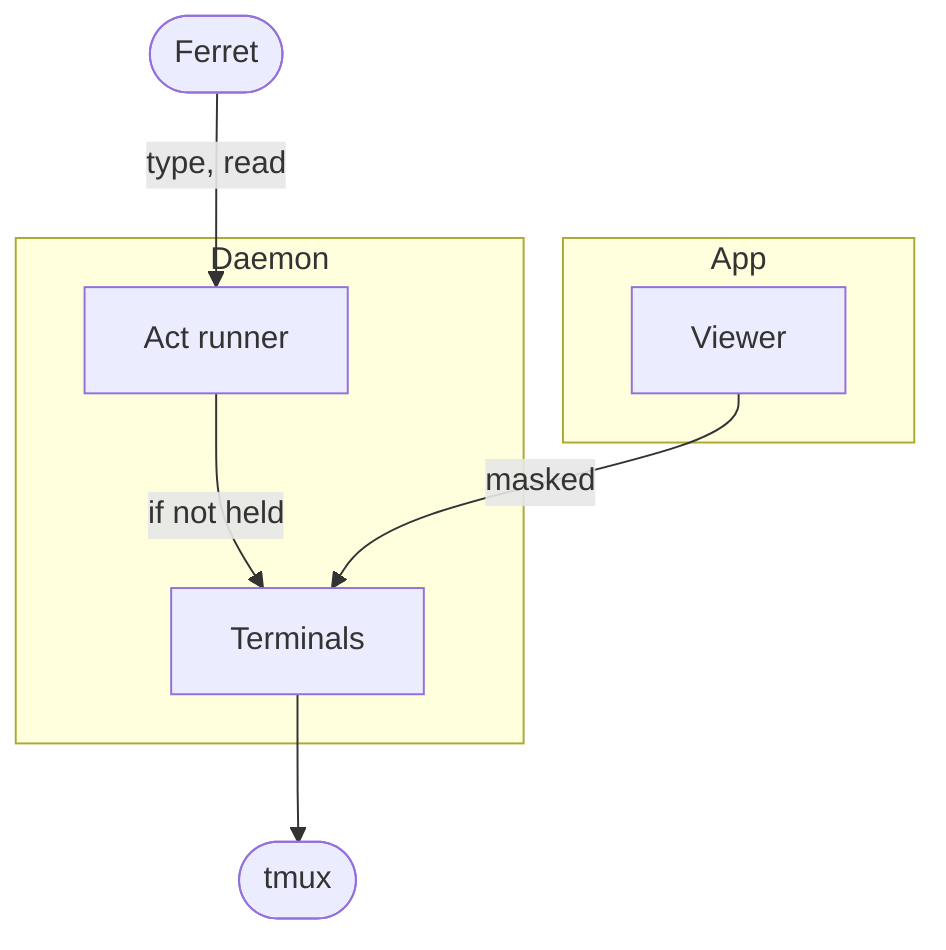

##### Browsers

- **Does:** Gives ferrets a browser to drive, and lets you take over a page.
- **Why a plugin (what happens when it is off):** A tool. Off: no browser for ferrets.
- **Owns:** the agent browser (Chrome via Playwright), pages, the `page` input target, page holds, challenges handed to you.
- **Needs:** nothing.
- **Takes:** `input.targets:page` (Vault).
- **Today:** `browser`, `browser-proxy`.

| Word          | Means                                   | Instead of     |
| ------------- | --------------------------------------- | -------------- |
| **page**      | one tab a ferret drives                 | tab (for this) |
| **take over** | you drive the page yourself for a while | hand-off       |

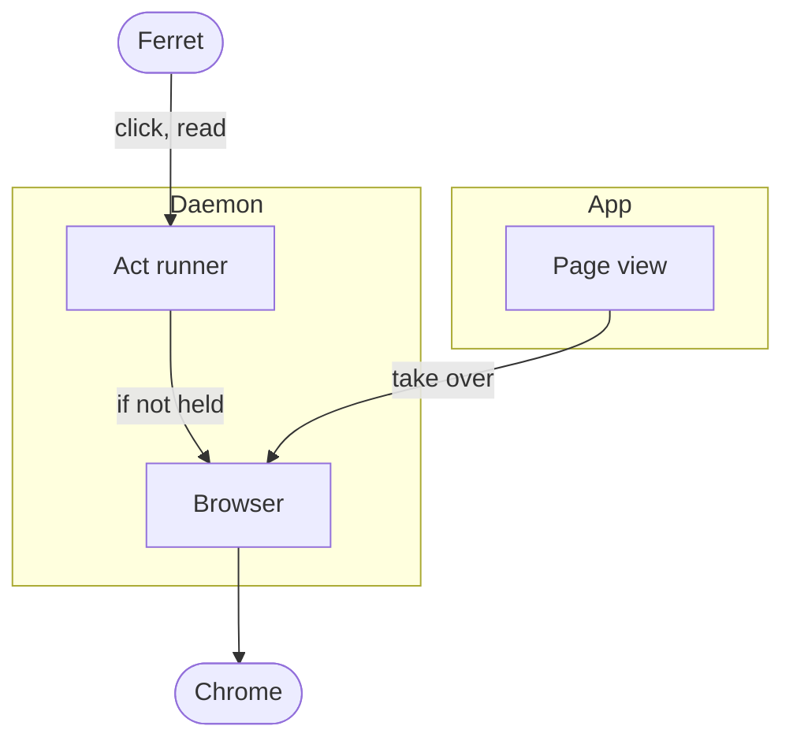

##### Accounts

- **Does:** Your website accounts: saved sign-ins, one-tap fill, 2FA codes, standing rules and login recipes.
- **Why a plugin (what happens when it is off):** Off: every sign-in asks you to type. Saved values stay sealed in the Vault and stay masked.
- **Owns:** accounts, sign-ins, saved logins, 2FA keys, rules, recipes, phone approvals, secure copy.
- **Needs:** Vault, Asks.
- **Takes:** `ask.sources:sign-in-approval` (Asks).
- **Today:** `secrets` (account half), `sign-in-rules`, `sign-in-grants`, `secure-copy`, `task-plans`.

| Word        | Means                                 | Instead of            |
| ----------- | ------------------------------------- | --------------------- |
| **account** | your account on a website             | site account          |
| **sign-in** | one way into an account, at one place | login (for a website) |
| **rule**    | your standing yes for one sign-in     | pre-approval          |
| **recipe**  | how a sign-in works, written down     | playbook              |

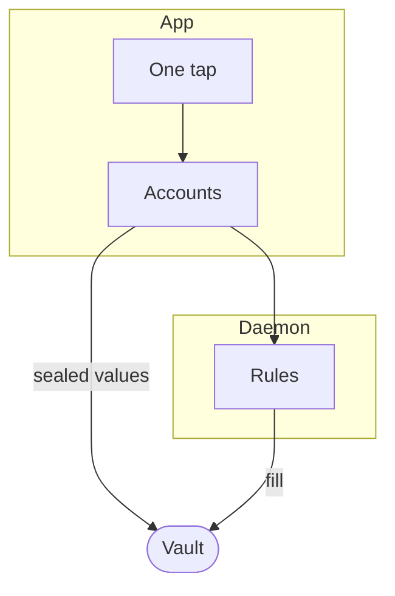

#### Work

##### Conversation

- **Does:** What you say to a ferret and what it says back: messages, the queue, turns, questions, attachments, and imports by link.
- **Why a plugin (what happens when it is off):** Off: you can still drive ferrets from their terminal.
- **Owns:** messages, the queue, turns, questions, attachments, renders, drafts, search, linked transcripts.
- **Needs:** Ferrets, Asks.
- **Takes:** `ask.sources:question` (Asks), `sitrep.lines` (Ferrets).
- **Offers:** `message.before-send` (transform), `turn.ended` (observe).
- **Today:** `session` send/queue/turn, `transcript`, `attachments`, `renders`, `shared-drafts`, `imports`, `work-search`.

| Word         | Means                                                       | Instead of        |
| ------------ | ----------------------------------------------------------- | ----------------- |
| **message**  | one thing said to or by a ferret                            | prompt (for this) |
| **turn**     | one round of a ferret working                               | —                 |
| **question** | a ferret asking you mid-turn                                | —                 |
| **link**     | a conversation read from the harness's own file, not copied | import (copy)     |

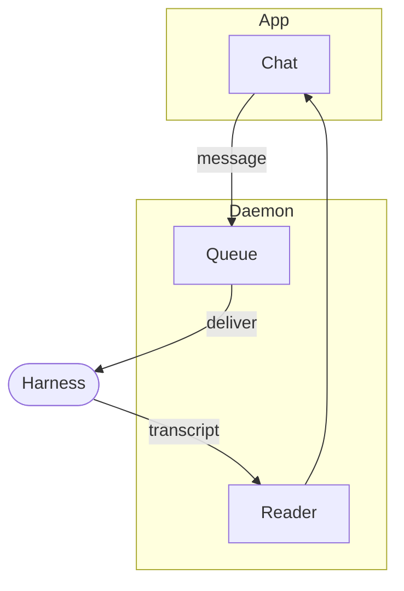

##### Agenda

- **Does:** Your inbox: every ask and notice, grouped, with buzzes to your phone.
- **Why a plugin (what happens when it is off):** Off: asks still exist in the core; `fy ask` lists and answers them.
- **Owns:** agenda views, tabs, modes, buzz policy, the daemon agenda.
- **Needs:** Asks.
- **Uses if on:** Access.
- **Today:** `agenda` (view half), `notifications`.

| Word       | Means                         | Instead of       |
| ---------- | ----------------------------- | ---------------- |
| **agenda** | your list of asks and notices | inbox, attention |
| **buzz**   | a push to your phone          | ping             |

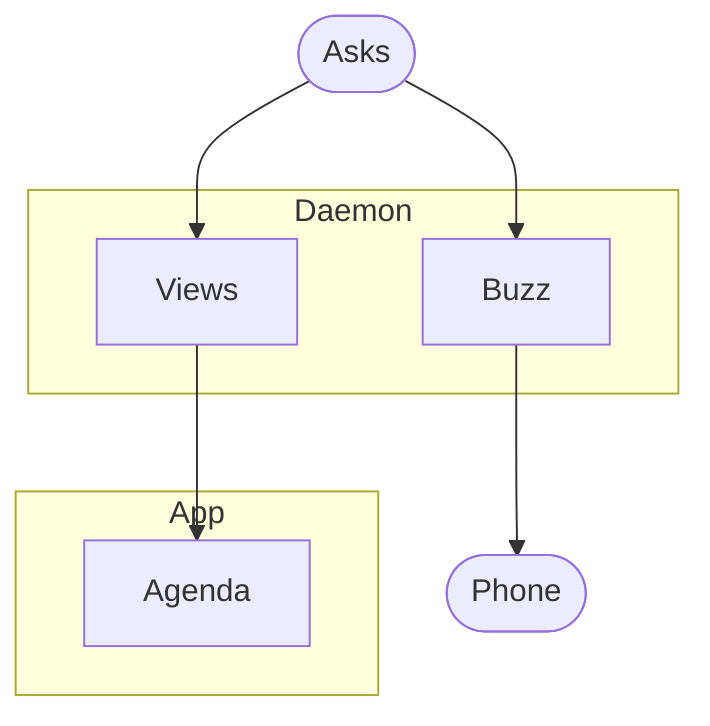

##### Projects

- **Does:** Your registered repositories: a list of folders with names. Plain data, kept by a small code plugin.
- **Why a plugin (what happens when it is off):** Off: ferrets start in the folder you name, or a scratch folder. It grants nothing: the folder a ferret may open is checked by the core (`WorkFolders`).
- **Owns:** the project list, `fy project add|list|remove`, the project picker.
- **Needs:** nothing.
- **Today:** `board-projects`.

| Word        | Means                               | Instead of        |
| ----------- | ----------------------------------- | ----------------- |
| **project** | a repository Ferretry knows by name | repo (owner text) |

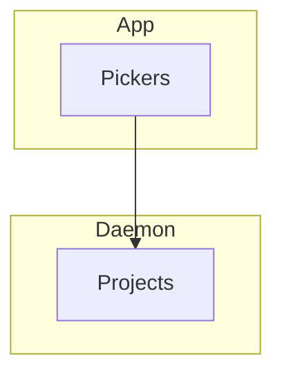

##### Board

- **Does:** Cards and lanes for the work you ask for, with each card's progress and its PRs.
- **Why a plugin (what happens when it is off):** Off: no cards; ferrets still work.
- **Owns:** cards, lanes, gate lanes, progress, GitHub watch.
- **Needs:** Ferrets, Asks.
- **Uses if on:** Projects.
- **Takes:** `ask.sources:card` (Asks), `start.decide` (Ferrets), `sitrep.lines` (Ferrets).
- **Offers:** `card.moving` (decide).
- **Today:** `board`, `board-github`, `board-import`, `task-plans`.

| Word         | Means                                                | Instead of                  |
| ------------ | ---------------------------------------------------- | --------------------------- |
| **card**     | one piece of work you asked for                      | task, ticket                |
| **lane**     | a column a card moves through                        | phase, column               |
| **progress** | one card's now, done and next, written by its ferret | status, sitrep (for a card) |

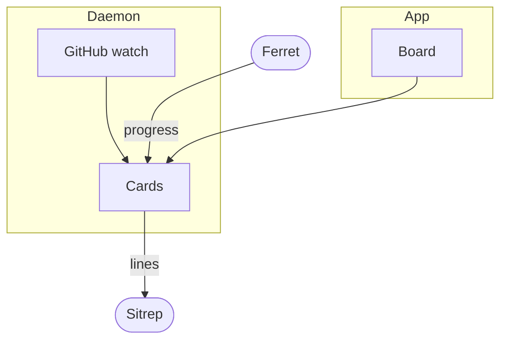

##### Packs

- **Does:** Leads start helpers on the right model, within limits.
- **Why a plugin (what happens when it is off):** Off: a ferret can still start one by hand; no recommendations.
- **Owns:** recommend, helper start, pack limits, routing.
- **Needs:** Ferrets.
- **Uses if on:** Usage, Runtimes.
- **Takes:** `start.decide` (Ferrets).
- **Today:** `pack`, `sub-ferret`, `speedups`.

| Word          | Means                                        | Instead of |
| ------------- | -------------------------------------------- | ---------- |
| **recommend** | Ferretry's list of models with room to spare | —          |

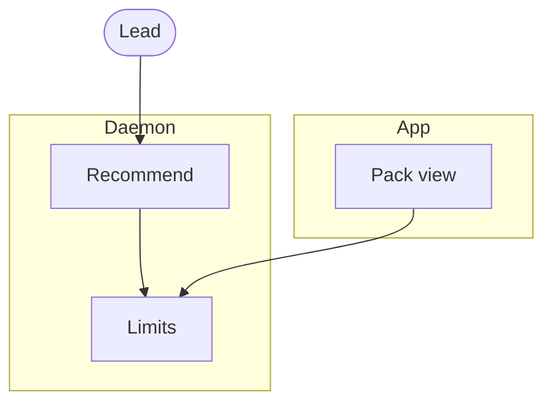

##### Warden

- **Does:** Watches ferrets for trouble and fixes or flags it.
- **Why a plugin (what happens when it is off):** Off: nobody watches; you notice stalls yourself.
- **Owns:** watch, triage, investigations, remedies.
- **Needs:** Ferrets, Conversation, Asks.
- **Uses if on:** Usage.
- **Takes:** `ferret.changed` (Ferrets), `turn.ended` (Conversation).
- **Today:** `warden`.

| Word       | Means                         | Instead of     |
| ---------- | ----------------------------- | -------------- |
| **flag**   | the warden noticing trouble   | alert          |
| **remedy** | what the warden does about it | fix (for this) |

```mermaid
flowchart TD
  subgraph A[App]
    n0["Warden"]
  end
  subgraph D[Daemon]
    n1["Watch"]
    n2["Triage"]
    n3["Remedy"]
  end
  n4(["Ferret"])
  n1 --> n4
  n1 -->|flag| n2
  n2 --> n3
  n0 --> n2
```

##### Usage

- **Does:** Knows what each login spent and has left, and pauses spending at your budget.
- **Why a plugin (what happens when it is off):** Off: no budgets and no insights.
- **Owns:** meter, budgets, pause, quotas, insights.
- **Needs:** Conversation, Logins.
- **Takes:** `start.decide` (Ferrets), `turn.ended` (Conversation).
- **Today:** `usage`, `budget`, `analytics`, `performance`.

| Word        | Means                                           | Instead of      |
| ----------- | ----------------------------------------------- | --------------- |
| **spend**   | money or tokens a login used                    | cost            |
| **budget**  | your cap on a login's spend                     | —               |
| **pause**   | Ferretry stopping a login's ferrets at a budget | hold (for this) |
| **insight** | a chart over spend and time                     | analytics       |

```mermaid
flowchart TD
  subgraph A[App]
    n0["Insights"]
  end
  subgraph D[Daemon]
    n1["Meter"]
    n2["Budgets"]
  end
  n3(["Turns"])
  n3 --> n1
  n1 --> n2
  n1 --> n0
```

##### Lessons

- **Does:** Rules learned when you correct a ferret, given to every ferret after.
- **Why a plugin (what happens when it is off):** Off: corrections are not remembered.
- **Owns:** lessons, suggestions, approvals.
- **Needs:** Conversation.
- **Takes:** `turn.ended` (Conversation), `launch.parts` (Ferrets).
- **Today:** `learning`.

| Word       | Means                            | Instead of |
| ---------- | -------------------------------- | ---------- |
| **lesson** | a rule learned from a correction | learning   |

```mermaid
flowchart TD
  subgraph A[App]
    n0["Lessons"]
  end
  subgraph D[Daemon]
    n0["Lessons"]
  end
  n2(["Launch"])
  n0 -->|instructions| n2
```

##### Voice

- **Does:** Talk instead of type.
- **Why a plugin (what happens when it is off):** Off: no microphone button.
- **Owns:** speech to text, speed-ups.
- **Needs:** nothing.
- **Uses if on:** Logins.
- **Today:** `stt`, `speedups`.

| Word        | Means           | Instead of |
| ----------- | --------------- | ---------- |
| **dictate** | speak a message | STT        |

```mermaid
flowchart TD
  subgraph A[App]
    n0["Mic"]
  end
  subgraph D[Daemon]
    n1["Speech"]
  end
  n2(["Provider"])
  n0 --> n1
  n1 --> n2
```

#### Share

##### Catalogs

- **Does:** Share your setup: MCP servers, skills, shells, recipes, layouts, with other daemons and people.
- **Why a plugin (what happens when it is off):** Off: nothing is shared; your items still work.
- **Owns:** catalogs, members, shares, links, installs (with your yes for anything that runs a command), member routes, and the link-store Worker (`worker/`, deployed apart from the relay and routed from it).
- **Needs:** Access.
- **Takes:** `credentials:member` (Gate), `step-up:member` (Gate), `session.modes:member` (Kernel).
- **Today:** `shared-catalogs`, `catalog-*`, `local-skill-installs`.

| Word        | Means                                                                     | Instead of        |
| ----------- | ------------------------------------------------------------------------- | ----------------- |
| **catalog** | a shareable list of items                                                 | —                 |
| **item**    | one shareable thing: an MCP server, skill, shell, recipe, layout, theme … | component         |
| **share**   | giving a catalog to someone                                               | invite (for this) |
| **member**  | a person you share with                                                   | —                 |

```mermaid
flowchart TD
  subgraph A[App]
    n0["Catalog"]
  end
  subgraph D[Daemon]
    n1["Catalogs"]
    n2["Installs"]
  end
  n3(["Other daemon"])
  n0 --> n1
  n1 -->|share| n3
  n3 -->|your yes| n2
```

##### MCP

- **Does:** MCP servers as items: give ferrets more tools.
- **Why a plugin (what happens when it is off):** Off: ferrets get no extra MCP servers.
- **Owns:** the `mcp` item kind, pinned payloads (§4.9), MCP sign-ins (tokens sealed in the Vault).
- **Needs:** nothing.
- **Takes:** `launch.parts` (Ferrets).
- **Today:** `mcp-inventory`, `mcp-oauth`, `session-mcp`.

| Word           | Means                                    | Instead of |
| -------------- | ---------------------------------------- | ---------- |
| **MCP server** | a program that gives a ferret more tools | —          |

```mermaid
flowchart TD
  subgraph A[App]
    n0["Items"]
  end
  subgraph D[Daemon]
    n1["MCP"]
  end
  n2(["Launch"])
  n0 --> n1
  n1 -->|servers| n2
```

##### Skills

- **Does:** Skills as items.
- **Why a plugin (what happens when it is off):** Off: ferrets get no shared skills.
- **Owns:** the `skill` item kind.
- **Needs:** nothing.
- **Takes:** `launch.parts` (Ferrets).
- **Today:** `skills`, `local-skill-installs`.

| Word      | Means                                  | Instead of |
| --------- | -------------------------------------- | ---------- |
| **skill** | packaged instructions a ferret can use | —          |

```mermaid
flowchart TD
  subgraph A[App]
    n0["Items"]
  end
  subgraph D[Daemon]
    n1["Skills"]
  end
  n2(["Launch"])
  n0 --> n1
  n1 -->|skills| n2
```

##### Shells

- **Does:** Each ferret gets its own shell: the nix-shell of tools it works in.
- **Why a plugin (what happens when it is off):** Off: ferrets use the machine's tools.
- **Owns:** the `shell` item kind (a locked flake ref or a package list on a pinned nixpkgs), building and caching shells by narHash.
- **Needs:** nothing.
- **Takes:** `launch.parts` (Ferrets).
- **Needs at run time:** a `runners` provider (no build edge; without one it reports why it cannot start).
- **Today:** new (today ferrets inherit the project's direnv).

| Word      | Means                                            | Instead of    |
| --------- | ------------------------------------------------ | ------------- |
| **shell** | the set of tools a ferret works in (a nix shell) | devshell, env |

```mermaid
flowchart TD
  subgraph A[App]
    n0["Items"]
  end
  subgraph D[Daemon]
    n1["Shells"]
  end
  n2(["nix"])
  n3(["Runner"])
  n0 --> n1
  n1 -->|build| n2
  n1 -->|enter| n3
```

##### Layouts

- **Does:** How the app looks and is arranged: sidebar side, nav, panels, theme. All data, changed with one or two commands.
- **Why a plugin (what happens when it is off):** Off: the built-in default layout.
- **Owns:** layouts and themes (item kinds), `fy layout`, `fy theme`.
- **Needs:** nothing.
- **Today:** new (today the layout is hard-coded in `App.tsx`).

| Word       | Means                       | Instead of |
| ---------- | --------------------------- | ---------- |
| **layout** | where things sit in the app | —          |
| **theme**  | colours, type and spacing   | skin       |

```mermaid
flowchart TD
  subgraph A[App]
    n0["App shell"]
  end
  subgraph D[Daemon]
    n1["Layouts"]
  end
  n2(["fy layout"])
  n2 --> n1
  n1 -->|arrangement| n0
```

##### Onboarding

- **Does:** The first run: finds what you already have, asks only what it must, leaves the rest for later.
- **Why a plugin (what happens when it is off):** Off: you set things up by hand.
- **Owns:** the first-run flow; plugins add steps to it.
- **Needs:** nothing.
- **Today:** `fleet` setup scan, the app onboarding feature.

| Word     | Means                                                      | Instead of |
| -------- | ---------------------------------------------------------- | ---------- |
| **step** | one thing the first run does: find, ask or leave for later | —          |

```mermaid
flowchart TD
  subgraph A[App]
    n0["First run"]
  end
  subgraph D[Daemon]
    n1["Steps"]
  end
  n2(["Plugins"])
  n2 -->|add| n1
  n1 --> n0
```

##### Tidy

- **Does:** Cleans up old scratch folders and worktrees.
- **Why a plugin (what happens when it is off):** Off: nothing is cleaned automatically.
- **Owns:** housekeeping, scratch.
- **Needs:** Ferrets.
- **Takes:** `ferret.changed` (Ferrets).
- **Today:** `housekeeping`, `tidy`, `scratch`.

```mermaid
flowchart TD
  subgraph A[App]
    n0["Settings"]
  end
  subgraph D[Daemon]
    n1["Tidy"]
  end
  n2(["Ferrets"])
  n1 -->|idle?| n2
  n0 --> n1
```

### 2.4 The map

```mermaid
flowchart TD
  P["Plugins (26)"]
  F["Ferrets"]
  V["Vault"]
  A["Asks"]
  G["Gate"]
  K["Kernel"]
  P --> F --> V --> A --> G --> K
```

Everything below is generated by one script from the one manifest list (§2.3); the script fails on a cycle, on a
core piece that needs, uses or takes a hook from a plugin, on a security-path hook taken by a plugin not on its list,
and on two takers of one `provide` key.

**The start-order graph.** Edges are required needs **and** every taken hook (the offerer is built first), built-in
takers included. Metadata (instructions, words, nav, doctor checks, onboarding steps) comes from the post-build
snapshot and adds no edge. A subsystem only depends on lower layers:

| Layer | Subsystems (CORE in capitals)                                                                                   |
| ----: | --------------------------------------------------------------------------------------------------------------- |
|     0 | KERNEL, Projects, Voice, Layouts, Onboarding                                                                    |
|     1 | GATE, Connections                                                                                               |
|     2 | ASKS, Access                                                                                                    |
|     3 | VAULT, Agenda, Catalogs                                                                                         |
|     4 | FERRETS, Browsers, Accounts                                                                                     |
|     5 | Updates, Terminals, Claude Code, Codex, Logins, Runtimes, Conversation, Board, Packs, MCP, Skills, Shells, Tidy |
|     6 | Warden, Usage, Lessons                                                                                          |

**Optional uses** add no edge: Voice and Packs may be built before the plugins they use. Every optional port is
bound **after all builds** (§7.6 step 5): `build` receives it as an unbound handle it may not call, and from the
`started` state on it is either the provider's port or `undefined` when that plugin is off. Optional uses:
Agenda → Access; Board → Projects; Packs → Usage, Runtimes; Warden → Usage; Voice → Logins

**Turning a plugin off.** What goes with it follows required needs and hooks taken from it; plugins that need a
**run-time** provider (a runner) stay on but say they cannot act:

| Turn off         | Also turns off (required needs and taken hooks) | Stays on but cannot act                                                               |
| ---------------- | ----------------------------------------------- | ------------------------------------------------------------------------------------- |
| Access           | Catalogs                                        | —                                                                                     |
| Terminals        | —                                               | Claude Code, Codex, Shells (no runner: cannot start ferrets or enter shells; says so) |
| Logins           | Usage                                           | —                                                                                     |
| Conversation     | Warden, Usage, Lessons                          | —                                                                                     |
| any other plugin | —                                               | —                                                                                     |

`fy plugin off <id>` computes this from the enabled graph, shows it, and refuses unless confirmed
(`--with-dependents`); the change is one checked write of `config/plugins.yaml`. A hand-edited `plugins.yaml` that
leaves a plugin without a required provider is refused at boot: the daemon starts with the last enabled set it
accepted (`state/kernel/plugins-accepted.json`) and names the line to fix.

**The contract graph** (run-time schema and id imports) is separate and also acyclic: core contracts import only
`@ferretry/kernel/contract` and other core contracts; plugin contracts import core contracts and two plugin
contracts one way only (Usage → Logins for `LoginId`, Packs → Runtimes for `RuntimeId`). The `contract-graph` check
proves it on the real packages.

## 3. The plugin spec

(Owner round 2: "a well defined plugin; adding a new feature should be powerful enough to be a plugin".) This
section is the one definition. Everything in §2.3 and every future feature follows it, and **no feature ever needs a
core edit**: if one would, the core is missing a hook, and adding that hook is the core edit, made once, for every
plugin after it (§3.10).

### 3.1 What a plugin is

A **plugin** is a package with **one manifest**. It comes in two forms:

|                   | Code plugin                                                      | Data plugin                                                                                                                                                       |
| ----------------- | ---------------------------------------------------------------- | ----------------------------------------------------------------------------------------------------------------------------------------------------------------- |
| Made of           | a manifest plus TypeScript halves: daemon, app, CLI (any subset) | a manifest plus YAML, markdown and assets; **no code**                                                                                                            |
| Who writes it     | Ferretry's developers, in this repository                        | anyone                                                                                                                                                            |
| Where it lives    | `packages/plugins/<id>/`, compiled into `fy`, `fyd` and the app  | `<home>/state/kernel/plugins/<id>/`, installed at run time                                                                                                        |
| What it can add   | any kind (§4)                                                    | the data kinds only: instructions, runtimes, login endpoints, items (MCP servers, skills, shells, recipes), layouts, themes, command aliases, onboarding defaults |
| Turned on and off | `fy plugin on/off`, restart of the plugin graph                  | `fy plugin on/off`, live                                                                                                                                          |
| Trust             | reviewed code; same trust as the core                            | runs nothing; what it would _cause_ to run (an MCP command, a nix shell) needs the owner's yes when installed (§3.6)                                              |

Third-party **code** plugins stay refused (Q10): a code plugin runs with the daemon's authority, and isolating
foreign code properly (a separate process with only its manifest's grants) is its own project. Data plugins give
anyone the customisations the owner asked for (layouts, themes, shells, catalogs, recipes, new OpenAI-compatible
providers) without that risk.

The **core pieces** (§2.2) are written as code plugins with `core: true`: same manifest, same halves, same tests;
they cannot be turned off.

### 3.2 Identity and versions

- `id`: kebab-case, unique, also its state folder, log scope, route prefix (`/v1/<id>/…`) and CLI noun (by default).
- `version`: the plugin's own semver. Code plugins carry Ferretry's version; data plugins their own.
- `api`: the plugin API major it was written for. The kernel accepts exactly its own major (zero compatibility,
  §9): a data plugin for another major is refused with "made for Ferretry N; this is M".
- Each plugin's stored files carry their own `format` numbers (§9.3).
- A data plugin's identity is its id plus the **content hash** of its folder, **and the resolved hash of everything
  it would execute** (review r6 finding 9). A folder hash alone does not pin a `github:me/shells#web` flake or an MCP
  command that fetches `npx some-server@latest`. So every executable input is resolved and pinned at install:
  - a **shell** is a flake ref **with its locked revision and `narHash`** (from `nix flake metadata`), or a package
    list on a pinned nixpkgs revision; Shells records the resolved `narHash` in `state/shells/locks/<name>.json`;
  - an **MCP server** is a pinned payload: an npm or PyPI package **with its integrity hash**, a binary with its
    sha256, a container image by digest, or a URL to a remote server (which runs nothing locally); the payload is
    fetched once into `state/mcp/payloads/<hash>/` and run from there;
  - a **floating** source (a branch, `@latest`, an unlocked flake) is allowed only if marked `floating: true`; it is
    resolved at install, shown with what it resolved to, and **asks again whenever the resolved payload changes**
    (each rebuild or start that resolves to a new hash raises an ask before running it).
    An update is therefore always a new install or a new ask the owner sees, never a silent change.

### 3.3 The manifest

The manifest is plain data. The generator, the checks, the daemon, the app and `fy` read the same value; halves only
implement what it declares. A code plugin's manifest is `manifest.ts` (typed); a data plugin's is `plugin.yaml`
with the same fields minus everything that needs code.

```ts
// packages/plugins/board/manifest.ts
import {
  definePlugin,
  route,
  verb,
  tool,
  screen,
  panel,
  settingsTab,
  renderer,
  appAction,
} from '@ferretry/kernel/manifest';
import { AskSources, AskAnswered } from '@ferretry/core-asks/contract';
import { FerretStopped, StartDecide, SitrepLines } from '@ferretry/core-ferrets/contract';
import { ProjectsPort } from '@ferretry/plugin-projects/contract';
import { BoardPort, CardMoving, CardRef, BOARD_STATE, BOARD_CONFIG, BOARD_WORDS, cap, audit } from './contract';

export default definePlugin({
  // identity
  id: 'board',
  title: 'Board',
  version: '5.0.0',
  api: 5,
  core: false,
  kinds: ['view', 'command'],
  words: BOARD_WORDS, // card, lane, progress (§1)

  // dependencies
  needs: { asks: 'core:asks', ferrets: 'core:ferrets' }, // required ports
  uses: { projects: ProjectsPort }, // optional: undefined when Projects is off
  provides: { board: BoardPort },

  // ACTIONS
  actions: {
    routes: [
      route('GET /v1/board', {
        minimum: 'operator',
        caller: 'any',
        capability: cap('board', 'use'),
        compress: true,
        audit: { skip: 'read' },
        guard: { none: 'no pane text' },
      }),
      route('POST /v1/board/cards/:id/move', {
        minimum: 'operator',
        caller: 'any',
        capability: cap('board', 'use'),
        audit: { record: audit('card-moved') },
        guard: { none: 'no pane text' },
      }),
    ],
    sockets: [],
    cli: [verb('card new'), verb('card move'), verb('card progress'), verb('card show'), verb('board')],
    agentTools: [
      tool('card_progress', { caller: 'ferret', capability: cap('board', 'use'), guard: { none: 'no pane text' } }),
    ],
    app: [appAction('card.move', { on: 'card', label: 'Move', calls: 'POST /v1/board/cards/:id/move' })],
  },

  // UI (§5)
  ui: {
    screens: [screen('board', { path: '/board/:project?', nav: { label: 'Board', icon: 'columns', order: 30 } })],
    panels: [panel('ferret.side', { id: 'cards-of-ferret', order: 20 })],
    settings: [settingsTab('board', { label: 'Board', order: 40 })],
    renderers: [renderer('ask', { source: 'card' }), renderer('reference', { prefix: '&' })],
  },

  // DATA
  data: {
    state: BOARD_STATE, // folder state/board/, each file's name, format and schema
    config: [BOARD_CONFIG], // config/board.yaml (§7.2)
    readModels: ['cards', 'progress'], // what others and the app may read through BoardPort
    publishes: ['board.card-moved'], // wake-ups (§7.4)
    subscribes: [AskAnswered, FerretStopped],
  },

  // HOOKS taken and offered (§3.5)
  hooks: {
    takes: [
      { hook: AskSources, key: 'card', schema: CardRef }, // provide: the `card` source (review r5 finding 8)
      { hook: StartDecide, priority: 60 }, // decide: refuse a start for a frozen card
      { hook: SitrepLines, priority: 50 }, // contribute: one line per card, from its progress
    ],
    offers: [{ hook: CardMoving, mode: 'decide', timeoutMs: 200 }],
  },

  // ORDER and PRIORITY
  order: { after: [] }, // start order comes from needs and taken hooks; add only what they cannot say
  priority: 50, // default for its hook entries; per-entry `priority` wins

  // metadata, read from the post-build snapshot (no start-order edge)
  instructions: [{ id: 'board', text: 'instructions/board.md', when: { role: 'any' } }],
  onboarding: [],
  doctor: ['board-store'],

  // PERMISSIONS: what it may touch outside its own folder (§3.7)
  permissions: { roots: [], network: ['api.github.com'], spawn: ['gh'], secrets: [] },
});
```

**Every field:**

| Section      | Field                                        | Declares                                                                                          | Code |                               Data                               |
| ------------ | -------------------------------------------- | ------------------------------------------------------------------------------------------------- | :--: | :--------------------------------------------------------------: |
| identity     | `id`, `title`, `version`, `api`, `core`      | §3.2                                                                                              |  ✓   |                     ✓ (`core` always false)                      |
| identity     | `kinds`                                      | which kinds (§4) it implements; each kind brings its contract and conformance suite               |  ✓   |                            data kinds                            |
| identity     | `words`                                      | its glossary entries (§1.3)                                                                       |  ✓   |                                ✓                                 |
| dependencies | `needs`, `uses`, `provides`                  | required ports, optional ports, offered ports (by token)                                          |  ✓   |                                —                                 |
| actions      | `routes`, `sockets`                          | every route and socket, each with the full security descriptor (§7.1)                             |  ✓   |                                —                                 |
| actions      | `memberRoutes`                               | routes for catalog members, with the member descriptor (§7.1); a separate table                   |  ✓   |                                —                                 |
| actions      | `cli`                                        | `fy` verbs (code) or aliases to existing verbs (data: `alias: { 'ship': 'card move --to done' }`) |  ✓   |                             aliases                              |
| actions      | `agentTools`                                 | MCP tools for ferrets, same descriptor                                                            |  ✓   |                                —                                 |
| actions      | `app`                                        | buttons and menu items on a thing (card, ferret, ask, page), each naming the route it calls       |  ✓   |                                —                                 |
| UI           | `screens`, `panels`, `settings`, `renderers` | §5                                                                                                |  ✓   |                                —                                 |
| UI           | `layouts`, `themes`                          | §5.3                                                                                              |  ✓   |                                ✓                                 |
| data         | `state`, `config`                            | its folder's files with formats; its config files and collections (§7.2)                          |  ✓   |                           config only                            |
| data         | `readModels`, `publishes`, `subscribes`      | queries others may read; wake-ups                                                                 |  ✓   |                                —                                 |
| data         | `items`                                      | items it brings (MCP servers, skills, shells, recipes, instructions)                              |  ✓   |                                ✓                                 |
| hooks        | `takes`, `offers`                            | §3.5                                                                                              |  ✓   | data hooks only (`launch.parts`, `sitrep.lines` from a template) |
| order        | `order.after`, `order.before`, `priority`    | §3.5                                                                                              |  ✓   |                            `priority`                            |
| metadata     | `instructions`, `onboarding`, `doctor`       | launch-prompt text (with `when`), first-run steps (§6.1), `fy doctor` checks                      |  ✓   |                instructions, onboarding defaults                 |
| permissions  | `roots`, `network`, `spawn`, `secrets`       | §3.7                                                                                              |  ✓   |            what its items would run, shown at install            |

### 3.4 Lifecycle

```mermaid
flowchart TD
  F["found"] --> C["checked"]
  C --> R["resolved"]
  R --> O{"on?"}
  O -->|no| X["off"]
  O -->|yes| B["built"]
  B --> N["bound"]
  N --> S["started"]
  S --> P["stopping"]
```

| State    | What happens                                                                                                                                  | Failure                                                                                                                                       |
| -------- | --------------------------------------------------------------------------------------------------------------------------------------------- | --------------------------------------------------------------------------------------------------------------------------------------------- |
| found    | the generator (code) or the loader (data, from `<home>/plugins/`) reads the manifest                                                          | unreadable manifest: refused, named in `fy doctor`                                                                                            |
| checked  | schema, kinds, descriptors, words, permissions, halves match the manifest (code: at build; data: at install and boot)                         | **refused**: not loaded; the rest boots                                                                                                       |
| resolved | the enabled graph is checked: required providers, one taker per `provide` key, no cycle                                                       | a plugin without a required provider is not started and its dependents follow (§2.4); boot keeps the last accepted set                        |
| off      | nothing is registered; its state stays on disk untouched; its capability is omitted (G134)                                                    | —                                                                                                                                             |
| built    | `build` makes its services, synchronously, in start order                                                                                     | **failed**: its routes answer `503 plugin_failed`, its `decide` hooks say no, its `provide` keys are `unavailable`; dependents are failed too |
| bound    | core binds the kernel-bound ports; every optional `uses` handle is bound to its provider or to `undefined`; the post-build snapshot is frozen | a core piece failing to build stops the boot (fail closed)                                                                                    |
| started  | jobs start; owed calls retry; reconcile runs once                                                                                             | a job that throws is restarted with backoff and named in `fy doctor`                                                                          |
| stopping | jobs stop in reverse order, `onStop` handlers run, state is closed                                                                            | —                                                                                                                                             |
| damaged  | its state could not be read: it serves only `fy doctor` and repair routes (§9.3)                                                              | —                                                                                                                                             |

### 3.5 Hooks, order and priority

A **hook** is a named point a subsystem offers, defined in its contract with typed input and output
(`defineHook`). Five modes:

| Mode           | What takers do                         | Order                                                                | When two takers clash                                   | When a taker fails                            |
| -------------- | -------------------------------------- | -------------------------------------------------------------------- | ------------------------------------------------------- | --------------------------------------------- |
| **observe**    | hear that something happened           | unordered, after the offerer's write                                 | never                                                   | logged                                        |
| **decide**     | yes or no to something about to happen | `priority` high first, then start order, then id                     | **the first no wins**, with its reason                  | throw or timeout (default 200 ms) is a **no** |
| **transform**  | change a value on its way              | `priority`, then start order, then id; each sees the previous output | none: they compose                                      | the whole operation is refused                |
| **provide**    | be THE implementation for a key        | one taker per key                                                    | **two takers of one key refuse the build**, naming both | the key is `unavailable`                      |
| **contribute** | add an item to a list                  | the item's `order`, then id                                          | duplicate ids refuse the build                          | the item is left out; `fy doctor` says so     |

Rules:

- **Taking a hook is a start-order edge** (the offerer is built first), and the graph proof includes every one
  (§2.4). Metadata is not a hook: instructions, words, nav, doctor checks and onboarding steps are read from the
  post-build snapshot (review r5 finding 6).
- **Only core offers or takes a security-path `decide` hook.** A plugin's `decide` can only add a refusal.
- `decide` and `transform` handlers are synchronous or bounded by the offerer's timeout, and may not call the
  offerer's port (that would be a loop at run time).
- `priority` is 0–100 (default 50). It orders; it never lets a plugin override a refusal.
- **A `provide` hook on the security path** (`carriers`, `session.modes`, `input.targets`, `runners`, `harnesses`,
  `logins`) names its allowed takers in the offering contract (`takers: [...]`); the build refuses any other taker,
  so adding a new carrier or tool is a reviewed change to that list as well as a new plugin.
- The generator writes the resolved order of every hook to `generated/hooks.md`.

**Every hook, generated from the manifest list** (built-in takers included; review r6 finding 5 removed Asks as a
taker of `sitrep.lines`: Ferrets reads blockers from the Asks port it already needs):

| Hook                  | Mode       | Offered by   | Taken by (key)                                                                                     | Takers allowed                           |
| --------------------- | ---------- | ------------ | -------------------------------------------------------------------------------------------------- | ---------------------------------------- |
| `carriers`            | provide    | Kernel       | Connections (`direct`), Connections (`relay`), Connections (`tunnel`), Connections (`webrtc`)      | only Connections (security path)         |
| `session.modes`       | provide    | Kernel       | Access (`device`), Access (`pair`), Catalogs (`member`)                                            | only Access, Catalogs (security path)    |
| `doctor.checks`       | contribute | Kernel       | none yet                                                                                           | any plugin                               |
| `credentials`         | provide    | Gate         | Access (`device`), Catalogs (`member`)                                                             | only Access, Catalogs (security path)    |
| `step-up`             | provide    | Gate         | Access (`device`), Catalogs (`member`)                                                             | only Access, Catalogs (security path)    |
| `ask.sources`         | provide    | Asks         | Vault (`input`), Accounts (`sign-in-approval`), Conversation (`question`), Board (`card`)          | any plugin                               |
| `input.targets`       | provide    | Vault        | Terminals (`terminal`), Browsers (`page`)                                                          | only Terminals, Browsers (security path) |
| `harnesses`           | provide    | Ferrets      | Claude Code (`claude-code`), Codex (`codex`)                                                       | only Claude Code, Codex (security path)  |
| `runners`             | provide    | Ferrets      | Terminals (`tmux`)                                                                                 | only Terminals (security path)           |
| `logins`              | provide    | Ferrets      | Logins (`anthropic`), Logins (`openai`), Logins (`api-key`), Logins (`proxy`), Logins (`endpoint`) | only Logins (security path)              |
| `launch.parts`        | contribute | Ferrets      | Lessons, MCP, Skills, Shells                                                                       | any plugin                               |
| `start.decide`        | decide     | Ferrets      | Board, Packs, Usage                                                                                | any plugin                               |
| `sitrep.lines`        | contribute | Ferrets      | Conversation, Board                                                                                | any plugin                               |
| `ferret.changed`      | observe    | Ferrets      | Updates, Warden, Tidy                                                                              | any plugin                               |
| `message.before-send` | transform  | Conversation | none yet                                                                                           | any plugin                               |
| `turn.ended`          | observe    | Conversation | Warden, Usage, Lessons                                                                             | any plugin                               |
| `card.moving`         | decide     | Board        | none yet                                                                                           | any plugin                               |

### 3.6 On, off, install and remove

```text
fy plugin list                       every plugin: code or data, on/off, version, what it adds, what needs it
fy plugin show <id>                  its manifest in words: actions, screens, hooks, permissions, state size
fy plugin off <id> [--with-dependents]   refuses unless the dependents (§2.4) are confirmed; one config write
fy plugin on <id>                    turns it (and, with --with-needs, what it requires) on
fy plugin add <path | git-url | share-link>   data plugins only: check, show, ask, install
fy plugin remove <id>                data plugins only; its state is kept in <home>/plugins-removed/<id>-<date>/
fy plugin check <path>               runs the data-plugin checks without installing (for authors)
```

- `config/plugins.yaml` holds `on`/`off` per plugin. It is person-only and passkey-checked (§7.2): turning a
  plugin **on** can widen what ferrets may do (a tool, an item), so it is a loosening change.
- Code plugins: on/off restarts the plugin graph in-process; ferrets keep running because runners own their
  processes. Data plugins: live.
- **Installing a data plugin**: `fy plugin add` checks the folder, **resolves and pins every executable input**
  (§3.2), then shows the owner, in plain words, everything it adds and everything it would run, **with the resolved
  revision or hash of each** (each MCP payload, each shell's locked flake, each network host). Nothing that runs
  anything is installed without the owner's yes, with a passkey from a device (today's catalog install rule, kept).
  The folder is copied into `<home>/state/kernel/plugins/<id>/` and pinned by content hash plus the resolved hashes.
- Sharing data plugins is what **Catalogs** does (§4.9): a share is a signed pointer to a pinned copy.

### 3.7 Isolation: what a plugin may touch

| Thing            | Rule                                                                                                                                                                                                                             | Enforced by                                                                                                   |
| ---------------- | -------------------------------------------------------------------------------------------------------------------------------------------------------------------------------------------------------------------------------- | ------------------------------------------------------------------------------------------------------------- |
| Other subsystems | only through contracts and the ports it declared; no lookup by name                                                                                                                                                              | package exports + `context-imports` check                                                                     |
| Its own state    | `state/<id>/` through the `state` port; nobody else's folder                                                                                                                                                                     | kernel `state` port; `roots` check                                                                            |
| Other folders    | only its declared `roots`, through the `roots` port, fenced (§7.7)                                                                                                                                                               | kernel `roots` port, `banned-globals` check (no `fs`, `os.homedir`, `process.env`)                            |
| Network          | only its declared hosts, through `kernel.fetch`                                                                                                                                                                                  | `banned-globals` (no `fetch`, sockets)                                                                        |
| Processes        | only its declared programs, through `kernel.spawn` (inside a ferret's limits when it acts for one)                                                                                                                               | `banned-globals` (no `Bun.spawn`)                                                                             |
| Commands on PATH | only with `permissions.which`, through `kernel.paths.which`: a bounded lookup that never executes (§7.7)                                                                                                                         | `gatedWhich` (refused by name without it); `banned-globals` keeps `process.env` out                           |
| Other processes  | only with `permissions.processes`, through `kernel.processes`: pids and yes/no answers, SIGTERM to a process running from the plugin's own folder (§7.7)                                                                         | `processesPortFor` (refused by name without it); no member returns a command line or an environment           |
| Shared folders   | only with `permissions.shareTrees`, one folder of its OWN `work`/`imports` handle or own opaque named tree, through `kernel.roots.share`; the receiver materializes it with `RootHandle.copyShared` into an internal root (§7.7) | the roots port (`host/shared-trees.ts`): a kernel-held table, so a tree cannot be forged or rebuilt from JSON |
| Secret values    | by name only, through the Vault's `run` and `authorizeFetch`, or a plugin's OWN secret through `kernel.secrets` (`send`: the kernel places it on one request to an exactly declared host; never a value)                         | Vault port has no getter; `send` answers facts only                                                           |
| Output           | every route and frame through the Gate and the final check; reads of pane or page text through `Redaction` (§7.3)                                                                                                                | descriptor `guard`; `plugin-graph` check                                                                      |
| Tool acts        | only through `kernel.act(target, op, fn)`, which asks the holds per operation and actor (§4.7)                                                                                                                                   | act runner type; tool conformance suite                                                                       |
| Hooks            | only declared hooks; bounded time                                                                                                                                                                                                | hooks engine                                                                                                  |
| Data plugins     | run nothing; their items are inert until installed into a ferret's launch                                                                                                                                                        | loader (no code path)                                                                                         |

### 3.8 Packaging

- **Code plugin**: a workspace package `packages/plugins/<id>/` (core: `packages/core/<id>/`) with
  `"ferretry": { "id", "manifest" }` in `package.json`. The generator discovers packages through the root
  `workspaces` globs (§2.1), so adding one edits no shared file.
- **Data plugin**: a folder (or a single `<id>.plugin.yaml`):

```text
dusk-layout/
├── plugin.yaml            id, version, api, kinds: [layout, theme], words, permissions
├── layouts/dusk.yaml      sidebar: right, nav: [agenda, ferrets, board], panels: …
├── themes/dusk.yaml       colour, type and spacing tokens
└── README.md              shown by `fy plugin show`
```

### 3.9 Testing a plugin

- **Test host** (`@ferretry/kernel/testing`): builds one plugin with a fake for every port it needs, a driven clock,
  an in-memory state folder and the real Gate and final check. No other plugin's code is loaded.
- **Kind conformance suites**: each kind's contract ships a suite every implementation must pass (a harness must
  resume what it started; a tool must route every act through the act runner; a carrier must pass the final-check
  suite; a login kind must never put a value in a result).
- **Package-scoped generation** (review r5 finding 9): `fy check --package <id>` generates a registry with that
  plugin's halves plus the contract fakes of everything it needs and nothing else, so one port goes green while the
  other 30 are still skeletons. The day-1 exit check (§10.3) runs this on **Projects**, a code plugin under
  `packages/plugins/`, so it also proves nested-package discovery. The global build always compiles because day 1 ships a **skeleton** of every plugin
  (§10.3): every declared route answers `unavailable`, every hook entry is a no-op the conformance suite marks
  `skeleton`, and the global `manifest-match` check accepts a skeleton half only while the plugin is listed in
  `ports-pending.json`, which may only shrink.
- **Open gaps are sorted by root cause** (lead ruling #50, 2026-11-08): every `pendingReasons` line starts with
  the one piece of work that closes it, and lines are ordered by it — `[shell]` (the app shell draws no host for it,
  or the app contract is too thin to carry it), `[declare]` (built, and the slot, screen or tab it needs already
  exists: the owning plugin's own manifest and app half must declare and bind it), `[kernel: <capability>]` (a host
  capability the kernel does not offer), `[contribute: <plugin>]` (the named plugin contributes into a slot or hook
  another plugin already offers, with no change to that host), `[cross: <plugin>]` (it needs data, a contract member
  or a host change from the named plugin), `[compose]` (ported, but the plugin's own daemon does not compose it),
  `[cli]` (CLI verbs not declared), `[tests]` (only tests or captures missing), `[own]` (the plugin's own remaining
  work, or a lead decision about who owns it). The old `[mount]` bucket was split into `[shell]` and `[declare]`
  (ruling #50, shell-mount pass). Progress is reported per bucket, and work is cut as one unit per bucket (one shell
  contract change, one kernel batch with one security review, one unit per declaring or contributing plugin), not
  line by line.
- **Guarantee fixtures**: every row of Appendix D that a package owns has a test whose name contains the row id
  (`I103 wait predicate sees masked text`, in **Terminals**). `fy check` fails a kept row with no test. A row's owner
  is the package whose code **enforces** it, row by row, never the section it came from (review r8 finding 1): the
  `guarantee-owner` check resolves each enforcer the row names (a function, class, route, tool, file or command) to a
  symbol in the owner package or in a contract it takes, and fails a row whose enforcer lives elsewhere. A row owned
  as "X (with Y)" is tested in X's isolated suite against Y's contract fake, and again in the day-5 integration
  fixture with both real.
- **Data plugins**: `fy plugin check <path>` runs the schema, words and permissions checks, and renders each layout
  against the slot list.

### 3.10 A new feature, end to end, with no core edit

Example: "a ferret can drive an Android app" (§4.7).

1. `packages/plugins/android/` with a manifest: `kinds: [tool, view]`, `permissions.spawn: ['adb', 'emulator']`.
2. Contract: the tool's actions (`tap`, `type`, `swipe`, `screen`), its target kind `app`.
3. Daemon half: takes `input.targets` (key `app`); every act goes through `kernel.act`; screens leave only through
   `Redaction` and the final check.
4. App half: an `app` screen and a renderer for `%app:<key>` references.
5. CLI half: `fy app list|open|close`.
6. Words: `app-use`, `emulator`. Instructions: how to ask the owner to take over.
7. Tests: the tool conformance suite plus its own.

Nothing in `packages/core/` changes. If a step needed a point the core does not offer, that point is added as a hook
first, in its own reviewed change, and every later plugin gets it for free.

## 4. Plugin kinds: what a plugin can add

A **kind** is an extension point with its own contract (in the offering subsystem's contract package) and its own
conformance suite. A plugin lists its kinds in `kinds`. "Data" means a data plugin can add one.

|    # | Kind              | Adds                                                                            | Offered by                                | Code / data                                 |
| ---: | ----------------- | ------------------------------------------------------------------------------- | ----------------------------------------- | ------------------------------------------- |
|  4.1 | command           | `fy` verbs, or aliases                                                          | `fy` shell                                | code; aliases are data                      |
|  4.2 | instruction       | text in every ferret's launch prompt, by harness, role, project                 | Ferrets (post-build snapshot)             | both                                        |
|  4.3 | harness           | a ferret type: Claude Code, Codex, …                                            | Ferrets `harnesses`                       | code                                        |
|  4.4 | login             | a kind of login (an AI provider sign-in or key)                                 | Ferrets `logins`                          | code; an OpenAI-compatible endpoint is data |
|  4.5 | runtime           | a named way to start a ferret                                                   | Runtimes                                  | data                                        |
|  4.6 | runner            | where a ferret's process runs                                                   | Ferrets `runners`                         | code                                        |
|  4.7 | tool              | something a ferret drives: terminal, browser, computer, app                     | Vault `input.targets` + kernel act runner | code                                        |
|  4.8 | carrier           | a way a device reaches a daemon                                                 | Kernel `carriers`                         | code                                        |
|  4.9 | item              | a shareable piece: MCP server, skill, shell, recipe, instruction, layout, theme | Ferrets `launch.parts`, Catalogs          | data                                        |
| 4.10 | view              | screens, panels, settings tabs, renderers, app actions                          | app shell slots (§5)                      | code                                        |
| 4.11 | layout, theme     | the arrangement and look of the app                                             | Layouts (§5.3)                            | data                                        |
| 4.12 | onboarding step   | a find / ask / later step in the first run                                      | Onboarding (§6.1)                         | both                                        |
| 4.13 | session mode      | a pre-auth exchange on the sealed session                                       | Kernel `session.modes`                    | code (core-reviewed)                        |
| 4.14 | hook, job, doctor | the general hooks of §3.5, background work, `fy doctor` checks                  | every subsystem                           | code; doctor text is data                   |

### 4.1 command

A code plugin's `cli` lists verbs; its CLI half implements them with the `fy` terminal ports (cli-authoring doctrine
kept). Two plugins claiming one verb refuse the build. A data plugin may add **aliases** only: a new verb that
expands to existing verbs with fixed arguments (`ship: card move --to done`), never a script.

### 4.2 instruction

`instructions: [{ id, text, when: { harness?, role?: 'lead' | 'helper' | 'any', project?, plugin? } }]`. The Ferrets
launch step reads every enabled plugin's instructions from the post-build snapshot, filters by `when`, orders by
`order` then id, and hands the result to the harness, which writes it the way that harness reads instructions
(`CLAUDE.md`-style file, `AGENTS.md`, a system prompt flag). Text is markdown, checked by the `glossary` check, and
never contains a secret (checked by the Vault's redactor at install). The glossary rule (§1.3) is one of the core's
own instructions.

### 4.3 harness: a ferret type

Claude Code and Codex are the two main plugins of this kind. A harness plugin `provide`s the Ferrets `harnesses` hook
under its key and implements:

```ts
interface Harness {
  readonly key: HarnessKey; // 'claude-code'
  discover(): Promise<HarnessInstall | Missing>; // binary, version; never reads its sign-in files
  update?(): Promise<UpdateResult>; // `fy harness claude-code update`
  accepts: readonly LoginKindKey[]; // which login kinds it can spend
  prepareHome(spec: LaunchSpec): Promise<HomePlan>; // writes instructions, MCP config, skills in its own format
  start(spec: LaunchSpec, runner: RunnerHandle): Promise<Started>;
  resume(ferret: FerretId, runner: RunnerHandle): Promise<Started>;
  fork?(from: FerretId, at?: TurnRef): Promise<ForkPlan>;
  stop(ferret: FerretId, how: 'polite' | 'now'): Promise<void>;
  deliver(ferret: FerretId, message: OutboundMessage): Promise<Delivery>; // how a message reaches it (keys, API, file)
  transcript: TranscriptReader; // read, follow, find by id; used by Conversation and links
  usage: UsageReader; // tokens and cost per turn; used by Usage
  dialogs?: DialogReader; // permission prompts and questions it shows
  conversations: ConversationFinder; // the harness's own conversations on this machine (§6.2)
}
```

The conformance suite starts, resumes and stops a fake ferret, checks that `deliver` is idempotent by message id,
that `prepareHome` writes only inside the ferret's home, and that `discover` reads no file in the harness's sign-in
folder. A new agent type (Gemini CLI, opencode, Aider) is one more plugin of this kind.

### 4.4 login: a kind of login

A login plugin `provide`s Ferrets `logins` under each kind key and implements `fields` (what it asks for, which are
secret), `signIn` (a flow: browser OAuth through the Browsers tool, a device code shown on a card, or a key typed
on an input card), `refresh`, `quota?` (what is left), `env(spec)` (the environment or config the harness needs, with
values as `${secret:NAME}` references resolved only in the ferret's own process) and `harnesses` (which harnesses can
spend it). Values live only in the Vault.

**An OpenAI-compatible or Anthropic-compatible endpoint is a data plugin** of this kind: base URL, model list, key
field, which harness. That covers GLM, DeepSeek, MiniMax, local models and proxies with no code.

### 4.5 runtime

A runtime is data: `{ name, harness, login, model, effort?, shell?, tools: [...], profile?, runner? }`. Runtimes are
items (§4.9), so they are shareable. `fy new --runtime <name>` and the app's picker use them. "Additional runtimes"
are new data plugins, not code.

### 4.6 runner: where a ferret runs

A runner `provide`s Ferrets `runners`: `start(command, env, cwd, limits) → RunnerHandle` with `attach`, `signal`,
`alive`, `pid`. Terminals provides `tmux` (today's behaviour: every ferret in its own tmux window you can watch).
Later runners are plugins: a container runner (podman/docker, the ferret's work folder mounted), a remote runner
(ssh to another machine you own). The runner never sees secret values: `${secret:…}` references are resolved by the
Vault in the child's environment (secrets.md "use, never read").

### 4.7 tool: what a ferret can drive

A tool gives ferrets agent tools (MCP) to act on **targets**, gives the owner a view of them, and lets the owner type
a secret into them. Every tool:

- runs **every act** through the kernel's act runner, which knows **what** the act is and **who** asks (review r7
  finding 4):

  ```ts
  // @ferretry/core-vault/contract — frozen on day 1
  type Op =
    | 'read'
    | 'wait'
    | 'stream' // text out: a screen, a wait predicate, the viewer stream
    | 'picture' // screenshot, PDF, highlight
    | 'keys' // terminal_send (keys into a terminal)
    | 'type' // browser_type (text into the focused field)
    | 'press'
    | 'fill'
    | 'navigate'
    | 'open'
    | 'close' // other writes
    | 'script'; // browser_eval: a write that RETURNS page data
  type Effect = 'reads' | 'writes' | 'pictures';
  // Fixed in the contract, not chosen by a tool (review r9): every Op's effects.
  // `as const satisfies` keeps each entry's literal tuple (review r10 finding 2): a plain Record<Op, readonly Effect[]>
  // annotation would widen every entry to Effect[], and a write-only Op would then type as returning Content.
  const OP_EFFECTS = {
    read: ['reads'],
    wait: ['reads'],
    stream: ['reads', 'pictures'],
    picture: ['pictures'],
    keys: ['writes'],
    type: ['writes'],
    press: ['writes'],
    fill: ['writes'],
    close: ['writes'],
    navigate: ['writes'],
    open: ['writes'],
    script: ['reads', 'writes'],
  } as const satisfies Record<Op, readonly Effect[]>;

  // A write-only act hands back an Ack and nothing else (review r10 finding 1): a fixed status, a fixed refusal
  // code, and ids the DAEMON minted. No URL, title, frame name, field text or any other target-derived string: a
  // page can put an encoded secret in its own URL fragment or title. URL, title, tab list and every other page or
  // pane metadata are 'reads' and come only from a separate 'read' act, under the same holds and masking.
  declare const minted: unique symbol;
  type OpaqueId = string & { readonly [minted]: true }; // minted only by the kernel's id factory
  interface Ack {
    readonly status: 'done' | 'refused';
    readonly code?: RefusalCode; // a closed enum of fixed sentences
    readonly ids?: readonly OpaqueId[]; // e.g. the page id of a page `open` created
  }
  // An explicit result map, checked against OP_EFFECTS so the two cannot drift:
  interface ResultMap {
    read: Content;
    wait: Content;
    stream: Content;
    script: Content;
    picture: Picture;
    keys: Ack;
    type: Ack;
    press: Ack;
    fill: Ack;
    navigate: Ack;
    open: Ack;
    close: Ack;
  }
  type ResultOf<O extends Op> = ResultMap[O];
  type ShowsSomething<O extends Op> = Extract<(typeof OP_EFFECTS)[O][number], 'reads' | 'pictures'>;
  type Consistent = {
    [O in Op]: [ShowsSomething<O>] extends [never] ? (ResultMap[O] extends Ack ? true : false) : true;
  };
  const _consistent: Consistent = {
    read: true,
    wait: true,
    stream: true,
    script: true,
    picture: true,
    keys: true,
    type: true,
    press: true,
    fill: true,
    navigate: true,
    open: true,
    close: true,
  }; // fails to compile on drift
  // Compile-time negative cases, kept in the contract's type tests (`tsc --noEmit`, part of `fy check`):
  //   // @ts-expect-error a write-only Op cannot return page content
  //   const a: ResultOf<'navigate'> = { text: 'https://example.test/#c2VjcmV0' } as Content;
  //   // @ts-expect-error an Ack cannot carry a URL
  //   const b: Ack = { status: 'done', url: 'https://example.test/' };
  //   // @ts-expect-error a target-derived string is not an OpaqueId
  //   const c: Ack = { status: 'done', ids: [page.url] };
  //   // @ts-expect-error widening the effects table is refused
  //   const d: typeof OP_EFFECTS['keys'] = ['writes', 'reads'];
  type Actor = 'ferret' | 'owner-tools' | 'owner-viewer' | 'owner-input' | 'warden'; // stamped by the kernel from
  // the call's credential; a plugin cannot choose it
  interface InputHolds {
    decide(target: TargetRef, op: Op, actor: Actor, reveal?: RevealGrant): 'allow' | 'allow-masked' | Refusal;
  }
  // kernel port: act<O>(target, op: O, fn: () => Promise<ResultOf<O>>) — runs fn inside the target's queue only if
  // decide(...) allowed, asked synchronously immediately before fn; the actor is the kernel's, from the call.

  // The types above are the SECOND layer. TypeScript accepts extra fields through a variable and an extended
  // ResultMap entry, so the first layer is at runtime, inside kernel.act, for every actor (review r11):
  function closeAck(raw: unknown, minted: MintedIds): Ack {
    // Reads three own data properties by name; never spreads, never keeps or returns `raw`.
    if (!isPlainDataObject(raw)) return { status: 'refused', code: 'malformed_result' }; // getters, proxies, classes
    const status = raw.status === 'done' || raw.status === 'refused' ? raw.status : undefined;
    const code = raw.code === undefined || REFUSAL_CODES.has(raw.code) ? raw.code : undefined;
    const ids = raw.ids === undefined ? [] : Array.isArray(raw.ids) ? raw.ids : undefined;
    if (status === undefined || (raw.code !== undefined && code === undefined) || ids === undefined)
      return { status: 'refused', code: 'malformed_result' };
    if (!ids.every(id => minted.has(id))) return { status: 'refused', code: 'unminted_id' }; // the kernel's own registry
    const fresh: { status: Ack['status']; code?: RefusalCode; ids?: OpaqueId[] } = { status }; // a new object
    if (code !== undefined) fresh.code = code;
    if (ids.length) fresh.ids = ids.map(id => minted.get(id)); // the kernel's copy
    return Object.freeze(AckSchema.strict().parse(fresh)); // strict parse of the NEW object
  }
  // In kernel.act, after fn and BEFORE any formatting, journal, audit, viewer or reply:
  //   const effects = OP_EFFECTS[op];            // looked up from the RUNTIME op value, never the generic O;
  //                                              // an op not in the table is refused before fn runs
  //   if (!effects.includes('reads') && !effects.includes('pictures')) return closeAck(await fn(), minted);
  ```

  **Holds refuse by effect, not by a list of tools** (review r9). A hold that refuses reads refuses **every** Op whose
  effects include `reads`, so a write that also returns content (`script`) can never slip past a read-refusing
  hold; a hold that refuses writes refuses every Op with `writes`, `script` included. Every Op checked against every
  hold:

  | Op (tool)                                                                                             | Effects                              | Quarantined pane                | Page hold, page still on the held document | Page hold, after a new document                 | Pending card, any non-`code` field | Pending card, only `code` |
  | ----------------------------------------------------------------------------------------------------- | ------------------------------------ | ------------------------------- | ------------------------------------------ | ----------------------------------------------- | ---------------------------------- | ------------------------- |
  | `read`, `wait` (`terminal_read`, `terminal.wait`, `browser_read`, `browser_wait_for`)                 | reads                                | refused (ferret, `owner-tools`) | refused                                    | masked                                          | allowed                            | allowed                   |
  | `stream` (terminal viewer: text cells)                                                                | reads, pictures                      | notice unless revealed          | —                                          | —                                               | allowed                            | allowed                   |
  | `stream` (page viewer: frames)                                                                        | reads, pictures                      | —                               | refused, whole window                      | refused, whole window (except `until-moved-on`) | allowed                            | allowed                   |
  | `picture` (screenshot, PDF, highlight)                                                                | pictures                             | — (no pane pictures)            | refused, whole window                      | refused, whole window (except `until-moved-on`) | allowed                            | allowed                   |
  | `script` (`browser_eval`)                                                                             | reads, writes                        | —                               | **refused**                                | masked result                                   | refused                            | refused (waits)           |
  | `keys` (`terminal_send`)                                                                              | writes, `Ack` only                   | allowed                         | —                                          | —                                               | refused                            | **allowed** (I32)         |
  | `type` (`browser_type`)                                                                               | writes, `Ack` only                   | —                               | allowed                                    | allowed                                         | refused                            | **allowed** (I32)         |
  | `press`, `fill`                                                                                       | writes, `Ack` only                   | —                               | allowed                                    | allowed                                         | refused                            | refused (waits)           |
  | `navigate`, `open`, `close`                                                                           | writes, `Ack` only (no URL or title) | allowed                         | allowed                                    | allowed                                         | refused                            | refused (waits)           |
  | page or tab metadata: URL, title, tab list (`browser_tabs`, `browser_list`, the viewer's address bar) | reads                                | —                               | refused                                    | masked                                          | allowed                            | allowed                   |

  The rules `decide` keeps, from input-requests.md, in effect terms, each with a conformance case every tool plugin
  must pass:

  | State of the target                                              | Allowed                                                                                                | Refused                                                                                                                                                                                                                                                                   | Kept from                             |
  | ---------------------------------------------------------------- | ------------------------------------------------------------------------------------------------------ | ------------------------------------------------------------------------------------------------------------------------------------------------------------------------------------------------------------------------------------------------------------------------- | ------------------------------------- |
  | an input card is **pending** with any non-`code` field           | the owner's delivery (`owner-input`); Ops with only `reads`                                            | every ferret Op with `writes`: `keys`, `type`, `press`, `fill`, `script`, `navigate`, `open`, `close`                                                                                                                                                                     | I52, I118                             |
  | a pending card of **only `code` fields**                         | ferret `keys` (terminal_send) and `type` (browser_type), both `Ack` only; Ops with only `reads`        | every other Op with `writes`: `press`, `fill`, `script`, `navigate`, `open`, `close` wait                                                                                                                                                                                 | I32                                   |
  | a **terminal in quarantine** after a secret                      | ferret `keys` (it can still send keys); `owner-viewer` with an audited reveal ("Show anyway")          | every Op with `reads` for the ferret **and** for `owner-tools`; `stream` shows a notice unless revealed                                                                                                                                                                   | I72, I77                              |
  | a **page hold** (secret or private value)                        | after the page left that document, Ops with `reads` masked (`allow-masked`), `script` results included | every Op with `pictures` for the whole window (except `until-moved-on`); **every Op with `reads`** (`read`, `wait`, `script`) while the page shows that document; the page viewer `stream` sends frames, so it is a `pictures` Op too and is refused for the whole window | I116, I117                            |
  | a page with a **pending** card that has **any non-`code` field** | —                                                                                                      | ferret `type`, `fill`, `press`, `script` on that page                                                                                                                                                                                                                     | I118 (a code-only card is row 2, I32) |
  | `decide` throws, or no `InputHolds` is bound                     | —                                                                                                      | everything except `owner-input` delivery (fail closed)                                                                                                                                                                                                                    | review r3                             |

  **When several rows match one call, the most restrictive answer wins**: refused over `allow-masked` over allowed
  (review r8 finding 3). The two pending-card rows are split by the card's fields, so for one card exactly one of
  them matches, and the code-only row is the **only** row that lets a ferret write to a target with a pending card;
  no other row allows a write, so the order never overrides I32. Worked cases, each a conformance case:

  | Call                                                                                                                                                                    | Rows that match | Answer                                                                                                                                                        |
  | ----------------------------------------------------------------------------------------------------------------------------------------------------------------------- | --------------- | ------------------------------------------------------------------------------------------------------------------------------------------------------------- |
  | `browser_type` on a page whose pending card is code-only                                                                                                                | row 2           | allowed (I32; I118 does not apply)                                                                                                                            |
  | `browser_fill_form` on the same page                                                                                                                                    | row 2           | refused (waits)                                                                                                                                               |
  | `browser_eval` on the same page                                                                                                                                         | row 2           | refused (waits: `script` writes)                                                                                                                              |
  | `browser_type` on a page whose pending card has a `secret` field                                                                                                        | rows 1 and 5    | refused                                                                                                                                                       |
  | `browser_eval` on a page with a **live page hold and no pending card**, still on the held document                                                                      | row 4           | **refused** (`script` reads; I117)                                                                                                                            |
  | `browser_eval` on that page after it loaded a new document, inside the window                                                                                           | row 4           | allowed, result masked                                                                                                                                        |
  | `browser_type` on a code-only page that also has a page hold                                                                                                            | rows 2 and 4    | allowed: `type` has no `reads` and returns `Ack` only                                                                                                         |
  | `browser_read` on that page                                                                                                                                             | rows 2 and 4    | refused while the page shows the held document                                                                                                                |
  | `terminal_send` to a quarantined pane with a code-only card                                                                                                             | rows 2 and 3    | allowed (`Ack` only)                                                                                                                                          |
  | `terminal_read` on that pane                                                                                                                                            | rows 2 and 3    | refused (quarantine)                                                                                                                                          |
  | `browser_navigate` on a page with a live page hold, still on the held document, whose script then rewrites its own URL fragment, as the ferret **and** as `owner-tools` | row 4           | the `navigate` answer is an `Ack` (no URL); the follow-up URL read (`browser_tabs`) is refused while the held document shows, and masked after a new document |
  | the same URL read after the page loaded a new document, inside the window                                                                                               | row 4           | allowed, URL and title masked                                                                                                                                 |
  | any act when `decide` throws                                                                                                                                            | row 6           | refused, except `owner-input` delivery                                                                                                                        |

  A tool **declares** which `Op` each of its agent tools is (in its manifest); the generator refuses a tool action
  with no `Op`. **Write-only results are closed at runtime by `kernel.act`** (`closeAck` above): whatever `fn`
  returned, the only thing that leaves the act is a fresh, frozen, strictly parsed `Ack` built field by field from
  the fixed status, the closed refusal codes and ids the kernel's own registry minted, for the ferret and
  `owner-tools` alike. The `ResultOf` types and the negative type cases stay as a second layer that catches it at
  compile time. Runtime conformance cases, in the kernel's act-runner suite and run against every tool:

  | Case (`navigate` on a held page, as the ferret **and** as `owner-tools`)                                                                       | Published answer, and what the journal, audit, viewer and reply hold                 |
  | ---------------------------------------------------------------------------------------------------------------------------------------------- | ------------------------------------------------------------------------------------ |
  | `fn` returns a variable `raw = { status: 'done', url: page.url }` (type-checks)                                                                | `{ status: 'done' }`; no URL anywhere                                                |
  | the tool's own type extends the entry (`ResultMap['navigate'] & { title: string }`) and returns a title                                        | `{ status: 'done' }`; no title anywhere                                              |
  | a widened generic: `act<Op>(page, 'navigate' as Op, fn)` with `fn` returning `{ status: 'done', text: pageText }` (content typed as `Content`) | closed to `{ status: 'done' }`: the runtime op decides, and the page text is dropped |
  | `ids: [page.url]`                                                                                                                              | `{ status: 'refused', code: 'unminted_id' }`                                         |
  | a getter, a Proxy or a class instance as the result; a `status` or `code` outside the enums                                                    | `{ status: 'refused', code: 'malformed_result' }`                                    |
  | an op string not in `OP_EFFECTS`                                                                                                               | refused before `fn` runs                                                             |

  The conformance suite also runs every row, every cell of the effects table and every worked case above against
  every tool.

- `provide`s Vault `input.targets` under its target kind: `observe` (the facts the card shows), `refind`, `type`
  (one write into the observed field, under the binding check), `arm` (clear-on-leave where it can);
- returns everything a ferret or viewer can see through `Redaction.read` (masking before matching, diffing or
  storing) and the final check (§7.3);
- declares its **masking ability**: `text` (it can mask text it returns), `cells` (terminal cells), or `pixels`
  (it returns pictures it cannot mask).

| Tool         | Plugin                            | Status in 5.0                   |
| ------------ | --------------------------------- | ------------------------------- |
| terminal     | Terminals                         | port of today's code            |
| browser      | Browsers                          | port of today's code            |
| computer use | a future `desktop` plugin         | **designed, not built** (§10.6) |
| app use      | a future `android` / `ios` plugin | **designed, not built**         |

**Is computer use possible? Yes, safely only in a box the ferret owns.**

- **Linux:** a virtual display per ferret (Xvfb or Xvnc, which Browsers already runs for window mode), a window
  manager, screenshots, and synthetic keys and clicks (`xdotool` or XTEST). The ferret sees and drives only that
  display, never yours. You watch and take over through VNC in the app, as with a browser page.
- **macOS:** driving the real desktop needs Accessibility and Screen Recording permissions for the whole session, so
  a ferret would drive _your_ screen. Design: allowed only inside a macOS VM (Virtualization.framework, tart), never
  on the owner's own session.
- **App use:** Android through an emulator (or a USB phone) with `adb` (screenshots, `input tap/text/swipe`, UI dump
  for text); iOS through the Simulator on a Mac (`xcrun simctl`, `idb`). Real iPhones are out of reach without a
  developer device setup.
- **Typing a secret into pixels:** a picture cannot be masked. A `pixels` tool may still receive an owner's secret, but it
  always gets the **full hold** (no screenshot, no UI dump for the whole window), the card says "this screen cannot
  hide what you type", and the risk is always amber. A tool that cannot honour that refuses `secret` targets.

### 4.8 carrier

A carrier `provide`s the Kernel `carriers` hook: it accepts sealed frames from the session layer and delivers sealed
frames from remote devices. Rules that make it safe to be a plugin (review r4, kept):

- It moves **sealed bytes only**. Opening, sealing, device proof and the per-frame permit are the kernel's.
- **It cannot mark a call local.** Only the kernel's own listener constructs a local arrival (a type the carrier
  cannot build), so "loopback is ungoverned" can never be claimed by a relay that terminates on the host.
- **The last check is the kernel's.** A carrier pulls frames with `next()`; the kernel re-asks the frame's permit
  inside `next()`, synchronously, right before handing it over, and a frame whose permit changed is dropped and the
  session ended. The relay link's after-seal check (relay-protocol.md, gap G4) becomes this pull.
- Each carrier passes the carrier conformance suite.

Bundled: `direct`, `relay`, `tunnel`, `webrtc` in the Connections plugin.

### 4.9 item: shareable pieces

An **item** is a typed, inert piece of data that goes into a ferret's launch or the app. Each item type is a kind of
its own, `provide`d by the plugin that knows how to use it:

| Item              | Plugin   | What it is                                                                                                                                        | What it runs                                                                                       |
| ----------------- | -------- | ------------------------------------------------------------------------------------------------------------------------------------------------- | -------------------------------------------------------------------------------------------------- |
| `mcp`             | MCP      | an MCP server: a **pinned payload** (package with integrity hash, binary sha256, image digest) or a remote URL, with arguments, env names, scopes | its pinned payload (owner's yes at install, and again if a `floating` source resolves differently) |
| `skill`           | Skills   | a skill folder (SKILL.md + files)                                                                                                                 | nothing by itself                                                                                  |
| `shell`           | Shells   | a per-ferret nix shell: a **locked** flake ref (`github:me/shells/<rev>#web` with its `narHash`) or a package list on a pinned nixpkgs            | a nix build (owner's yes at install, and again if the resolved `narHash` ever changes)             |
| `recipe`          | Accounts | how a sign-in works, in words (never a value)                                                                                                     | nothing                                                                                            |
| `instruction`     | Ferrets  | launch-prompt text                                                                                                                                | nothing                                                                                            |
| `runtime`         | Runtimes | §4.5                                                                                                                                              | nothing                                                                                            |
| `layout`, `theme` | Layouts  | §5.3                                                                                                                                              | nothing                                                                                            |

**Per-ferret shells** (owner round 2): each ferret starts inside its own shell. The runtime or the project names a
shell; Shells resolves and locks it at install (§3.2), builds it once (`nix build` of the `devShell`, cached by `narHash` in `state/shells/cache/`), and the runner
starts the harness inside it (`nix develop <ref> -c <harness>`, or the cached env applied directly). Without nix on
the machine, Shells says so in onboarding and ferrets use the machine's tools. A project's own flake is offered as
its default shell.

**Catalogs** (the plugin) shares items: a catalog is a signed list of pinned items; members of a share see it and
install what they choose. Installing anything that runs something (MCP, shell) needs the owner's yes with a
passkey (today's rule). Because items are data, **anyone can make and share them**: a catalog is how the owner's
"people should be able to share their catalog" works for MCP servers, skills, shells and login recipes alike.

### 4.10 view

Screens, panels, settings tabs, renderers and app actions (§5.2). Code only. A view plugin's app half is lazily
loaded and only for daemons where the plugin is on.

### 4.11 layout and theme

Data. §5.3.

### 4.12 onboarding step

`onboarding: [{ id, order, find?, ask?, later? }]`: `find` detects something already on the machine (a signed-in
harness, nix, a project folder); `ask` is the smallest question if `find` found nothing; `later` names the moment it
will ask instead (first use). §6.1.

### 4.13 session mode and credential provider

Two security-path `provide` hooks let a plugin bring its own kind of remote caller without the core needing it.
Only the plugins named in the hook's taker list may take them (§3.5), and both are on the security path.

- **Session mode** (Kernel `session.modes`): a pre-auth exchange on the sealed session. Access provides `device`
  (a paired device proves its key) and `pair` (redeem an invite); Catalogs provides `member` (a catalog member
  joins). A mode implements `verify(proof)` and `redeem(record)`; `verify` checks the holder's non-extractable key over
  this session's transcript and returns the holder id, nothing else. The **kernel** stamps the session's
  `SessionPrincipal` from that answer (§7.1), so a mode cannot name a different session or carry a bearer. The kernel
  keeps today's pre-auth limits around it (frame sizes, rates, one redemption per code), so a mode cannot loosen them.
- **Credential provider** (Gate `credentials`) and **step-up witness** (Gate `step-up`): answer, on every governed
  call, for the holders their plugin enrolled (by holder id from the kernel's principal, never by a token) and
  verify its holders' passkeys (§7.1). Access provides `device`;
  Catalogs provides `member`. The policy itself (daemon-wide grants, unlock and step-up settings) is Gate's.
- **When the plugin is off, failed or throws**, the Gate and the kernel treat its kind as unknown: every new attempt
  gets today's identical refusal (R605), and every open session or stream of that kind is closed (§7.1).

### 4.14 hooks, jobs and doctor checks

Every code plugin may offer and take hooks (§3.5), run jobs (`every`, `cron`, `once after start`, `after: [job]`),
and add `fy doctor` checks. These are not separate kinds; they come with any plugin.

## 5. The app: a shell, slots and a layout anyone can change

(Owner round 2: "anyone can change the layout with a single or two commands, even the sidebar position".)

### 5.1 The app shell

The app shell is core and owns no feature: the router, the **layout engine**, the slots, theme tokens, the sealed
session client, the daemon list (grouped by machine), the reference grammar ([reference-standard.md](../reference-standard.md)),
and the generated surface registry. Everything you see is a plugin's view, placed by the layout.

```mermaid
flowchart TD
  L["Layout (data)"]
  E["Layout engine"]
  S["Slots"]
  V["Plugin views"]
  T["Theme (data)"]
  L --> E --> S
  V --> S
  T --> E
```

### 5.2 Slots

A **slot** is a named place. The shell offers the frame slots; plugin screens offer their own.

| Slot                            | Where                          | Holds                                                                                                   |
| ------------------------------- | ------------------------------ | ------------------------------------------------------------------------------------------------------- |
| `nav`                           | the navigation bar             | nav entries (screen links), in layout order                                                             |
| `top`                           | the bar above the screen       | daemon picker, search, status chips                                                                     |
| `main`                          | the screen                     | one screen at a time (router)                                                                           |
| `side`                          | a second column (wide screens) | one screen or panels, chosen by the layout                                                              |
| `bottom`                        | the bottom bar (phones)        | nav entries, when the layout puts nav there                                                             |
| `composer.tools`                | next to the message box        | buttons (mic, attach, …)                                                                                |
| `ferret.side`, `ferret.toolbar` | the ferret screen              | panels and actions about one ferret                                                                     |
| `card.detail`                   | a card                         | panels about one card                                                                                   |
| `daemon.status`                 | the daemon page                | status panels                                                                                           |
| `settings`                      | a daemon's settings            | **one tab per plugin, per daemon**: that daemon's settings for that plugin, saved on that daemon        |
| `device.settings`               | this device's settings         | app-side, per device: theme, layout, carrier choice; saved in the app on this device, never on a daemon |

**Renderers** are `provide` hooks: one per ask source (`ask:card`, `ask:input`, …) and one per reference prefix
(`:` ferret, `@` file, `&` card, `!` ask, `/` skill, `%terminal:`, `%browser:`, and any a tool plugin adds). **App
actions** name the route they call; the app hides an action the Gate would refuse this device (from `GET /v1/grants`).
The app reads `GET /v1/plugins` from each daemon and shows a plugin's views only where it is on **and** its contract
effective contract hash matches the app's (§9.6). The check is in the generated per-daemon client, so it also
blocks calls, subscriptions and sockets, not just views; a blocked plugin and the plugins that consume it show one
line, "Update this daemon to use <plugin>" or "Reload the app to use <plugin>", and every other plugin keeps working.

**Two kinds of settings, stated plainly.** Daemon settings are one tab per plugin per daemon: with two daemons you
see a Board tab under each, and each edits that daemon's files. This-device settings (theme, layout, carrier choice)
live in the app and apply to this device only; they need no daemon and no hash check.

### 5.3 Layouts and themes are data

A **layout** is a YAML item:

```yaml
# layouts/default.yaml
id: default
nav: { side: left, style: rail, items: [agenda, ferrets, board, insights, settings] } # side: left | right | top | bottom
side: { show: wide-only, holds: ferret } # second column: none | a screen | panels
top: [daemon-picker, search]
composer.tools: [mic, attach]
panels:
  ferret.side: [cards-of-ferret, sitrep, usage]
density: comfortable # compact | comfortable
phone: { nav: { side: bottom, items: [agenda, ferrets, board] } } # overrides on narrow screens
```

A **theme** is colour, type and spacing tokens. Both are checked against the slot list and the installed views
(`fy plugin check`); an unknown view name is refused, so a layout cannot break the app.

**The commands** (from `fy` or the app's command bar):

```text
fy layout set nav.side right            move the sidebar to the right
fy layout set nav.items agenda,board    choose what the nav holds, in order
fy layout use compact                   switch to another installed layout
fy layout show | list | reset
fy layout save mine                     save the current one as a new layout item (shareable)
fy theme use dusk                       switch theme
```

- Each takes effect at once on every open app, through a wake-up.
- **Where a layout applies:** to the owner on every device by default; `--device` sets it for this device only
  (phone and laptop can differ); per user on a shared machine, each owner has their own.
- `fy layout set` writes `config/layout.yaml` (an ordinary, non-loosening config file, §7.2); `fy layout use`
  names an installed layout item. Layouts and themes are items, so a catalog can share them and `fy plugin add`
  installs one.
- The built-in default layout ships in the Layouts plugin; with Layouts off, the shell uses that default and the
  commands are gone.

## 6. First run and conversation links

### 6.1 Onboarding: as few steps and keys as possible

(Owner round 2: "too many keys".) The rule: **find before asking; ask only what the next step needs; everything
else waits for its first use.** Every plugin adds its steps (§4.12); the Onboarding plugin runs them in order.

| Step            | Find (no question)                                                                                                                                               | Ask (only if nothing was found)                                              | Later (asked on first use)                                                                                                                                      |
| --------------- | ---------------------------------------------------------------------------------------------------------------------------------------------------------------- | ---------------------------------------------------------------------------- | --------------------------------------------------------------------------------------------------------------------------------------------------------------- |
| 1 Start         | the daemon starts itself on the first `fy` command or app open; no `fy daemon start`                                                                             | —                                                                            | —                                                                                                                                                               |
| 2 Harness       | Claude Code and Codex installed, and whether each is signed in                                                                                                   | "Install Claude Code?" with the one command                                  | other harnesses                                                                                                                                                 |
| 3 Login         | a harness already signed in on this machine is **linked**: the ferret's home points at that harness's own sign-in file, which Ferretry never opens (link, below) | one browser sign-in or one API key, on an input card                         | more logins, proxies, endpoints                                                                                                                                 |
| 4 Phone         | —                                                                                                                                                                | one QR invite scan; the phone makes a **passkey** in the same step (one tap) | more devices                                                                                                                                                    |
| 5 Relay         | the hosted relay advertisement (already automatic)                                                                                                               | —                                                                            | your own tunnel                                                                                                                                                 |
| 6 Projects      | the folder you ran `fy` in, if it is a repository                                                                                                                | —                                                                            | more projects: added when you start a ferret in one                                                                                                             |
| 7 Conversations | the harnesses' own recent conversations, listed instantly (§6.2)                                                                                                 | "Keep any of these?" (optional)                                              | —                                                                                                                                                               |
| —               | —                                                                                                                                                                | —                                                                            | secrets (an input card the first time a ferret needs one), accounts, budgets, voice keys (Voice uses an OpenAI login if you have one), catalogs, warden, shells |

**Keys asked on a machine where Claude Code is already signed in: zero.** Otherwise one sign-in. One scan and one tap
pair a phone. No operator password exists.

**Linking a sign-in, and its costs.** The harness plugin links the harness's own sign-in file into the ferret's home
(a symlink, or the harness's own "use this config dir" setting). Ferretry never reads it. The costs: ferrets share
your quota and your provider account; a sign-out in your own terminal signs the ferrets out too; Usage cannot tell
your spend from theirs on that login. Onboarding says this in one line and offers a separate Ferretry login later.

### 6.2 Importing a conversation: a link, not a copy

(Owner round 2: "importing convo should be fast; can we link it?") Today's import already hard-links a conversation
into the runtime's history instead of copying it (conversation-import.md). It is slow because of **listing and
preview**, not the link. The design:

1. **Listing is incremental.** The harness's `ConversationFinder` keeps an index in `state/conversation/finder.json`
   keyed by (device, inode, size, mtime). Opening the list reads only files that changed since the last look, so a
   machine with thousands of conversations lists in milliseconds after the first time.
2. **Preview reads the tail only:** the last 64 KB, parsed for the last four exchanges.
3. **Keeping one is a link.** `fy link <harness> <id|path>` (or "Keep" in the app) records a **link**: { harness,
   path, device, inode, size at link time, hash of the first 64 KB }. Same filesystem: a hard link into the ferret's
   home, so the harness resumes it natively. Another filesystem: a symlink. The ferret starts with the harness's own
   resume at once; Conversation indexes the transcript in the background.
4. **Reading is on demand**, through the harness's `TranscriptReader`, from the linked file.

**What a link costs:**

| Cost                                                       | What happens                                                                                                                                                                                              |
| ---------------------------------------------------------- | --------------------------------------------------------------------------------------------------------------------------------------------------------------------------------------------------------- |
| A symlink breaks if the source moves or is deleted         | the conversation shows "link broken" with **Find it** (search by id) and **Make a copy**                                                                                                                  |
| A hard link survives a move or delete of the original name | but both names see every change; the harness writing in your own terminal also writes the ferret's history                                                                                                |
| The source is outside the daemon's home                    | it is read through the harness plugin's declared **read-only root** for its own history folders (§7.7): no other path, no following links out of the root, never another user's home (multi-user-host.md) |
| The source can change under Ferretry                       | reads re-check size and mtime; the index is rebuilt when they change; a shrunk file is treated as replaced                                                                                                |
| A secret in the transcript                                 | every read goes through read-scoped `Redaction`, like any other read                                                                                                                                      |

**Make a copy** turns a link into Ferretry's own file whenever the owner wants durability.

## 7. Kernel internals: how the core keeps today's guarantees

The developer contract of the core. Today's security mechanisms keep their names and meanings (review r4); this
section says where each one lives. Kernel-bound ports, provided only by core: `Admission` (Gate), `InputHolds`,
`OutputGuard` and `Redaction` (Vault), `WorkFolders` (Ferrets).

### 7.1 Who may call: the descriptor, admission and credentials

**The descriptor is today's `ScopedRoute` and `ApiRoute`, field for field** (`packages/daemon/src/lib/api/route.ts`,
`capability.ts`), plus two required fields, `audit` and `guard`. Nothing is renamed, merged or dropped: the fields
answer independent questions on purpose. Every route, socket and agent tool carries it. Policy values are branded
refs the kernel does not interpret; Gate's contract owns the vocabulary, and a plugin adds its own entries (a
capability per tool, a remedy per warden action) through its manifest, reviewed with that plugin.

```ts
// @ferretry/kernel/contract — generic, no subsystem's vocabulary
type PolicyRef<K extends 'capability' | 'remedy' | 'audit' | 'step-up-act'> = string & { readonly __policy: K };

interface RoutePattern {
  // unchanged
  readonly precedence?: number;
  readonly method: string;
  readonly path: string;
  readonly available?: () => boolean; // synchronous; false = not in the table for this request
}

interface ScopedRoute extends RoutePattern {
  // unchanged fields, unchanged meanings
  readonly minimum: 'none' | 'authenticated' | 'operator' | 'admin-token'; // a ladder; a wardenRemedy overrides 'none'
  readonly caller: 'person' | 'any'; // required, no default; one predicate (callerIsAgent) decides
  readonly ferretDoor?: string; // a person route's pointer for a ferret
  readonly privilegedOnly?: true; // must have ARRIVED over a privileged carrier
  readonly unlockExempt?: true; // served before the device has unlocked (first passkey, the unlock itself)
  readonly capability?: {
    // the operator's narrower question; asked only after the above pass
    readonly capability: PolicyRef<'capability'>;
    readonly axis: 'use' | 'configure';
    readonly narrowing?: true; // only takes away: grant and unlock still asked, never a per-act passkey
  };
  readonly consultsGrants?: true; // ungoverned route with one governed act: the boundary derives governance
  readonly wardenRemedy?: PolicyRef<'remedy'>; // absent = no warden may act here
  // the two additions
  readonly audit: { readonly record: PolicyRef<'audit'> } | { readonly skip: string }; // a reviewed reason to skip
  readonly guard: 'secrets' | { readonly none: string }; // §7.3
}

interface ApiRoute extends ScopedRoute {
  // unchanged
  readonly noStore?: boolean;
  readonly compress?: true; // opt-in, audited to hold no secret (BREACH)
  handle(call: CallContext): Promise<ApiResponse>;
}
```

`capability` absent means **ungoverned, not unguarded**, exactly as today. The per-act passkey acts stay Gate's
closed lists (`STEP_UP_ACTS_EVERY_CALLER`, `STEP_UP_ACTS_STORED_PROOF`, the machine-skippable set), typed as
`PolicyRef<'step-up-act'>`, so `claimFreshStepUp('add-2fa-key')` still does not compile.

**The handler's context is today's `RouteContext`, unchanged:**

| Field                                                                     | What it is                                                                                                               | Who mints it                       |
| ------------------------------------------------------------------------- | ------------------------------------------------------------------------------------------------------------------------ | ---------------------------------- |
| `actor`, `credential`                                                     | server-derived identity and how it authenticated: a bearer class Gate checked, or a session principal the kernel stamped | Gate                               |
| `wardenRemedy`                                                            | the warden's `WardenRemedyGrant` for this target                                                                         | the remedy authorizer, inside Gate |
| `governance`                                                              | where the caller stands relative to the owner's grants; on every route with `capability` or `consultsGrants`             | Gate                               |
| `presentation`                                                            | carrier-proved locality (`arrivedOnHost`), admin-token flag, step-up, the device's grants                                | Gate                               |
| `spendStepUp`, `spendFreshStepUp`, `claimFreshStepUp`, `claimStoredProof` | step-up spending and claiming; one confirmation buys one act                                                             | Gate                               |

The kernel carries it as `CallContext<Standing>`; `Standing` is Gate's contract. **A handler cannot mint any of it.**

**Admission is bound centrally.** The dispatcher, the socket upgrade and the agent-tool runner each call `Admission`
**before** a handler, synchronously, with the descriptor and the arrival tag. Its decision is today's boundary:
credential class, privileged arrival, unlock (with `unlockExempt`), capability and axis (with `narrowing`),
`consultsGrants`, the warden remedy, person-or-ferret. "Local" can only come from the kernel's own listener (§4.8).
If `Admission` throws or answers nothing, every call except `minimum: 'none'` routes without a remedy is refused.

**The whole policy is Gate's; plugins only answer for what they issued** (review r6 finding 4, review r7 findings
2–3). Gate owns, as core state, every **policy** input admission reads, so no core decision depends on reading a
plugin's state:

| Policy input                                                                                                                       | Gate owns it as                                                    | Today                                   |
| ---------------------------------------------------------------------------------------------------------------------------------- | ------------------------------------------------------------------ | --------------------------------------- |
| the daemon-wide half of the grants (what any governed caller may do at most)                                                       | `config/gate.yaml` › `grants`                                      | the daemon-wide grants document         |
| the security settings: unlock on or off, unlock period, `stepUpOnActions`, `stepUpWindowMinutes`, the closed per-act step-up lists | `config/gate.yaml` › `security`, and Gate's contract for the lists | `security.json`, grants.md "The unlock" |
| remote warden calls: the warden token and what a remote warden may do (the daemon-wide half plus the step-up, G140)                | `state/gate/warden-token`, `gate.yaml` › `warden`                  | `api-warden-token`, grants.md           |
| the bearer classes: the admin token and ferret tokens (the warden token is the row above); **there is no device or member bearer** | `state/gate/admin-token`, Ferrets' `tokens.json` (hashes)          | `api-token`, session credentials        |

Access edits the daemon-wide grants and security settings from its settings screen **through Gate's config route**
(person-only, passkey-checked, a loosening edit held for the owner as today), so the file is Gate's whatever plugin is
on. Plugins answer only for **holder-specific** facts they issued, through two security-path hooks the Gate offers,
taken only by Access and Catalogs:

```ts
// @ferretry/core-gate/contract
// Minted only by the kernel session layer, after a session mode's proof verified on THIS session (§4.13).
// No header, body, route or plugin can construct one; it carries no key, token or digest.
interface SessionPrincipal {
  readonly kind: 'device' | 'member';
  readonly holder: HolderId; // the device id or member id whose key signed this session's transcript
  readonly session: SessionId;
  readonly leaseUntil: Instant; // the access lease (15 min from proof, renewed; R241)
}
interface CredentialProvider {
  // hook `credentials`, keyed 'device' | 'member'
  // Synchronous, memory-only, no secret: the provider's projection, refreshed on its own writes.
  standing(holder: HolderId, now: Instant): HolderStanding | 'unknown' | 'revoked';
  generation(): number; // bumps on any revoke, narrowing, unlock, lock or grant change
}
interface HolderStanding {
  readonly holder: HolderId; // device id or member id
  readonly grants: GrantSet; // the device half (device) or the shared catalogs (member)
  readonly unlockedUntil?: Instant; // devices and members both unlock; absent = locked
}
interface StepUpWitness {
  // hook `step-up`, keyed 'device' | 'member'
  // Verifies a passkey assertion against the holder's registered passkeys and returns a proof bound to one act.
  verify(
    holder: HolderId,
    assertion: PasskeyAssertion,
    act: PolicyRef<'step-up-act'>,
    now: Instant,
  ): StepUpProof | 'refused';
}
```

How Gate decides, exactly as today but with each input's owner named:

1. **Credential**, two paths that never mix (review r8 finding 2):
   - **Bearer classes** (the local admin token, a ferret's `fys_` token, the remote warden token): Gate compares the
     presented bearer with its own hashes (`state/gate/`, Ferrets' `tokens.json`) in constant time. These are the
     only bearers; a device or member has none (P6, P12, R74, R241).
   - **Device and member**: the call arrives on a sealed session whose mode already verified the holder's
     non-extractable key over **that session's** transcript; the kernel stamps a `SessionPrincipal` on the session
     and on every call it carries, and Gate takes the principal as the credential. Gate never sees a key, a proof or
     a token, and never reads a principal from anything but the kernel's stamp. No principal (proof not finished,
     lease ended, session closed) is refused. Gate then asks that kind's provider for `standing(holder)`; `unknown`
     is `undetermined` and refused (G140), `revoked` is refused. A member principal never reaches the main table
     (R615), and a device principal never reaches the member table.
2. **Daemon-wide half first, then the holder half** (G139): Gate asks its own `grants` (`not-granted`), then the
   provider's `grants` (`grant_device_not_granted`), and names the half that refused.
3. **Unlock**: with `security.unlock` on, a governed caller needs `unlockedUntil` in the future (or an `unlockExempt`
   route). With the unlock **off**, every governed act asks a step-up (G79).
4. **Step-up**: Gate decides **whether** an act needs one (its settings and closed lists, `stepUpOnActions`,
   `stepUpWindowMinutes`, G97) and spends proofs; the witness only verifies the passkey assertion.
5. **Remote warden**: Gate alone decides (its token, its `warden` half, plus a step-up through the device witness).

**Fail-closed lifecycle.** A missing provider or witness (plugin off, failed at build, throwing, or damaged) makes its
kind unknown: every new call of that kind is refused (R605's identical refusal), every open session and stream of
that kind is closed (`4401`), and every act needing that witness is refused, including the local owner's acts that
need a passkey (add a 2FA key). Gate watches `generation()` and re-admits every open stream of that kind when it
changes, so a narrowing or revoke takes effect at once. **Gate's own tests** cover, with fake providers: an ordinary
unlocked device; a device with the unlock **turned off** (every act asks); a remote warden (daemon-wide half plus
step-up, never more); a device whose record vanishes mid-stream; a narrowing mid-stream; and each provider removed,
throwing and damaged.

**Member routes are their own descriptor** (review r7 finding 3). Today's `SharedRoute` is a separate table with its
own admission, and so it stays:

```ts
interface MemberRoute extends RoutePattern {
  // today's SharedRoute, field for field
  readonly member: 'key' | 'unlocked'; // 'key': the member's key alone (join, unlock, passkeys within the
  // 10-minute window, R606); 'unlocked': an unlocked member session
  readonly catalog?: 'path'; // re-reads the member's grant for the catalog named in the path on
  // every request: gone key 401, locked 403 member_locked, ungranted 404 (R617)
  readonly noStore: true; // member answers are no-store (R619)
  readonly audit: { readonly record: PolicyRef<'audit'> } | { readonly skip: string };
  readonly guard: 'secrets' | { readonly none: string };
  handle(call: MemberCallContext): Promise<ApiResponse>;
}
```

A manifest declares them in `actions.memberRoutes`; the generator builds a **separate member table**, served only to
a `member` standing on a member session, and never to a device; a device standing never reaches it. The member's
unlock is checked live through `standing().unlockedUntil` on every request. `descriptor-parity` compares the member
table with today's `SharedRoute` table field by field, and the member route contract is part of the day-1 Gate
contract (§10.3).

**Pre-auth** (proving a device or member key, redeeming an invite, a member join) is a **session mode** (§4.13). A
mode returns only the holder whose key it verified; the kernel, not the mode, stamps the `SessionPrincipal`, and the
holder is answered for afterwards through `credentials`. Pairing enrols a device's **public key**; it never issues a
bearer.

**The mapping is checked route by route.** Each port copies its `ScopedRoute`s mechanically, and a
`descriptor-parity` test compares the generated descriptor tables (routes, sockets, tools and member routes) with today's tables field by field, with
fixtures for every `unlockExempt` route, every `narrowing` demand and every `consultsGrants` route (first-passkey
registration works before unlock; revoking a device asks no per-act passkey; a held-config confirmation reads a
`governance` the handler did not mint). Each plugin keeps its `tests/route-contract.ts` (who may call each route and
why).

### 7.2 Config files and collections

```ts
config: [
  defineConfig({ file: 'updates.yaml', schema: UpdatesSchema, axis: 'configure', loosens: updatesLoosens }),
  defineConfig({
    collection: 'logins',
    name: /^[a-z0-9-]{1,40}$/,
    schema: LoginSchema,
    axis: 'configure',
    loosens: loginLoosens,
  }),
];
```

- A **file** is one path under `config/`; a **collection** is a folder of `<name>.yaml` files with one schema.
- `loosens(before, after)` says which edits loosen spend or authority; those are held for the owner
  ([config-files.md](../config-files.md), unchanged). `plugins.yaml` turning a plugin **on** is a loosening edit.
- `axis` is the grant axis a remote editor needs; Gate applies it to `fy config write` and the app's editor exactly
  as to a route.
- The generator refuses two entries that could claim one path. §9.2 lists every file and its owner.

### 7.3 What may leave: masking first, then one synchronous final check

Two separate steps, in this order (review r6 finding 3):

**1. Masking happens before anything is matched, diffed, stored or answered.** Through the Vault's read-scoped port:

```ts
interface Redaction {
  read<T>(fn: (scope: RedactionScope) => T | Promise<T>): Promise<T>; // opens the vault's values for this read only
}
interface RedactionScope {
  text(s: string): string; // the composed redactor (vault values + input window + token shapes)
  cells(grid: CellGrid): CellGrid; // same-width '*' over exactly the matched cells
  lines(lines: readonly string[]): readonly string[]; // a value wrapped across rows is masked in each row
}
```

- Values are opened **once per read** and dropped when it returns (S20); nothing is cached between reads. A failing
  redactor fails closed: the read refuses, a stream closes.
- A `terminal.wait` predicate is tested on masked text (I103); log search matches and cuts snippets from masked text
  (G164); the viewer stream diffs masked cells (I105, I106); a `use` child's output is masked before it is stored
  (S14). Tool and reader plugins take a `RedactionScope` in those code paths (`read-scoped` check, §7.9).
- For a route with `guard: 'secrets'`, the handler builds its body **inside one `Redaction.read`**, so the body is
  already masked when the response is constructed. The vault is opened once per response.

**2. The final check is synchronous and opens nothing.** Today's primitives, unchanged in behaviour:

- **`ApiResponse.late`** and **`finalised(response)`**: every carrier calls `finalised` as its last synchronous step
  before turning a response into bytes. For a `guard: 'secrets'` route, the dispatcher attaches a `late` that only
  **chooses**: the already-masked body, or the fixed withheld sentence. It decides from `OutputGuard`, which holds
  **no secret**: the hold registry and a permit generation per target, refreshed on the same serialization chain as
  every hold change. If a hold began or the generation moved since the body was built, `late` returns the withheld
  sentence. No await, no vault, no masking in `late`.
- **`permit`** on every stream frame and relay record: true while what it shows may still be shown, decided from the
  same non-secret state. The kernel's session layer seals frames, and a carrier **pulls** them with `next()`; the kernel
  asks the permit again inside `next()`, after queueing and sealing, immediately before handing the bytes to the
  carrier's socket write. A frame whose permit changed is dropped unsent, its sequence number is never spent, and the
  session ends ("what it was about to send changed before it left"), as `link.ts` does today.
- A missing `OutputGuard`, a throw or a damaged Vault makes `late` withhold and `permit` say no.
- **Every carrier passes the carrier conformance suite** in `@ferretry/kernel/testing`: a hold that begins while a
  response or frame is queued, being sealed or waiting on backpressure stops it before the socket write, with no
  await after the final check. The Terminals port adds a test that a hold beginning mid-relay-queue drops the record.

### 7.4 Ports, hooks and events

A **port** is a typed interface plus a token in its owner's contract. Example, the core Asks port with its generic
source envelope (no plugin's ids in a core contract):

```ts
// packages/core/asks/contract/port.ts
export const AskSource = z.strictObject({
  source: SourceKey, // 'card', 'sign-in-approval', 'question', 'input': one per ask.sources taker
  ref: z.unknown(), // validated by the schema that source registered (Board: CardRef)
  entry: EntryId, // the source's own entry id: a card's gate entry, an approval id
});
export interface AsksApi {
  raise(ask: AskDraft): Promise<AskId>; // idempotent by (source, entry)
  answers(filter: { source: SourceKey; entry?: EntryId }, since?: Instant): Promise<readonly AskAnswer[]>;
  close(id: AskId, reason: CloseReason): Promise<void>;
  open(filter: AskFilter): Promise<readonly AskSummary[]>;
}
export const AsksPort = definePort<AsksApi>('asks');
export const AskSources = defineHook('ask.sources', {
  mode: 'provide',
  key: SourceKey,
  value: z.strictObject({ schema: ZodSchemaRef, title: TemplateRef, form: z.boolean() }),
});
export const AskAnswered = defineEvent(
  'asks.answered',
  z.strictObject({ askId: AskId, answerId: AnswerId, source: SourceKey, entry: EntryId }),
);
```

The Board owns and validates its own ref (`CardRef = { card, lane }`); Asks parses `ref` with the registered schema
on raise and read, and shows "source unavailable" if the Board is later turned off.

The rules:

1. **The graph is one-way** (§2.4). Today's late-bound links (`seedAgenda`, the board's lazy agenda,
   `seedOwnerSession`) become one-way needs plus wake-ups.
2. **A subsystem gets only what it declared**: `build` receives its required ports, unbound handles for its optional
   ones (§7.6), and the kernel ports below. No lookup by name.
3. **Events are wake-ups, not records.** Delivered in-process after the publisher's write, at most once, possibly lost
   in a crash. **No correctness depends on an event.** The truth is the owner's state, read through its port.
4. **Effects across subsystems are owed, then reconciled.** When A must cause an effect in B and A needs B, A records
   "owed: call B.x(id)" **in the same atomic write as its own change**, then calls B, which is idempotent by that id; A
   retries on start, on a job tick and after a failure, and clears the record when B acknowledges. Example: the Board
   moves a card into a gate lane, mints a gate entry id, records `owedAsk` in the card's file, and calls
   `AsksPort.raise({ source: 'card', ref: { card, lane }, entry })`. When B needs A instead, A only publishes a
   wake-up and B reconciles from A's port. Answers come back the same way: woken by `AskAnswered`, the Board calls
   `AsksPort.answers({ source: 'card', entry })` and applies each answer once **by answer id**; an answer for an old
   gate entry is refused and its ask closed.
5. **Queries go through ports, facts through wake-ups.**

**Kernel ports** every subsystem may receive (and nothing else from the kernel):

| Port        | Gives                                                                                                                                                                    | Instead of                           |
| ----------- | ------------------------------------------------------------------------------------------------------------------------------------------------------------------------ | ------------------------------------ |
| `clock`     | `now()`, timers the test host drives                                                                                                                                     | `Date.now()`, `setTimeout`           |
| `log`       | logging scoped to the subsystem                                                                                                                                          | stray `process.stderr` writes        |
| `state`     | `state/<id>/`: atomic JSON/JSONL, SQLite transactions, each declared file's format check                                                                                 | `StateFileSystem`, `FoundationPaths` |
| `config`    | its declared files and collections, parsed, live                                                                                                                         | getters passed by hand               |
| `roots`     | a handle per declared root (§7.7), fenced                                                                                                                                | free `fs` use                        |
| `events`    | publish its declared types                                                                                                                                               | string event names                   |
| `jobs`      | interval, cron or once-after-start; main or worker lane                                                                                                                  | hand arming                          |
| `workers`   | a Bun worker from its own package                                                                                                                                        | per-worker wiring in `fyd.ts`        |
| `spawn`     | a child process from its declared programs, inside a ferret's limits when acting for one                                                                                 | `Bun.spawn` everywhere               |
| `fetch`     | HTTP to its declared hosts                                                                                                                                               | free `fetch`                         |
| `act`       | the act runner: `act(target, op, fn)` asks `InputHolds.decide(target, op, actor)` inside the target's queue right before `fn`; the actor is stamped from the call (§4.7) | the hold check passed by hand        |
| `redaction` | the bound `Redaction` (§7.3)                                                                                                                                             | the redactor passed by hand          |
| `snapshot`  | the post-build snapshot (instructions, words, nav, doctor, onboarding steps); adds no start-order edge                                                                   | `fixed-layer.ts`                     |
| `lifecycle` | `onStop(fn)`, `stopping()`                                                                                                                                               | `ModuleLifecycle`                    |

**Kernel-bound ports** are provided only by core and bound by the kernel after build, before it listens: each has
exactly one provider, and the kernel fails closed for whatever a missing or failing one guards. No plugin can provide
one, so turning plugins off never unbinds one.

### 7.5 Registration and discovery

1. Each package says what it is in its own `package.json`: `"ferretry": { "id": "board", "manifest": "./manifest.ts" }`.
2. `scripts/gen/registries.ts` (Bun) finds packages through the **root `workspaces` globs** (`packages/*`,
   `packages/core/*`, `packages/plugins/*`; one list, read from the root `package.json`, review r6 finding 10), checks
   each half against its manifest, resolves hook order, and writes `kernel/src/generated/plugins.ts`,
   `cli/src/generated/commands.ts`, `app/src/generated/surfaces.ts`, `kernel/src/generated/glossary.ts` and
   `generated/hooks.md`. With `--package <id>` it writes a registry of that one package plus contract fakes (§3.9).
3. Generated files are git-ignored and regenerated by `bun install`, `task build`, `task test` and `task typecheck`.
   Adding a package edits no shared file.

### 7.6 Start and stop order

1. **Check** the enabled graph (the same checks as CI); a plugin without a required provider is not started, with its
   dependents, and boot keeps the last accepted set (§2.4).
2. **Home and fence**: `decideHome` (§9.3); set every fenced folder to `0700`; register the fence.
3. **Open state**: check every declared file's format (§9.3).
4. **Build** in start order (needs and taken hooks). `build` is synchronous; async set-up belongs in a job.
5. **Bind** the kernel-bound ports and every optional `uses` handle (to its provider or `undefined`), and freeze the
   post-build snapshot. Nothing is served and no ferret launched before this.
6. **Mount** routes, sockets and agent tools behind admission, by specificity (`orderRoutesBySpecificity`).
7. **Listen**: the local listener and every carrier start; the daemon reports ready.
8. **Start jobs** in start order; owed-call retries and reconciles run once first; `after: [job]` waits for that job's
   first run.
9. **Stop** in reverse: stop accepting, stop jobs, run `onStop` handlers, close state.

The boot-trace test asserts this order from the manifests.

### 7.7 What a subsystem may touch: roots and the fence

A subsystem's own `state/<id>/` and declared config are its own. Anything else is a declared **root**, handed as a
scoped handle:

| Root              | Kind                   | Holder                                          | Where it may reach                                                                                                                                                                                                                                         |
| ----------------- | ---------------------- | ----------------------------------------------- | ---------------------------------------------------------------------------------------------------------------------------------------------------------------------------------------------------------------------------------------------------------- |
| `agent-homes`     | internal               | each harness plugin, its own subfolder          | only `state/<harness>/agent-homes/`; Conversation reads a transcript only through the harness's `TranscriptReader`                                                                                                                                         |
| `harness-history` | owner's, read-only     | each harness plugin                             | only that harness's documented history folders of **this** user (links, §6.2); links not followed out                                                                                                                                                      |
| `worktrees`       | internal               | Ferrets                                         | only `<FY_HOME>-worktrees/`                                                                                                                                                                                                                                |
| `work`            | owner's                | Ferrets, and through it a ferret's tools        | only the folder `WorkFolders` allows for that ferret: the one it was started in, checked against the fence                                                                                                                                                 |
| `imports`         | owner's, one operation | Skills, Catalogs, Conversation, `fy plugin add` | only the path the owner named, once                                                                                                                                                                                                                        |
| `downloads`       | internal               | Browsers                                        | only its staging folder                                                                                                                                                                                                                                    |
| `fleet`           | internal               | Runtimes alone                                  | only `<FY_HOME>/fleet/` (wrappers, one harness home per runtime under `homes/<id>/`, assets, setup records); a handle may be scoped to one relative folder in it                                                                                           |
| `harness-home`    | owner's, read-only     | Runtimes alone                                  | only the ONE harness home the caller names (absolute: `CLAUDE_CONFIG_DIR` or `~/.claude`, `CODEX_HOME` or `~/.codex`), for the first-run scan; links not followed out, refused inside the fence; plus, through `harnessFile`, each declared file beside it |

- Every handle resolves symlinks before checking, refuses `..`, and keeps today's link and device-file checks.
- `fleet` and `harness-home` are new in 5.0 (the Runtimes catalogue and first-run scan read and write through them
  instead of raw paths). `fleet` is an internal root at a fixed place, not under `state/<id>/`: its base must be exactly
  `<FY_HOME>/fleet` with no link from the home down to it, and it is already one of the fence's pinned paths, so no
  owner's root reaches it. Both are refused to any plugin but Runtimes whatever its manifest declares.
- The provisioner's three descriptor calls are root members, not raw paths:
  - `linkTo(at, { root, path, dangling? })` writes the "stored once, never copied" link from a runtime home to the
    host's credential or history. Its text is the REAL path of a name in one of the SAME plugin's own handles (never
    free text; `copyTree`'s `link` rule, for a file too). It writes only into `fleet` or `agent-homes`, only where
    nothing is at the name, with no link on the way, through the folder's checked no-follow descriptor. A missing
    target only with `dangling` (an empty sign-in slot), and its folder must exist.
  - `setMode(path, mode)` is an `fchmod` through an `O_NOFOLLOW` descriptor proven to be what was looked at. It keeps
    `mode & 0o700` on an internal root and `mode & 0o777` elsewhere, never setuid/setgid/sticky. It is refused on a
    read-only root and for a file with a second hard link.
  - `kernel.roots.harnessFile(absolutePath)` (`permissions.harnessFiles`, by exact basename, Runtimes with
    `harness-home` only) reads ONE file beside a harness home (`~/.claude.json` sits beside `~/.claude`), read-only.
    Its folder is never listable. The leaf is never a link, never a second hard link, never a device, and the name
    is checked again after the open. A hard link (`GuardedFolder.link`) stays refused: copy, or `linkTo`.
- A plugin that must know whether a command is installed asks `kernel.paths.which(name, { directories? })`
  (`permissions.which`): one plain command name, the caller's absolute folders then the daemon's `PATH`, empty and
  relative entries dropped, at most 64 folders, the first regular executable file wins. No shell, nothing executed;
  the answer is a path or absent, never the `PATH`.
- A plugin that must stop what a child it started left behind (Runtimes: an ended Codex ferret's app-server pair)
  asks `kernel.processes` (`permissions.processes`, listing by exact name the environment variables it may match).
  Today's Codex stopper's rules, held by the kernel: `usersOf(variable, folder)` answers the pids of this user's
  processes whose environment holds exactly `variable=<the folder's real path>`, the folder being one of the plugin's
  OWN root handles (never free text, so no guessing oracle); `runsFrom(pid, folder)` answers yes/no; `terminate` sends
  SIGTERM, and only SIGTERM, after reading the command line again and finding it still starts with the folder's path
  plus `/`. Never pid 0 or 1, the daemon or its ancestors, never another uid; `environ` and `cmdline` are read by the
  kernel (`/proc`, or an absolute `ps` run with an empty environment) and never returned. A pid reused between that
  check and the signal is the declared residual (no pidfd binding in Bun).
- A folder one plugin owns reaches another as a **shared tree** (kernel batch #10): the owner mints it with
  `kernel.roots.share` (`permissions.shareTrees`; only a folder of one of its OWN `work` or `imports` handles, or one
  name of its own opaque named tree such as Skills' `installed/*`), and the receiver brings it into one of its
  internal roots (`agent-homes`) with `RootHandle.copyShared`, under `copyTree`'s rules (no link followed inside, a
  hard-linked file skipped, `maxEntries`, both ends fenced). A tree is opaque and held in a kernel table, so a copy or
  a JSON round trip (`{ shared: <folder name> }`) opens nothing, and every tree is revoked when its minter stops. A
  link instead of a copy is made only when the link rule allows it: by default (`link-internal`, #52 Q5) only from the
  minter's own state, so a project skill is always COPIED (tightened from today, which linked it); `link-own` (the
  owner's choice, !A466) also links a project folder that is the receiving ferret's own work folder into that ferret's
  own home. Copy is the fallback whenever a link is not allowed.
- An owner's root refuses everything inside **the fence**: the live `FY_HOME`, every `<FY_HOME>-before-*` folder and
  every `state/<id>-before-*` folder (§9.3), for every caller including the owner's own `fy` imports. An internal
  root reaches its own subtree only.
- The `banned-globals` check refuses `homedir()`, `process.env`, `process.platform`, `node:fs`, `fetch` and
  `Bun.spawn` outside the kernel's adapters. No mutable singletons; no work outside a job or a handler.

### 7.8 Testing a subsystem alone

```ts
const asks = fakeAsks(); // @ferretry/core-asks/contract/testing
const host = await testHost({
  plugins: [board],
  fakes: { asks, ferrets: fakeFerrets() }, // every required need
  uses: { projects: fakeProjects() }, // optional: omit to test "Projects off"
  gate: realGate(), // the real admission decision
  clock: fixedClock('2026-11-06T09:00:00Z'),
});
await host.request('POST', '/v1/board/cards/F12/move', { body: { lane: 'try-it' }, as: ferret('F12-holder') });
expect(asks.raised()).toEqual([expect.objectContaining({ source: 'card', ref: { card: 'F12', lane: 'try-it' } })]);
const answerId = asks.answer({ source: 'card' }, 'not-good');
host.emit(AskAnswered, asks.lastAnsweredEvent());
await host.settle();
host.crashAfterNextWrite(); // owed calls survive a crash
```

- Real dispatcher, real Gate, in-memory state, driven clock. Each contract ships a fake **and** a conformance suite;
  the real implementation and every fake pass the same suite, so fakes cannot drift.
- Tiers stay the doctrine's: unit (`lib`), integration (adapters and the test host), SIT (built `fy` + `fyd`).
- Every Appendix D row a subsystem owns has a test named with the row id (`guarantees` check).

### 7.9 The checks

All in `scripts/validate/`, in pre-commit and CI; each has a test that plants a violation.

| Check               | Fails when                                                                                                                                                                                                                                                                                                                                                                                                                                                                                                                                                                                                       |
| ------------------- | ---------------------------------------------------------------------------------------------------------------------------------------------------------------------------------------------------------------------------------------------------------------------------------------------------------------------------------------------------------------------------------------------------------------------------------------------------------------------------------------------------------------------------------------------------------------------------------------------------------------- |
| `context-imports`   | a package imports another's non-contract files; a contract imports anything but `zod`, `@ferretry/std`, `@ferretry/kernel/contract` and other contracts                                                                                                                                                                                                                                                                                                                                                                                                                                                          |
| `contract-consumes` | a client half imports a contract, calls a route, opens a socket, subscribes to an event or registers a renderer for a key its manifest does not declare it consumes; a call to a daemon bypasses the generated client (§9.6)                                                                                                                                                                                                                                                                                                                                                                                     |
| `contract-graph`    | the contract import graph has a cycle, or a core contract imports a plugin contract                                                                                                                                                                                                                                                                                                                                                                                                                                                                                                                              |
| `plugin-graph`      | the start-order graph (needs + taken hooks) has a cycle; a required provider is missing; a kernel-bound port has zero or two providers; a security-path hook is taken by a plugin not on its list; two takers of one `provide` key                                                                                                                                                                                                                                                                                                                                                                               |
| `core-closed`       | a core manifest needs, uses or takes a hook from a plugin                                                                                                                                                                                                                                                                                                                                                                                                                                                                                                                                                        |
| `manifest-match`    | a half implements something its manifest does not declare, or misses something it does (skeletons pass only while listed in `ports-pending.json`)                                                                                                                                                                                                                                                                                                                                                                                                                                                                |
| `ports-pending`     | `ports-pending.json` grows, or lists a plugin that is no longer a skeleton                                                                                                                                                                                                                                                                                                                                                                                                                                                                                                                                       |
| `descriptor-parity` | a route, socket or tool differs from today's table (until the route is deliberately changed with a recorded reason)                                                                                                                                                                                                                                                                                                                                                                                                                                                                                              |
| `read-scoped`       | a tool or reader's wait, search, diff or store path does not take a `RedactionScope`                                                                                                                                                                                                                                                                                                                                                                                                                                                                                                                             |
| `act-runner`        | a tool act does not go through `kernel.act`, or a tool action declares no `Op` (type-level: the queue's runner takes the decision as a parameter); a tool fails a row of the §4.7 hold table, a cell of the §4.7 effects table or a worked case of the overlap table; a write-only result reaches formatting, the journal, audit, the viewer or a reply without going through `closeAck` in `kernel.act`, or a §4.7 runtime case leaks a field; second layer: an Op without `reads` types as returning content or a target-derived string (`ResultOf`, `Ack`, `OpaqueId`), or a §4.7 negative type case compiles |
| `banned-globals`    | §7.7                                                                                                                                                                                                                                                                                                                                                                                                                                                                                                                                                                                                             |
| `host-files`        | a host file (`fyd.ts`, `fy.ts`, `main.tsx`) names a subsystem or exceeds 150 lines; generated registries excepted by exact path and only if `registries-fresh` passes                                                                                                                                                                                                                                                                                                                                                                                                                                            |
| `registries-fresh`  | a generated file differs from a fresh generation                                                                                                                                                                                                                                                                                                                                                                                                                                                                                                                                                                 |
| `guarantees`        | a kept row (or the kept half of a split row) of Appendix D has no passing test with its id; a REMOVED row's code remains                                                                                                                                                                                                                                                                                                                                                                                                                                                                                         |
| `guarantee-owner`   | a kept row's test is not in its owner's suite, or an enforcer the row names resolves to no symbol in the owner package or a contract it takes (§3.9)                                                                                                                                                                                                                                                                                                                                                                                                                                                             |
| `one-format`        | a state file's reader accepts more than one format number                                                                                                                                                                                                                                                                                                                                                                                                                                                                                                                                                        |
| `no-compat`         | `legacy`, `deprecated`, `compat`, `migrat*`, `retired` or an older-peer fallback appear in product identifiers or strings                                                                                                                                                                                                                                                                                                                                                                                                                                                                                        |
| `words`             | a word is owned twice                                                                                                                                                                                                                                                                                                                                                                                                                                                                                                                                                                                            |
| `glossary`          | owner-facing text uses an "instead of" word                                                                                                                                                                                                                                                                                                                                                                                                                                                                                                                                                                      |
| `pins`              | a data plugin's executable input is not pinned and not marked `floating` (§3.2)                                                                                                                                                                                                                                                                                                                                                                                                                                                                                                                                  |

### 7.10 What is kept from today

- `ScopedRoute`, `ApiRoute`, `RouteContext`, the route-contract fragments, the audit rules (now beside each route),
  routing by specificity and the dispatch-equivalence test.
- `ApiResponse.late`, `finalised`, per-frame `permit` and the relay's after-seal check (§7.3).
- The input hold, still asked inside each queue immediately before the act, with its per-operation rules and owner and
  code exceptions (§4.7); the composed redactor, now
  read-scoped (§7.3).
- The 21 already-extracted module bodies move into their packages almost as they are.
- **Deleted:** hand wiring in `fyd.ts`, `LateBound`, `MountedSubsystems`, `seamsOf`, `DaemonWorld`, `ModuleHandles`,
  `legacyModule()`, `DAEMON_FEATURES` (§9.6), `fixed-layer.ts` (each subsystem's `instructions`).

## 8. Packages: what moves where

One package per subsystem, generated from the same list as §2. The day-0 port brief lists each package's exact
files from `git ls-files` on that day; this table names today's folders each one starts from.

| Package                         | Kind   | From today                                                                                                                     |
| ------------------------------- | ------ | ------------------------------------------------------------------------------------------------------------------------------ |
| `packages/core/kernel`          | core   | `runtime/`, `config-files`, `storage`, `journal`, `state-home`, `paths`, `layout.ts`, `ports.ts`, the session layer of `relay` |
| `packages/core/gate`            | core   | `api/` route/capability/http/socket, `audit`, `security`, `step-up` plumbing                                                   |
| `packages/core/vault`           | core   | `secrets` (vault half), `input-requests`, `security` redactor                                                                  |
| `packages/core/ferrets`         | core   | `session` (identity half), `names`, `fleet`, `sub-ferret` lineage                                                              |
| `packages/core/asks`            | core   | `agenda` (store and answer half)                                                                                               |
| `packages/plugins/access`       | plugin | `pairing`, `passkeys`, `grants`, `step-up`, `push`                                                                             |
| `packages/plugins/connections`  | plugin | `relay` (carrier half), `tunnel`, `webrtc`, `runtime/carriers*`                                                                |
| `packages/plugins/updates`      | plugin | `update`, `harness-update` (daemon half)                                                                                       |
| `packages/plugins/claude-code`  | plugin | `agent-files`, `harness-update`, `transcript` (Claude half), `session-mcp` (Claude half)                                       |
| `packages/plugins/codex`        | plugin | the Codex halves of the same modules                                                                                           |
| `packages/plugins/logins`       | plugin | `fleet-login`, `provider-probe`, `models`, `local-models`, MCP OAuth                                                           |
| `packages/plugins/runtimes`     | plugin | `fleet` setup, profiles, runtimes, presets                                                                                     |
| `packages/plugins/terminals`    | plugin | `terminal`, `tmux`, `cgroups`, `processes`                                                                                     |
| `packages/plugins/browsers`     | plugin | `browser`, `browser-proxy`                                                                                                     |
| `packages/plugins/accounts`     | plugin | `secrets` (account half), `sign-in-rules`, `sign-in-grants`, `secure-copy`, `task-plans`                                       |
| `packages/plugins/conversation` | plugin | `session` send/queue/turn, `transcript`, `attachments`, `renders`, `shared-drafts`, `imports`, `work-search`                   |
| `packages/plugins/agenda`       | plugin | `agenda` (view half), `notifications`                                                                                          |
| `packages/plugins/projects`     | plugin | `board-projects`                                                                                                               |
| `packages/plugins/board`        | plugin | `board`, `board-github`, `board-import`, `task-plans`                                                                          |
| `packages/plugins/packs`        | plugin | `pack`, `sub-ferret`, `speedups`                                                                                               |
| `packages/plugins/warden`       | plugin | `warden`                                                                                                                       |
| `packages/plugins/usage`        | plugin | `usage`, `budget`, `analytics`, `performance`                                                                                  |
| `packages/plugins/lessons`      | plugin | `learning`                                                                                                                     |
| `packages/plugins/voice`        | plugin | `stt`, `speedups`                                                                                                              |
| `packages/plugins/catalogs`     | plugin | `shared-catalogs`, `catalog-*`, `local-skill-installs`                                                                         |
| `packages/plugins/mcp`          | plugin | `mcp-inventory`, `mcp-oauth`, `session-mcp`                                                                                    |
| `packages/plugins/skills`       | plugin | `skills`, `local-skill-installs`                                                                                               |
| `packages/plugins/shells`       | plugin | new (today ferrets inherit the project's direnv)                                                                               |
| `packages/plugins/layouts`      | plugin | new (today the layout is hard-coded in `App.tsx`)                                                                              |
| `packages/plugins/onboarding`   | plugin | `fleet` setup scan, the app onboarding feature                                                                                 |
| `packages/plugins/tidy`         | plugin | `housekeeping`, `tidy`, `scratch`                                                                                              |

`@ferretry/protocol` and `@ferretry/fleet` dissolve into these contracts. `packages/daemon/bin/fyd.ts` (14,420 lines
today) becomes a host of at most 150 lines; `cli/bin/program.ts` (1,445) about 150; `pwa/src/App.tsx` (3,372) about
400; `fleet/src/lib/account/fixed-layer.ts` (912) becomes each subsystem's `instructions`.

## 9. Clean slate

### 9.1 The owner's decision (A452, 2026-11-06)

> "have ONE prompt (not built into ferretry) to migrate everything. i can re-do the sign ins and secrets and paried
> phones. no problem there. clean slate is important if we can get rid of old code for adapter etc -- the main
> benefit we are looking at for clean slate is a more compressed version of the cvurrent thing, hwne have alot of
> backward compatiblity built in."

As rules:

1. **Zero backward compatibility in the product**: no converters, no old-format readers, no one-shot boot passes, no
   migration markers, no old-peer fallbacks, no deprecated aliases, no feature flags about what an older peer can do.
2. **One handshake stays**: one protocol number for the session layer, plus one contract hash per plugin (§9.6).
3. **Every stored format starts at `1`**; a later breaking change bumps that file's number and its reader accepts
   exactly the new number (§9.3, Q5).
4. **Nothing survives automatically**: sign-ins, secrets, devices, settings, cards, asks, ferrets start empty.
5. **Carry-over is one prompt outside the product** (`docs/migration/clean-slate-prompt.md`, §9.5). No product code
   reads old state, ever.

### 9.2 One home, one owner per file

```text
~/.ferretry/                  FY_HOME
├── home.json                 { "format": 1, "createdBy": "fyd 5.0.0", "createdAt": "…" }   Kernel
├── run/daemon.lock           Kernel
├── logs/fyd.log              Kernel
├── config/                   what the owner edits (YAML only); .schema/<file>.json generated
└── state/<id>/               one folder per subsystem; nothing else at the top level
```

Every JSON document Ferretry writes has `"format": <n>` first, starting at 1; a SQLite file with real state carries
it in `user_version`; a SQLite **cache** is dropped and rebuilt on mismatch (a cache rule, not compatibility).

**Every file and its owner** (generated from the manifest list; review r6 finding 6). Core security state lives only
in core: the identity key in Kernel; tokens, audit, the daemon-wide grants and the security settings in Gate; asks
and answers in Asks; the vault, its key, hold evidence and input requests in Vault; ferret tokens in Ferrets.

| Subsystem    | Kind   | State (`state/<id>/…` unless noted)                                                                                                                                                                                                                                                                                                                                                                          | Config (`config/…`)                                                                                                       |
| ------------ | ------ | ------------------------------------------------------------------------------------------------------------------------------------------------------------------------------------------------------------------------------------------------------------------------------------------------------------------------------------------------------------------------------------------------------------ | ------------------------------------------------------------------------------------------------------------------------- |
| Kernel       | core   | `home.json` (at the home root), `run/daemon.lock`, `logs/fyd.log`, `identity.json` (the daemon's signing key, `0600`), `accepted-config/<file>`, `health.jsonl`, `self-restart.json`, `plugins/<id>/` (installed data plugins, pinned), `plugins-accepted.json` (the last enabled set it accepted)                                                                                                           | `plugins.yaml`                                                                                                            |
| Gate         | core   | `admin-token`, `warden-token` (`0600`), `audit.jsonl` (+ rotated)                                                                                                                                                                                                                                                                                                                                            | `gate.yaml` (daemon-wide grants, security settings, remote warden)                                                        |
| Vault        | core   | `vault.json` (sealed) + `vault.key`, `holds.jsonl` (hold evidence), `input-requests/`                                                                                                                                                                                                                                                                                                                        | —                                                                                                                         |
| Ferrets      | core   | `<ferret>/ferret.json`, `<ferret>/history.jsonl`, `<ferret>/launch/`, `<ferret>/media/`, `tokens.json` (ferret token hashes), `names.json`, `archive.json`, `auto-resume.json`, `restarts.json`, `worktrees.json`, `forks/`, `moves/`, `limits-applied.json`, `index.sqlite` (cache), and on the internal `sessions` root `sessions/<ferret>/` (`environment.json`, `turns/`, `effects/`, `{marker}.marker`) | `limits.yaml` (limits, which tools a ferret gets), `instructions/<name>.md` (instruction items)                           |
| Asks         | core   | `asks.json`, `answers.json`, `history.jsonl`, `versions/<ask>.sqlite`                                                                                                                                                                                                                                                                                                                                        | —                                                                                                                         |
| Access       | plugin | `devices.json` (device grants), `passkeys.json`, `unlocks.json`, `push.json`, `push-keys.json`                                                                                                                                                                                                                                                                                                               | —                                                                                                                         |
| Connections  | plugin | `tunnel.json`, `advertisement.json` (cache)                                                                                                                                                                                                                                                                                                                                                                  | `connections.yaml`                                                                                                        |
| Updates      | plugin | `update/latest.json`, `update/report.json`, `update.log`                                                                                                                                                                                                                                                                                                                                                     | `updates.yaml`                                                                                                            |
| Claude Code  | plugin | `agent-homes/` (Claude Code's own format), `discovery.json`                                                                                                                                                                                                                                                                                                                                                  | `harness-claude-code.yaml` (binary, permission mode), `claude-code/settings/<name>.yaml`, `claude-code/hooks/<name>.yaml` |
| Codex        | plugin | `agent-homes/` (Codex's own format), `discovery.json`                                                                                                                                                                                                                                                                                                                                                        | `harness-codex.yaml` (binary, permission mode), `codex/settings/<name>.yaml`                                              |
| Logins       | plugin | `credentials/<login>/` (a harness's sign-in files, never read by Ferretry), `models.json`                                                                                                                                                                                                                                                                                                                    | `logins/<id>.yaml`, `endpoints/<id>.yaml` (provider presets as data), `models/<name>.yaml` (model catalogs)               |
| Runtimes     | plugin | —                                                                                                                                                                                                                                                                                                                                                                                                            | `runtimes.yaml` (default runtime, auto-resume), `runtimes/<name>.yaml`, `profiles/<name>.yaml`, `model-sets/<name>.yaml`  |
| Terminals    | plugin | `tmux.sock`, `terminals.json`                                                                                                                                                                                                                                                                                                                                                                                | `terminals.yaml`                                                                                                          |
| Browsers     | plugin | `data/` (Chrome's own format), `data.json`, `x11/`                                                                                                                                                                                                                                                                                                                                                           | `browsers.yaml`                                                                                                           |
| Accounts     | plugin | `accounts.json` (index; values sealed in the vault), `sign-in-rules.json`, `copy-rules.json`, `copy-plans/`                                                                                                                                                                                                                                                                                                  | `accounts.yaml`                                                                                                           |
| Conversation | plugin | `<ferret>/queue.jsonl`, `sends.jsonl`, `answers.jsonl`, `question.json`, `drafts/`, `attachments/`, `renders/`, `links.json`, `finder.json` (cache), `search.sqlite` (cache), `message-token.key`                                                                                                                                                                                                            | `conversation.yaml` (keep in sync, …)                                                                                     |
| Agenda       | plugin | `seen.json`, `buzzes.jsonl`                                                                                                                                                                                                                                                                                                                                                                                  | `agenda.yaml`                                                                                                             |
| Projects     | plugin | `projects.json`                                                                                                                                                                                                                                                                                                                                                                                              | —                                                                                                                         |
| Board        | plugin | `cards/<id>.json`, `counters.json`, `boards/<project>.json`, `sweep.json`, `github.json`                                                                                                                                                                                                                                                                                                                     | `board.yaml`                                                                                                              |
| Packs        | plugin | `runs/<id>/`, `jev-spend.json`                                                                                                                                                                                                                                                                                                                                                                               | `packs.yaml`                                                                                                              |
| Warden       | plugin | `state.json`, `reports/`, `jev-checks/`, `remembered.json`                                                                                                                                                                                                                                                                                                                                                   | `warden.yaml`                                                                                                             |
| Usage        | plugin | `pauses.json`, `pause-told.json`, `pricing.json`, `quotas/<login>.json`, `analytics.sqlite` (cache)                                                                                                                                                                                                                                                                                                          | `usage.yaml` (budgets per login)                                                                                          |
| Lessons      | plugin | `state.json`, `observations.jsonl`, `suggested.json`, `dismissed.json`, `runs/`                                                                                                                                                                                                                                                                                                                              | `lessons.yaml`                                                                                                            |
| Voice        | plugin | `models/` (cache)                                                                                                                                                                                                                                                                                                                                                                                            | `voice.yaml` (keys only as `${secret:NAME}`)                                                                              |
| Catalogs     | plugin | `catalogs.json`, `blobs/`, `links.json`, `link-keys.json`, `members.json`, `shares.json`, `member-passkeys.json`, `member-unlocks.json`, `installs.json`, `worker/` (the link-store Worker's own Cloudflare storage, not in the home)                                                                                                                                                                        | —                                                                                                                         |
| MCP          | plugin | `inventory.json`, `payloads/<hash>/` (pinned)                                                                                                                                                                                                                                                                                                                                                                | `mcp/<name>.yaml`                                                                                                         |
| Skills       | plugin | `installed/<hash>/`                                                                                                                                                                                                                                                                                                                                                                                          | `skills/<name>.yaml`                                                                                                      |
| Shells       | plugin | `locks/<name>.json` (resolved rev + narHash), `cache/<narHash>/`                                                                                                                                                                                                                                                                                                                                             | `shells/<name>.yaml`                                                                                                      |
| Layouts      | plugin | —                                                                                                                                                                                                                                                                                                                                                                                                            | `layout.yaml`, `layouts/<name>.yaml`, `themes/<name>.yaml`                                                                |
| Onboarding   | plugin | `progress.json`                                                                                                                                                                                                                                                                                                                                                                                              | —                                                                                                                         |
| Tidy         | plugin | `housekeeping.json`                                                                                                                                                                                                                                                                                                                                                                                          | `tidy.yaml`                                                                                                               |

Outside the home, unchanged: the git worktrees (`~/.ferretry-worktrees/`, real git data; Ferrets' registry of them
starts empty), the service unit files, and the root-owned loopback-firewall files (`/run/ferretry/…`,
`/etc/ferretry/…`, format 1).

**Gone with no replacement:** the 13 top-level migration markers, `layout-version`, `carriers-migration.json`,
`board-import.json`, `legacy-wire-use.json`, `operator-password.json`, `cgroups/` (old), every `*.migrated`,
`*.v1.json`, `*.v2.json` and `*.before-*.json` backup, per-ferret `tasks.json` and `attention*.json`,
`fleet/config.yaml`, `fleet/shared/.migration-journal`, `pack-routing-migration-*.json`, `daemon.json`,
`routing.json`.

### 9.3 What the daemon does with a home, and with a file it cannot use

**The product never decides that a folder is an old home, and never moves a whole home** (review r6 finding 7). On
start the kernel asks one question, `decideHome` (in the kernel contract; `fy` calls the same function):

| What is at `FY_HOME`                                                                                                                           | What happens                                                             |
| ---------------------------------------------------------------------------------------------------------------------------------------------- | ------------------------------------------------------------------------ |
| nothing, or an empty folder                                                                                                                    | create the tree, write `home.json`, start                                |
| `home.json` that parses, with `format: 1`                                                                                                      | start; each file is then checked (below)                                 |
| **anything else**: a non-empty folder with no `home.json`; a `home.json` that cannot be read; a **lower** or **higher** `format`; any IO error | **refuse to start, touch nothing**, and say what it found and what to do |

A lower whole-home format can only appear after a future major release; moving that home aside is the carry-over
prompt's job, done with ferrets and the old daemon stopped and the owner's yes (§9.5), exactly like 4.x → 5.0. What
the daemon says when it refuses a non-empty folder with no `home.json`:

> `~/.ferretry` is not empty and has no home.json, so Ferretry will not use or change it.
> If it is a home from an older Ferretry, follow docs/migration/clean-slate-prompt.md: it moves the folder aside
> with your yes, and Ferretry then starts empty.
> If it is a Ferretry 5 home whose home.json was lost, restore home.json from a backup.
> Or point FY_HOME at another folder.

Since 4.x homes have no `home.json`, every daemon refuses its first 5.0 start until the prompt has run; that is why
5.0.0 is released with the owner at hand and auto-update off (§10.2 day 6).

**The fence.** A moved-aside home holds the old vault, its key, tokens and harness sign-in files, so it stays fenced:

1. The prompt renames to `<FY_HOME>-before-<YYYY-MM-DD-HHMM>` and sets `0700`; on every start, before anything is
   served, the kernel sets every folder matching the pattern to `0700`.
2. The fence covers, **by name**, `<FY_HOME>`, every `<FY_HOME>-before-*` folder and every `state/<id>-before-*`
   folder. The pattern is defined once in the kernel contract; the prompt quotes it.
3. Every root handle, file tool, import, catalog install, attachment and upload staging applies it after resolving
   symlinks (§7.7). Nothing in Ferretry lists, reads or deletes inside it. That includes the owner's own `fy` imports
   from a shell (`fy instruction add`, `fy skill add`, `fy mcp add`, `fy config write`): a source inside the fence is
   refused `source_fenced`, and the remedy says to copy the chosen non-secret file out first. The carry-over prompt
   does exactly that (its step 4a), with the agent's own shell, never through Ferretry.

**One file at a time.** Each declared file names its format, and its reader accepts exactly that number:

| What the kernel finds in a declared file                                                                                       | What happens                                                                                                                           |
| ------------------------------------------------------------------------------------------------------------------------------ | -------------------------------------------------------------------------------------------------------------------------------------- |
| it parses, with a **lower** format, in a **plugin**, and that plugin has no live targets                                       | that plugin's folder is moved aside (`state/<id>` → `state/<id>-before-<date>`, fenced), the plugin starts empty, and a notice says so |
| a lower format in a **core** piece                                                                                             | **damaged** (below). Core formats change only in a major release, through the prompt                                                   |
| a lower format in a **tool plugin with live targets** (Terminals or Browsers with open terminals or pages, or ferrets it runs) | **damaged** until the owner stops those ferrets; the reset happens on the next start with none live                                    |
| a **higher** format (a downgrade)                                                                                              | **damaged**                                                                                                                            |
| it does not parse, has no `format`, fails its schema, a required file is missing, or reading fails                             | **damaged**: nothing is moved, deleted or reset                                                                                        |

Hold evidence is in the core Vault (`state/vault/holds.jsonl`, journalled before the first byte), so no plugin reset
can drop it, and every target under an unresolved hold stays held because the act runner asks the Vault, not the tool
(review r5 finding 10). The same rules run at every boot, after an upgrade or an ordinary restart.

**Damaged is not empty** ([secrets.md](../secrets.md), now a rule for every subsystem):

- A damaged subsystem answers every call with `store_damaged`, naming the file; it never answers as if empty.
- It **fails closed** for what it guards: a damaged Gate (its tokens, `audit.jsonl` or `gate.yaml`) admits only the
  local admin token (so the owner can repair);
  a damaged Vault refuses every use and `OutputGuard` withholds; a damaged Ferrets starts no ferret; a damaged Access
  answers `unknown` for every device credential; the others refuse their own routes and jobs.
- `fy doctor` and `fy daemon status` name each damaged file. Repair is the owner's act: restore the file, or
  `fy plugin reset <id>` (person-only, passkey-checked; plugins only, never core, never with live targets).
- **A file may declare a narrower damaged policy, never a wider one**: `sign-in-rules.json` reads as zero rules
  with `health: damaged` and an audit record; a damaged `unlocks.json` re-asks every device to unlock; a damaged
  accounts index is shown as damaged, never as empty. `defineState` takes `onDamaged: 'subsystem' | { narrower }`;
  a narrower rule must still refuse whatever the file grants.

### 9.4 The app's saved data

All browser-side names change once, so the new app never reads an old entry:

| Storage        | Today                                                                           | After                                                                                        |
| -------------- | ------------------------------------------------------------------------------- | -------------------------------------------------------------------------------------------- |
| localStorage   | 37 keys like `fy-theme-v1`, `fy-onboarding-v4`, `ferretry.devices-seen.v2:<id>` | `fy:<id>:<name>` (no version in the name; `format: 1` inside)                                |
| sessionStorage | `fy-router-trail:v1`, `fy-scroll-memory:v1`                                     | `fy:app:trail`, `fy:app:scroll`                                                              |
| IndexedDB      | 9 databases `ferretry-*` (connections, device keys, member keys, outbox, …)     | `fy-<id>` (one database per subsystem that needs one)                                        |
| Cache Storage  | release caches, 10 speech-model caches                                          | release caches unchanged (they are already pruned by name); speech models `fy:voice:<model>` |
| Service worker | one, at the app's scope                                                         | same scope, new code                                                                         |

**Old entries are not deleted by code** (deleting them means knowing their names: compatibility code). They are
harmless and unread. The device key in the old `ferretry-device-keys` is never read, so every device pairs again, as
the owner accepted.

**Clear first, then pair** (review r1 finding 16). "Clear site data" deletes every IndexedDB database on the origin,
including the **new** device key a pairing just created, which would leave a device record on the daemon that no
browser can use. So the order is always: clear the old app's site data in that browser, reload, **then** pair and
unlock. The prompt (§9.5) and the owner page say it in that order.

The **hosted relay worker** has server-side state (the link store). New daemons have new identity keys, so every old
link is dead anyway; the worker is redeployed with fresh storage names, and its compat path for older self-hosted
workers (`claim-probe`) is deleted.

### 9.5 The carry-over prompt

`docs/migration/clean-slate-prompt.md` is a runbook an agent follows by hand, one daemon at a time. It is not
shipped or read by any product code. Its shape:

1. On the old version: turn off automatic updates; note what each ferret was doing into a scratch file; stop every
   ferret and the old daemon.
2. **With the owner's yes, move the old home aside**: one `mv` of `FY_HOME` to `FY_HOME-before-<YYYY-MM-DD-HHMM>`
   and `chmod 700`. Update and start; the daemon finds no home and starts empty.
3. In each browser: clear the site's data, reload, **then** pair (one scan) and unlock (§9.4).
4. Sign in to each login again, or link a harness's existing sign-in (§6.1).
5. Re-create settings from the old YAML with `fy config write`, leaving out retired keys; secret values are retyped by
   the owner (`fy secret set`), never copied. The agent reads the backup from its own shell, never through a Ferretry
   tool, and never opens its secret files.
6. Re-register projects; turn boards back on.
7. Optionally re-create open cards and asks from the scratch file.
8. When the owner is happy, the owner deletes the backup.

### 9.6 The one handshake, and one check per plugin

Two checks, each kept tiny (owner question on A452: a plugin adds a settings tab, so does the app need to agree with
the daemon plugin by plugin?). **Yes, per plugin, by one hash, and nothing finer.**

- **`PROTOCOL` covers the session layer only**: the sealed session, its records and modes (relay-protocol.md). It
  lives in the kernel contract; `GET /v1/health` returns `{ protocol: 1, version: "5.0.0" }`. A mismatch is the one
  full-screen sentence: app newer, "This daemon needs an update" with the command; app older, "Reload to get the new
  app".
- **The pre-auth `GET /v1/health` answer is exactly `{ protocol, version, features }`** and nothing else: no
  credential, token, digest or caller fact, to anyone who asks. `features` lists one name, `session.credential.1`
  (`SESSION_CREDENTIAL_FEATURE` in the kernel contract). A `fy` released before 5.0, running in a ferret's pane,
  presents the ferret's own `fys_` credential only to a daemon that lists it, and after a `401` reads health again:
  a missing name is its proof of an older daemon and its cue to retry with the host's admin token. A 5.0 daemon
  always takes the ferret's credential, so it always lists the name, and its `401` is the answer — a pre-5.0 `fy`
  never falls back to the admin token against it. Readers in this release treat `features` as optional. The kernel's
  boot test pins the whole answer strictly (R-0097), so a new key in it fails.
- **Every package has an effective contract hash** (review r13 finding 1). At build, the generator hashes each
  package's **own** published surface (routes, sockets, agent tools, events, ask sources, renderer keys, with the JSON
  schema of every body either side parses) and then folds in the effective hashes of **every contract its client
  halves consume**, transitively: what it `needs`, `uses` and `takes`, and every dynamic contract it touches by key (an
  Asks source payload it renders, a reference prefix it renders, an `input.targets` kind it drives). So a change to
  Board's card payload changes Board's hash **and** the hash of every package that renders or calls it. Declarations
  are enforced: a client half that imports a contract, calls a route or registers a renderer for a key it did not
  declare fails `contract-consumes` (§7.9).
- **`GET /v1/plugins` is the Kernel's, with a Gate descriptor** (review r13 finding 3): `minimum: 'authenticated'`,
  no capability, `unlockExempt: true` (the app needs it to draw the unlock screen), audit skipped, `noStore`. It
  answers `{ protocol, plugins: [{ id, on, contract }] }`, projected by Gate per standing:

  | Caller                                                   | Sees                                                                                                                                                                                                    |
  | -------------------------------------------------------- | ------------------------------------------------------------------------------------------------------------------------------------------------------------------------------------------------------- |
  | owner on the host (admin token), a ferret (`fys_` token) | every package                                                                                                                                                                                           |
  | a device                                                 | the five core pieces, Access, and each plugin with at least one route, tool or event this device's grants admit (ignoring the unlock); anything else is omitted, so a limited device cannot discover it |
  | the remote warden                                        | the core pieces and Warden                                                                                                                                                                              |
  | a member                                                 | refused `403` on the main table; the member table has only `GET /v1/shared/contract`, Catalogs' member-route hash                                                                                       |
  | no principal (pre-auth, a pairing session)               | refused; pairing is the session layer, covered by `PROTOCOL`                                                                                                                                            |

  **The safe bootstrap read**: after the session principal exists, the client's first and only call is this read;
  until it answers, nothing else is sent and no plugin code starts.

- **Enforced at the generated per-daemon client, not at the view** (review r13 finding 2). The app shell and the
  `fy` shell (including the agent-tool clients a ferret's `fy` runs) talk to a daemon only through one generated
  client. Before **every** route call, tool call, event subscription and socket open, it checks the owning
  package's entry: present, `on`, and effective hash equal to its own compiled one. Missing, off, unknown or
  different is **blocked** without sending: the call fails `plugin_paused`, the subscription is never made, and no
  frame decoder for that package is installed (an event for a package the client did not subscribe to is dropped
  unparsed). Background clients (sync, notifications, the composer) start only after the bootstrap read.
- **Re-checked on change.** On reconnect the client re-reads the inventory before it resumes anything. The Kernel
  emits `plugins.changed` (a core event) when a plugin turns on or off or the daemon restarts on a new build; the
  client re-reads, closes the streams of every package now blocked, and resumes the ones now allowed.
- **What you see.** A blocked package's tab, screens and panels for that daemon show one line: **"Update this daemon
  to use <plugin>"** (with the command) when the app is newer, or **"Reload the app to use <plugin>"** when the daemon
  is newer. Packages that consume a changed one are blocked with it and say so ("needs Board, which needs an
  update"). Every package whose effective hash matches keeps working. A core hash mismatch blocks everything, so it
  is the full-screen sentence above.
- No version ranges, no per-feature or per-route checks, no "machine lacks" panes. A user with several daemons on
  different releases sees each plugin work on the daemons that match and the one line on the ones that do not.
- `fy` and `fyd` ship in one archive, so they match except for the minutes before a restart; `fy` checks the same
  hashes through the same client and says "restart the daemon: `fy daemon restart`".
- `DAEMON_FEATURES`, `machineOffers`/`machineLacks`, `LEGACY_MAX_IDEA_CHARS`, the "machine is older" panes, the
  `426` for pre-device-key callers and the ten "daemon too old" sentences in the CLI are deleted.
- The doctrine section "The app ships before the daemon" (`docs/standards/architecture/index.md`) is rewritten in the
  same step.

**What changes a hash, and how the two sides ship together** (review r1 finding 14, review r2 finding 3):

- The wire schemas are strict objects (relay-protocol.md records why), so a reader rejects any field it does not
  know. **Any** change to a plugin's published contract therefore changes its hash, and the hash of every package that
  consumes it: renaming or removing a route,
  socket, agent tool, field, enum value or event; adding a field to a request, response, frame or event, optional
  or not; adding an enum value. Only that plugin and its consumers pause on a daemon that has the other hash.
- A change to the sealed session itself bumps `PROTOCOL`.
- A check in CI regenerates every hash and compares it with the last release's; the release notes list each plugin
  whose hash changed, so the "update this daemon" line is never a surprise.
- **A wire change lands in one PR with every caller**: the daemon route, the contract, `fy`'s command and the app's
  screen move and rename together, so `main` is never in a state where its app calls a route its daemon lacks.
- **The app ships from the release, not from `main`**, starting with 5.0.0 (§11 Q4). The release job builds `fy`,
  `fyd` and the app from the same commit and deploys the app in the same job, so the hosted app matches the newest
  release. A daemon on an older release shows the one line only for the plugins whose hash changed, and only until
  it updates (minutes, where the daemon updates itself after a release).

### 9.7 How much the clean slate deletes

Measured on `origin/main` @ `557a6d3dd` unless marked as an estimate. "src" and "tests" are lines.

| Piece                                                                                                            |                src | tests | Source                             |
| ---------------------------------------------------------------------------------------------------------------- | -----------------: | ----: | ---------------------------------- |
| Open compat PRs #1543 #1554 #1556 #1558 #1565 #1576 (gross deletions; net 21.6k)                                 | ← 29.8k combined → |       | `gh pr view` additions/deletions   |
| Unmerged branch `c52/pr-16` (fallbacks below the version floor)                                                  |      0.9k combined |       | branch diffstat                    |
| Agenda ledger read-time chain (v1/unversioned → v4) and sidecar adoption                                         |              ~0.6k | ~1.3k | C52 inventory (estimate)           |
| Notification ledger old spelling                                                                                 |              0.08k | 0.23k | C52 inventory (estimate)           |
| Carriers conversion (`carriers-conversion.ts` + journal + `host`/`port` spelling)                                |               0.3k |  0.5k | measured file + inventory          |
| Shared-history pool migration journal (part of `shared-history.ts`, 1.8k)                                        |              ~0.5k | ~0.8k | estimate                           |
| Session credential fallbacks (pre-`fys_`, old env name)                                                          |             ~0.15k | ~0.1k | inventory                          |
| Feature probes: `DAEMON_FEATURES` (0.4k), 77 call sites, version-skew panes and sentences (0.9k src, 1.1k tests) |              ~1.6k | ~1.4k | measured                           |
| Layout markers, `decideLayout` v1 arm, CLI known-entries list                                                    |              ~0.3k | ~0.4k | estimate                           |
| PWA storage compat, push subscription migration                                                                  |              0.15k | 0.29k | inventory                          |
| cgroups legacy, board-switch migration, relay `claim-probe`                                                      |              ~0.3k | ~0.2k | measured + estimate                |
| **Clean slate total**                                                                                            |                    |       | **≈ 37k lines (±20%), ~300 files** |

The redesign (§10, days 1–4) then compresses the **composition**, which today is spread over shared files:

| Piece                                                                               |  Today |                                                                                                                                                                    After |
| ----------------------------------------------------------------------------------- | -----: | -----------------------------------------------------------------------------------------------------------------------------------------------------------------------: |
| `packages/daemon/bin/fyd.ts`                                                        | 14,420 | ≤ 150 (the rest moves into plugins; ~3–4k of imports, `DaemonWorld`, `MountedSubsystems`, the `createSubsystems` parameter list and hand job-arming is deleted outright) |
| `runtime/mounts/index.ts`, `bin/modules/seams.ts`, `tests/unit/modules/fixtures.ts` |    921 |                                                                                                                                                                        0 |
| `audit/routes.ts` shared rule list                                                  |  1,224 |                                                                                                                                     0 (each rule moves beside its route) |
| `daemon/src/{lib,adapters}/index.ts`, `protocol/src/lib/index.ts` barrels           |    399 |                                                                                                                                                                        0 |
| `cli/bin/program.ts`                                                                |  1,445 |                                                                                                                                                                     ~150 |
| `pwa/src/App.tsx` (routes, nav, crumbs)                                             |  3,372 |                                                                                                                                                                     ~400 |
| `fleet/src/lib/account/fixed-layer.ts` (every subsystem's instruction text)         |    912 |                                                                                                                                    ~150 (texts move to their subsystems) |

**Honest total: the clean slate deletes about 37k lines; the restructure deletes another ~6–8k of composition
boilerplate and moves (does not delete) ~250k.** For scale: product source today is ~715k lines and tests ~1.09M.
Already merged under C52 before this design: about 85k lines deleted (half of it the 44k-line screenshot-script prune).

## 10. Plan: about one week

(A smaller core, 31 packages, and a few new pieces. Still one week.)

### 10.1 Why a week works

- **One integration branch, `rewrite/5.0`.** `main` stays on 4.x and keeps running the ferrets doing the work.
- **Contracts and skeletons first.** Day 1 publishes every contract **and a skeleton of every plugin** (it compiles,
  declares everything, answers `unavailable`). After that nobody waits for anybody: each port is tested alone with
  contract fakes and `fy check --package <id>` (§3.9, review r5 finding 9).
- **Port = copy, strip, rename.** Each ferret copies today's code for its subsystem, deletes compatibility code
  (Appendix D's REMOVED rows and the removed halves of SPLIT rows), renames to the words, fills the halves.
- **Security code is copied, not redesigned** (§7), and every kept guarantee has a test named after its row.
- **Review where it matters**: one automated round for mechanical ports; two rounds plus the guarantee check for
  Kernel, Gate, Vault, Ferrets, Asks, Access, Connections and Accounts.

### 10.2 The week

| Day      | What                                                                                                                                               |   Ferrets at once | Done when                                                                                                            |
| -------- | -------------------------------------------------------------------------------------------------------------------------------------------------- | ----------------: | -------------------------------------------------------------------------------------------------------------------- |
| 0 (half) | land #1552; freeze features on `main`; create `rewrite/5.0`; write the port brief                                                                  |                 2 | every in-flight item has a decision (§10.7)                                                                          |
| 1        | **Spine** (§10.3)                                                                                                                                  |                 6 | spine merged; contracts frozen; every skeleton green; one sample port green alone                                    |
| 2–4      | **Ports** (§10.4)                                                                                                                                  | ~31 + 3 reviewers | each port green alone and merged; `ports-pending.json` empty (or its lines moved to `deferred.json` by a cut, §10.6) |
| 5        | **Integrate** (§10.5)                                                                                                                              |               6–8 | SIT green; the guarantee check passes; the go/no-go list passes from a phone                                         |
| 6        | **You try it** on a second daemon on this machine (own home and port; 4.x keeps running); release **5.0.0**; run the prompt on your three machines |                 3 | 5.0.0 released; machines moved                                                                                       |
| 7        | buffer                                                                                                                                             |         as needed | —                                                                                                                    |

### 10.3 Day 1: the spine

Six ferrets in parallel, all on Opus:

| Slice                        | What                                                                                                                                                                                                                                                                                                                                                                                                                                           |
| ---------------------------- | ---------------------------------------------------------------------------------------------------------------------------------------------------------------------------------------------------------------------------------------------------------------------------------------------------------------------------------------------------------------------------------------------------------------------------------------------- |
| Kernel                       | host, plugin loader (code and data), hooks engine (five modes, security-path takers), store with formats and damaged, config, jobs, roots and fence, `decideHome`, identity key, local listener, session layer API with `carriers` and `session.modes`, act runner, post-build snapshot; `GET /v1/plugins` and `plugins.changed`                                                                                                               |
| SDK + generator              | `definePlugin`, `implementDaemon/App/Cli`, generator (global and `--package`), `manifest-match` with `ports-pending.json`, the checks of §7.9, test host, descriptor parity harness, carrier and tool conformance suites, guarantee-test check; canonical and effective contract hashes, `contract-consumes`, the release hash compare                                                                                                         |
| Core contracts               | Gate (descriptor, `MemberRoute`, `PolicyRef`, `RouteContext`, `gate.yaml` policy schema, `credentials` and `step-up` hooks), Vault (`OutputGuard`, `InputHolds` with `Op` and `Actor`, `Redaction`, `input.targets`), Ferrets (`harnesses`, `runners`, `logins`, `launch.parts`, `start.decide`, `sitrep.lines`, `WorkFolders`), Asks (generic source envelope, `ask.sources`); Gate's inventory descriptor and per-standing projection (§9.6) |
| Plugin contracts + skeletons | all 26 plugin contracts and their skeleton halves, generated from the manifests                                                                                                                                                                                                                                                                                                                                                                |
| App shell                    | router, layout engine, slots, theme tokens, sealed session client, daemon list, reference grammar; the generated per-daemon client with the hash guard and bootstrap read                                                                                                                                                                                                                                                                      |
| `fy` shell                   | router, terminal ports, generated command registry, `fy plugin`, `fy words`, `fy doctor`, `fy ask`; the same client guard for commands and agent tools                                                                                                                                                                                                                                                                                         |

**Day-1 exit check:** a sample port (Projects, a small **code** plugin under `packages/plugins/`) is filled in and
passes `fy check --package projects` with the other 30 still skeletons, which also proves nested-package discovery
through the root `workspaces` globs (review r6 findings 10, 11). Contracts are frozen; a later change needs the lead's yes and is announced to
every porting ferret at once.

### 10.4 Days 2–4: the ports

| Port                          | Ferrets | Model              | Notes                                                                                                                                        |
| ----------------------------- | ------: | ------------------ | -------------------------------------------------------------------------------------------------------------------------------------------- |
| Kernel (fill-in)              |       1 | Opus               | continues the spine slice: today's `api/`, `runtime/`, storage, session layer                                                                |
| Gate                          |       1 | Opus               | descriptor parity for every route                                                                                                            |
| Vault                         |       2 | Opus               | (a) store, `run`, `authorizeFetch`, `Redaction`, guard; (b) inputs, holds, typing, hold evidence                                             |
| Ferrets                       |       1 | Opus               | identity, tokens, lineage, state, launch, sitrep                                                                                             |
| Asks                          |       1 | Sonnet             | store, answers, source envelope                                                                                                              |
| Access                        |       1 | Opus               | pairing, devices, passkeys, unlock, grants; `device` and `pair` modes                                                                        |
| Connections                   |       2 | gpt-6.1-sol        | (a) direct, relay, discovery; (b) tunnel, WebRTC, Worker                                                                                     |
| Accounts                      |       2 | Opus + gpt-6.1-sol | (a) accounts, sign-ins, saved logins, 2FA; (b) rules, plans, recipes, phone approval, secure copy                                            |
| Terminals                     |       1 | Sonnet             | tmux tool, `terminal` target (the guarded tmux write), `tmux` runner, the masked viewer stream and `terminal.wait`, processes, console input |
| Browsers                      |       2 | gpt-6.1-sol        | (a) worker, pages, tools; (b) `page` target, page holds, challenges                                                                          |
| Claude Code, Codex            |       2 | Sonnet             | one each                                                                                                                                     |
| Logins                        |       1 | Sonnet             | login kinds, endpoint data kind                                                                                                              |
| Conversation                  |       2 | Sonnet             | (a) queue, delivery, questions, turns; (b) reader, finder index, links, attachments, renders, search                                         |
| Agenda                        |       1 | Sonnet             | views, buzz (after #1552)                                                                                                                    |
| Board                         |       1 | Sonnet             | cards, progress, GitHub watch                                                                                                                |
| Packs, Warden, Usage          |       3 | Sonnet             | one each                                                                                                                                     |
| Catalogs                      |       1 | Sonnet             | shares, members (`member` mode), installs                                                                                                    |
| MCP + Skills                  |       1 | Sonnet             | item kinds                                                                                                                                   |
| Shells                        |       1 | Sonnet             | **new**: shell items, nix build cache, runner integration                                                                                    |
| Layouts + Projects            |       1 | Sonnet             | **new**: layout and theme items, `fy layout`, `fy theme`; Projects data                                                                      |
| Runtimes + Onboarding         |       1 | Sonnet             | runtimes as items; **new** first-run flow and linked sign-in                                                                                 |
| Updates, Tidy, Lessons, Voice |       1 | Sonnet             | the small ones                                                                                                                               |
| **Total**                     | **~31** |                    | plus 3 reviewers on gpt-6.1-sol (high) reviewing as PRs land                                                                                 |

The port checklist (the brief) has two rules beyond copy, strip, rename: **every kept or split row of
Appendix D that the plugin owns gets a test named after its id**, and **`ports-pending.json` loses the plugin's line
in the same PR**. "Owns" is Appendix D's owner column, assigned by each row's enforcer (§3.9): the Terminals port
writes I103, I105, I106 and the guarded-write rows; the Accounts port writes S13 and the hint routes; a "(with
Vault)" row is written against Vault's contract fake. The brief lists each port's rows by id from that column.

### 10.5 Day 5: integrate and check

- One integrator (Opus) plus the porting ferrets of whatever breaks.
- **The guarantee check** (review r5 findings 1–2): `fy check guarantees` fails unless every kept row and the kept
  half of every split row has a passing test with its id, and a reviewer (gpt-6.1-sol) reads each core and security
  plugin's rows against the enforcer named in the table. REMOVED rows are checked to have no code left, and that
  check never deletes a kept half.
- **The two-release fixture** (review r13 finding 4), required green before day 6: the app and `fy` built from
  this commit against a daemon built with (a) nothing changed, (b) one provider's route, tool, event and socket
  schema changed, (c) a consumer's renderer for that provider, (d) a core contract changed, and (e) a limited device
  and a member reading the inventory. Expected: unchanged plugins work; the provider and its consumers are blocked
  before any call, subscription or socket open, with the one line; a core change is the full-screen sentence; the
  limited device sees only its plugins; the member is refused.
- **Go / no-go for day 6, from a phone over the relay:** pair, unlock, start a ferret, talk to it, answer an ask, type
  a secret into a terminal and see the hold and the masking, link a conversation, move the sidebar with
  `fy layout set nav.side right`, turn a plugin off and on.

### 10.6 What it needs, what it risks, and the smallest cut

**Parallelism:** about **31 porting ferrets + 3 reviewers + 1 integrator + the lead** on days 2–4 (35 at peak).

**Risks accepted (Q12):** `main` frozen for features for a week; one big-bang merge (4.x still runs if day 5 goes
badly); one automated review round for mechanical ports; contract changes after day 1 ripple; small rough edges at
5.0.0; the ~25 parked feature PRs are redone on 5.0 afterwards.

**New work inside the week** (everything else is a port): the layout engine and Layouts, the data-plugin loader and
`fy plugin add`, the per-plugin contract hashes with the client guard and inventory (§9.6), the incremental finder and links, linked sign-in in onboarding, Shells, session modes (a re-cut of
today's pre-auth code), the package-scoped generator.

**Smallest cut, if the week slips** (Q14; review r6 finding 12). Switching a plugin off saves no work while the
release gates still demand its port and its guarantee tests, so the cut changes the **release scope**, not a switch:

1. **`release.json`** lists the packages built into 5.0.0. A cut plugin is **removed from it**: not compiled, not in
   any registry, its skeleton deleted from the build, its line moved from `ports-pending.json` to
   `deferred.json` (which only 5.0.1 may empty).
2. **Its guarantees move with it.** Appendix D rows owned by a cut plugin are tagged `deferred: 5.0.1`; the
   `guarantees` check skips them for 5.0.0 and requires them for 5.0.1.
3. **What a cut plugin leaves behind must fail closed, and that is tested in core.** The only security-relevant one
   is Catalogs: with no `member` session mode and no `member` credential provider, every member join and member
   call gets today's identical refusal (R605). That test lives in the Kernel and Gate packages, which ship.
4. **The cut list**, in this order, smallest first: **Tidy**, **Voice**, **Lessons**, **Shells**, **Catalogs**. Each
   is a leaf in §2.4 (nothing requires it), so removing it changes no other package. Then, if still needed:
   `fy plugin add` from a local path only, and layout keys limited to `nav.side`, `nav.items` and `layout use`.
5. Each cut is the lead's call on day 4 evening, recorded on the card, and the go/no-go list (§10.5) drops the items
   it covers.

**Not in 5.0 at all:** computer use and app use tools. They are designed (§4.7) and are plugins, so they come after
5.0 with no core change.

### 10.7 In-flight work (decisions unchanged; timing is "day 0")

"Fold into the clean-slate branch" means **the port of that subsystem drops this code**. `refactor/finish`'s six
extractions are the starting point for the Connections, Ferrets and Conversation ports.

| Item                                                                                                                                                       | Decision                                                                                                                                                                                                                                                                                                                                | Why                                                                                                                                                                                                                                                                                                 |
| ---------------------------------------------------------------------------------------------------------------------------------------------------------- | --------------------------------------------------------------------------------------------------------------------------------------------------------------------------------------------------------------------------------------------------------------------------------------------------------------------------------------- | --------------------------------------------------------------------------------------------------------------------------------------------------------------------------------------------------------------------------------------------------------------------------------------------------- |
| Open compat PRs **#1543** (boot one-shots, v1 layouts), **#1554** (old store readers), **#1556** (board import, `legacyRef`), **#1558** (agenda one-shots) | **Fold** into the clean-slate branch as its first PRs, rebased                                                                                                                                                                                                                                                                          | They are exactly the zero-compat deletions; reviewed and mostly green                                                                                                                                                                                                                               |
| **#1565** (retired `daemon.json` keys)                                                                                                                     | **Fold, changed**: drop its shared "retired keys" list                                                                                                                                                                                                                                                                                  | Under the clean slate `daemon.json` is gone and strict schemas refuse unknown keys; a list of retired names is itself compatibility code                                                                                                                                                            |
| **#1576** (PWA feature gates, saved-logins surface)                                                                                                        | **Fold**, and extend: delete the gates' mechanism too (§9.6)                                                                                                                                                                                                                                                                            | Same direction, finished by the handshake and per-plugin hash (§9.6)                                                                                                                                                                                                                                |
| **#1578** (conversation-import module)                                                                                                                     | Already merged; nothing to do                                                                                                                                                                                                                                                                                                           |                                                                                                                                                                                                                                                                                                     |
| **#1552** (B165, "the agenda asks, the card shows", +8.4k, red on Compile/SIT)                                                                             | **Land on day 0** (finish its CI), as the last feature PR                                                                                                                                                                                                                                                                               | It is the target agenda/board model the glossary names ("a card's ask", "the card shows progress"). Holding 8.4k lines across the restructure guarantees a painful rebase; landing it first lets the clean slate delete its compat bits (`gateAttached` mirror, synthesized rows) in the same sweep |
| Branch **`refactor/finish`** (jaela: 6 C50 extractions — reach, session-fork/handover/migrate/reads/resume — plus copies of #1543/#1558/#1565)             | **Fold the six extractions** into the ports (they become the bodies of the Connections, Ferrets and Conversation plugins); **drop** its three C52 copies                                                                                                                                                                                | The extractions are the hardest part of moving `fyd.ts` and are done; the copies duplicate the open PRs                                                                                                                                                                                             |
| `fix/c50-resume-jobs`                                                                                                                                      | Fold with `refactor/finish`                                                                                                                                                                                                                                                                                                             | One fix-up on that stack                                                                                                                                                                                                                                                                            |
| `c50/config-files`, `c50/pack`                                                                                                                             | Drop                                                                                                                                                                                                                                                                                                                                    | No commits of their own                                                                                                                                                                                                                                                                             |
| `refactor/c50-module-board-github`                                                                                                                         | Fold its one new extraction (3 files) into the Board port                                                                                                                                                                                                                                                                               | The rest already landed                                                                                                                                                                                                                                                                             |
| `.worktrees/c52-*`: `c52/fold`, `c52/pr-15`, `c52/pr-20a`, `c52/pr-16b`                                                                                    | **Drop**                                                                                                                                                                                                                                                                                                                                | Duplicate stacks of the open PRs                                                                                                                                                                                                                                                                    |
| `c52/pr-16`, `c52/pr-16c` (version-floor fallbacks)                                                                                                        | **Fold** the deletions, **drop** the version floor                                                                                                                                                                                                                                                                                      | The handshake and per-plugin hash replace any floor                                                                                                                                                                                                                                                 |
| `c52/pr-18` (`fys_`-only session credential)                                                                                                               | **Fold**                                                                                                                                                                                                                                                                                                                                | Pure deletion of a fallback                                                                                                                                                                                                                                                                         |
| `c52/pr-19a` (notification ledger rewrite)                                                                                                                 | **Drop**                                                                                                                                                                                                                                                                                                                                | It adds a one-shot rewrite of old rows: a converter. The clean slate makes it unnecessary                                                                                                                                                                                                           |
| F640 sign-in recipe approval: stack **#1425 → #1427 → #1426**, and **#1479**                                                                               | **Keep the stack, park it, re-cut it** on 5.0, as an Accounts approval raised through Asks (`source: 'sign-in-approval'`) that the Agenda shows with a form. **Close #1479 as a duplicate.** (Review r1 finding 15: the first draft wrongly read these as board cards that ask; they are agenda items, and they implement an owner ask) | The stack carries the owner's A320 choices (edit and approve on the ask, passkey from a remote device, "1 of 2 sign-ins"); #1479 implements the same ask (PR1 + PR2's goal) a second way, so only one survives                                                                                      |
| Worktrees of merged C52/C50 branches (~20)                                                                                                                 | Remove                                                                                                                                                                                                                                                                                                                                  | Nothing left in them                                                                                                                                                                                                                                                                                |
| Other open feature PRs (#1405–#1527, ~25: voice, onboarding, settings, catalogs)                                                                           | **Park**; re-cut each on 5.0 as a change to one package                                                                                                                                                                                                                                                                                 | Each touches files that move                                                                                                                                                                                                                                                                        |
| #1573 (Realworld tests nightly only)                                                                                                                       | Land                                                                                                                                                                                                                                                                                                                                    | CI hygiene; also clears #1554's red check                                                                                                                                                                                                                                                           |

## 11. Open questions for the owner

Each is a short choice with my pick. None is answered yet.

|   # | Question                                                           | Options                                                                                                                                                                 | My pick                                                                                                                     |
| --: | ------------------------------------------------------------------ | ----------------------------------------------------------------------------------------------------------------------------------------------------------------------- | --------------------------------------------------------------------------------------------------------------------------- |
|  Q1 | Your list of asks: **Agenda** or **Inbox**?                        | (a) Agenda; (b) Inbox                                                                                                                                                   | **(a).** One glossary change if you prefer Inbox                                                                            |
|  Q2 | A ferret started by a ferret                                       | (a) helper (role) + child (relation); (b) only child                                                                                                                    | **(a)**                                                                                                                     |
|  Q3 | Rename code and routes too?                                        | (a) everything, in each port; (b) what you see only                                                                                                                     | **(a)**                                                                                                                     |
|  Q4 | Deploy the app from the release or from `main`?                    | (a) release; (b) `main`                                                                                                                                                 | **(a)**, required (§9.6)                                                                                                    |
|  Q5 | A later breaking format change                                     | (a) bump it; a plugin's folder is moved aside when it has no live targets; core and whole homes only through the prompt in a major release (§9.3); (b) allow converters | **(a)**                                                                                                                     |
|  Q6 | One integration branch?                                            | (a) `rewrite/5.0`; (b) on `main`                                                                                                                                        | **(a)**                                                                                                                     |
|  Q7 | When does feature work restart?                                    | (a) the day after 5.0.0, as plugins; (b) during the week                                                                                                                | **(a)**                                                                                                                     |
|  Q8 | #1552: land first?                                                 | (a) day 0; (b) hold                                                                                                                                                     | **(a)**                                                                                                                     |
|  Q9 | One package per subsystem (31) or folders?                         | (a) packages; (b) folders                                                                                                                                               | **(a)**                                                                                                                     |
| Q10 | Third-party **code** plugins                                       | keep refused / revisit                                                                                                                                                  | **Keep refused in 5.0.** Data plugins cover layouts, themes, catalogs, shells, recipes and new providers for anyone         |
| Q11 | Old command names as aliases?                                      | (a) no; (b) one release                                                                                                                                                 | **(a)**; the gentle correction helps instead                                                                                |
| Q12 | Accept the week's risks (§10.6)?                                   | (a) yes; (b) two review rounds everywhere (+2 days)                                                                                                                     | **(a)**                                                                                                                     |
| Q13 | The core (§2.2): Kernel, Gate, Vault, Ferrets, Asks                | (a) these five; (b) also Agenda and Terminals, for a daemon that works with every plugin off                                                                            | **(a).** Each of the five closes a named hole; nothing else does. Every plugin is on by default, so nothing changes for you |
| Q14 | If the week slips                                                  | (a) cut leaf plugins from the release scope, smallest first: Tidy, Voice, Lessons, Shells, Catalogs (§10.6); (b) wait and ship everything                               | **(a)**                                                                                                                     |
| Q15 | Zero-key onboarding by linking a harness's existing sign-in (§6.1) | (a) offer it, with its costs said in one line; (b) always ask for a separate Ferretry login                                                                             | **(a).** You can add a separate login any time                                                                              |
| Q16 | Where a layout applies by default                                  | (a) you, on every device, with `--device` for one; (b) per device only                                                                                                  | **(a)**                                                                                                                     |
| Q17 | Computer use and app use                                           | (a) designed now, built after 5.0 as plugins; (b) build one inside the week                                                                                             | **(a).** Not a port; it would push the week                                                                                 |
| Q18 | Per-ferret shells                                                  | (a) every ferret starts in a shell (project's flake by default); (b) only when a runtime names one                                                                      | **(b) for 5.0**, (a) once shells are cached and fast                                                                        |
| Q19 | Conversation links                                                 | (a) link by default, "Make a copy" on request; (b) copy by default                                                                                                      | **(a).** Instant; the costs are listed (§6.2)                                                                               |

## Appendix A. How this version came about

Earlier versions and their resolution appendices are in this file's git history; this document is the one current
version. Every finding below is resolved **in the body**; the column says where.

| Round                   | Asked                                                                                                                                                                                                                                                                                                                                                                                                                                                       | Where it lives now                                                                  |
| ----------------------- | ----------------------------------------------------------------------------------------------------------------------------------------------------------------------------------------------------------------------------------------------------------------------------------------------------------------------------------------------------------------------------------------------------------------------------------------------------------- | ----------------------------------------------------------------------------------- |
| Review r1 (16 findings) | the descriptor was too thin; events were treated as records; config, roots, contract imports, formats, the fence, protocol bumps, clearing site data                                                                                                                                                                                                                                                                                                        | §7.1, §7.4 (owed calls and reconcile), §7.2, §7.7, §2.1, §9.2, §9.3, §9.6, §9.4     |
| Review r2 (10)          | redaction and holds needed to be kernel-bound; recognised vs damaged formats; strict wire objects; ask identity is the obligation; contract-graph cycle                                                                                                                                                                                                                                                                                                     | §7.3, §4.7, §9.3, §9.6, §7.4, §2.4                                                  |
| Review r3 (4)           | holds asked inside the queue before each act; a missing `home.json` must never trigger a move; contracts first; project folders                                                                                                                                                                                                                                                                                                                             | §4.7, §9.3, §10.3, §7.7 (`WorkFolders`)                                             |
| Review r4 (2)           | keep today's `ScopedRoute`/`RouteContext` field for field; keep the late, per-frame, fail-closed publication check                                                                                                                                                                                                                                                                                                                                          | §7.1, §7.3                                                                          |
| Owner round 1 (15)      | machine ≠ daemon; user/owner/developer; parent/child vs lead; single words; phone diagrams; words per subsystem; ferrets correct words; plugins on both sides; a detailed manifest; a real core; about one week                                                                                                                                                                                                                                             | §1, §2.2–§2.3, §3, §5, §10                                                          |
| Review r5 (10)          | REMOVED rows dropped real guarantees; keyword mapping; read-scoped redaction; no value snapshot; pre-auth cycle; launch-prompt edges; plugin-off closure; generic ask source; per-package generation; reset vs hold evidence                                                                                                                                                                                                                                | Appendix D, §7.3, §4.13, §2.4, §7.4, §3.9, §9.3                                     |
| Owner round 2           | a much smaller core; one precise plugin spec; plugin kinds (CLI, instructions, harnesses, logins, tools, runtimes, items, layout); computer and app use; layout by command; few keys; conversation links; progress vs sitrep                                                                                                                                                                                                                                | §2.2, §3, §4, §5, §6, §1.2                                                          |
| Review r6 (12)          | Appendix I                                                                                                                                                                                                                                                                                                                                                                                                                                                  | Appendix I                                                                          |
| Review r7 (5)           | owners by the source document's section (Worker rows to the Catalogs Worker package, seed staging to Accounts, pairing refusal to the session layer); the whole capability and step-up policy in Gate with typed `credentials` and `step-up` bindings and a fail-closed lifecycle; a separate `MemberRoute` descriptor and table; an operation- and actor-aware `InputHolds`/act contract keeping I32 and I72; the carry-over prompt rewritten against §9.2 | Appendix D.1, §7.1, §4.13, §4.7, §7.4, §9.2, `docs/migration/clean-slate-prompt.md` |

| Review r8 (4) | owners by each row's own enforcer, every row audited, with a `guarantee-owner` check (Terminals keeps I103, I105, I106 and the guarded tmux write; Accounts keeps S13 and the hint routes); devices hold no bearer: Gate takes a kernel-stamped `SessionPrincipal` from the session mode's proof and hash-compares only the admin, ferret and warden bearers; pending-page refusal limited to non-code cards, I118 keeps I32's exception, most-restrictive-wins order with worked cases; the carry-over prompt stages chosen non-secret files outside the fence before any `fy` import, and the fence binds the owner's own imports | Appendix D.1, §3.9, §7.9, §10.4, §2.2, §4.13, §7.1, §4.7, §7.7, §9.3, Access diagram, `docs/migration/clean-slate-prompt.md` |
| Review r9 (1) | every `Op` has fixed effects (`reads`, `writes`, `pictures`) and holds refuse by effect: `script` (`browser_eval`) reads and writes, so a page hold refuses it on the held document and masks its result after; a write-only Op returns `Ack` only (type-level `ResultOf`); every Op checked against every hold in one table, with a live-page-hold, no-pending-card conformance case; I32's code-only `browser_type` exception kept | §4.7, §7.9, Appendix D I116, I117 |
| Review r10 (2) | a write-only `Ack` carries a fixed status, a fixed refusal code and daemon-minted opaque ids only (no URL, title or any target-derived text); page and tab metadata are `reads` under the page hold; a same-document URL-echo conformance case for the ferret and `owner-tools`; `OP_EFFECTS` is `as const satisfies`, with an explicit `ResultMap` checked against it and compile-time negative cases | §4.7, §7.9 |
| Review r11 (1) | write-only results closed at runtime: `kernel.act` looks up the runtime op's effects and builds a fresh, frozen, strictly parsed `Ack` field by field (`closeAck`: fixed status, closed refusal codes, ids from the kernel's own registry; never spread) before any formatting or publication, for the ferret and `owner-tools`; runtime cases for extra fields via a variable, an extended `ResultMap` entry, a widened `Op` generic, unminted ids and non-plain results; the types stay as a second layer | §4.7, §7.9 |
| Owner question (A452) | per-plugin contract check: each package's published contract is hashed at build, `GET /v1/plugins` returns `{ id, on, contract }`, the app mounts a plugin's views for a daemon only on a matching hash and otherwise shows one line (update the daemon / reload the app) while every other plugin keeps working; `PROTOCOL` now covers the session layer only; settings slot = one tab per plugin per daemon, this-device settings app-side | §9.6, §5.2, owner tab 3 |
| Review r13 (4) | effective contract hash folds in every consumed contract (incl. ask sources and renderers), declarations enforced by `contract-consumes`; the guard sits in the generated per-daemon client before every call, tool, subscription and socket, after a bootstrap read, re-checked on reconnect and `plugins.changed`; `GET /v1/plugins` is the Kernel's with a Gate descriptor and a per-standing projection (members and pre-auth refused); plan: hashing to SDK + generator, inventory to Kernel + Gate, the guard to the app and `fy` shells, a two-release fixture before day 6 | §9.6, §5.2, §7.9, §10.3, §10.5, §10.6, owner tab 3 |

## Appendix I. Review r6 resolutions

All twelve accepted. Lizzette also asked for **one consistent version**: the carried v1/v2 text and Appendix H are
deleted; §7 and §9 are rewritten for version 4; every graph table, the hook table, the file map and the package list
are generated from one manifest list; and the whole document was searched for retired words and owners (result at
the end).

|   # | Finding                                                         | Resolution                                                                                                                                                                                                                                                                                                                                                                                               |
| --: | --------------------------------------------------------------- | -------------------------------------------------------------------------------------------------------------------------------------------------------------------------------------------------------------------------------------------------------------------------------------------------------------------------------------------------------------------------------------------------------- |
|   1 | S60 removed a live security diagnostic                          | **Split**: the `FY_TOKEN` warning is kept and tested; only the pre-prefix warning goes (Appendix D)                                                                                                                                                                                                                                                                                                      |
|   2 | Rows owned by components that cannot implement them             | Relay rows are assigned by the relay document's own section and the mechanism they name: member sessions → Catalogs, pairing sessions → Access, keystroke/tmux → Terminals, tunnel → Connections' `tunnel` carrier, WebRTC → `webrtc`, discovery/metering → the `relay` carrier and Worker. R602 and R606 → Catalogs, R566 → Terminals, R666 → Connections. The owner spread was re-audited (D.1)        |
|   3 | `late` awaited a fresh `Redaction.read`                         | Masking happens **once, before** the response is built, inside one `Redaction.read`; `late` only **chooses** between the already-masked body and the withheld sentence from non-secret hold state; the permit is still re-asked after sealing (§7.3)                                                                                                                                                     |
|   4 | No core contract for live device and member standing            | The Gate offers a security-path `credentials` hook (`CredentialProvider.standing` + `generation`), taken only by Access (`device`) and Catalogs (`member`); every governed call asks it; a generation change re-admits open streams; a removed, failed or throwing provider closes every session of that kind and refuses new ones as R605; member and device dispatch tables are separate (§7.1, §4.13) |
|   5 | `sitrep.lines` made Asks → Ferrets → Vault → Asks               | Asks no longer takes it; Ferrets needs Asks and builds blocker lines from the Asks port; the proof now includes built-in takers (§2.4, §3.5)                                                                                                                                                                                                                                                             |
|   6 | The file map still used v2 owners                               | §9.2 is generated from the manifest list: the identity key in Kernel; tokens and audit in Gate; asks and answers in Asks; the vault, its key, hold evidence and input requests in Vault; accounts in Accounts; harness homes in each harness plugin                                                                                                                                                      |
|   7 | A lower `home.json` format auto-renamed the whole home          | Refused, touching nothing; only the prompt moves a home, with ferrets stopped and the owner's yes (§9.3)                                                                                                                                                                                                                                                                                                 |
|   8 | Needs disagreed between sections; no binding for optional ports | One manifest list generates every needs line and table; optional `uses` are bound after all builds (§7.6 step 5); run-time needs (a runner) are listed separately, and turning Terminals off shows Claude Code, Codex and Shells as "on but cannot act" (§2.4)                                                                                                                                           |
|   9 | A folder hash does not pin what runs                            | Every executable input is resolved and pinned at install (locked flake rev + `narHash`; MCP payload by integrity hash, sha256 or digest); `floating: true` sources ask again whenever the resolved payload changes; a `pins` check (§3.2, §4.9, §7.9)                                                                                                                                                    |
|  10 | Discovery used `packages/*` only                                | One list of workspace globs in the root `package.json` (`packages/*`, `packages/core/*`, `packages/plugins/*`), read by the generator; the day-1 exit check proves nested discovery (§2.1, §7.5, §10.3)                                                                                                                                                                                                  |
|  11 | Projects called a data plugin                                   | A small **code** plugin keeping plain data; the data-plugin boundary is unchanged (§2.2, §2.3)                                                                                                                                                                                                                                                                                                           |
|  12 | The cut saved no work                                           | The cut changes the **release scope**: a cut plugin is removed from `release.json`, its rows are tagged `deferred: 5.0.1`, its pending line moves to `deferred.json`, and what it leaves behind (Catalogs' member refusal) is tested in the core packages that ship; cuts are leaves only (§10.6)                                                                                                        |

**The sweep** (everything above Appendix D's rows; the rows quote today's documents verbatim). Searched for
`Setup`, `Secrets` as a subsystem, `Machine` as a subsystem, `sub-ferret`, `operator password`, `ProjectRoots`,
`contributions snapshot`, `bridge`, the old plan's steps and waves, `Inbox`, `AI login`, `agent CLI`, `site account`,
`AgendaPort`, `SecretsPort`, `SetupPort`, Access-owned tokens, audit or policy, Connections-owned identity,
Agenda-owned asks, and references to deleted appendices. What remains is intended: the retired-word list (§1.5),
"instead of" columns, today's folder names in "Today" lines, and the owner's own questions. Every `§` reference
resolves to a heading in this file, except `its §13/§15/§16/§17` in D.1, which point into relay-protocol.md.

## Appendix D. Every guarantee in the five security contracts, and what keeps it

docs/grants.md, docs/pairing.md, docs/input-requests.md, docs/secrets.md and docs/relay-protocol.md were read end
to end by six read-only readers (one per document, two for relay-protocol.md). Each listed every promise in
document order with its section and the code mechanism the document names. **How to read "kept by":**

- **Owner**: the package whose code **enforces** the row, decided row by row from the enforcer it names (a function,
  class, route, tool, file or command), never from the section it sits in (review r8 finding 1). A per-document
  section map gives the starting point; every one of the 1,215 rows was then audited against its enforcer, and the
  221 corrections are a listed table the build reads (`overrides.tsv`, id, owner and the enforcer that decided it).
  Examples: `terminal.wait`, `RedactingTerminalStreamService`, `capture-pane` and the guarded `tmux` write →
  Terminals (with Vault); `account_hint` and the hint routes → Accounts; the page `refind` and `inputArm` →
  Browsers; the redaction window → Vault; the device proof and lease → Access `device` mode; terminal and browser
  stream frames → Terminals and Browsers on the session layer; machine-to-machine secret copy → Vault. The
  `guarantee-owner` check (§7.9) keeps it true after the port: a row's test lives in its owner's suite and its
  enforcer must resolve to a symbol there. A row whose owner names two packages carries **an integration fixture**
  across them (411 rows).
- **Enforcer**: the mechanism **the source document names** (480 rows), copied by the port; otherwise "behaviour as
  written".
- **Notes** are attached only by the enforcer's identifier: the final check §7.3, read-scoped `Redaction` §7.3,
  Vault `InputHolds`, descriptor parity §7.1, the fence §9.3. Fourteen rows carry the read-scoped note by hand.
- **Test**: every kept row and the kept half of every split row has a test whose name contains the row id
  (`guarantees` check, §7.9). That test, not this table, is the proof. A row owned by a plugin cut from 5.0.0 is
  tagged `deferred: 5.0.1` (§10.6).
- **SPLIT**: a real guarantee mixed with an older-peer branch; only the older-peer part is removed.
- **REMOVED**: only an older peer or file needed it (A452, §9.1). Re-audited by hand.
- **Totals:** 1,215 guarantees (1,158 kept, 26 split, 31 removed) and 161 declared gaps, kept as declared (D.2).

**grants.md**

| id   | guarantee                                                                                                                                                                                                                                                                 | doc §                                                    | kept by (owner · enforcer · notes · test)                                                                                                                                                                                                                                                          |
| ---- | ------------------------------------------------------------------------------------------------------------------------------------------------------------------------------------------------------------------------------------------------------------------------- | -------------------------------------------------------- | -------------------------------------------------------------------------------------------------------------------------------------------------------------------------------------------------------------------------------------------------------------------------------------------------- |
| G1   | Only the owner at the machine (`fy` with the host's admin token) is ungoverned. Every other caller is governed: a paired phone, a browser across the network, a relayed session, and a browser on the host.                                                               | The one-sentence version                                 | Gate (core) · behaviour as written · test `G1`                                                                                                                                                                                                                                                     |
| G2   | A governed caller can do nothing until its device unlocks the machine with a passkey. After that it may do what the operator granted for the unlock period, with no further prompt unless the owner asked for one per act.                                                | The one-sentence version                                 | Gate (core) · behaviour as written · test `G2`                                                                                                                                                                                                                                                     |
| G3   | The host command line is never gated, so a lost passkey or a mis-narrowed device can always be repaired at the machine. The feature cannot brick a machine.                                                                                                               | Why the host command line is exempt                      | Gate (core) · admin token · test `G3`                                                                                                                                                                                                                                                              |
| G4   | A browser is a paired device wherever it runs, the host included, and is governed like every other device.                                                                                                                                                                | A browser on the host is an ordinary device              | Gate (core) · behaviour as written · test `G4`                                                                                                                                                                                                                                                     |
| G5   | A browser on the host confirms dangerous acts with a passkey and can never widen a grant.                                                                                                                                                                                 | A browser on the host is an ordinary device              | Gate (core) · behaviour as written · test `G5`                                                                                                                                                                                                                                                     |
| G6   | A fresh install needs no setup, no questionnaire and no secret. There is no password to set.                                                                                                                                                                              | A browser on the host is an ordinary device              | Gate (core) · behaviour as written · test `G6`                                                                                                                                                                                                                                                     |
| G7   | A ferret session's own `fys_` credential is not a grant holder, and it is never served on person routes (`403 owner_only`).                                                                                                                                               | A browser on the host is an ordinary device              | Gate (core) · `isFerretToken`, `OWNER_ONLY_CODE` · test `G7`                                                                                                                                                                                                                                       |
| G8   | The admin token naming a ferret's session (older `fy`) is never served on person routes (`403 owner_only`).                                                                                                                                                               | A browser on the host is an ordinary device              | Gate (core) · behaviour as written · test `G8`                                                                                                                                                                                                                                                     |
| G9   | `GrantsView` reports `governed`, `hostLocal` and `steppedUp`. Today `hostLocal` is exactly `!governed`, but the two stay separate fields.                                                                                                                                 | A browser on the host is an ordinary device              | Gate (core) · `GrantsView` · test `G9`                                                                                                                                                                                                                                                             |
| G10  | A session credential never goes through `decideCapability`. It is looked up only for a request on the privileged loopback carrier.                                                                                                                                        | A ferret session's own credential is not a device        | Gate (core) · `decideCapability` · test `G10`                                                                                                                                                                                                                                                      |
| G11  | A `caller: 'person'` route refuses a session credential, the admin token naming a ferret's session, and a warden with `403 owner_only`, before the handler runs or the body is read.                                                                                      | A ferret session's own credential is not a device        | Gate (core) · `caller` declaration · test `G11`                                                                                                                                                                                                                                                    |
| G12  | A `caller: 'any'` route serves a session credential as its own session, never as the owner. Every session it starts is its own child, and any other parent gets `callerIsAgent`; Ferrets raises parent_mismatch (packages/core/ferrets/daemon/index.ts).                  | A ferret session's own credential is not a device        | Gate (core) · `callerIsAgent`; Ferrets raises parent_mismatch (packages/core/ferrets/daemon/index.ts) · accept half proved through the daemon with the real Packs half (ruling #43); with Packs absent a child is refused 503 (GAP(provenance)) · test `G12`                                       |
| G13  | The `caller` rule is asked after authentication, only ever refuses, and widens nothing. Every grant question still applies.                                                                                                                                               | A ferret session's own credential is not a device        | Gate (core) · behaviour as written · test `G13`                                                                                                                                                                                                                                                    |
| G14  | `ApiRequest.loopback` is carrier-derived. The Bun transport sets it from the socket's real remote address.                                                                                                                                                                | "Loopback" means how the request arrived                 | Kernel (local listener), read by Gate · `ApiRequest.loopback` · test `G14`                                                                                                                                                                                                                         |
| G15  | For a relayed session, loopback is `false` unconditionally. For a direct session it is exactly what the listener decided for the WebSocket upgrade. Nothing inside a record can change it.                                                                                | "Loopback" means how the request arrived                 | Kernel (session layer) · `carrierListenerPort` · test `G15`                                                                                                                                                                                                                                        |
| G16  | A tunnel arrival never lands on the API listener. The dedicated tunnel listener serves only the session route and stamps every arrival `loopback: false` and unprivileged.                                                                                                | "Loopback" means how the request arrived                 | Connections (tunnel carrier) · tunnel listener · test `G16`                                                                                                                                                                                                                                        |
| G17  | Nothing re-derives loopback, and no header can move it. A test sends a relayed request with every loopback-looking signal to prove this.                                                                                                                                  | "Loopback" means how the request arrived                 | Gate (core) · `packages/daemon/tests/unit/grants/policy.test.ts` · test `G17`                                                                                                                                                                                                                      |
| G18  | Every owner rule reads `arrivedOnHost`, never `loopback`: widening (`hostLocal`), whether a caller is governed, and passkey recovery. It admits only the host's admin token over a loopback peer.                                                                         | "Loopback" means how the request arrived                 | Gate (core) · `arrivedOnHost` (`packages/daemon/src/lib/api/http.ts`) · test `G18`                                                                                                                                                                                                                 |
| G19  | The carrier's privileged-loopback proof is about the place, never the owner. It admits only `privilegedOnly` routes and grants nothing.                                                                                                                                   | "Loopback" means how the request arrived                 | Gate (core) · `privilegedLoopback`, `arrivedPrivileged` · test `G19`                                                                                                                                                                                                                               |
| G20  | A ferret reads only the current version of a catalog item. Older versions and their changes belong to the owner.                                                                                                                                                          | Eight capabilities, two axes                             | Catalogs, governed by Gate · behaviour as written · integration fixture across the packages named · test `G20`                                                                                                                                                                                     |
| G21  | `POST /v1/warden/leave` is `warden.configure`. A governed device steps up for it, and a remote warden can never quiet its own or anyone's supervision.                                                                                                                    | Eight capabilities, two axes                             | Gate (core) · behaviour as written · test `G21`                                                                                                                                                                                                                                                    |
| G22  | Daemon update: the `GET` is `fleet` use. Starting an update or changing automatic install is `configure` plus a step-up for that act. Turning automatic install off never needs one.                                                                                      | Eight capabilities, two axes                             | Gate (core) · behaviour as written · test `G22`                                                                                                                                                                                                                                                    |
| G23  | `GET …/subtree` is `fleet.use`. A narrowed caller gets `grant_not_granted` before anything is read.                                                                                                                                                                       | Eight capabilities, two axes                             | Gate (core) · behaviour as written · test `G23`                                                                                                                                                                                                                                                    |
| G24  | Subtree excerpts pass the fail-closed secret redactor, showing `[excerpt withheld]` if it cannot run. The outbox work is bounded, it writes nothing, and lineage comes from registry `parent` links, never from the request.                                              | Eight capabilities, two axes                             | Ferrets (with Vault) · behaviour as written · integration fixture across the packages named · test `G24`                                                                                                                                                                                           |
| G25  | Harness update: `GET` is `use`, `POST` is `configure` plus a step-up, and a ferret may never start one.                                                                                                                                                                   | Eight capabilities, two axes                             | Gate (core) · behaviour as written · test `G25`                                                                                                                                                                                                                                                    |
| G26  | `POST /v1/system/open-url` is `privilegedOnly`, decided from the carrier. A relayed, tunnelled or WebRTC caller gets `403` before the handler runs.                                                                                                                       | Eight capabilities, two axes                             | Gate (core) · `privilegedOnly` · descriptor parity §7.1 · test `G26`                                                                                                                                                                                                                               |
| G27  | open-url passes the address as one argv element, never a shell string. Credentials and non-http(s) schemes are refused, the rate is 10 per 10 s, and the log records `link.opened` with the host only.                                                                    | Eight capabilities, two axes                             | Gate (core) · behaviour as written · test `G27`                                                                                                                                                                                                                                                    |
| G28  | Console input is `terminal`/`use`. It is ungoverned from loopback; remotely it needs the grant plus a current step-up; an undetermined document refuses.                                                                                                                  | Eight capabilities, two axes                             | Gate (core) · behaviour as written · test `G28`                                                                                                                                                                                                                                                    |
| G29  | Console input writes only to the pane the attach proof names (pane id, pid, process start), never to a session name.                                                                                                                                                      | Eight capabilities, two axes                             | Terminals · attach proof · test `G29`                                                                                                                                                                                                                                                              |
| G30  | Console writes are audited as `terminal.input`, `detail.mode: 'console'`, folded per window, and never record what was typed.                                                                                                                                             | Eight capabilities, two axes                             | Terminals (with Gate audit log) · behaviour as written · integration fixture across the packages named · test `G30`                                                                                                                                                                                |
| G31  | The permission-prompt answer is `terminal`/`use` and one key into the proved pane. It is audited with `mode: 'permission'` and never records the choice.                                                                                                                  | Eight capabilities, two axes                             | Claude Code / Codex (dialogs), checked by Gate · behaviour as written · integration fixture across the packages named · test `G31`                                                                                                                                                                 |
| G32  | The harness-dialog answer is `terminal`/`use`, audited with `mode: 'dialog'`, and never records the choice.                                                                                                                                                               | Eight capabilities, two axes                             | Claude Code / Codex (dialogs), checked by Gate · behaviour as written · integration fixture across the packages named · test `G32`                                                                                                                                                                 |
| G33  | The composer action is `terminal`/`use` and acts only while the composer holds exactly the quoted draft. It writes no ledger row and is audited with `mode: 'composer'`, never with the text.                                                                             | Eight capabilities, two axes                             | Terminals, checked by Gate · behaviour as written · integration fixture across the packages named · test `G33`                                                                                                                                                                                     |
| G34  | Processes list, output and Stop are `terminal`/`use`. Stop re-proves the process belongs to the pane, with the same start time, before sending SIGTERM, and is audited as `process-stop`.                                                                                 | Eight capabilities, two axes                             | Terminals, checked by Gate · behaviour as written · integration fixture across the packages named · test `G34`                                                                                                                                                                                     |
| G35  | The capability list is closed. Sessions, tasks, the agenda and pins are deliberately not capabilities.                                                                                                                                                                    | Eight capabilities, two axes                             | Gate (core) · behaviour as written · test `G35`                                                                                                                                                                                                                                                    |
| G36  | Shared drafts are `operator` with no capability and `caller: 'person'`. Every ferret is refused; a malformed item is 422 and an unknown or closed item 404.                                                                                                               | Eight capabilities, two axes                             | Gate (core) · `tests/unit/runtime/mounts/shared-drafts.test.ts` · test `G36`                                                                                                                                                                                                                       |
| G37  | Pin and unpin are `operator`, no capability, `caller: 'person'`, so every ferret is refused. The store keeps only session ids and instants.                                                                                                                               | Eight capabilities, two axes                             | Gate (core) · `OWNER_ONLY_CODE`; Ferrets keeps `state/agent-pins.json` with pinnedAt (packages/core/ferrets/daemon/lib/agent-pins) · test `G37`                                                                                                                                                    |
| G38  | `GET` of renders is `operator` with no capability.                                                                                                                                                                                                                        | Eight capabilities, two axes                             | Gate (core) · behaviour as written · test `G38`                                                                                                                                                                                                                                                    |
| G39  | `POST /v1/renders` admits only a ferret's own credential or the admin token over a loopback carrier. Everyone else gets `403 render_save_host_only` before the body is read.                                                                                              | Eight capabilities, two axes                             | Gate (core) · `arrivedOnHost`, `renders.test.ts` · test `G39`                                                                                                                                                                                                                                      |
| G40  | Agenda actions are gated by who acts, never by a capability. `clear-agents`, `agenda/open` and the machine agenda are owner-only, and an agent or non-human actor gets 403.                                                                                               | Eight capabilities, two axes                             | Gate (core) · `caller: 'person'` · test `G40`                                                                                                                                                                                                                                                      |
| G41  | The conversation read is `caller: 'any'` with the item's session authorization. Responses are bounded fragments, and relayed loopback callers stay remote.                                                                                                                | Eight capabilities, two axes                             | Conversation, checked by Gate · behaviour as written · integration fixture across the packages named · test `G41`                                                                                                                                                                                  |
| G42  | `PUT …/seen` is `caller: 'person'` and keyed by the credential's device (`host` for the local one).                                                                                                                                                                       | Eight capabilities, two axes                             | Gate (core) · behaviour as written · test `G42`                                                                                                                                                                                                                                                    |
| G43  | Agenda `log`/`merge`/`split`: a ferret may touch only its own items (a lead also its sub-ferrets'); the owner may touch any.                                                                                                                                              | Eight capabilities, two axes                             | Agenda (with Ferrets parent/child) · behaviour as written · integration fixture across the packages named · test `G43`                                                                                                                                                                             |
| G44  | An agenda answer confirming a held configuration change asks that file's grant, as `POST /v1/config/confirm` does. A route that asks a grant question without `consultsGrants` can only refuse.                                                                           | Eight capabilities, two axes                             | Gate (core) · `consultsGrants` · descriptor parity §7.1 · test `G44`                                                                                                                                                                                                                               |
| G45  | Both axes default to enabled for every capability.                                                                                                                                                                                                                        | Permissive by default; LOCALITY is the layer             | Gate (core) · behaviour as written · test `G45`                                                                                                                                                                                                                                                    |
| G46  | A remote caller can never turn a capability on.                                                                                                                                                                                                                           | Permissive by default; LOCALITY is the layer             | Gate (core) · behaviour as written · test `G46`                                                                                                                                                                                                                                                    |
| G47  | The unlock stands in for the step-up over every `configure` and over `use` of terminal, browser, pairing, secrets and sharing.                                                                                                                                            | Permissive by default; LOCALITY is the layer             | Gate (core) · behaviour as written · test `G47`                                                                                                                                                                                                                                                    |
| G48  | Four acts always want a passkey for that act: minting a code, widening a device, sealing secrets for another machine, and turning agent control back ON remotely.                                                                                                         | Permissive by default; LOCALITY is the layer             | Gate (core) · behaviour as written · test `G48`                                                                                                                                                                                                                                                    |
| G49  | Turning agent control OFF never asks for more than the `fleet.configure` step-up. A mixed save asks once, for the ON half.                                                                                                                                                | Permissive by default; LOCALITY is the layer             | Gate (core) · behaviour as written · test `G49`                                                                                                                                                                                                                                                    |
| G50  | The unlock needs no setup beyond pairing.                                                                                                                                                                                                                                 | Permissive by default; LOCALITY is the layer             | Gate (core) · behaviour as written · test `G50`                                                                                                                                                                                                                                                    |
| G51  | Pairing routes sit at `admin` scope with a `pairing` demand. A device minting a code needs `pairing.use` plus a step-up wherever it runs; only `fy pair` with the admin token mints without either.                                                                       | `pairing` is the one that produces credentials           | Access, checked by Gate · behaviour as written · integration fixture across the packages named · test `G51`                                                                                                                                                                                        |
| G52  | A remote caller may switch `pairing` off but can never switch it back on.                                                                                                                                                                                                 | `pairing` is the one that produces credentials           | Access, checked by Gate · behaviour as written · integration fixture across the packages named · test `G52`                                                                                                                                                                                        |
| G53  | `pairing` governs minting, never redemption. There is no redemption route; redemption is a sealed record on a pre-auth session, on every carrier.                                                                                                                         | `pairing` is the one that produces credentials           | Access, checked by Gate · relay-protocol §14 · integration fixture across the packages named · test `G53`                                                                                                                                                                                          |
| G54  | Ending a code and revoking a device are both on the `use` axis.                                                                                                                                                                                                           | `pairing` is the one that produces credentials           | Access, checked by Gate · behaviour as written · integration fixture across the packages named · test `G54`                                                                                                                                                                                        |
| G55  | A widen refusal names the host command, and a remote turn-off warns before the change, not after.                                                                                                                                                                         | Before you add capability seven                          | Gate (core) · behaviour as written · test `G55`                                                                                                                                                                                                                                                    |
| G56  | The remote `pairing` turn-off warning carries "revoke that device FIRST".                                                                                                                                                                                                 | Before you add capability seven                          | Gate (core) · `COARSE_SWITCH_ALSO_STOPS` (`packages/pwa/src/lib/grants.ts`) · test `G56`                                                                                                                                                                                                           |
| G57  | A daemon that cannot claim its state home names `fy daemon adopt`.                                                                                                                                                                                                        | Before you add capability seven                          | Kernel · behaviour as written · test `G57`                                                                                                                                                                                                                                                         |
| G58  | Secret routes demand `secrets`, and `secrets.use` needs a step-up from a governed caller. The host's `fy secret` is ungoverned.                                                                                                                                           | Capability seven was added: `secrets`                    | Gate (core) · behaviour as written · test `G58`                                                                                                                                                                                                                                                    |
| G59  | The `secrets` turn-off control names `fy daemon config set secrets --use`.                                                                                                                                                                                                | Capability seven was added: `secrets`                    | Gate (core) · behaviour as written · test `G59`                                                                                                                                                                                                                                                    |
| G60  | `sharing.use` needs a step-up from a governed caller. A ferret holding the admin token is refused every write but may list.                                                                                                                                               | Capability eight was added: `sharing`                    | Gate (core) · behaviour as written · test `G60`                                                                                                                                                                                                                                                    |
| G61  | Minting a share needs a fresh `share-catalog` passkey. A ferret may list shares and members but never mint, end or revoke.                                                                                                                                                | Capability eight was added: `sharing`                    | Gate (core) · behaviour as written · test `G61`                                                                                                                                                                                                                                                    |
| G62  | `PUT …/new-passkey` is person-only `sharing.use` with a fresh `share-catalog` passkey. `DELETE` narrows and needs no step-up. `noPasskeyLeft` only pre-ticks a box, and no route sets the mark by itself.                                                                 | Capability eight was added: `sharing`                    | Gate (core) · behaviour as written · test `G62`                                                                                                                                                                                                                                                    |
| G63  | The `join-options`/`join` records are no route and carry no grant. A relayed share link adds a carrier, never a route or a grant. Revoking a member closes its sessions.                                                                                                  | Capability eight was added: `sharing`                    | Catalogs, governed by Gate · behaviour as written · integration fixture across the packages named · test `G63`                                                                                                                                                                                     |
| G64  | Download links: making, moving or widening one needs a fresh `share-link` passkey. The `share-link` and `share-catalog` proofs do not buy each other's acts.                                                                                                              | Capability eight was added: `sharing`                    | Gate (core) · behaviour as written · test `G64`                                                                                                                                                                                                                                                    |
| G65  | Download links: Copy and a narrowing change need only the unlock, and turning a link off asks nothing.                                                                                                                                                                    | Capability eight was added: `sharing`                    | Gate (core) · behaviour as written · test `G65`                                                                                                                                                                                                                                                    |
| G66  | A ferret may list and read download links but never preview, make, copy, move, change or turn one off (403 `forbidden`).                                                                                                                                                  | Capability eight was added: `sharing`                    | Gate (core) · behaviour as written · test `G66`                                                                                                                                                                                                                                                    |
| G67  | A link's URL and key leave the machine only in the make and Copy answers.                                                                                                                                                                                                 | Capability eight was added: `sharing`                    | Catalogs · behaviour as written · test `G67`                                                                                                                                                                                                                                                       |
| G68  | The `sharing` turn-off control names `fy daemon config set sharing --use`. `sharing.configure` governs only whether a remote caller may re-grant `sharing`.                                                                                                               | Capability eight was added: `sharing`                    | Gate (core) · behaviour as written · test `G68`                                                                                                                                                                                                                                                    |
| G69  | A device paired before Sharing existed reads Sharing as off.                                                                                                                                                                                                              | Capability eight was added: `sharing`                    | REMOVED: only an older peer or file needed it (§9.1)                                                                                                                                                                                                                                               |
| G70  | One boot repair grants Sharing only when all of these hold: every other capability is fully on and Sharing fully off; the daemon-wide doc is readable with Pairing fully on; no journal record ever names its Sharing; no journal record names the device since v4.177.0. | Capability eight was added: `sharing`                    | REMOVED: only an older peer or file needed it (§9.1)                                                                                                                                                                                                                                               |
| G71  | Each repair is journaled as `daemon:sharing-follows-pairing` after its write, so it happens once. A failed record is reported at boot.                                                                                                                                    | Capability eight was added: `sharing`                    | REMOVED: only an older peer or file needed it (§9.1)                                                                                                                                                                                                                                               |
| G72  | A journal over 8 MiB, or an unreadable line or file, means nothing is repaired and the daemon says so. A device that held less than everything is never widened.                                                                                                          | Capability eight was added: `sharing`                    | REMOVED: only an older peer or file needed it (§9.1)                                                                                                                                                                                                                                               |
| G73  | The conflict-marker gate recognises the formatter-laundered shape as well as the raw one.                                                                                                                                                                                 | Capability eight was added: `sharing`                    | Repo tooling (`scripts/validate`) · `scripts/validate/conflict-markers.sh` · test `G73`                                                                                                                                                                                                            |
| G74  | A governed device gets `401 unlock_required` on everything except the routes it needs to get in, until it unlocks.                                                                                                                                                        | The unlock, and the passkey step-up inside it            | Gate (unlock and step-up policy) + Access (passkeys, per-device unlocks, `StepUpWitness`) · behaviour as written · integration fixture across the packages named · test `G74`                                                                                                                      |
| G75  | One unlock lasts `unlockValidityHours` per device (default 8, range 1 h–7 d) and survives a daemon restart.                                                                                                                                                               | The unlock, and the passkey step-up inside it            | Gate (unlock and step-up policy) + Access (passkeys, per-device unlocks, `StepUpWitness`) · `unlockValidityHours` · integration fixture across the packages named · test `G75`                                                                                                                     |
| G76  | The unlock file holds only device id and instant: no key, token or signature. It is owner-only, bound to the daemon identity, and read at boot only for devices still paired.                                                                                             | The unlock, and the passkey step-up inside it            | Gate (unlock and step-up policy) + Access (passkeys, per-device unlocks, `StepUpWitness`) · `state/unlocks.json` · integration fixture across the packages named · test `G76`                                                                                                                      |
| G77  | Validity is judged against the settings in force, so a shorter period applies at once. Revoking a device removes its line; a damaged file re-asks every device, with one boot notice.                                                                                     | The unlock, and the passkey step-up inside it            | Gate (unlock and step-up policy) + Access (passkeys, per-device unlocks, `StepUpWitness`) · behaviour as written · integration fixture across the packages named · test `G77`                                                                                                                      |
| G78  | Per-act step-ups and fresh proofs live only in memory and end with the process.                                                                                                                                                                                           | The unlock, and the passkey step-up inside it            | Gate (unlock and step-up policy) + Access (passkeys, per-device unlocks, `StepUpWitness`) · behaviour as written · integration fixture across the packages named · test `G78`                                                                                                                      |
| G79  | While unlocked, the step-up is held for every act unless `stepUpOnActions` is on. With the unlock turned off, every act asks.                                                                                                                                             | The unlock, and the passkey step-up inside it            | Gate (unlock and step-up policy) + Access (passkeys, per-device unlocks, `StepUpWitness`) · `stepUpOnActions` · integration fixture across the packages named · test `G79`                                                                                                                         |
| G80  | Adding access always asks a passkey proved for that act, from any device, unlocked or not: minting a pairing code, widening another device, agent control ON, and catalog install.                                                                                        | The unlock, and the passkey step-up inside it            | Gate (unlock and step-up policy) + Access (passkeys, per-device unlocks, `StepUpWitness`) · act `catalog-install` · integration fixture across the packages named · test `G80`                                                                                                                     |
| G81  | An unlock is never a fresh proof for any act: minting, widening, agent control, a daemon update or an install.                                                                                                                                                            | The unlock, and the passkey step-up inside it            | Gate (unlock and step-up policy) + Access (passkeys, per-device unlocks, `StepUpWitness`) · behaviour as written · integration fixture across the packages named · test `G81`                                                                                                                      |
| G82  | A fresh proof is stamped with its act, and a claim accepts only a proof for that act. It is claimed atomically at admission, so one passkey buys one install.                                                                                                             | The unlock, and the passkey step-up inside it            | Gate (unlock and step-up policy) + Access (passkeys, per-device unlocks, `StepUpWitness`) · behaviour as written · integration fixture across the packages named · test `G82`                                                                                                                      |
| G83  | Five acts are asked of every caller, the admin token on loopback included.                                                                                                                                                                                                | The unlock, and the passkey step-up inside it            | Gate (unlock and step-up policy) + Access (passkeys, per-device unlocks, `StepUpWitness`) · `add-2fa-key`, `approve-task-plan`, `approve-sign-in-rule`, `approve-paste-rule`, `allow-profile-targets` · integration fixture across the packages named · test `G83`                                 |
| G84  | Each of those five proofs is bound to one staged `subject`, and only the bound device gets a challenge. It opens no window, is never another act's proof, and a held window is never enough.                                                                              | The unlock, and the passkey step-up inside it            | Gate (unlock and step-up policy) + Access (passkeys, per-device unlocks, `StepUpWitness`) · `st_…`, `tps_…`, `srs_…`, `prs_…` · integration fixture across the packages named · test `G84`                                                                                                         |
| G85  | A standing-rule proof is stored, with its challenge derived from the rule's signed bytes. It is claimed only through `ClaimStoredProof`, never as a fresh proof.                                                                                                          | The unlock, and the passkey step-up inside it            | Gate (unlock and step-up policy) + Access (passkeys, per-device unlocks, `StepUpWitness`) · `STEP_UP_ACTS_STORED_PROOF`, `ClaimStoredProof` · integration fixture across the packages named · test `G85`                                                                                           |
| G86  | Standing-rule options answer only the device the stage waits on. Anyone else, or a stage that is not waiting, gets `404 stage_not_found` and no challenge.                                                                                                                | The unlock, and the passkey step-up inside it            | Gate (unlock and step-up policy) + Access (passkeys, per-device unlocks, `StepUpWitness`) · behaviour as written · integration fixture across the packages named · test `G86`                                                                                                                      |
| G87  | Task plans are `caller: 'person'`. Staging, committing and confirming demand `terminal.configure`, plus `browser.use` and `secrets.configure` where the plan needs them.                                                                                                  | The unlock, and the passkey step-up inside it            | Gate (unlock and step-up policy) + Access (passkeys, per-device unlocks, `StepUpWitness`) · behaviour as written · integration fixture across the packages named · test `G87`                                                                                                                      |
| G88  | Task plans: reading, dropping and revoking need `terminal.use`, and revoking never asks a passkey. Any answer naming a plan or stage summary also needs `secrets.use`.                                                                                                    | The unlock, and the passkey step-up inside it            | Gate (unlock and step-up policy) + Access (passkeys, per-device unlocks, `StepUpWitness`) · behaviour as written · integration fixture across the packages named · test `G88`                                                                                                                      |
| G89  | Input-request cards come without `saved` unless the caller has `secrets.use`. Typing a saved `entry` needs `secrets.use`; `save` needs `secrets.configure` plus the step-up.                                                                                              | The unlock, and the passkey step-up inside it            | Vault (core), checked by Gate · behaviour as written · integration fixture across the packages named · test `G89`                                                                                                                                                                                  |
| G90  | Phone approvals omit `account`, `username` and `via` unless the caller has `secrets.use`.                                                                                                                                                                                 | The unlock, and the passkey step-up inside it            | Accounts (values sealed in Vault), checked by Gate · behaviour as written · integration fixture across the packages named · test `G90`                                                                                                                                                             |
| G91  | Sign-in rules are `caller: 'person'` on every route, so a ferret gets `owner_only` before the body is read.                                                                                                                                                               | The unlock, and the passkey step-up inside it            | Gate (unlock and step-up policy) + Access (passkeys, per-device unlocks, `StepUpWitness`) · behaviour as written · integration fixture across the packages named · test `G91`                                                                                                                      |
| G92  | Sign-in rules: reading, dropping, narrowing and revoking need `secrets.use` and never a passkey.                                                                                                                                                                          | The unlock, and the passkey step-up inside it            | Gate (unlock and step-up policy) + Access (passkeys, per-device unlocks, `StepUpWitness`) · behaviour as written · integration fixture across the packages named · test `G92`                                                                                                                      |
| G93  | Sign-in rules: staging, confirming, `…/bind` and commit need `secrets.configure` plus `browser.use`. This is decided before the proof is claimed, so a refusal never spends it.                                                                                           | The unlock, and the passkey step-up inside it            | Gate (unlock and step-up policy) + Access (passkeys, per-device unlocks, `StepUpWitness`) · behaviour as written · integration fixture across the packages named · test `G93`                                                                                                                      |
| G94  | A rule commit takes only the kept `approve-sign-in-rule` assertion over that stage, from a paired device. The admin token on loopback gets the step-up demand.                                                                                                            | The unlock, and the passkey step-up inside it            | Gate (unlock and step-up policy) + Access (passkeys, per-device unlocks, `StepUpWitness`) · behaviour as written · integration fixture across the packages named · test `G94`                                                                                                                      |
| G95  | A background `GET`/`HEAD` that meets an unlock or step-up waits until its machine is on screen; anything a person pressed asks at once. Same-named machines are told apart by address.                                                                                    | The unlock, and the passkey step-up inside it            | Gate (unlock and step-up policy) + Access (passkeys, per-device unlocks, `StepUpWitness`) · behaviour as written · integration fixture across the packages named · test `G95`                                                                                                                      |
| G96  | There is no operator password, and nothing is kept for compatibility.                                                                                                                                                                                                     | The unlock, and the passkey step-up inside it            | Gate (unlock and step-up policy) + Access (passkeys, per-device unlocks, `StepUpWitness`) · behaviour as written · integration fixture across the packages named · test `G96`                                                                                                                      |
| G97  | The step-up window is `stepUpWindowMinutes` (0–60, default 15). At 0 one step-up admits exactly one act and the boundary spends it. An unlock is never spent.                                                                                                             | The unlock, and the passkey step-up inside it            | Gate (unlock and step-up policy) + Access (passkeys, per-device unlocks, `StepUpWitness`) · `stepUpWindowMinutes` · integration fixture across the packages named · test `G97`                                                                                                                     |
| G98  | A governed caller needs a step-up for every `configure`, and for `use` of terminal, browser, pairing, secrets and sharing. Every other `use` needs only the grant.                                                                                                        | The unlock, and the passkey step-up inside it            | Gate (unlock and step-up policy) + Access (passkeys, per-device unlocks, `StepUpWitness`) · `demandNeedsStepUp` · integration fixture across the packages named · test `G98`                                                                                                                       |
| G99  | The step-up rule is read in the same place as the grant, so the two cannot drift.                                                                                                                                                                                         | The unlock, and the passkey step-up inside it            | Gate (unlock and step-up policy) + Access (passkeys, per-device unlocks, `StepUpWitness`) · `demandNeedsStepUp` · integration fixture across the packages named · test `G99`                                                                                                                       |
| G100 | A step-up is a daemon-memory fact about a device and app session. The browser holds no replayable value, and `steppedUp` is always false with no proven device.                                                                                                           | The unlock, and the passkey step-up inside it            | Gate (unlock and step-up policy) + Access (passkeys, per-device unlocks, `StepUpWitness`) · `GrantsView.steppedUp` · integration fixture across the packages named · test `G100`                                                                                                                   |
| G101 | The step-up refusal is `grant_step_up_required`, and the grants route answers with the same code as the boundary.                                                                                                                                                         | The unlock, and the passkey step-up inside it            | Gate (unlock and step-up policy) + Access (passkeys, per-device unlocks, `StepUpWitness`) · `STEP_UP_REQUIRED_CODE` · integration fixture across the packages named · test `G101`                                                                                                                  |
| G102 | A device without a passkey registers one within its pairing window. Losing every passkey is repaired at the machine.                                                                                                                                                      | The unlock, and the passkey step-up inside it            | Gate (unlock and step-up policy) + Access (passkeys, per-device unlocks, `StepUpWitness`) · behaviour as written · integration fixture across the packages named · test `G102`                                                                                                                     |
| G103 | A remote warden is governed and can never step up, so `warden.configure` is unreachable to it. `warden.use` is unchanged.                                                                                                                                                 | The unlock, and the passkey step-up inside it            | Gate (unlock and step-up policy) + Access (passkeys, per-device unlocks, `StepUpWitness`) · behaviour as written · integration fixture across the packages named · test `G103`                                                                                                                     |
| G104 | A stale operator-password file is deleted at boot, with one notice line.                                                                                                                                                                                                  | The unlock, and the passkey step-up inside it            | REMOVED: only an older peer or file needed it (§9.1)                                                                                                                                                                                                                                               |
| G105 | There is one step-up prompt: raised on refusal, one ceremony, one retry. There is no second implementation.                                                                                                                                                               | Where the browser asks for it                            | Access, checked by Gate · behaviour as written · integration fixture across the packages named · test `G105`                                                                                                                                                                                       |
| G106 | The prompt is the operating system's, not one drawn by the page.                                                                                                                                                                                                          | Where the browser asks for it                            | Access, checked by Gate · behaviour as written · integration fixture across the packages named · test `G106`                                                                                                                                                                                       |
| G107 | A surface that just stepped up re-reads its own permissions.                                                                                                                                                                                                              | Where the browser asks for it                            | Access, checked by Gate · behaviour as written · integration fixture across the packages named · test `G107`                                                                                                                                                                                       |
| G108 | `not-granted` and `undetermined` refusals get no prompt, and a caller on the host is never asked.                                                                                                                                                                         | Where the browser asks for it                            | Access, checked by Gate · behaviour as written · integration fixture across the packages named · test `G108`                                                                                                                                                                                       |
| G109 | Fleet proposal apply and `POST /v1/fleet/login` sit under the `fleet.configure` step-up and ask nothing in the body; their schemas are empty objects.                                                                                                                     | The per-change confirmation is gone, and what that costs | Gate (core) · behaviour as written · test `G109`                                                                                                                                                                                                                                                   |
| G110 | Starting a harness sign-in is `fleet.configure`, with the step-up in front of it.                                                                                                                                                                                         | The per-change confirmation is gone, and what that costs | Gate (core) · behaviour as written · test `G110`                                                                                                                                                                                                                                                   |
| G111 | `PATCH /v1/security` demands `pairing.configure` plus a step-up, and a remote caller may only narrow.                                                                                                                                                                     | Who may change the security settings                     | Gate (core) · behaviour as written · test `G111`                                                                                                                                                                                                                                                   |
| G112 | Widening a security setting is host-only. A remote widen gets `403 security_widen_at_machine`, naming `fy daemon security set`.                                                                                                                                           | Who may change the security settings                     | Gate (core) · `arrivedOnHost` · test `G112`                                                                                                                                                                                                                                                        |
| G113 | A security patch is judged field by field and refused whole if any field widens. `GET /v1/security` needs no capability.                                                                                                                                                  | Who may change the security settings                     | Gate (core) · behaviour as written · test `G113`                                                                                                                                                                                                                                                   |
| G114 | The only exception: a device may raise `unlockValidityHours` (up to 7 d) with a passkey proved for `loosen-security`. The unlock it holds is not enough.                                                                                                                  | Who may change the security settings                     | Gate (core) · `STEP_UP_ACTS.loosenSecurity`, `SECURITY_PASSKEY_WIDEN_FIELDS` (`packages/protocol/src/lib/security.ts`) · test `G114`                                                                                                                                                               |
| G115 | Without that proof the raise gets `403 grant_step_up_required` naming the act. With it, the change applies at once, spends the proof, and is journaled as `security.loosened-with=passkey` with the old and new value.                                                    | Who may change the security settings                     | Gate (core) · behaviour as written · test `G115`                                                                                                                                                                                                                                                   |
| G116 | A raise combined with any other loosening is refused whole, without asking a passkey first. At the machine, `fy` raises it with no prompt.                                                                                                                                | Who may change the security settings                     | Gate (core) · behaviour as written · test `G116`                                                                                                                                                                                                                                                   |
| G117 | `PUT /v1/tunnel` is `pairing.configure` plus a step-up for every governed caller. The host's `fy daemon tunnel on/off` is ungoverned.                                                                                                                                     | Turning the tunnel on or off                             | Connections, governed by Gate · behaviour as written · integration fixture across the packages named · test `G117`                                                                                                                                                                                 |
| G118 | Pairing is refused on the tunnel listener, and every tunnel session is the §6 handshake against the pinned identity.                                                                                                                                                      | Turning the tunnel on or off                             | Connections, governed by Gate · behaviour as written · integration fixture across the packages named · test `G118`                                                                                                                                                                                 |
| G119 | `GET /v1/tunnel` needs no capability, and a change is journaled as `security.changed`, subject `tunnel`.                                                                                                                                                                  | Turning the tunnel on or off                             | Connections, governed by Gate · behaviour as written · integration fixture across the packages named · test `G119`                                                                                                                                                                                 |
| G120 | A remote device with `pairing.configure` and an axis may copy that axis to another device, with a step-up, never beyond the daemon-wide document.                                                                                                                         | Widening is a local act. There is no remote path to it.  | Gate (core) · behaviour as written · test `G120`                                                                                                                                                                                                                                                   |
| G121 | No step-up buys a governed caller a daemon-wide off→on change.                                                                                                                                                                                                            | Widening is a local act. There is no remote path to it.  | Gate (core) · behaviour as written · test `G121`                                                                                                                                                                                                                                                   |
| G122 | Remotely, turning off or configuring an on capability needs a step-up. Configuring an off capability is refused as `not-granted`.                                                                                                                                         | Widening is a local act. There is no remote path to it.  | Gate (core) · `hostLocal` · test `G122`                                                                                                                                                                                                                                                            |
| G123 | A patch that widens one capability and narrows another is refused entirely.                                                                                                                                                                                               | Widening is a local act. There is no remote path to it.  | Gate (core) · behaviour as written · test `G123`                                                                                                                                                                                                                                                   |
| G124 | The refusal names the remedy, and `mayGrant` on each capability view warns before anyone acts.                                                                                                                                                                            | Widening is a local act. There is no remote path to it.  | Gate (core) · `mayGrant` · test `G124`                                                                                                                                                                                                                                                             |
| G125 | A pure governed narrowing needs no per-act step-up and no trip to the host, but does need a proven device. The admin token off loopback and a remote warden are refused.                                                                                                  | Widening is a local act. There is no remote path to it.  | Gate (core) · behaviour as written · test `G125`                                                                                                                                                                                                                                                   |
| G126 | Anything that is not a pure narrowing asks the live step-up. A widen needs a passkey proved for it, so one confirmation buys one widen.                                                                                                                                   | Widening is a local act. There is no remote path to it.  | Gate (core) · behaviour as written · test `G126`                                                                                                                                                                                                                                                   |
| G127 | A `narrowing: true` route still asks its grant, a proven device and the unlock, but never a per-act passkey, whatever `stepUpOnActions` says and even with the unlock off.                                                                                                | Narrowing never asks again                               | Gate (core) · `narrowing: true` (`api/capability.ts`) · descriptor parity §7.1 · test `G127`                                                                                                                                                                                                       |
| G128 | Narrowing routes: plan revoke, sign-in rule narrow/revoke, paste-rule delete/drop, removing a default account, device revoke, and device grants `PATCH`.                                                                                                                  | Narrowing never asks again                               | Gate (core) · behaviour as written · test `G128`                                                                                                                                                                                                                                                   |
| G129 | Setting or changing a default account still asks `loosen-config`, and a widen inside a grants patch still wants a passkey.                                                                                                                                                | Narrowing never asks again                               | Gate (core) · behaviour as written · test `G129`                                                                                                                                                                                                                                                   |
| G130 | Deleting stored data (2FA key, sign-in, account) is not a narrowing and still asks per act.                                                                                                                                                                               | Narrowing never asks again                               | Gate (core) · behaviour as written · test `G130`                                                                                                                                                                                                                                                   |
| G131 | A `PUT /v1/config/file` that only removes lines needs no `loosen-config`; an add or change asks. A ferret's `config.write`, a disk edit and a file deletion are always held.                                                                                              | Narrowing never asks again                               | Gate (core) · behaviour as written · test `G131`                                                                                                                                                                                                                                                   |
| G132 | The grant layer runs after authentication, the credential minimum and `privilegedOnly`. Every branch keeps or removes access, and no input or document turns a refusal into service.                                                                                      | A grant only ever narrows                                | Gate (core) · behaviour as written · test `G132`                                                                                                                                                                                                                                                   |
| G133 | The effective grant is the daemon-wide grant AND the device's grant.                                                                                                                                                                                                      | Per-device grants                                        | Gate (daemon-wide half) + Access (device half, `standing`) · `effective(...)` · integration fixture across the packages named · test `G133`                                                                                                                                                        |
| G134 | A client reads a capability the daemon omits as off and drops unknown keys, so it never shows ungranted access. The daemon stays closed on what it enforces.                                                                                                              | Per-device grants                                        | SPLIT. Kept: a capability the daemon omits reads as off (now also: a plugin that is off omits its capability); the daemon stays closed on what it enforces · Gate (daemon-wide half) + Access (device half, `standing`) · test `G134`. Removed: dropping unknown keys (strict objects refuse them) |
| G135 | A newly paired device holds every capability, behind the unlock.                                                                                                                                                                                                          | Per-device grants                                        | Gate (daemon-wide half) + Access (device half, `standing`) · `FULL_DEVICE_GRANTS` · integration fixture across the packages named · test `G135`                                                                                                                                                    |
| G136 | A `--limited` code gives `fleet.use` only.                                                                                                                                                                                                                                | Per-device grants                                        | Gate (daemon-wide half) + Access (device half, `standing`) · `LIMITED_DEVICE_GRANTS` · integration fixture across the packages named · test `G136`                                                                                                                                                 |
| G137 | A full code minted by a device is refused unless that device holds everything. The choice is carried in the daemon, never in the QR or link.                                                                                                                              | Per-device grants                                        | Gate (daemon-wide half) + Access (device half, `standing`) · behaviour as written · integration fixture across the packages named · test `G137`                                                                                                                                                    |
| G138 | The host is narrowed by neither document.                                                                                                                                                                                                                                 | Per-device grants                                        | Gate (daemon-wide half) + Access (device half, `standing`) · behaviour as written · integration fixture across the packages named · test `G138`                                                                                                                                                    |
| G139 | A refusal names which half refused. The daemon-wide half is asked first (`not-granted`), then the device half.                                                                                                                                                            | Per-device grants                                        | Gate (daemon-wide half) + Access (device half, `standing`) · `grant_device_not_granted` · integration fixture across the packages named · test `G139`                                                                                                                                              |
| G140 | A proved device whose record is gone is `undetermined`, never served unnarrowed. A remote warden gets only the daemon-wide half plus the step-up.                                                                                                                         | Per-device grants                                        | Gate (daemon-wide half) + Access (device half, `standing`) · behaviour as written · integration fixture across the packages named · test `G140`                                                                                                                                                    |
| G141 | `devices.json` stays at `schemaVersion: 2`. A missing `grants` reads as `fleet.use` only, every write carries the field, and a malformed `grants` fails the document closed.                                                                                              | Per-device grants                                        | SPLIT. Kept: a malformed `grants` fails the device document closed; every write carries the field · Gate (daemon-wide half) + Access (device half, `standing`) · test `G141`. Removed: `schemaVersion: 2` and the missing-`grants` default                                                         |
| G142 | A missing capability is filled as `{use:false, configure:false}` and written back once, whole.                                                                                                                                                                            | Per-device grants                                        | REMOVED: only an older peer or file needed it (§9.1)                                                                                                                                                                                                                                               |
| G143 | `PATCH …/grants` answers the whole device list. A device may widen only an axis it effectively holds, plus `pairing.configure`, with a step-up.                                                                                                                           | Changing a device's grants                               | Access, checked by Gate · `DeviceGrantsPatch` · integration fixture across the packages named · test `G143`                                                                                                                                                                                        |
| G144 | A device may narrow any device, its own included, with no per-act step-up.                                                                                                                                                                                                | Changing a device's grants                               | Access, checked by Gate · behaviour as written · integration fixture across the packages named · test `G144`                                                                                                                                                                                       |
| G145 | A device widening anything it does not hold gets `403 grant_forbidden`, naming the host command.                                                                                                                                                                          | Changing a device's grants                               | Access, checked by Gate · behaviour as written · integration fixture across the packages named · test `G145`                                                                                                                                                                                       |
| G146 | The grants route demands `pairing.use` as a narrowing.                                                                                                                                                                                                                    | Changing a device's grants                               | Access, checked by Gate · behaviour as written · integration fixture across the packages named · test `G146`                                                                                                                                                                                       |
| G147 | `configure` implies `use`: turning configure on turns use on, and turning use off turns configure off. A field naming both reads as the narrowing.                                                                                                                        | Changing a device's grants                               | Access, checked by Gate · behaviour as written · integration fixture across the packages named · test `G147`                                                                                                                                                                                       |
| G148 | A grants patch is judged field by field. One illegal widen refuses all of it before any write and before any step-up is asked.                                                                                                                                            | Changing a device's grants                               | Access, checked by Gate · behaviour as written · integration fixture across the packages named · test `G148`                                                                                                                                                                                       |
| G149 | A grant change re-asks every open stream, so a narrowed terminal closes.                                                                                                                                                                                                  | Changing a device's grants                               | Gate (admission re-asked over the Kernel session layer) · `recheckAll`, `ApiSocketDispatcher.reauthorize` · test `G149`                                                                                                                                                                            |
| G150 | Device grant changes are audited one per axis, attributed to the actor.                                                                                                                                                                                                   | Changing a device's grants                               | Access, checked by Gate · `state/grant-audit.jsonl` · integration fixture across the packages named · test `G150`                                                                                                                                                                                  |
| G151 | `mayWiden` lists the axes this caller may turn on, and `deviceGranted` shows the device's own record.                                                                                                                                                                     | Changing a device's grants                               | Access, checked by Gate · `PairedDevicesView.mayWiden`, `CapabilityGrantView.deviceGranted` · integration fixture across the packages named · test `G151`                                                                                                                                          |
| G152 | No `grants` key means every axis takes the product default.                                                                                                                                                                                                               | Unknown is not permitted                                 | Gate (core) · behaviour as written · test `G152`                                                                                                                                                                                                                                                   |
| G153 | A wrong `grants` key fails to parse, and the boot refuses with no fallback.                                                                                                                                                                                               | Unknown is not permitted                                 | Gate (core) · behaviour as written · test `G153`                                                                                                                                                                                                                                                   |
| G154 | A document unreadable at runtime is `undetermined`, and every governed capability is refused until repaired.                                                                                                                                                              | Unknown is not permitted                                 | Gate (core) · behaviour as written · test `G154`                                                                                                                                                                                                                                                   |
| G155 | `fyd --print-config` reports each capability's origin (`default` or `config file`). `fy daemon reset` removes both roots.                                                                                                                                                 | Where it lives                                           | Gate (core) · behaviour as written · test `G155`                                                                                                                                                                                                                                                   |
| G156 | Every refusal names a command that fixes it.                                                                                                                                                                                                                              | Finding out without reading this document                | Gate (core) · behaviour as written · test `G156`                                                                                                                                                                                                                                                   |
| G157 | `step-up-required` is the only refusal a caller can clear alone. A remote warden meets it as final.                                                                                                                                                                       | Finding out without reading this document                | Gate (core) · behaviour as written · test `G157`                                                                                                                                                                                                                                                   |
| G158 | `fyd --check` states reachability first, counting the relay and not just the bind. It recites capabilities only when reachable and gives no password advice.                                                                                                              | Finding out without reading this document                | Connections (reachability in `fyd --check`) · behaviour as written · test `G158`                                                                                                                                                                                                                   |
| G159 | `fy daemon config set` writes the document and the in-memory answer in the same call, with no restart. A hand edit needs a restart, and the command says so.                                                                                                              | Changes take effect immediately                          | Gate (core) · behaviour as written · test `G159`                                                                                                                                                                                                                                                   |
| G160 | The grant audit read is `admin` scope, bounded to 64 KiB and the newest 50 records. Unparseable lines are counted and reported, never dropped.                                                                                                                            | Declared GAPs                                            | Gate (core) · `GET /v1/grants/audit`, `fy daemon config history` · test `G160`                                                                                                                                                                                                                     |
| G161 | `/v1/events` `live` frames widen nothing (`operator` minimum, the same data as snapshot and logs).                                                                                                                                                                        | Declared GAPs                                            | Gate (core) · `GET /v1/events` socket descriptor (`operator` minimum) + `FleetEventStreamService` live sampling and frame schema · test `G161`                                                                                                                                                     |
| G162 | A transcript image handle addresses only a record re-parsed by the harness parser, never arbitrary bytes; a foreign handle is 4xx with a code. It is served `private, immutable` with a strong etag.                                                                      | Declared GAPs                                            | Conversation (with Claude Code / Codex transcript parsers) · behaviour as written · integration fixture across the packages named · test `G162`                                                                                                                                                    |
| G163 | The log page is scrubbed like `/logs`. `start` is a byte offset and `file` an opaque digest, never the path.                                                                                                                                                              | Declared GAPs                                            | Kernel (logs, with Vault output guard) · `readerRoutes.logPage` (`plugins/conversation/daemon/reader/routes.ts`) · read-scoped `Redaction` §7.3 (before matching, diffing or storing); integration fixture across the packages named · test `G163`                                                 |
| G164 | Log search matches on scrubbed text and cuts snippets from it, so it can never reveal whether a secret appears.                                                                                                                                                           | Declared GAPs                                            | Kernel (logs, with Vault output guard) · behaviour as written · read-scoped `Redaction` §7.3 (before matching, diffing or storing); integration fixture across the packages named · test `G164`                                                                                                    |
| G165 | Self push-enrolment needs no capability; seeing or revoking other devices' enrolments needs `pairing.use`; the host sees all.                                                                                                                                             | Declared GAPs                                            | Access, checked by Gate · behaviour as written · integration fixture across the packages named · test `G165`                                                                                                                                                                                       |
| G166 | Revoking a device takes its push enrolments, and an endpoint must be a browser push service.                                                                                                                                                                              | Declared GAPs                                            | Access · behaviour as written · test `G166`                                                                                                                                                                                                                                                        |
| G167 | `POST /v1/push/seen` is `fleet.use`. It answers only the named tags, never an endpoint or item words, and skips the caller's device, read from the credential.                                                                                                            | Declared GAPs                                            | Access, checked by Gate · behaviour as written · integration fixture across the packages named · test `G167`                                                                                                                                                                                       |
| G168 | Devices paired before B5 read as `fleet.use` only and lost secret access on upgrade.                                                                                                                                                                                      | Declared GAPs                                            | REMOVED: only an older peer or file needed it (§9.1)                                                                                                                                                                                                                                               |
| G169 | `pairing.configure` gates reading `GET /v1/audit`, and `filesystem.configure` gates `POST /v1/projects`.                                                                                                                                                                  | Declared GAPs                                            | Gate (core) · behaviour as written · test `G169`                                                                                                                                                                                                                                                   |
| G170 | Catalog install: a preview is `use` and an apply `configure`. A governed apply (every install, update and Replace) needs a fresh `catalog-install` proof, claimed at admission and never given back.                                                                      | Installing from a catalog file                           | Catalogs, governed by Gate · `STEP_UP_ACTS.catalogInstall` · integration fixture across the packages named · test `G170`                                                                                                                                                                           |
| G171 | Catalog install: a `replaceEdited` preview needs no passkey; remove and Stay/Skip need only the capability. A ferret may preview and list but is refused install and remove.                                                                                              | Installing from a catalog file                           | Catalogs, governed by Gate · behaviour as written · integration fixture across the packages named · test `G171`                                                                                                                                                                                    |
| G172 | Copying a skill: both previews are `filesystem.use`. Without it the list shows only runtime copies.                                                                                                                                                                       | Copying a skill from this machine                        | Skills, governed by Gate · behaviour as written · integration fixture across the packages named · test `G172`                                                                                                                                                                                      |
| G173 | Copying a skill: a project apply or remove is `filesystem.configure`; a runtime apply or remove is `fleet.configure`.                                                                                                                                                     | Copying a skill from this machine                        | Skills, governed by Gate · behaviour as written · integration fixture across the packages named · test `G173`                                                                                                                                                                                      |
| G174 | Copying a skill: every route is `caller: 'person'`, so a ferret is refused all of them. A governed apply needs a fresh `catalog-install` proof.                                                                                                                           | Copying a skill from this machine                        | Skills, governed by Gate · behaviour as written · integration fixture across the packages named · test `G174`                                                                                                                                                                                      |
| G175 | The copy source is never taken from the request; it must be an inventory skill found again by its `SKILL.md` path.                                                                                                                                                        | Copying a skill from this machine                        | Skills, governed by Gate · behaviour as written · integration fixture across the packages named · test `G175`                                                                                                                                                                                      |
| G176 | Each MCP-add route declares exactly one capability, as tabled.                                                                                                                                                                                                            | Adding an MCP server for one ferret                      | MCP, governed by Gate · `session-mcp.ts` · integration fixture across the packages named · test `G176`                                                                                                                                                                                             |
| G177 | A project `.mcp.json` write lands only at the root of a known project or managed worktree (the longest match). It is compare-and-swap on the preview etag, never follows a symlink, keeps the mode, and a governed caller steps up.                                       | Adding an MCP server for one ferret                      | MCP, governed by Gate · behaviour as written · integration fixture across the packages named · test `G177`                                                                                                                                                                                         |
| G178 | A login add is two reviewed changes through the same catalogue service and governance.                                                                                                                                                                                    | Adding an MCP server for one ferret                      | MCP, governed by Gate · `component.put`, `profile.put` · integration fixture across the packages named · test `G178`                                                                                                                                                                               |
| G179 | An MCP add is logged as `fleet.configured` (`mcp-add`, `scope`), naming the session and server, never the command, address or environment. Previews are not logged.                                                                                                       | Adding an MCP server for one ferret                      | MCP, governed by Gate · behaviour as written · integration fixture across the packages named · test `G179`                                                                                                                                                                                         |
| G180 | No secret value crosses either MCP-add route; a value that looks like a raw key is refused by both ends.                                                                                                                                                                  | Adding an MCP server for one ferret                      | MCP, governed by Gate · behaviour as written · integration fixture across the packages named · test `G180`                                                                                                                                                                                         |

**pairing.md**

| id   | guarantee                                                                                                                                                                                                                                              | doc §                             | kept by (owner · enforcer · notes · test)                                                                                                                                                                                     |
| ---- | ------------------------------------------------------------------------------------------------------------------------------------------------------------------------------------------------------------------------------------------------------ | --------------------------------- | ----------------------------------------------------------------------------------------------------------------------------------------------------------------------------------------------------------------------------- |
| P1   | A daemon serves only the devices it has been told to serve, and pairing is the only way that decision is made                                                                                                                                          | (intro)                           | Access · behaviour as written · test `P1`                                                                                                                                                                                     |
| P2   | A pairing code lives for two minutes and works once                                                                                                                                                                                                    | The one-sentence version          | Access · behaviour as written · test `P2`                                                                                                                                                                                     |
| P3   | The redeeming device registers a key it generated itself and can never export                                                                                                                                                                          | The one-sentence version          | Access · behaviour as written · test `P3`                                                                                                                                                                                     |
| P4   | The machine keeps only the public half of the device key                                                                                                                                                                                               | The one-sentence version          | Access · behaviour as written · test `P4`                                                                                                                                                                                     |
| P5   | A grant ends when it is revoked, or when it goes unused for its idle period (30 days unless the owner changed it)                                                                                                                                      | The one-sentence version          | Access · behaviour as written · test `P5`                                                                                                                                                                                     |
| P6   | No bearer value exists anywhere                                                                                                                                                                                                                        | The one-sentence version          | Access `device` mode on the Kernel session layer + Gate · behaviour as written · no bearer: Gate takes the kernel-stamped `SessionPrincipal` §7.1; integration fixture across the packages named · test `P6`                  |
| P7   | The pairing code exists only in daemon memory for its TTL and on one screen                                                                                                                                                                            | What travels, and what never does | Access · behaviour as written · test `P7`                                                                                                                                                                                     |
| P8   | The pairing id is non-secret and appears only in the mint response and revoke URLs                                                                                                                                                                     | What travels, and what never does | Access · behaviour as written · test `P8`                                                                                                                                                                                     |
| P9   | The device private key is stored non-extractable in the browser's IndexedDB; the browser signs with it but never exports it                                                                                                                            | What travels, and what never does | Access · behaviour as written · test `P9`                                                                                                                                                                                     |
| P10  | The device public key is held as SPKI in `state/devices.json` and in the sealed `pair` record                                                                                                                                                          | What travels, and what never does | Access · `state/devices.json` · test `P10`                                                                                                                                                                                    |
| P11  | A device id names a grant and proves nothing on its own                                                                                                                                                                                                | What travels, and what never does | Access · behaviour as written · test `P11`                                                                                                                                                                                    |
| P12  | There is no device credential to return: each session's handshake transcript is signed, so a captured record is worthless in any other session and the daemon holds nothing replayable                                                                 | What travels, and what never does | Access `device` mode on the Kernel session layer + Gate · relay-protocol.md §14 · no bearer: Gate takes the kernel-stamped `SessionPrincipal` §7.1; integration fixture across the packages named · test `P12`                |
| P13  | The wire projection of a paired device has no field for a key or a proof                                                                                                                                                                               | What travels, and what never does | Access · `PairedDeviceSchema` · test `P13`                                                                                                                                                                                    |
| P14  | The code never enters a URL path or query; revocation is addressed by pairing id                                                                                                                                                                       | What travels, and what never does | Access · behaviour as written · test `P14`                                                                                                                                                                                    |
| P15  | The pairing link carries the code only in a fragment, which is never sent in an HTTP request                                                                                                                                                           | What travels, and what never does | Access · behaviour as written · test `P15`                                                                                                                                                                                    |
| P16  | The code, device and identity routes require the operator minimum plus `pairing.use`                                                                                                                                                                   | The exchange                      | Access, checked by Gate · `POST/GET/DELETE /v1/pair/code[/:pairingId]`, `GET /v1/pair/devices`, `DELETE /v1/pair/devices/:id`, `GET /v1/pair/identity` · integration fixture across the packages named · test `P16`           |
| P17  | Revoking a code returns the code's fate, never the code                                                                                                                                                                                                | The exchange                      | Access · `DELETE /v1/pair/code/:pairingId` · test `P17`                                                                                                                                                                       |
| P18  | Redemption has no route; it is a sealed `pair` record inside a session returning deviceId, daemonId, daemonName, capabilities, carriers and idleExpiryDays                                                                                             | The exchange                      | Access `pair` mode on the Kernel session layer · sealed `pair` record · integration fixture across the packages named · test `P18`                                                                                            |
| P19  | `/v1/pair/identity` is person-only and no-store, and returns only the non-secret daemonId                                                                                                                                                              | The exchange                      | Access, checked by Gate · `GET /v1/pair/identity` · integration fixture across the packages named · test `P19`                                                                                                                |
| P20  | The `operator` minimum is met by any credential except a warden's, including a paired device's session; it is not an admin-token minimum                                                                                                               | The exchange                      | Gate (core) · behaviour as written · test `P20`                                                                                                                                                                               |
| P21  | There is no public route on the pairing surface; `POST /v1/pair` is deleted and an app calling it gets no answer                                                                                                                                       | The exchange                      | Access · behaviour as written · test `P21`                                                                                                                                                                                    |
| P22  | The browser mints a fresh non-extractable Ed25519 key for each pairing                                                                                                                                                                                 | Redemption is one sealed record…  | Access `pair` mode on the Kernel session layer · behaviour as written · integration fixture across the packages named · test `P22`                                                                                            |
| P23  | The pre-auth session is tried on the daemon's own address first, then on the rendezvous the build discovered                                                                                                                                           | Redemption is one sealed record…  | Connections (carrier order), for Access `pair` mode · `/v1/rendezvous/<daemonId>/client` · test `P23`                                                                                                                         |
| P24  | The daemon is proved against the QR-pinned fingerprint before the code is sent                                                                                                                                                                         | Redemption is one sealed record…  | Access `pair` mode on the Kernel session layer · behaviour as written · integration fixture across the packages named · test `P24`                                                                                            |
| P25  | Each session gets exactly one attempt and one sealed outcome (`paired` or a generic `pair-refused`), then closes                                                                                                                                       | Redemption is one sealed record…  | Access `pair` mode on the Kernel session layer · behaviour as written · integration fixture across the packages named · test `P25`                                                                                            |
| P26  | A bad signature spends one guess and gets the same uniform refusal as a wrong code, so the proof is not a second oracle                                                                                                                                | Redemption is one sealed record…  | Access `pair` mode on the Kernel session layer · behaviour as written · integration fixture across the packages named · test `P26`                                                                                            |
| P27  | Direct attempts are keyed by peer address and spend the five direct guesses; relayed attempts spend a separate relay budget                                                                                                                            | Redemption is one sealed record…  | Access `pair` mode on the Kernel session layer · behaviour as written · integration fixture across the packages named · test `P27`                                                                                            |
| P28  | The key is saved only after `paired`; a refused or unreachable pairing leaves nothing in the browser                                                                                                                                                   | Redemption is one sealed record…  | Access `pair` mode on the Kernel session layer · behaviour as written · integration fixture across the packages named · test `P28`                                                                                            |
| P29  | An attempt that was sent but got no answer is reported plainly; a later refusal of the same code warns that a device may have been paired and says to check the device list                                                                            | Redemption is one sealed record…  | Access `pair` mode on the Kernel session layer · behaviour as written · integration fixture across the packages named · test `P29`                                                                                            |
| P30  | When every carrier fails, every leg is reported in one plain sentence each: loopback is named "this computer itself", the relay leg gives its reason, and "no relay discovered" is said                                                                | Redemption is one sealed record…  | Access `pair` mode on the Kernel session layer · `PairingUnreachableError` in `packages/pwa/src/lib/pairing-unreachable.ts` · integration fixture across the packages named · test `P30`                                      |
| P31  | Failure sentences name only a host and port, never a path, so the fingerprint stays out of them                                                                                                                                                        | Redemption is one sealed record…  | Access `pair` mode on the Kernel session layer · behaviour as written · integration fixture across the packages named · test `P31`                                                                                            |
| P32  | A relay operator never sees the code, the key, the minted device id, the device name or the outcome (it can see the fingerprint, client IP, timing, frame shape and that a first pairing happened)                                                     | Redemption is one sealed record…  | Access `pair` mode on the Kernel session layer · relay-protocol.md §10, §13 · integration fixture across the packages named · test `P32`                                                                                      |
| P33  | The pairing session ends once its outcome is sealed; the device then reconnects as an ordinary authenticated session, with a separate stream session per live stream                                                                                   | Redemption is one sealed record…  | Access `pair` mode on the Kernel session layer · behaviour as written · integration fixture across the packages named · test `P33`                                                                                            |
| P34  | The `paired` outcome carries `carriers`: every way the daemon can be reached, not only the address used to pair                                                                                                                                        | What a redemption hands back      | Access · `carriers` · test `P34`                                                                                                                                                                                              |
| P35  | The daemon resolves the carrier set once at boot and hands the same value to redemption and to the refresh route                                                                                                                                       | What a redemption hands back      | Connections · behaviour as written · test `P35`                                                                                                                                                                               |
| P36  | The daemon fingerprint is never in the carrier list; the wire schema has no field for it                                                                                                                                                               | What a redemption hands back      | Connections · behaviour as written · test `P36`                                                                                                                                                                               |
| P37  | A newly paired (full) device can do anything once unlocked with its passkey; before its first unlock it can only unlock and register its first passkey                                                                                                 | What a new device may do          | Access · behaviour as written · test `P37`                                                                                                                                                                                    |
| P38  | An unlock lasts the unlock period (8 h default) for every page of that device, and a revoke ends it at once                                                                                                                                            | What a new device may do          | Access · behaviour as written · test `P38`                                                                                                                                                                                    |
| P39  | A `--limited` code grants `fleet.use` only; terminals, files, browser, secrets, warden, pairing and every `configure` axis start off                                                                                                                   | What a new device may do          | Access · `fy pair --limited` · test `P39`                                                                                                                                                                                     |
| P40  | A limited device is widened one capability at a time, either by the owner with the admin token or by a device holding `pairing.configure` and the capability it is giving                                                                              | What a new device may do          | Access · `fy device grant <device> <capability> --use`; Settings → Devices · test `P40`                                                                                                                                       |
| P41  | Mint defaults to `full`; from a paired device a full mint is refused unless that device holds every capability; at the machine anything goes; any device allowed to pair may mint a limited code                                                       | What a new device may do          | Access · `403 grant_forbidden`; `{ "grants": "limited" }` · test `P41`                                                                                                                                                        |
| P42  | The daemon holds the grant choice with the live code and applies it at redemption; the QR stays the `v1` fragment, so the grant is not visible to whoever reads it                                                                                     | What a new device may do          | Access · behaviour as written · test `P42`                                                                                                                                                                                    |
| P43  | A newer mint replaces both the code and its grant choice                                                                                                                                                                                               | What a new device may do          | Access · behaviour as written · test `P43`                                                                                                                                                                                    |
| P44  | A limited or full code is not a bypass: the daemon-wide document still narrows the device, and it must still unlock                                                                                                                                    | What a new device may do          | Access · behaviour as written · test `P44`                                                                                                                                                                                    |
| P45  | The mint answers `grants: "full" \| "limited"`; an old daemon that echoes nothing is read as `full`, and `fy pair --limited` then says it was not applied                                                                                              | What a new device may do          | SPLIT. Kept: the mint answers `grants: "full" \| "limited"` · Access · test `P45`. Removed: reading an old daemon's missing echo as `full`                                                                                    |
| P46  | `fy pair --full` no longer exists; full is the default                                                                                                                                                                                                 | What a new device may do          | Access · behaviour as written · test `P46`                                                                                                                                                                                    |
| P47  | `/v1/carriers` is `authenticated`: any credential-holder may call it, including a paired device and the warden                                                                                                                                         | Asking again — `GET /v1/carriers` | Connections · `GET /v1/carriers` · test `P47`                                                                                                                                                                                 |
| P48  | `/v1/carriers` is `no-store`                                                                                                                                                                                                                           | Asking again — `GET /v1/carriers` | Connections · behaviour as written · test `P48`                                                                                                                                                                               |
| P49  | `/v1/carriers` is not `privilegedOnly` and has no capability demand, so switching `pairing` off never strands already-paired devices                                                                                                                   | Asking again — `GET /v1/carriers` | Connections · behaviour as written · test `P49`                                                                                                                                                                               |
| P50  | `/v1/carriers` is read-only (no POST/PUT/DELETE); a device can never re-point the daemon                                                                                                                                                               | Asking again — `GET /v1/carriers` | Connections · behaviour as written · test `P50`                                                                                                                                                                               |
| P51  | A client replaces its stored carrier set with the daemon's answer and never merges                                                                                                                                                                     | Asking again — `GET /v1/carriers` | Connections · behaviour as written · test `P51`                                                                                                                                                                               |
| P52  | `/v1/carriers` is reachable only inside a session opened by a paired device key, on any carrier                                                                                                                                                        | Asking again — `GET /v1/carriers` | Connections · behaviour as written · test `P52`                                                                                                                                                                               |
| P53  | A daemon that publishes a rendezvous can be paired by a phone that can never dial it directly                                                                                                                                                          | Asking again — `GET /v1/carriers` | Connections · behaviour as written · test `P53`                                                                                                                                                                               |
| P54  | Only the owner at the machine (`fy pair` with the admin token) mints ungoverned; every paired device, a browser on the host included, is governed and mints only while `pairing` is on                                                                 | Who may mint                      | Access · behaviour as written · test `P54`                                                                                                                                                                                    |
| P55  | `GET /v1/pair/devices` exposes `hostLocal` and `thisDeviceId`; `hostLocal` is `arrivedOnHost`, never the bare loopback flag, so a caller behind a local proxy is never told it is at the machine                                                       | Who may mint                      | Access · `arrivedOnHost` · test `P55`                                                                                                                                                                                         |
| P56  | Since B5 a paired device also needs `pairing.use` in its own grants to mint                                                                                                                                                                            | Who may mint                      | Access · behaviour as written · test `P56`                                                                                                                                                                                    |
| P57  | `hostLocal` and `thisDeviceId` are carrier-derived and server-derived and may never be inferred in a browser                                                                                                                                           | Who may mint                      | Access · behaviour as written · test `P57`                                                                                                                                                                                    |
| P58  | The two pairing shortcuts show only while `GET /v1/grants` reads `pairing.use` as open or waiting only on a passkey; otherwise they are hidden and Settings explains why                                                                               | Who may mint                      | Access · `add-device-settings.tsx`, `pair-phone.tsx` · test `P58`                                                                                                                                                             |
| P59  | Minting asks for no secret; the owner's `fy pair` mints freely                                                                                                                                                                                         | Minting needs no password         | Access · `POST /v1/pair/code` · test `P59`                                                                                                                                                                                    |
| P60  | A governed caller mints only while `pairing` is on AND it has confirmed this mint with a passkey proof at most two minutes old, spent by that one code; an unlock or a step-up window is not enough, whatever `stepUpOnActions` says                   | Minting needs no password         | Access · `stepUpOnActions` · test `P60`                                                                                                                                                                                       |
| P61  | The refusal is `403 grant_step_up_required` with `demand.act: "add-device"`; the app raises the passkey prompt and retries once                                                                                                                        | Minting needs no password         | Access · behaviour as written · test `P61`                                                                                                                                                                                    |
| P62  | A remote warden has no device and can never mint                                                                                                                                                                                                       | Minting needs no password         | Access · behaviour as written · test `P62`                                                                                                                                                                                    |
| P63  | Widening another device's grants follows the same per-act passkey rule                                                                                                                                                                                 | Minting needs no password         | Access · `act: "widen-device"` · test `P63`                                                                                                                                                                                   |
| P64  | There is no first-password requirement; an unlocked phone cannot pair another device without its owner's passkey                                                                                                                                       | Minting needs no password         | Access · behaviour as written · test `P64`                                                                                                                                                                                    |
| P65  | Pairing does not gate local use: an unpaired machine starts, serves and configures itself with no setup                                                                                                                                                | Minting needs no password         | Access · behaviour as written · test `P65`                                                                                                                                                                                    |
| P66  | The step-up does not govern redemption; the code is the credential and its two-minute life bounds the rest                                                                                                                                             | Minting needs no password         | Access · behaviour as written · test `P66`                                                                                                                                                                                    |
| P67  | A leftover `state/operator-password.json` is deleted at boot with one notice line, and nothing is revoked                                                                                                                                              | Minting needs no password         | REMOVED: only an older peer or file needed it (§9.1)                                                                                                                                                                          |
| P68  | A link is never minted without saying who can redeem it; the mint response carries that answer so no renderer infers it                                                                                                                                | Who may redeem                    | Access · `reach` · test `P68`                                                                                                                                                                                                 |
| P69  | `reach: "any-device"` means a dialable address; the surfaces show the link and draw the QR                                                                                                                                                             | Who may redeem                    | Access · behaviour as written · test `P69`                                                                                                                                                                                    |
| P70  | `reach: "local-only"` on its own means no QR; beside a `discoveredRelayUrl` the QR is drawn and the notice says what the rendezvous can observe                                                                                                        | Who may redeem                    | Access · `discoveredRelayUrl` · test `P70`                                                                                                                                                                                    |
| P71  | One function owns both local-only sentences and no surface re-derives the answer; one narrowing decides whether a QR is drawn                                                                                                                          | Who may redeem                    | Access · `localOnlyNotice`; `invitationRedeemableByAnotherDevice` in `@ferretry/protocol` · test `P71`                                                                                                                        |
| P72  | A `refusal` replaces `daemonUrl`, `pairUrl` and `reach` on wildcard bind or missing port; the code is still minted, no link is shown, and the fix for that reason is named                                                                             | Who may redeem                    | Access · `refusal` · test `P72`                                                                                                                                                                                               |
| P73  | A refusal never carries a `discoveredRelayUrl`; a disclosed rendezvous only ever rides beside a link (schema-enforced)                                                                                                                                 | Who may redeem                    | Access · behaviour as written · test `P73`                                                                                                                                                                                    |
| P74  | The fragment has one form, `#v1;url=…;code=…;fp=…`, byte-identical to every link ever written                                                                                                                                                          | The link names no rendezvous…     | Access · behaviour as written · test `P74`                                                                                                                                                                                    |
| P75  | One codec writes and reads the fragment; readers require url/code/fp, ignore unknown fields (so `relay=` is never honoured) and refuse duplicates                                                                                                      | The link names no rendezvous…     | Access · `formatPairingFragment` / `parsePairingFragment` · test `P75`                                                                                                                                                        |
| P76  | A fragment holding a pairing code plus `share` or `k` is read by no reader; a download link is routed by `/get` and never handed to the pairing reader                                                                                                 | The link names no rendezvous…     | Access · behaviour as written · test `P76`                                                                                                                                                                                    |
| P77  | The scanning device reads the no-store directory advertisement once per document and dials it when the daemon's own address fails; the daemon uses the same default                                                                                    | The link names no rendezvous…     | Connections (relay discovery) · `HOSTED_RELAY_DIRECTORY_ORIGIN` · test `P77`                                                                                                                                                  |
| P78  | The discovered rendezvous serves one redemption and is never stored; afterwards the device navigates by `carriers`                                                                                                                                     | The link names no rendezvous…     | Connections (relay discovery) · behaviour as written · test `P78`                                                                                                                                                             |
| P79  | The browser refuses a relayed pairing whose published carrier set does not name the rendezvous the exchange crossed                                                                                                                                    | The link names no rendezvous…     | Access · behaviour as written · test `P79`                                                                                                                                                                                    |
| P80  | A catalog share link is minted exactly when a pairing QR would be drawn; it carries the same loopback `url` and `fp`, names no rendezvous, and joins via a sealed `join` record                                                                        | The link names no rendezvous…     | Catalogs (share links, via the Kernel session layer) · `discoverableRelayUrl`; sealed `join` record · test `P80`                                                                                                              |
| P81  | For a share link with a loopback `url`, the reader's browser does not dial that address while it has a rendezvous to try (unless the app was opened on loopback, where it goes last)                                                                   | The link names no rendezvous…     | Catalogs (share links, with Connections carriers) · behaviour as written · test `P81`                                                                                                                                         |
| P82  | `discoveredRelayUrl` is host-facing only and comes from relay provenance: only an address read from the daemon's directory, never the operator's own block, never merely the first published relay                                                     | The link names no rendezvous…     | Connections (relay discovery) · behaviour as written · test `P82`                                                                                                                                                             |
| P83  | No `v2` fragment was ever released, so the version escape hatch is unspent                                                                                                                                                                             | The link names no rendezvous…     | Access · behaviour as written · test `P83`                                                                                                                                                                                    |
| P84  | There is one remedy per reason; two functions own every remedy sentence, and `fy pair`, the Add-a-device panel and `fyd --check` render only those                                                                                                     | The link names no rendezvous…     | Access · `localOnlyNotice`, `refusalNotice` in `@ferretry/protocol` · test `P84`                                                                                                                                              |
| P85  | The `local-only` remedy is bind `0.0.0.0` plus `publicUrl`, then restart; the sentence names the network exposure, and loopback stays available                                                                                                        | The link names no rendezvous…     | Access · behaviour as written · test `P85`                                                                                                                                                                                    |
| P86  | The `wildcard-bind` remedy is `publicUrl` alone; the `no-port` remedy is start once or write `port`, because `publicUrl` cannot supply a port                                                                                                          | The link names no rendezvous…     | Access · behaviour as written · test `P86`                                                                                                                                                                                    |
| P87  | Remedy examples carry this daemon's actual port, never the compiled-in default                                                                                                                                                                         | The link names no rendezvous…     | Access · behaviour as written · test `P87`                                                                                                                                                                                    |
| P88  | A wildcard bind reports no foreign address, so the "not deliberate" `publicUrl` boot notice never fires at an operator who added it on purpose                                                                                                         | The link names no rendezvous…     | Connections (direct carrier `publicUrl`) · `advertisesForeignAddress` · test `P88`                                                                                                                                            |
| P89  | A local client dials the recorded bind, never `publicUrl`; client and daemon use the same function, and a wildcard bind resolves to loopback at the recorded port                                                                                      | The link names no rendezvous…     | Kernel (local listener) · `recordedBindAddress` · test `P89`                                                                                                                                                                  |
| P90  | `FY_URL` wins outright, and a genuinely remote daemon still requires its own `FY_TOKEN`                                                                                                                                                                | The link names no rendezvous…     | Gate (admin token) + `fy` CLI · `authenticate`; the shell reads FY_URL and FY_TOKEN · integration fixture across the packages named · test `P90`                                                                              |
| P91  | The minter's own carrier never changes the reach answer                                                                                                                                                                                                | The link names no rendezvous…     | Access · `ApiRequest.loopback` · test `P91`                                                                                                                                                                                   |
| P92  | Each code has a two-minute TTL and a five-attempt budget, whichever runs out first                                                                                                                                                                     | What bounds a guess               | Access `pair` mode on the Kernel session layer · behaviour as written · integration fixture across the packages named · test `P92`                                                                                            |
| P93  | A separate relay budget can never spend the direct five; exhausting it closes only the relay path, so a LAN device can still redeem                                                                                                                    | What bounds a guess               | Access `pair` mode on the Kernel session layer · relay-protocol.md §14 · integration fixture across the packages named · test `P93`                                                                                           |
| P94  | A fixed-window per-peer rate limit is independent of the budget; a relayed caller's rate-limit identity comes from its rendezvous session, never a shared bucket                                                                                       | What bounds a guess               | Access `pair` mode on the Kernel session layer · behaviour as written · integration fixture across the packages named · test `P94`                                                                                            |
| P95  | One active code per daemon: minting replaces the previous code, and a UI must not offer mint beside a live code                                                                                                                                        | What bounds a guess               | Access · behaviour as written · test `P95`                                                                                                                                                                                    |
| P96  | Code comparison is constant-time and runs even when no code is active                                                                                                                                                                                  | What bounds a guess               | Access `pair` mode on the Kernel session layer · behaviour as written · integration fixture across the packages named · test `P96`                                                                                            |
| P97  | A daemon holds at most 32 paired devices and grants at most 10 redemptions per hour on each carrier (a count, not per peer)                                                                                                                            | What bounds how many devices      | Access · `PAIRING_MAX_DEVICES`, `PAIRING_GRANTS_PER_HOUR` · test `P97`                                                                                                                                                        |
| P98  | Both limits are checked after the code is judged and before it is consumed, with the wrong-code refusal, so a full daemon leaves the code live                                                                                                         | What bounds how many devices      | Access · behaviour as written · test `P98`                                                                                                                                                                                    |
| P99  | These limits bound the new-device alerts and idle expiries that the security log records                                                                                                                                                               | What bounds how many devices      | Access · audit.md · test `P99`                                                                                                                                                                                                |
| P100 | The QR is generated locally: never by a QR image service, and no pairing URL goes in any third-party request (browser: byte-mode encoder; CLI: block characters)                                                                                       | The QR code is a live credential  | Access · `packages/pwa/src/lib/qr-code.ts` · test `P100`                                                                                                                                                                      |
| P101 | The QR's accessible name says what it is, never what it encodes                                                                                                                                                                                        | The QR code is a live credential  | Access · behaviour as written · test `P101`                                                                                                                                                                                   |
| P102 | The code is never persisted (no store, `localStorage`, URL, log or memo); it lives in component state for its TTL only                                                                                                                                 | The QR code is a live credential  | Access · behaviour as written · test `P102`                                                                                                                                                                                   |
| P103 | The link is never put in an argument vector: `fy pair --open` never hands it to `xdg-open`/`open`/`start`, and writes a redirect page instead, in a fresh `0700` dir under `<FY_HOME>/pair-open-*` (never `/tmp`), as a `0600` file created `O_EXCL`   | The QR code is a live credential  | Access · `packages/cli/src/lib/pair/redirect-page.ts`; `location.replace(<link>)` · test `P103`                                                                                                                               |
| P104 | The redirect page is deleted 10 s after the launcher starts, at once if the launcher is missing, and on exit or stop; `--no-wait` is held open for those seconds                                                                                       | The QR code is a live credential  | Access · behaviour as written · test `P104`                                                                                                                                                                                   |
| P105 | A code expires two minutes after minting whether or not a leftover file survives; the page can never extend its life                                                                                                                                   | The QR code is a live credential  | Access · behaviour as written · test `P105`                                                                                                                                                                                   |
| P106 | The next `fy pair` and daemon boot remove `pairing.html` files older than 30 s: exact-name match, no symlink follow, regular files only, plain `rmdir`, an absent state home is a no-op, and younger pages are left                                    | The QR code is a live credential  | Access · `sweepPairingRedirects` in `packages/protocol/src/adapters/pairing-redirect-sweep.ts`; `pairing-redirect.ts` · test `P106`                                                                                           |
| P107 | A real code is never screenshotted; committed captures use a fixed fake code                                                                                                                                                                           | The QR code is a live credential  | Access · `HARNESS_INVITE` · test `P107`                                                                                                                                                                                       |
| P108 | Revoking a known code is idempotent; an id the daemon never minted gets a 404                                                                                                                                                                          | Revoking                          | Access · behaviour as written · test `P108`                                                                                                                                                                                   |
| P109 | A redeemed code stays reported as redeemed, never "expired"                                                                                                                                                                                            | Revoking                          | Access · behaviour as written · test `P109`                                                                                                                                                                                   |
| P110 | Device revoke writes the document first, and only a successful write drops the live grant; there is no `await` between them, so no request authenticates against a forgotten credential                                                                | Revoking                          | Access · behaviour as written · test `P110`                                                                                                                                                                                   |
| P111 | Every live session the device holds, direct and relayed, is then closed with `4403`                                                                                                                                                                    | Revoking                          | Access · `4403` · test `P111`                                                                                                                                                                                                 |
| P112 | A request already in flight is refused at the request boundary: the dispatcher re-checks pairing, and an unanswerable check is a refusal                                                                                                               | Revoking                          | Gate (admission, via Access `credentials` hook) · dispatcher · test `P112`                                                                                                                                                    |
| P113 | An idle device is removed the next time the daemon looks (boot, session proof, device-list read) and must pair again                                                                                                                                   | Revoking                          | Access · behaviour as written · test `P113`                                                                                                                                                                                   |
| P114 | "Use" means a request marked `presence` (page visible and touched within five minutes by real input); a page load, a proof or a silent renewal is not use                                                                                              | Revoking                          | Access · `presence` · test `P114`                                                                                                                                                                                             |
| P115 | `lastSeenAt` reaches disk at most once an hour, and each row's `idleExpiresAt` says when the grant ends                                                                                                                                                | Revoking                          | Access · `lastSeenAt`, `idleExpiresAt` · test `P115`                                                                                                                                                                          |
| P116 | `idleExpiryDays` is 1–90 (default 30) and read at every check, so shortening it unpairs devices at once; the change reports `devicesExpiring`, and redemption reports the value in force                                                               | Revoking                          | Access · `idleExpiryDays`; `fy daemon security set idleExpiryDays <days>` · test `P116`                                                                                                                                       |
| P117 | `fy device revoke` takes an id or a unique name and calls the revoke route with the admin token over loopback, ungoverned, with no step-up                                                                                                             | Revoking                          | Access · `fy device revoke <device>`; `DELETE /v1/pair/devices/:deviceId` · test `P117`                                                                                                                                       |
| P118 | From a paired device, revoke needs only `pairing.use` and the unlock, never a per-act passkey                                                                                                                                                          | Revoking                          | Access · behaviour as written · test `P118`                                                                                                                                                                                   |
| P119 | A caller with no proven device (the admin token off loopback) is refused revoke                                                                                                                                                                        | Revoking                          | Access · behaviour as written · test `P119`                                                                                                                                                                                   |
| P120 | The CLI makes you type `revoke` unless `--yes`; off a terminal it refuses without `--yes`                                                                                                                                                              | Revoking                          | Access · behaviour as written · test `P120`                                                                                                                                                                                   |
| P121 | The CLI ends in one success sentence; an unknown name, an ambiguous name, a daemon not running, or a device already gone each give one plain sentence and exit code 1                                                                                  | Revoking                          | Access · behaviour as written · test `P121`                                                                                                                                                                                   |
| P122 | Every requested revocation is recorded as `device.revoked=<deviceId>` with the actor (`admin-cli` or `device:<id>`), never a credential                                                                                                                | Revoking                          | Access · `state/grant-audit.jsonl` · test `P122`                                                                                                                                                                              |
| P123 | The record is the last step, so a refused or unknown revocation leaves none; a journal write failure never undoes the revocation and surfaces as an error                                                                                              | Revoking                          | Access · behaviour as written · test `P123`                                                                                                                                                                                   |
| P124 | A revoked or idle-expired device's standing sign-in rules are suspended; every purge is attempted even if an earlier one fails; a kept proof stops verifying once the device is unpaired; only a new passkey from a still-paired device resumes a rule | Revoking                          | Accounts (rules), on Access revoke · `passkey-removed` · test `P124`                                                                                                                                                          |
| P125 | Before revoking, Settings › Devices warns how many standing rules will be suspended, only on a machine reporting `sign-in-rules.1` and to a device that may read the rules                                                                             | Revoking                          | SPLIT. Kept: before revoking a device, the app warns how many standing rules will be suspended, to a device that may read the rules (when Accounts is on) · Access · test `P125`. Removed: the `sign-in-rules.1` feature gate |
| P126 | Revoke and switching `pairing` off carry the same `pairing.use` demand, and turning it back on is a local act                                                                                                                                          | Revoking                          | Access · behaviour as written · test `P126`                                                                                                                                                                                   |
| P127 | Revoking the credential you are using is offered, not blocked, and each row states what its revoke will do before the press                                                                                                                            | Revoking                          | Access · behaviour as written · test `P127`                                                                                                                                                                                   |
| P128 | Device names are bounded by a schema                                                                                                                                                                                                                   | Declared GAPs                     | Access · `PairingDeviceNameSchema` · test `P128`                                                                                                                                                                              |
| P129 | Pre-schema-2 device grants are dropped at boot, and this is said once                                                                                                                                                                                  | Declared GAPs                     | REMOVED: only an older peer or file needed it (§9.1)                                                                                                                                                                          |
| P130 | A device's first passkey can be added only in the ten minutes after pairing; a device without one sees one dismissible line pointing to Add a passkey                                                                                                  | Declared GAPs                     | Access · behaviour as written · test `P130`                                                                                                                                                                                   |
| P131 | Only the owner at the machine can reopen a passkey window; others get `403 step_up_not_at_machine` and an unknown device gets `404 step_up_unknown_device`; the window is ten minutes, admits one passkey, and is audited                              | Declared GAPs                     | Access · `fy passkey window <device>`; `POST /v1/passkeys/registration-window` · test `P131`                                                                                                                                  |
| P132 | Reopening the passkey window does not re-pair the device; its grant and other sessions are untouched                                                                                                                                                   | Declared GAPs                     | Access · behaviour as written · test `P132`                                                                                                                                                                                   |
| P133 | A browser can never reopen its own passkey window                                                                                                                                                                                                      | Declared GAPs                     | Access · behaviour as written · test `P133`                                                                                                                                                                                   |
| P134 | For a daemon published only through a self-hosted carrier, `fy pair`, the panel and `fyd --check` fail closed: no QR, only the local-only sentence                                                                                                     | Declared GAPs                     | Access · behaviour as written · test `P134`                                                                                                                                                                                   |
| P135 | The fingerprint is pinned before any pairing code, token or payload is sent, so a wrong directory or rendezvous learns none of them                                                                                                                    | Declared GAPs                     | Access `pair` mode on the Kernel session layer · behaviour as written · integration fixture across the packages named · test `P135`                                                                                           |

**input-requests.md**

| id   | guarantee                                                                                                                                                                                                                                                                                                                            | doc §                                                    | kept by (owner · enforcer · notes · test)                                                                                                                                                                                                                                                  |
| ---- | ------------------------------------------------------------------------------------------------------------------------------------------------------------------------------------------------------------------------------------------------------------------------------------------------------------------------------------ | -------------------------------------------------------- | ------------------------------------------------------------------------------------------------------------------------------------------------------------------------------------------------------------------------------------------------------------------------------------------ |
| I1   | The bridge never carries a `secret` value through the agent, a tool call, the journal, `agenda.json`, the audit log, a push payload or disk                                                                                                                                                                                          | The one rule                                             | Vault (core) · behaviour as written · test `I1`                                                                                                                                                                                                                                            |
| I2   | No route, command or API returns a value or a digest of one, and nothing logs a body                                                                                                                                                                                                                                                 | The one rule                                             | Vault (core) · behaviour as written · test `I2`                                                                                                                                                                                                                                            |
| I3   | For the quarantine window, the daemon keeps the terminal the value went into away from the agent and from the viewer                                                                                                                                                                                                                 | The one rule                                             | Vault `InputHolds` + Terminals · quarantine · Vault `InputHolds` §2.2, evidence never reset §9.3; integration fixture across the packages named · test `I3`                                                                                                                                |
| I4   | The agenda, journal, audit, push and ledger schemas have no field for a value, and a test walks every schema to keep it that way                                                                                                                                                                                                     | The one rule                                             | Vault (core) · behaviour as written · test `I4`                                                                                                                                                                                                                                            |
| I5   | The bridge's own files never hold a value on disk, except the sealed saved-login document when the owner ticks "Save as"                                                                                                                                                                                                             | The one rule                                             | Vault (core) · behaviour as written · test `I5`                                                                                                                                                                                                                                            |
| I6   | The app holds the value only in the controlled field until Send, and clears it on send, on unmount and when the page is hidden                                                                                                                                                                                                       | The one rule                                             | Vault (core) · behaviour as written · test `I6`                                                                                                                                                                                                                                            |
| I7   | On the wire the value travels only inside the end-to-end sealed carrier, padded to a 256-byte bucket                                                                                                                                                                                                                                 | The one rule                                             | Vault (core) · behaviour as written · test `I7`                                                                                                                                                                                                                                            |
| I8   | Daemon RAM holds the value only from body parse to inject; no reference is kept after the handler returns                                                                                                                                                                                                                            | The one rule                                             | Vault (core) · behaviour as written · test `I8`                                                                                                                                                                                                                                            |
| I9   | The redaction window is the one retained copy: a per-session map, 10 min by default and 60 at most, never serialized                                                                                                                                                                                                                 | The one rule                                             | Vault (core) · behaviour as written · test `I9`                                                                                                                                                                                                                                            |
| I10  | Only one schema carries a value, and only as `padded`; nothing stores or returns it                                                                                                                                                                                                                                                  | The one rule                                             | Vault (core) · `InputDeliverBodySchema` · test `I10`                                                                                                                                                                                                                                       |
| I11  | An input card survives a daemon restart as "re-observing", and Send is not allowed until the target is observed again                                                                                                                                                                                                                | The agenda card                                          | Vault + Asks · behaviour as written · integration fixture across the packages named · test `I11`                                                                                                                                                                                           |
| I12  | The daemon closes the card the moment its request ends; the app view stays open only while a Send is in flight or a follow-up offer is pending, and a hold never outlives the opening that made it                                                                                                                                   | The agenda card                                          | Vault + Asks · behaviour as written · integration fixture across the packages named · test `I12`                                                                                                                                                                                           |
| I13  | Only a drawn card (the latest version of an open item) takes the prompt out of the context; closed records and older versions keep it as written                                                                                                                                                                                     | The agenda card                                          | Vault + Asks · `INPUT_PROMPT_MARKER` · read-scoped `Redaction` §7.3; integration fixture across the packages named · test `I13`                                                                                                                                                            |
| I14  | The generic agenda answer refuses `kind: 'input'`, and the generic add refuses it too; only the input tool adds one                                                                                                                                                                                                                  | The agenda card                                          | Vault + Asks · 400 `use_input_form` · integration fixture across the packages named · test `I14`                                                                                                                                                                                           |
| I15  | Nothing the daemon observes is accepted from the agent; a raise has a prompt of at most 280 characters and one sensitivity or up to four fields                                                                                                                                                                                      | The shapes                                               | Vault (core) · `InputRaiseSchema` · test `I15`                                                                                                                                                                                                                                             |
| I16  | A one-field deliver sends exactly one of `padded` or `entry`; a multi-field deliver pads each value on its own; a secure-copy paste sends `sealed: true` and no value                                                                                                                                                                | The shapes                                               | Vault (core) · `InputDeliverBodySchema` · test `I16`                                                                                                                                                                                                                                       |
| I17  | The agent's view never carries the value, its length or a saved login's name                                                                                                                                                                                                                                                         | The shapes                                               | Vault (core) · `InputAgentViewSchema` · test `I17`                                                                                                                                                                                                                                         |
| I18  | Event and audit details carry names and flags only, and the audit detail does not carry the prompt text                                                                                                                                                                                                                              | The shapes                                               | Vault (core) · `InputEventSchema`, `InputAuditDetailSchema` · test `I18`                                                                                                                                                                                                                   |
| I19  | `secret`, `private` and `code` values are never refused for their target; the only hard refusals are a control character or line break, a changed target, and a caller who is not the owner                                                                                                                                          | Sensitivity                                              | Vault (core) · 409 `target_changed` · test `I19`                                                                                                                                                                                                                                           |
| I20  | A `secret`, `private` or `code` value with a control character or line break is refused ("this would press keys"); a `plain` value may contain Tab                                                                                                                                                                                   | Sensitivity                                              | Vault (core) · `inputValueProblem` · test `I20`                                                                                                                                                                                                                                            |
| I21  | A `plain` value is not held in the redaction window and is not handed back in the agent's result                                                                                                                                                                                                                                     | Sensitivity                                              | Vault (core) · behaviour as written · test `I21`                                                                                                                                                                                                                                           |
| I22  | A `private` value always gets quarantine and masking exactly as `secret` does, and is always flagged amber                                                                                                                                                                                                                           | Sensitivity                                              | Vault (core) · behaviour as written · test `I22`                                                                                                                                                                                                                                           |
| I23  | A `code` gets no lock, no quarantine, no page hold and no masking, and is flagged neutral                                                                                                                                                                                                                                            | Sensitivity                                              | Vault (core) · behaviour as written · test `I23`                                                                                                                                                                                                                                           |
| I24  | A terminal card takes exactly one field                                                                                                                                                                                                                                                                                              | Cards of several fields                                  | Vault (core) · behaviour as written · test `I24`                                                                                                                                                                                                                                           |
| I25  | Every field is covered (typed, or filled by role from ONE saved login) before anything is typed; only a saved login that holds every field's value is offered                                                                                                                                                                        | Cards of several fields                                  | Vault (core) · behaviour as written · test `I25`                                                                                                                                                                                                                                           |
| I26  | "Save as" keeps a login card as ONE saved login in one change under the store-wide lock; a code is never kept; a card with two usernames or two passwords does not offer it; every kept field must have been typed                                                                                                                   | Cards of several fields                                  | Vault (core) · `savedRolesOf` · test `I26`                                                                                                                                                                                                                                                 |
| I27  | All values go to the target adapter in field order, under one binding check, with Enter after the last; every non-`plain` value is masked before it is typed                                                                                                                                                                         | Cards of several fields                                  | Vault (core) · behaviour as written · test `I27`                                                                                                                                                                                                                                           |
| I28  | `chain` must name an input request of the SAME session that this daemon holds; any other is refused                                                                                                                                                                                                                                  | Cards of several fields                                  | Vault (core) · `chain`, `request.step` · test `I28`                                                                                                                                                                                                                                        |
| I29  | Only a password input is green; a text input with `autocomplete="current-password"` stays amber                                                                                                                                                                                                                                      | Cards of several fields                                  | Vault (core) · behaviour as written · test `I29`                                                                                                                                                                                                                                           |
| I30  | When a saved login is on offer, the card still lists every field with its flag                                                                                                                                                                                                                                                       | Cards of several fields                                  | Vault (core) · behaviour as written · test `I30`                                                                                                                                                                                                                                           |
| I31  | A page card does not survive a daemon restart and ends as interrupted                                                                                                                                                                                                                                                                | Cards of several fields                                  | Vault (core) · behaviour as written · test `I31`                                                                                                                                                                                                                                           |
| I32  | A pending card made only of `code` fields lets `terminal_send` and `browser_type` through; scripts, key presses and form fills still wait, and a card with any other field blocks all of them                                                                                                                                        | One-time codes (`code`)                                  | Vault (core) · behaviour as written · the only row that lets a ferret write past a pending card; overlap order §4.7 · test `I32`                                                                                                                                                           |
| I33  | An owner's Send after the ferret typed is checked against the target like any other                                                                                                                                                                                                                                                  | One-time codes (`code`)                                  | Vault (core) · behaviour as written · test `I33`                                                                                                                                                                                                                                           |
| I34  | A code the daemon made is never returned by any tool, result or route, is typed only into that sign-in's observed field, and its text is masked from text reads for the redaction window                                                                                                                                             | One-time codes (`code`)                                  | Accounts (values sealed in Vault) · behaviour as written · test `I34`                                                                                                                                                                                                                      |
| I35  | A `code` aimed at a password field or prompt is handled as `secret` (field type/name/id/autocomplete, sudo/su/doas/passwd, password wording, echo off, or the ferret's or label's words); the ferret's words can raise a code to secret but never lower one                                                                          | One-time codes (`code`)                                  | Vault (core) · behaviour as written · test `I35`                                                                                                                                                                                                                                           |
| I36  | The echo-off code exception needs every foreground process proved from `/proc/<pid>/exe` in a system folder, with no hop owned by this account or open to anyone, no other session holding the terminal, and a code-only prompt; on macOS an echo-off code is always a secret; a shell's `read -s` is never a code                   | One-time codes (`code`)                                  | Vault (core) · behaviour as written · test `I36`                                                                                                                                                                                                                                           |
| I37  | Words are matched after NFKC with combining marks and invisible characters removed; mixed-script and letter-spaced password words still count                                                                                                                                                                                        | One-time codes (`code`)                                  | Vault (core) · behaviour as written · test `I37`                                                                                                                                                                                                                                           |
| I38  | An upgraded field is hidden, fully locked, masked, blocks ferret typing and is `secret` in journal and audit; this is decided at raise and checked again at redraw, restart and write, and is never undone                                                                                                                           | One-time codes (`code`)                                  | Vault (core) · behaviour as written · test `I38`                                                                                                                                                                                                                                           |
| I39  | A code field found going into a password at the write gets no daemon-made code: Send is refused, nothing is typed, and the card asks for a secret from then on                                                                                                                                                                       | One-time codes (`code`)                                  | Vault (core) · behaviour as written · test `I39`                                                                                                                                                                                                                                           |
| I40  | A code is never saved, and a card with a code is never dummy-probed                                                                                                                                                                                                                                                                  | One-time codes (`code`)                                  | Vault (core) · behaviour as written · test `I40`                                                                                                                                                                                                                                           |
| I41  | Older clients fail closed: a closed enum refuses the whole request; newer clients read an unknown sensitivity as `secret` and an unknown risk as `amber`; an older daemon refuses a raise naming `code`                                                                                                                              | One-time codes (`code`)                                  | SPLIT. Kept: an unknown sensitivity is handled as `secret` and an unknown risk as `amber` · Vault (core) · test `I41`. Removed: older clients and older daemons                                                                                                                            |
| I42  | Only an agent may raise, through `/v1/agent/tools`, and only on a surface it opened or was handed                                                                                                                                                                                                                                    | Who may do what                                          | Vault (core) · behaviour as written · test `I42`                                                                                                                                                                                                                                           |
| I43  | A card's `saved` goes only to a caller with `secrets.use`; typing a saved account needs `secrets.use`; Save to Accounts needs `secrets.configure`                                                                                                                                                                                    | Who may do what                                          | Vault (core) · behaviour as written · test `I43`                                                                                                                                                                                                                                           |
| I44  | Answer and cancel are owner-only: the route refuses `peer:`/`warden:` before reading the body; the service refuses again first unless the actor is `admin-cli`, `admin-ui` or a paired device; an agent's cancel has no side effects                                                                                                 | Who may do what                                          | Vault (core) · behaviour as written · test `I44`                                                                                                                                                                                                                                           |
| I45  | Retries never type twice: `surface.input_delivering` is journalled before the write (fail closed if it cannot be); a restart mid-delivery restores the request as interrupted and never retries; a second id after delivery gets 409                                                                                                 | Who may do what                                          | Vault (core) · `deliveryId`, `surface.input_delivering`, 409 `already_delivered` · Vault `InputHolds` §2.2, evidence never reset §9.3 · test `I45`                                                                                                                                         |
| I46  | The whole attempt (observe, compare, write) runs under the session lock, so concurrent Sends queue and the second is refused                                                                                                                                                                                                         | Who may do what                                          | Vault (core) · session lock · test `I46`                                                                                                                                                                                                                                                   |
| I47  | `observedDigest` is a keyed HMAC whose key lives only in this daemon process                                                                                                                                                                                                                                                         | Who may do what                                          | Vault (core) · `observedDigest` · test `I47`                                                                                                                                                                                                                                               |
| I48  | The write is one `tmux if-shell -F` command; tmux checks pane id, shell pid, `pane_current_command`, cursor row and not-dead immediately before it queues the write; a mismatch types nothing (409); a refused or failed command is uncertain; a name tmux cannot compare safely is refused                                          | Who may do what                                          | Terminals (with Vault `input.targets`) · `tmux if-shell -F` · integration fixture across the packages named · test `I48`                                                                                                                                                                   |
| I49  | Three failed checks end the request; a change that is still the same target redraws the card instead of counting                                                                                                                                                                                                                     | Who may do what                                          | Vault (core) · behaviour as written · test `I49`                                                                                                                                                                                                                                           |
| I50  | A terminal delivery is ONE hex `send-keys -H` carrying the value and the `\r`; if it fails or throws the outcome is uncertain/interrupted and it is never retried, whatever `deliveryId` the next Send carries                                                                                                                       | Who may do what                                          | Terminals (with Vault `input.targets`) · `send-keys -H` · integration fixture across the packages named · test `I50`                                                                                                                                                                       |
| I51  | Enter is on by default for a terminal secret and off for a browser                                                                                                                                                                                                                                                                   | Who may do what                                          | Vault (core) · behaviour as written · test `I51`                                                                                                                                                                                                                                           |
| I52  | A raise, the agent's own `terminal.send`/`close` and a delivery share one per-session lock: an agent send cannot complete after a raise on its pane, two raises on one target cannot both be admitted, and admission reserves the surface and the capacity                                                                           | Who may do what                                          | Vault (core) · behaviour as written · test `I52`                                                                                                                                                                                                                                           |
| I53  | Owner cancel and card dismissal do not take the lock but change the final state synchronously; a delivery past its last look finishes as delivered; one not yet started finds the request closed; a close the daemon caused is ignored by the card-closed observer                                                                   | Who may do what                                          | Vault (core) · behaviour as written · test `I53`                                                                                                                                                                                                                                           |
| I54  | Per session: at most 3 pending requests and 20 raises an hour; per daemon: 30 remote deliveries an hour (see GAP G24)                                                                                                                                                                                                                | Who may do what                                          | Vault (core) · behaviour as written · test `I54`                                                                                                                                                                                                                                           |
| I55  | ANY change to the bound facts refuses the write                                                                                                                                                                                                                                                                                      | When the target changes                                  | Vault (core) · behaviour as written · test `I55`                                                                                                                                                                                                                                           |
| I56  | A Send whose look does not match looks again; a page search that cannot prove a candidate, finds more than eight, or sees the page change is ambiguous (not even the pointer decides); a field in a frame is found again only through the pointer                                                                                    | When the target changes                                  | Browsers (with Vault `input.targets`) · `InputTargetPort.refind` · integration fixture across the packages named · test `I56`                                                                                                                                                              |
| I57  | A rebind keeps only the binding: for a page, page, origin, https, frame origins and field attributes; for a terminal, pane, program, echo, prompt line and asks-for-secrets; only the cursor row may change on a terminal                                                                                                            | When the target changes                                  | Vault (core) · `lib/input-requests/rebind.ts` · test `I57`                                                                                                                                                                                                                                 |
| I58  | Same target with other changes: the card is redrawn (new picture, new digest, risk recomputed), nothing is typed and nothing is counted; a rebind never types, and it is audited                                                                                                                                                     | When the target changes                                  | Vault (core) · 409 `target_rebound`, `input.rebound` · test `I58`                                                                                                                                                                                                                          |
| I59  | A page card redrawn onto another document is flagged amber, shows the origin and not the address, and a red field stays red                                                                                                                                                                                                          | When the target changes                                  | Vault (core) · behaviour as written · test `I59`                                                                                                                                                                                                                                           |
| I60  | Several look-alikes count as a failed check and none is chosen                                                                                                                                                                                                                                                                       | When the target changes                                  | Vault (core) · behaviour as written · test `I60`                                                                                                                                                                                                                                           |
| I61  | A card holding a pre-redraw digest is answered `target_rebound` and not counted                                                                                                                                                                                                                                                      | When the target changes                                  | Vault (core) · behaviour as written · test `I61`                                                                                                                                                                                                                                           |
| I62  | More than 5 redraws gives 410 and closes the card; three failed checks give 409 and close it without ever inviting a fresh request on the changed target                                                                                                                                                                             | When the target changes                                  | Vault (core) · `INPUT_MAX_REBINDS`, 410 `target_unsettled` · test `I62`                                                                                                                                                                                                                    |
| I63  | `inputType` writes only to the exact nodes the (redrawn) card showed; a write refused at the last moment redraws the card and is never retried within that Send                                                                                                                                                                      | When the target changes                                  | Browsers (with Vault `input.targets`) · `inputType` · integration fixture across the packages named · test `I63`                                                                                                                                                                           |
| I64  | The card shows what the daemon observed large and what the agent wrote small; the risk sentence is fixed and never contains terminal text                                                                                                                                                                                            | The risk is flagged, never a reason to refuse            | Vault (core) · `request.risk` · test `I64`                                                                                                                                                                                                                                                 |
| I65  | Green only for (a) a secret with echo off in line mode where every foreground process is proved to run one recognised program and no stranger holds the terminal, or (b) a page secret going into a password field on a secure page                                                                                                  | The risk is flagged, never a reason to refuse            | Vault (core) · behaviour as written · test `I65`                                                                                                                                                                                                                                           |
| I66  | An unverified reader is always amber, whatever name `ps` shows                                                                                                                                                                                                                                                                       | The risk is flagged, never a reason to refuse            | Vault (core) · behaviour as written · test `I66`                                                                                                                                                                                                                                           |
| I67  | The flag is computed from daemon observations at raise and at restore; Send is available at every level                                                                                                                                                                                                                              | The risk is flagged, never a reason to refuse            | Vault (core) · behaviour as written · test `I67`                                                                                                                                                                                                                                           |
| I68  | The agent instruction makes `terminal_request_input` the only way to answer a sudo prompt; the agent never types it or asks for it in chat                                                                                                                                                                                           | The risk is flagged, never a reason to refuse            | Terminals (with Vault) · `terminal_request_input` · integration fixture across the packages named · test `I68`                                                                                                                                                                             |
| I69  | The value is length-prefixed and padded to the next 256-byte boundary, so short and long passwords look the same in size                                                                                                                                                                                                             | The relay can see sizes                                  | Vault (core) · `padInputValue`, `unpadInputValue` · test `I69`                                                                                                                                                                                                                             |
| I70  | Masking is defence in depth only; the confidentiality boundary is the quarantine                                                                                                                                                                                                                                                     | Redaction                                                | Vault (core) · behaviour as written · test `I70`                                                                                                                                                                                                                                           |
| I71  | A delivered secret quarantines its terminal for 120 s, or 10 s when the daemon proved the target hides typing                                                                                                                                                                                                                        | The pane quarantine                                      | Vault `InputHolds` + Terminals · `INPUT_QUARANTINE_SECONDS`, `INPUT_SHORT_LOCK_SECONDS` · Vault `InputHolds` §2.2, evidence never reset §9.3; integration fixture across the packages named · test `I71`                                                                                   |
| I72  | During quarantine, `terminal.read`/`terminal.wait` are refused for the agent AND for the owner's ordinary terminal-tools endpoint; the owner's only way to look is the audited "Show anyway"; the agent can still send keys                                                                                                          | The pane quarantine                                      | Vault `InputHolds` + Terminals · `conflict` error · integration fixture across the packages named · test `I72`                                                                                                                                                                             |
| I73  | ONE publication gate re-checks synchronously where every pane-derived result leaves the daemon: after each await, before return, predicate match, every stream frame kind, or recording the last frame; a screen read before quarantine began is discarded if quarantine began before it was published                               | The pane quarantine                                      | Vault `InputHolds` + Terminals · behaviour as written · integration fixture across the packages named · test `I73`                                                                                                                                                                         |
| I74  | Each carrier calls the late check as the last synchronous step before bytes leave (direct HTTP server and relay tunnel), so no await sits between the final check and the wire                                                                                                                                                       | The pane quarantine                                      | Kernel (session layer carriers) with Vault `InputHolds` · `ApiResponse.late`, `finalised` · final check §7.3; integration fixture across the packages named · test `I74`                                                                                                                   |
| I75  | The relay link checks again after a record is queued and sealed; an answer or stream frame whose permit changed is dropped unsent and the session ends, so no sequence number is reused                                                                                                                                              | The pane quarantine                                      | Kernel (per-frame permits) + Connections `relay` link · per-frame permit · final check §7.3; integration fixture across the packages named · test `I75`                                                                                                                                    |
| I76  | While quarantined, the prompt line, program name and argv are replaced with a notice in the owner's list, the agent's view and restored requests; the agenda card and audit never carry what the pane showed (audit holds ids, kinds, flags and outcomes, not the program name)                                                      | The pane quarantine                                      | Vault `InputHolds` + Terminals · behaviour as written · integration fixture across the packages named · test `I76`                                                                                                                                                                         |
| I77  | A viewer gets a notice instead of the pane unless it chose "Show anyway", which is per connection, owner-gated and audited                                                                                                                                                                                                           | The pane quarantine                                      | Vault `InputHolds` + Terminals · `?reveal=1`, `input.quarantine_revealed` · Vault `InputHolds` §2.2, evidence never reset §9.3; integration fixture across the packages named · test `I77`                                                                                                 |
| I78  | Ending early releases exactly the settled holds it covers, each journalled by its id, never every hold sharing a name; a hold whose write may be in flight or unresolved is never ended this way                                                                                                                                     | The pane quarantine                                      | Vault `InputHolds` + Terminals · `POST .../input-quarantines/:key/end`, `input.quarantine_ended` · Vault `InputHolds` §2.2, evidence never reset §9.3; integration fixture across the packages named · test `I78`                                                                          |
| I79  | The hold is journalled before the first byte, or the delivery aborts with nothing typed; in flight it reads as now plus the window, and the full window runs from when the write returns                                                                                                                                             | The pane quarantine                                      | Vault `InputHolds` + Terminals · behaviour as written · integration fixture across the packages named · test `I79`                                                                                                                                                                         |
| I80  | Each attempt has its own hold; a failed, refused or uncertain attempt releases only its own                                                                                                                                                                                                                                          | The pane quarantine                                      | Vault `InputHolds` + Terminals · behaviour as written · integration fixture across the packages named · test `I80`                                                                                                                                                                         |
| I81  | A hold stays `unresolved` (no end time) until its settlement is journalled, so a landed or uncertain delivery stays held after a restart; reaching a final state does not remove that evidence                                                                                                                                       | The pane quarantine                                      | Vault `InputHolds` + Terminals · `unresolved` · integration fixture across the packages named · test `I81`                                                                                                                                                                                 |
| I82  | Holds survive a restart: every name is journalled (no value, digest or length); all holds are restored in a first pass before anything unlocks; every terminal reads quarantined until then; a failed replay stays quarantined for a window; an unresolved hold gets a fresh window; an expired one is not restored                  | The pane quarantine                                      | Vault `InputHolds` + Terminals · `surface.input_quarantined`, `surface.input_quarantine_ended` · Vault `InputHolds` §2.2, evidence never reset §9.3; integration fixture across the packages named · test `I82`                                                                            |
| I83  | "Show anyway" is refused if the daemon cannot record it                                                                                                                                                                                                                                                                              | The pane quarantine                                      | Vault `InputHolds` + Terminals · behaviour as written · integration fixture across the packages named · test `I83`                                                                                                                                                                         |
| I84  | A terminal is known by every name (key, name, id), and a read by any of them is refused                                                                                                                                                                                                                                              | The pane quarantine                                      | Vault `InputHolds` + Terminals · behaviour as written · integration fixture across the packages named · test `I84`                                                                                                                                                                         |
| I85  | At raise nothing is refused for its target; an echoing or echo-unknown secret is allowed but amber and checked again at delivery                                                                                                                                                                                                     | The pane quarantine                                      | Vault `InputHolds` + Terminals · behaviour as written · integration fixture across the packages named · test `I85`                                                                                                                                                                         |
| I86  | The lock is decided only from what the daemon observed; the card shows its length and a fixed reason, and the agent learns only the seconds                                                                                                                                                                                          | How long the lock lasts                                  | Vault (core) · `lock.ts`, `InputHoldSchema`, `lockSeconds` · test `I86`                                                                                                                                                                                                                    |
| I87  | The 10 s terminal lock needs echo off, line mode, a proved sudo/sudoedit/su/doas/passwd, and every foreground process setuid root; ssh, docker, psql, readline/raw programs and unverified cards are never short                                                                                                                     | How long the lock lasts                                  | Vault (core) · `hidden-terminal` · test `I87`                                                                                                                                                                                                                                              |
| I88  | A short page lock needs every secret field to be a visible, uncovered `input type=password` on a secure page, in the page's own origin, with no human check, plus clean facts or a clean probe                                                                                                                                       | How long the lock lasts                                  | Vault (core) · `proven-field`, `probed-field` · test `I88`                                                                                                                                                                                                                                 |
| I89  | Lock sentences are fixed, never page or terminal text; a waiting card shows the lock Send would give now                                                                                                                                                                                                                             | How long the lock lasts                                  | Vault (core) · `INPUT_LOCK_WORDS` · test `I89`                                                                                                                                                                                                                                             |
| I90  | A card of only `plain` and `code` values has no lock; a code beside a secret is locked for the secret alone                                                                                                                                                                                                                          | How long the lock lasts                                  | Vault (core) · `heldFromView` · test `I90`                                                                                                                                                                                                                                                 |
| I91  | Masking does not shorten: the redaction window stays 10 min whatever the lock                                                                                                                                                                                                                                                        | How long the lock lasts                                  | Vault (core) · behaviour as written · test `I91`                                                                                                                                                                                                                                           |
| I92  | A card never shortens at the write: the longer of the Send-time lock and the card's lock is used; a redraw onto a re-rendered field drops its probe result                                                                                                                                                                           | How long the lock lasts                                  | Vault (core) · behaviour as written · test `I92`                                                                                                                                                                                                                                           |
| I93  | A page or site a script ran on never gets a short lock and is never probed; a ferret act on THAT page since the raise voids the short lock at Send                                                                                                                                                                                   | How long the lock lasts                                  | Vault (core) · behaviour as written · test `I93`                                                                                                                                                                                                                                           |
| I94  | A value Ferretry did not submit stays held while the page shows its document (up to 120 s), whatever the facts or `tapped` say; a `pagehide` clear is armed, or else the plain full hold applies; probe-shown or probe-stopped pages get the plain full hold                                                                         | How long the lock lasts                                  | Vault (core) · `until-moved-on` · Vault `InputHolds` §2.2, evidence never reset §9.3 · test `I94`                                                                                                                                                                                          |
| I95  | A terminal's OBSERVED facts never shorten the lock; only the card's own facts do                                                                                                                                                                                                                                                     | How long the lock lasts                                  | Vault (core) · behaviour as written · test `I95`                                                                                                                                                                                                                                           |
| I96  | The dummy probe runs only on a page card, one empty main-frame secret field, no open WebSocket, in the page's queue; it types 3 chars, never presses Enter or changes field, empties the field and proves it empty; any request, new document, WebSocket, non-empty field or unreadable page aborts it and keeps 120 s               | How long the lock lasts                                  | Browsers (with Vault) · dummy probe, `aborted` · integration fixture across the packages named · test `I96`                                                                                                                                                                                |
| I97  | Hosts group by site (last two labels, port dropped), never narrower than the registrable domain; an IP or one-label host is its own site                                                                                                                                                                                             | What the ferret did, judged per page                     | Browsers (with Vault) · `siteOf` · integration fixture across the packages named · test `I97`                                                                                                                                                                                              |
| I98  | Any script by this session on the card's page or site (or an unknown one), one still running, or any session's script on the site, an unreadable host, or running anywhere gives `scripted`: no probe and the full lock                                                                                                              | What the ferret did, judged per page                     | Browsers (with Vault) · `LoginObserver.pageSteer`, `steerOf` · integration fixture across the packages named · test `I98`                                                                                                                                                                  |
| I99  | Acts since raise on the card's page, or on a storage-sharing page while on its site, count; this is asked after the store read and again with the page held before the write; an act in between gets the full hold, taken before the short one is let go                                                                             | What the ferret did, judged per page                     | Browsers (with Vault) · behaviour as written · integration fixture across the packages named · test `I99`                                                                                                                                                                                  |
| I100 | An act counts on every page until its call ends; an unlookable page or unreadable host widens it to every page or every host                                                                                                                                                                                                         | What the ferret did, judged per page                     | Browsers (with Vault) · behaviour as written · integration fixture across the packages named · test `I100`                                                                                                                                                                                 |
| I101 | Each delivered secret is held in RAM for the window and masked everywhere the daemon scrubs text (and in the agent's reads after quarantine); redaction fails closed                                                                                                                                                                 | What the ferret did, judged per page                     | Vault (core) · `[redacted:input !A7]` · read-scoped `Redaction` §7.3 · test `I101`                                                                                                                                                                                                         |
| I102 | The window and the vault redactor are composed into one redactor that owner and agent reads share; masking is a union, overlaps merge, and each run is replaced once                                                                                                                                                                 | What the ferret did, judged per page                     | Vault (core) · `EphemeralAwareRedactor`, `SecretRedactor` · read-scoped `Redaction` §7.3 · test `I102`                                                                                                                                                                                     |
| I103 | `terminal.wait`'s predicate runs on the redacted screen                                                                                                                                                                                                                                                                              | What the ferret did, judged per page                     | Terminals (with Vault) · behaviour as written · read-scoped `Redaction` §7.3 (before matching, diffing or storing); integration fixture across the packages named · test `I103`                                                                                                            |
| I104 | Prompt line, `comm` and argv are masked whole, then cut to 200/64/200; a wrapped partial-value line is replaced outright; all outputs use this one projection; raw facts are digested, handed to the write, then dropped; an ended request keeps no facts or digest                                                                  | What the ferret did, judged per page                     | Terminals (with Vault) · behaviour as written · integration fixture across the packages named · test `I104`                                                                                                                                                                                |
| I105 | The viewer stream masks each capture before diffing, overwriting exactly the matched cells with same-width `*`; only SGR escapes are kept; a wrapped value is masked in each row; a failing redactor closes the stream                                                                                                               | What the ferret did, judged per page                     | Terminals (with Vault) · `RedactingTerminalStreamService` · read-scoped `Redaction` §7.3; integration fixture across the packages named · test `I105`                                                                                                                                      |
| I106 | Captures keep trailing spaces until masked, and 1–2 char values match as half-pieces                                                                                                                                                                                                                                                 | What the ferret did, judged per page                     | Terminals (with Vault) · `capture-pane -N` · read-scoped `Redaction` §7.3; integration fixture across the packages named · test `I106`                                                                                                                                                     |
| I107 | The observed and prompt-line digests are HMACs under a per-process key                                                                                                                                                                                                                                                               | What the ferret did, judged per page                     | Vault (core) · `observedDigest` · test `I107`                                                                                                                                                                                                                                              |
| I108 | Expired values are really dropped: each purge keeps only unexpired entries, a clock sweep purges every session, and an ending session drops its values at once                                                                                                                                                                       | What the ferret did, judged per page                     | Vault (core) · behaviour as written · test `I108`                                                                                                                                                                                                                                          |
| I109 | An input card takes no free text: a human resolve or dismiss ignores any note, and the app empties the composer                                                                                                                                                                                                                      | What the ferret did, judged per page                     | Asks (with Vault) · behaviour as written · integration fixture across the packages named · test `I109`                                                                                                                                                                                     |
| I110 | The browser, not the agent, resolves the element; the node is found by a marker the worker sets and removes, never by page script                                                                                                                                                                                                    | Looking: the browser decides, the agent only points      | Browsers (with Vault) · `backendNodeId` · integration fixture across the packages named · test `I110`                                                                                                                                                                                      |
| I111 | A missing field refuses the raise; every look and write runs in the page's own queue, so no agent act lands between check and write                                                                                                                                                                                                  | Looking: the browser decides, the agent only points      | Browsers (with Vault) · `BrowserSubsystem.inputOnPage` · integration fixture across the packages named · test `I111`                                                                                                                                                                       |
| I112 | The field picture is taken at raise before anything is typed, kept in RAM only, served owner-only, and dropped when the request ends                                                                                                                                                                                                 | Looking: the browser decides, the agent only points      | Browsers (with Vault) · `GET .../input-requests/:id/shot`, `request.pictured` · integration fixture across the packages named · test `I112`                                                                                                                                                |
| I113 | The field's identity is the node Playwright holds, plus its target; the write's session must be that target and describe that node, or the field is refused; no page script is asked; a missing internal part refuses and never guesses                                                                                              | Looking: the browser decides, the agent only points      | Browsers (with Vault) · `DOM.describeNode` · integration fixture across the packages named · test `I113`                                                                                                                                                                                   |
| I114 | A covered or off-screen field is flagged amber, not refused                                                                                                                                                                                                                                                                          | Looking: the browser decides, the agent only points      | Browsers (with Vault) · `covered` · integration fixture across the packages named · test `I114`                                                                                                                                                                                            |
| I115 | `inputType` rechecks document, origin, nodes and attributes (else `target_changed`, nothing typed), then focus, proof, select and insert run in an isolated world with insert next after proof; failure before the first insert typed nothing, after it is uncertain and never retried; the value appears in no answer, error or log | Typing: one write into exactly the nodes the card showed | Browsers (with Vault) · `inputType`, `Input.insertText` · integration fixture across the packages named · test `I115`                                                                                                                                                                      |
| I116 | A `secret` or `private` (never `code`) on a page holds it; screenshots, PDFs and highlights are refused for the whole window (except `until-moved-on`)                                                                                                                                                                               | The hold on a page                                       | Vault `InputHolds` + Browsers · `INPUT_QUARANTINE_SECONDS` · Vault `InputHolds` §2.2, evidence never reset §9.3; refused by effect: every Op with `pictures` (§4.7 effects table); integration fixture across the packages named · test `I116`                                             |
| I117 | Every text tool on the page is refused while it shows the value's document; after a new `loaderId`, reads are masked for the redaction window                                                                                                                                                                                        | The hold on a page                                       | Vault `InputHolds` + Browsers · behaviour as written · refused by effect: every Op with `reads`, so `script` (browser_eval) is refused on the held document and its result masked after (§4.7 effects table); integration fixture across the packages named · test `I117`                  |
| I118 | While a request is pending, the agent's `browser_type`, `browser_fill_form`, `browser_press` and `browser_eval` on that page are refused                                                                                                                                                                                             | The hold on a page                                       | Vault `InputHolds` + Browsers · behaviour as written · non-code cards only: keeps I32's exception (a code-only card lets `browser_type` through); overlap order §4.7; integration fixture across the packages named · test `I118`                                                          |
| I119 | The hold decision is made inside the page's queue immediately before the act, for every caller; the pre-queue check only fails fast; a post-act check still withholds a result a hold began under                                                                                                                                    | The hold on a page                                       | Vault `InputHolds` + Browsers · behaviour as written · integration fixture across the packages named · test `I119`                                                                                                                                                                         |
| I120 | A failed call under a hold answers with the hold; other error messages pass the redactor and fail closed to a fixed sentence                                                                                                                                                                                                         | The hold on a page                                       | Vault `InputHolds` + Browsers · behaviour as written · integration fixture across the packages named · test `I120`                                                                                                                                                                         |
| I121 | Page holds use their own names (a page `app` never seals terminal `app`) and are not journalled; a page card ends as interrupted on restart                                                                                                                                                                                          | The hold on a page                                       | Vault `InputHolds` + Browsers · behaviour as written · integration fixture across the packages named · test `I121`                                                                                                                                                                         |
| I122 | Chrome password saving is forced off on every agent-profile lease before Chrome starts; a profile whose preferences cannot be written is not handed out                                                                                                                                                                              | Password saving is off in the agent profile              | Browsers (with Vault) · behaviour as written · integration fixture across the packages named · test `I122`                                                                                                                                                                                 |
| I123 | Every agent-browser page gets a virtual authenticator that never verifies, so passkey calls fail; nothing is spoofed; the agent instruction forbids accepting passkey offers                                                                                                                                                         | Passkeys are off in the agent browser                    | Browsers (with Vault) · `WebAuthn.addVirtualAuthenticator`, `setResponseOverrideBits({ isBadUP: true })` · integration fixture across the packages named · test `I123`                                                                                                                     |
| I124 | Captchas are recognised and handed to the owner; Ferretry never solves, skips or disguises itself past one                                                                                                                                                                                                                           | Captchas are the owner's                                 | Browsers (with Vault) · `recogniseBrowserChallenge`, `challenge` · integration fixture across the packages named · test `I124`                                                                                                                                                             |
| I125 | Passwords and TOTP seeds are sealed under the vault key and seen by nobody; the index is `0600`                                                                                                                                                                                                                                      | Saved logins                                             | Accounts (values sealed in Vault) · `login-secrets.json`, `login-entries.json` · test `I125`                                                                                                                                                                                               |
| I126 | No route, command or API answers a password, seed or code; listings show only which secret fields exist; `fy secret use` and `${secret:…}` cannot reach a saved login; saved values are masked                                                                                                                                       | Saved logins                                             | Accounts (values sealed in Vault) · `[redacted:login:<ID>:password]` · read-scoped `Redaction` §7.3 · test `I126`                                                                                                                                                                          |
| I127 | `via` must name an existing entry; a rename moves the link and a delete drops it                                                                                                                                                                                                                                                     | How it signs in, and where                               | Accounts (values sealed in Vault) · `via` · test `I127`                                                                                                                                                                                                                                    |
| I128 | There is no passkey method, and an `sso` name that mentions a passkey or security key is refused                                                                                                                                                                                                                                     | How it signs in, and where                               | Accounts (values sealed in Vault) · `namesPasskey` · test `I128`                                                                                                                                                                                                                           |
| I129 | A page's one-tap needs the page host to equal a login domain exactly (no wildcard or parent); a terminal matches by `match`                                                                                                                                                                                                          | How it signs in, and where                               | Accounts (values sealed in Vault) · behaviour as written · test `I129`                                                                                                                                                                                                                     |
| I130 | Where a sign-in goes through a provider, only a password the daemon matched on that page is offered; a provider account is never offered by hand anywhere it is not matched                                                                                                                                                          | How it signs in, and where                               | Accounts (values sealed in Vault) · `InputSaved.signIn` · test `I130`                                                                                                                                                                                                                      |
| I131 | `account_hint` never returns a password, seed, code, which secret fields exist, 2FA parameters, seal names, auto-apply or proposals; it ranks with the same function over every matched sign-in; an older `fy` gets no unknown field                                                                                                 | The ferret's hint: `account_hint`                        | SPLIT. Kept: `account_hint` never returns a password, seed, code, which secret fields exist, 2FA parameters, seal names, auto-apply or proposals, and ranks with one function over every matched sign-in · Accounts (values sealed in Vault) · test `I131`. Removed: the older-`fy` clause |
| I132 | A recipe is at most 4,000 characters, with hidden/control/private-use characters and fence markers refused; a proposal's reason follows the same rule                                                                                                                                                                                | Login recipes: how it signs in, and what the daemon saw  | Accounts (values sealed in Vault) · `hidesCharacters` · test `I132`                                                                                                                                                                                                                        |
| I133 | A recipe never holds a value: every write is checked by the redactor (refused if it cannot run); every read is masked again, and no recipe is served where nothing can mask                                                                                                                                                          | Login recipes: how it signs in, and what the daemon saw  | Accounts (values sealed in Vault) · `recipe_holds_value` · read-scoped `Redaction` §7.3 (before matching, diffing or storing) · test `I133`                                                                                                                                                |
| I134 | A ferret's auto-applied recipe stays marked until the owner edits or approves it; the hint fences and labels it; the app shows recipes as plain text, never rendered Markdown                                                                                                                                                        | Login recipes: how it signs in, and what the daemon saw  | Accounts (values sealed in Vault) · `recipeBy: ferret` · test `I134`                                                                                                                                                                                                                       |
| I135 | Facts are recorded only by the daemon, only at the sign-in's own places, never from agent words; no route takes a fact; a hand pick keeps none                                                                                                                                                                                       | Login recipes: how it signs in, and what the daemon saw  | Accounts (values sealed in Vault) · `LoginFactSink.observeSignIn` · test `I135`                                                                                                                                                                                                            |
| I136 | `noEchoAfterSubmit` needs both looks to be able to tell; a page too large reads "cannot tell"; the value never leaves the daemon for this                                                                                                                                                                                            | Login recipes: how it signs in, and what the daemon saw  | Accounts (values sealed in Vault) · behaviour as written · test `I136`                                                                                                                                                                                                                     |
| I137 | `tapped` is written only for a `device` fill and never shown to a ferret; the observer mapping is exhaustive with no default                                                                                                                                                                                                         | Login recipes: how it signs in, and what the daemon saw  | Accounts (values sealed in Vault) · `observerByOf` · test `I137`                                                                                                                                                                                                                           |
| I138 | A different field identity at a place drops the old facts                                                                                                                                                                                                                                                                            | Login recipes: how it signs in, and what the daemon saw  | Accounts (values sealed in Vault) · behaviour as written · test `I138`                                                                                                                                                                                                                     |
| I139 | After-submit facts are dropped on any surface-changing tool call since raise, or any page script ever; looks are pinned to the surface id; an unreadable raise time keeps no after-submit fact                                                                                                                                       | Login recipes: how it signs in, and what the daemon saw  | Accounts (values sealed in Vault) · `actsOn` · test `I139`                                                                                                                                                                                                                                 |
| I140 | A proposal is keyed by sign-in (an account with several places is refused); at most 3 per sign-in; the agenda card names the place only and approves nothing; approval is owner-only and refused if the recipe changed; auto-apply is per sign-in and audited                                                                        | Login recipes: how it signs in, and what the daemon saw  | Accounts (values sealed in Vault) · `account_propose`, `stale_proposal`, `login-recipe-auto` · test `I140`                                                                                                                                                                                 |
| I141 | Every applied change bumps `recipeVersion`, and the counter survives a clear, so a (sign-in, version) pair names one text forever                                                                                                                                                                                                    | Login recipes: how it signs in, and what the daemon saw  | Accounts (values sealed in Vault) · `recipeVersion` · test `I141`                                                                                                                                                                                                                          |
| I142 | Page text never writes a recipe or a fact                                                                                                                                                                                                                                                                                            | Login recipes: how it signs in, and what the daemon saw  | Accounts (values sealed in Vault) · behaviour as written · test `I142`                                                                                                                                                                                                                     |
| I143 | The Save-as username is pre-filled only from who the page is signing in, never from another account                                                                                                                                                                                                                                  | The first time: "Save as"                                | Accounts (values sealed in Vault) · behaviour as written · test `I143`                                                                                                                                                                                                                     |
| I144 | Save as always starts on "new"; overwriting a saved password is only the owner's own pick of Update                                                                                                                                                                                                                                  | The first time: "Save as"                                | Accounts (values sealed in Vault) · `InputSaved.update` · test `I144`                                                                                                                                                                                                                      |
| I145 | A new terminal name is never one an account already has                                                                                                                                                                                                                                                                              | The first time: "Save as"                                | Accounts (values sealed in Vault) · behaviour as written · test `I145`                                                                                                                                                                                                                     |
| I146 | Update is never offered when the page signs in someone that account is not; the typed username never chooses the account                                                                                                                                                                                                             | The first time: "Save as"                                | Accounts (values sealed in Vault) · `InputSaved.update` · test `I146`                                                                                                                                                                                                                      |
| I147 | `save` is enforced before typing and again under the store lock: no `mode` saves only new; `update` goes only into the offered account; a refusal types nothing, or a lost race says "typed, but not saved" and overwrites nothing                                                                                                   | The first time: "Save as"                                | Accounts (values sealed in Vault) · `LoginDirectory.saveFields` · test `I147`                                                                                                                                                                                                              |
| I148 | A code is never saved and a password under 8 chars cannot be kept; either refuses the Send with nothing typed; the app warns first, so a short password is never dropped silently                                                                                                                                                    | The first time: "Save as"                                | Accounts (values sealed in Vault) · `LOGIN_PASSWORD_MIN_LENGTH` · test `I148`                                                                                                                                                                                                              |
| I149 | A failure to save never undoes the delivery                                                                                                                                                                                                                                                                                          | The first time: "Save as"                                | Accounts (values sealed in Vault) · `saved: { ok: false }` · test `I149`                                                                                                                                                                                                                   |
| I150 | A save is recorded as a kept `secrets.changed` record, never with the value                                                                                                                                                                                                                                                          | The first time: "Save as"                                | Accounts (values sealed in Vault) · `login-save` · test `I150`                                                                                                                                                                                                                             |
| I151 | Every change to the login store runs read-merge-write in one store-wide queue                                                                                                                                                                                                                                                        | The first time: "Save as"                                | Accounts (values sealed in Vault) · `LoginStoreLock` · test `I151`                                                                                                                                                                                                                         |
| I152 | Saves are all-or-nothing across a crash: no sealed value in use is overwritten; new values get fresh names; the index rename is the one commit point; orphans are swept only under the state-home lock; a damaged store sweeps nothing and keeps everything masked                                                                   | The first time: "Save as"                                | Accounts (values sealed in Vault) · `LoginDirectory.sweepUnreferenced` · test `I152`                                                                                                                                                                                                       |
| I153 | A username and a password from one card are kept together in one change                                                                                                                                                                                                                                                              | The first time: "Save as"                                | Accounts (values sealed in Vault) · `LoginDirectory.saveFields` · test `I153`                                                                                                                                                                                                              |
| I154 | Who the page signs in is kept in memory only, per page and host, from the ferret's own identifier-field acts, never from a password or token/code field                                                                                                                                                                              | Who is signing in                                        | Browsers (with Accounts) · `TypedIdentities`, `identifierFieldHost`, `clickedIdentityOf` · integration fixture across the packages named · test `I154`                                                                                                                                     |
| I155 | A missing record is the safe state: the runtime clears it on any listed act, before the act, and after a partial failure; only agent tools put it back; it is also cleared on delivery, a host change, 15 min, or session end                                                                                                        | Who is signing in                                        | Browsers (with Accounts) · `BrowserSignInWatch` · integration fixture across the packages named · test `I155`                                                                                                                                                                              |
| I156 | A raise reads the record through the redactor, and drops a value the redactor would change                                                                                                                                                                                                                                           | Who is signing in                                        | Accounts (values sealed in Vault) · `InputSaved.typedUsername` · test `I156`                                                                                                                                                                                                               |
| I157 | The typed identity can only take things away: it removes a one-tap or an Update and never creates or promotes one                                                                                                                                                                                                                    | Who is signing in                                        | Accounts (values sealed in Vault) · `differentFrom` · test `I157`                                                                                                                                                                                                                          |
| I158 | The title names an account only from the `secrets.use`-gated listing; without it, a device sees the place-only title and no `saved`; agenda text never names an account or person                                                                                                                                                    | Who is signing in                                        | Accounts (values sealed in Vault) · `GET /v1/accounts` · test `I158`                                                                                                                                                                                                                       |
| I159 | The target key comes from daemon observation and matches a sign-in exactly; with two or more matched and nothing choosing, there is no primary                                                                                                                                                                                       | The next time: one tap                                   | Accounts (values sealed in Vault) · `signInMatches`, `offer.primary` · test `I159`                                                                                                                                                                                                         |
| I160 | The tap is the permission: nothing is typed until the owner taps; every delivery rule applies; the value is opened inside the daemon after every refusing check and goes only into that write                                                                                                                                        | The next time: one tap                                   | Accounts (values sealed in Vault) · behaviour as written · test `I160`                                                                                                                                                                                                                     |
| I161 | A saved value never passes through the app; at Send the daemon redraws the offers and refuses an account not offered now, or a mismatched `signIn`, before opening or typing (with the same answer whose ever it is)                                                                                                                 | The next time: one tap                                   | Accounts (values sealed in Vault) · `savedForFields`, `bad_request` · test `I161`                                                                                                                                                                                                          |
| I162 | An entry without the needed field is not offered                                                                                                                                                                                                                                                                                     | The next time: one tap                                   | Accounts (values sealed in Vault) · behaviour as written · test `I162`                                                                                                                                                                                                                     |
| I163 | A mismatch is never the primary; hand-picking is allowed except for codes, provider-sign-in pages and providers where not matched; a hand pick keeps no facts                                                                                                                                                                        | The next time: one tap                                   | Accounts (values sealed in Vault) · behaviour as written · test `I163`                                                                                                                                                                                                                     |
| I164 | An account saved for another site is never the primary or a one-tap; place keys leave only inside `saved`; "Only account here" is said only when it is true                                                                                                                                                                          | The next time: one tap                                   | Accounts (values sealed in Vault) · `elsewhere` · test `I164`                                                                                                                                                                                                                              |
| I165 | A ferret hint promotes only a matched sign-in, and otherwise only tags; the answer is the same whether the account exists; no hint or default types anything                                                                                                                                                                         | The next time: one tap                                   | Accounts (values sealed in Vault) · `secretHint` · test `I165`                                                                                                                                                                                                                             |
| I166 | From a saved fill the agent learns `source: saved` and nothing else                                                                                                                                                                                                                                                                  | The next time: one tap                                   | Accounts (values sealed in Vault) · behaviour as written · test `I166`                                                                                                                                                                                                                     |
| I167 | A code card's title names the place and key kinds only, never a key label, digits, address or ferret words; a `factor` naming another account is ignored                                                                                                                                                                             | Codes Ferretry makes                                     | Accounts (values sealed in Vault) · `factorAskWords` · test `I167`                                                                                                                                                                                                                         |
| I168 | A daemon code may go only to an https, visible, uncovered own-frame field, or a proved line-mode terminal prompt whose key matched; checked at the card and at the write; otherwise no code is offered and a deliver is refused                                                                                                      | Codes Ferretry makes                                     | Accounts (values sealed in Vault) · `codeTargetProblem` · test `I168`                                                                                                                                                                                                                      |
| I169 | A code deliver is refused (nothing opened or typed) for a key not on that offer, an account not offered (never a hand pick), no code field, a forbidden target, or a code field that now looks like a password                                                                                                                       | Codes Ferretry makes                                     | Accounts (values sealed in Vault) · `bad_request` · test `I169`                                                                                                                                                                                                                            |
| I170 | The code is made inside the vault and handed only to the write; no result, wait, journal, agenda, push or log field can hold it                                                                                                                                                                                                      | Codes Ferretry makes                                     | Accounts (values sealed in Vault) · `fill(account, 'totp', now, { factor })`, `input.delivered` · test `I170`                                                                                                                                                                              |
| I171 | Checked-by-use only orders buttons and grants nothing; nothing is kept when unclear or the ferret acted                                                                                                                                                                                                                              | Codes Ferretry makes                                     | Accounts (values sealed in Vault) · `LoginObserver.codeTyped`, `verified` · test `I171`                                                                                                                                                                                                    |
| I172 | A failed code reopens the card only when it is all codes, nothing else waits on the target, and the target still exists                                                                                                                                                                                                              | Codes Ferretry makes                                     | Accounts (values sealed in Vault) · behaviour as written · test `I172`                                                                                                                                                                                                                     |
| I173 | "Use it now" types only into the card as it was when staged (a redrawn card types nothing); a save staged from the machine or a ferret token never types                                                                                                                                                                             | Codes Ferretry makes                                     | Accounts (values sealed in Vault) · `TwoFactorSeedSaved.typed` · test `I173`                                                                                                                                                                                                               |
| I174 | The seed panel's ticks start off and Save stays disabled; the seed is staged once and the field emptied on send, hide or close; the commit carries no body; a dismissed passkey saves nothing                                                                                                                                        | Codes Ferretry makes                                     | Accounts (values sealed in Vault) · `LOGIN_TOTP_WARNING`, `add-2fa-key` · test `I174`                                                                                                                                                                                                      |
| I175 | A TOTP seed never leaves the use boundary; it is off by default and needs explicit confirmation of the warning                                                                                                                                                                                                                       | 2FA seeds (opt-in, per entry)                            | Accounts (values sealed in Vault) · `LOGIN_TOTP_WARNING`, `AUTOMATED_CODE_WARNING` · test `I175`                                                                                                                                                                                           |
| I176 | Lists never show values; values come from a masked field or an echo-off TTY, never a flag; every write is a person route (a ferret gets 403 and `fy` tries no other credential)                                                                                                                                                      | Managing them                                            | Accounts (values sealed in Vault) · `403 owner_only` · test `I176`                                                                                                                                                                                                                         |
| I177 | `factor add --totp` does an owner-only read before prompting, and drops the typed key once the stage request is answered                                                                                                                                                                                                             | Managing them                                            | Accounts (values sealed in Vault) · behaviour as written · test `I177`                                                                                                                                                                                                                     |
| I178 | Login routes need `secrets` use to list and configure to change, and each change is a kept `secrets.changed`                                                                                                                                                                                                                         | Managing them                                            | Accounts (values sealed in Vault) · behaviour as written · test `I178`                                                                                                                                                                                                                     |
| I179 | The account/sign-in split changes no sealed name, and a sign-in's `si_` id never changes                                                                                                                                                                                                                                             | Accounts and sign-ins (data model)                       | Accounts (values sealed in Vault) · behaviour as written · test `I179`                                                                                                                                                                                                                     |
| I180 | Matching is exact, and what a site is "for" never matches a page                                                                                                                                                                                                                                                                     | Accounts and sign-ins (data model)                       | Accounts (values sealed in Vault) · `placeKeys` · test `I180`                                                                                                                                                                                                                              |
| I181 | The migration is pure and deterministic; the sealed document is unchanged; a refused `via` is dropped and counted; an older daemon reads v2 as damaged, never empty                                                                                                                                                                  | Accounts and sign-ins (data model)                       | REMOVED: only an older peer or file needed it (§9.1)                                                                                                                                                                                                                                       |
| I182 | The index enforces its rules on every read (account exists, no duplicate place per account, `via` valid and not circular)                                                                                                                                                                                                            | Accounts and sign-ins (data model)                       | Accounts (values sealed in Vault) · behaviour as written · test `I182`                                                                                                                                                                                                                     |
| I183 | `chosenSignIn` chooses only among matched sign-ins; a hint or default with no matched sign-in is ignored; a line choosing two chooses neither                                                                                                                                                                                        | Accounts and sign-ins (data model)                       | Accounts (values sealed in Vault) · `chosenSignIn` · test `I183`                                                                                                                                                                                                                           |
| I184 | Order comes from session knowledge, never a ferret field: project from the credential-derived actor, matched by id if names collide; folder only for Unfiled and only while still its real path                                                                                                                                      | Which account is first, and why                          | Accounts (values sealed in Vault) · `SessionSignInContext`, `projectOf`, `nameIsUnique` · test `I184`                                                                                                                                                                                      |
| I185 | Anything unreadable is left out of the ordering                                                                                                                                                                                                                                                                                      | Which account is first, and why                          | Accounts (values sealed in Vault) · behaviour as written · test `I185`                                                                                                                                                                                                                     |
| I186 | A one-tap is only the daemon's `primary`, never "first matched"; "Always use" writes through an owner-only route (ferret refused, passkey asked)                                                                                                                                                                                     | Which account is first, and why                          | Accounts (values sealed in Vault) · `PUT /v1/accounts/defaults` · test `I186`                                                                                                                                                                                                              |
| I187 | An account has at most 8 keys and 4 seeds; ids unique, seals under its own key, no duplicate sealed name, params exactly when a seed exists; otherwise the index reads as damaged                                                                                                                                                    | 2FA keys                                                 | Accounts (values sealed in Vault) · behaviour as written · test `I187`                                                                                                                                                                                                                     |
| I188 | A sweep must keep every sealed name an account points at                                                                                                                                                                                                                                                                             | 2FA keys                                                 | Accounts (values sealed in Vault) · `sealedNamesOf` · test `I188`                                                                                                                                                                                                                          |
| I189 | The migration moves a seed without rewriting it; the sealed document is byte-identical; a seed/param mismatch is refused as damaged                                                                                                                                                                                                  | 2FA keys                                                 | REMOVED: only an older peer or file needed it (§9.1)                                                                                                                                                                                                                                       |
| I190 | A ferret sees a key's id, kind and label only, and a `totp` key looks the same whether or not a seed is held                                                                                                                                                                                                                         | 2FA keys                                                 | Accounts (values sealed in Vault) · behaviour as written · test `I190`                                                                                                                                                                                                                     |
| I191 | Seed input is parsed by the daemon (final say); listed bad inputs are refused, and no refusal repeats any part of the input                                                                                                                                                                                                          | 2FA keys                                                 | Accounts (values sealed in Vault) · `parseTotpInput` · test `I191`                                                                                                                                                                                                                         |
| I192 | A key that says it is for another account is refused unless the owner ticked "save it here anyway"                                                                                                                                                                                                                                   | 2FA keys                                                 | Accounts (values sealed in Vault) · `factorMismatch` · test `I192`                                                                                                                                                                                                                         |
| I193 | Adding a 2FA key always needs a passkey, even admin token on loopback, and the proof is bound to that one staged save                                                                                                                                                                                                                | 2FA keys                                                 | Accounts (values sealed in Vault) · `add-2fa-key`, `addTwoFactorKeySubject` · test `I193`                                                                                                                                                                                                  |
| I194 | An older daemon refuses `push: true`                                                                                                                                                                                                                                                                                                 | Approve on your phone                                    | REMOVED: only an older peer or file needed it (§9.1)                                                                                                                                                                                                                                       |
| I195 | The ferret is never told the number                                                                                                                                                                                                                                                                                                  | Approve on your phone                                    | Accounts (values sealed in Vault) · `PhoneApprovalAgentView` · test `I195`                                                                                                                                                                                                                 |
| I196 | A phone-approval raise has no prompt, message, label or number field, and an extra field is refused                                                                                                                                                                                                                                  | Approve on your phone                                    | Accounts (values sealed in Vault) · `PhoneApprovalRaise` · test `I196`                                                                                                                                                                                                                     |
| I197 | Card, agenda and push are built only from the approval's own fields                                                                                                                                                                                                                                                                  | Approve on your phone                                    | Accounts (values sealed in Vault) · `phoneApprovalWords` · test `I197`                                                                                                                                                                                                                     |
| I198 | The push names the place, never the account; agenda text never has the number, account, provider or username                                                                                                                                                                                                                         | Approve on your phone                                    | Accounts (values sealed in Vault) · behaviour as written · test `I198`                                                                                                                                                                                                                     |
| I199 | Only a daemon-read number is shown; it is dropped when unreadable, expired, or a different approval shows; every card ends "Never use a number a ferret tells you."                                                                                                                                                                  | Approve on your phone                                    | Accounts (values sealed in Vault) · behaviour as written · test `I199`                                                                                                                                                                                                                     |
| I200 | The number passes three gates: right host, no page script this session, a recognised provider view (visible, read-only, main frame, same document before and after)                                                                                                                                                                  | Approve on your phone                                    | Accounts (values sealed in Vault) · `push-number.ts`, `numberMissing` · test `I200`                                                                                                                                                                                                        |
| I201 | The daemon never reads an element the ferret points at                                                                                                                                                                                                                                                                               | Approve on your phone                                    | Accounts (values sealed in Vault) · behaviour as written · test `I201`                                                                                                                                                                                                                     |
| I202 | A document change clears the number; after any ferret act, a new document's number is never shown; at most 4 pushes per approval, 2 waiting and 10 an hour, one per surface                                                                                                                                                          | Approve on your phone                                    | Accounts (values sealed in Vault) · `numberMissing: 'steered'` · test `I202`                                                                                                                                                                                                               |
| I203 | A terminal approval never shows a number                                                                                                                                                                                                                                                                                             | Approve on your phone                                    | Accounts (values sealed in Vault) · `numberMissing: 'terminal'` · test `I203`                                                                                                                                                                                                              |
| I204 | `moved-on` is set only by the daemon seeing it; there is no "I approved" route; the push fact is kept only when the ferret did not act                                                                                                                                                                                               | Approve on your phone                                    | Accounts (values sealed in Vault) · behaviour as written · test `I204`                                                                                                                                                                                                                     |
| I205 | Approvals live in RAM, and a restart closes every card                                                                                                                                                                                                                                                                               | Approve on your phone                                    | Accounts (values sealed in Vault) · behaviour as written · test `I205`                                                                                                                                                                                                                     |
| I206 | Approval routes are owner-only (agent refused before read); the agenda answer is refused; without `secrets.use` account, username and via are stripped; only the daemon raises a phone-approval ref                                                                                                                                  | Approve on your phone                                    | Accounts (values sealed in Vault) · `use_input_form` · test `I206`                                                                                                                                                                                                                         |
| I207 | The security log never records the number                                                                                                                                                                                                                                                                                            | Approve on your phone                                    | Accounts (values sealed in Vault) · behaviour as written · test `I207`                                                                                                                                                                                                                     |
| I208 | The push lasts no longer than the card, under tag `pa-<id>`                                                                                                                                                                                                                                                                          | Approve on your phone                                    | Accounts (values sealed in Vault) · behaviour as written · test `I208`                                                                                                                                                                                                                     |
| I209 | Plan-line fills happen only while the daemon reports the feature                                                                                                                                                                                                                                                                     | Task plan fills                                          | REMOVED: only an older peer or file needed it (§9.1)                                                                                                                                                                                                                                       |
| I210 | One shared matcher runs at raise and at write, and every check must hold or nothing is typed (rows 1–17)                                                                                                                                                                                                                             | Task plan fills                                          | Accounts (values sealed in Vault) · `packages/daemon/src/lib/sign-in-grants/` · test `I210`                                                                                                                                                                                                |
| I211 | The form is pinned per field set; later fills must match it                                                                                                                                                                                                                                                                          | Task plan fills                                          | Accounts (values sealed in Vault) · behaviour as written · test `I211`                                                                                                                                                                                                                     |
| I212 | A grant types only after every check, a code only if ticked, with the same lock and hold as a tap, never shorter                                                                                                                                                                                                                     | Task plan fills                                          | Accounts (values sealed in Vault) · behaviour as written · test `I212`                                                                                                                                                                                                                     |
| I213 | Uses are spent synchronously in the session lock (counting in-flight fills); each role is typed once per use; a nothing-typed write returns the use; an uncertain one spends it                                                                                                                                                      | Task plan fills                                          | Accounts (values sealed in Vault) · `SignInGrantLedger` · test `I213`                                                                                                                                                                                                                      |
| I214 | A revoke stops a fill in flight: the line is re-read and held is asked again synchronously in the target's own turn                                                                                                                                                                                                                  | Task plan fills                                          | Accounts (values sealed in Vault) · behaviour as written · test `I214`                                                                                                                                                                                                                     |
| I215 | A miss types nothing and leaves the card; the ferret and agenda get one sentence whatever the reason                                                                                                                                                                                                                                 | Task plan fills                                          | Accounts (values sealed in Vault) · `TASK_PLAN_MISS_AGENT_NOTE`, `grantMissLine` · test `I215`                                                                                                                                                                                             |
| I216 | A filled card closes at once and is raised quiet                                                                                                                                                                                                                                                                                     | Task plan fills                                          | Accounts (values sealed in Vault) · `grantFilledLineFor` · test `I216`                                                                                                                                                                                                                     |
| I217 | Before typing, a `pagehide` clear is armed (a refusing worker types nothing); a never-expiring hold follows the write; a field still holding a value is emptied and the line stops; unknown or uncertain stops it too and holds longer; bfcache is off                                                                               | Task plan fills                                          | Browsers (with Vault `input.targets`) · `inputArm` · integration fixture across the packages named · test `I217`                                                                                                                                                                           |
| I218 | Plan fills are audited without the value; a failed write-back fails closed and the line is matched no more                                                                                                                                                                                                                           | Task plan fills                                          | Accounts (values sealed in Vault) · `task-plan-line-stopped`, `task-plan-line-failed` · test `I218`                                                                                                                                                                                        |
| I219 | Without the rule feature, every sign-in a rule would cover stays a normal card                                                                                                                                                                                                                                                       | Standing rule fills                                      | REMOVED: only an older peer or file needed it (§9.1)                                                                                                                                                                                                                                       |
| I220 | Page rules last at most 90 days and terminal rules 7; one ledger rate-counts plan and rule fills together                                                                                                                                                                                                                            | Standing rule fills                                      | Accounts (values sealed in Vault) · `sign-in-grants/rules.ts`, `sources.ts` · test `I220`                                                                                                                                                                                                  |
| I221 | Rule-only checks: scope, account and 2FA drift (suspend), a code only from the pinned key, a code-only step only as a join, machine-wide script taint, never a new form, proof re-checked offline                                                                                                                                    | Standing rule fills                                      | Accounts (values sealed in Vault) · behaviour as written · test `I221`                                                                                                                                                                                                                     |
| I222 | The last check before typing is synchronous; an unreadable registry fills and suspends nothing; a revoke, suspension or narrowing during the fill types nothing and returns the use                                                                                                                                                  | Standing rule fills                                      | Accounts (values sealed in Vault) · `held()`, `proceed()`, `verified` · Vault `InputHolds` §2.2, evidence never reset §9.3 · test `I222`                                                                                                                                                   |
| I223 | A use belongs to one session; another ferret's step never joins it                                                                                                                                                                                                                                                                   | Standing rule fills                                      | Accounts (values sealed in Vault) · behaviour as written · test `I223`                                                                                                                                                                                                                     |
| I224 | Every `browser_eval` taints three hosts (world origin trusted only when both checks agree, never from agent output); taint suspends on disk; no rule fills while any agent script runs; an unreadable host or failed script taints every page rule                                                                                   | Standing rule fills                                      | Accounts (values sealed in Vault) · `browser_eval` · test `I224`                                                                                                                                                                                                                           |
| I225 | A left-filled, unknown or uncertain clear suspends the rule                                                                                                                                                                                                                                                                          | Standing rule fills                                      | Accounts (values sealed in Vault) · `did-not-move-on` · test `I225`                                                                                                                                                                                                                        |
| I226 | On a fill the ferret gets only a fixed sentence and `source: saved`; on a miss its view is byte-identical to no rule (never `delivering`, never a longer lock); a changed target is a plain miss                                                                                                                                     | Standing rule fills                                      | Accounts (values sealed in Vault) · behaviour as written · test `I226`                                                                                                                                                                                                                     |
| I227 | A suspension raises no card in the ferret's session                                                                                                                                                                                                                                                                                  | Standing rule fills                                      | Accounts (values sealed in Vault) · behaviour as written · test `I227`                                                                                                                                                                                                                     |
| I228 | A rule-filled agenda card closes as "Input request delivered.", quiet; a miss buzzes once                                                                                                                                                                                                                                            | Standing rule fills                                      | Accounts (values sealed in Vault) · `grantMissLineFor`, `grantFilledLineFor` · test `I228`                                                                                                                                                                                                 |
| I229 | Terminal rules cover only sudo, su or doas on this host, password only, need kernel proof and the guard; Enter only after re-proof; a changed reader suspends; any other program never gets a rule                                                                                                                                   | Standing rule fills                                      | Accounts (values sealed in Vault) · `sign-in-rules-terminal.1`, `program-changed`, `tool-not-covered` · test `I229`                                                                                                                                                                        |
| I230 | A ferret can only suggest a rule; the suggestion creates, stages and widens nothing, and no port refuses the call whole                                                                                                                                                                                                              | Standing rule fills                                      | Accounts (values sealed in Vault) · `preapprove`, `unavailable` · test `I230`                                                                                                                                                                                                              |
| I231 | Rule fills are audited without the value, and each suspension is recorded with its reason                                                                                                                                                                                                                                            | Standing rule fills                                      | Accounts (values sealed in Vault) · `input.delivered`, `sign-in-rule-suspended` · test `I231`                                                                                                                                                                                              |
| I232 | A rule fills a code only as a join right after its own password in the same session and tab, within 3 min, with no ferret act between                                                                                                                                                                                                | Standing rule fills                                      | Accounts (values sealed in Vault) · `code-without-sign-in` · test `I232`                                                                                                                                                                                                                   |
| I233 | A username-only page, or a form with a plain-text code box, asks the owner                                                                                                                                                                                                                                                           | Standing rule fills                                      | Accounts (values sealed in Vault) · `no-history` · test `I233`                                                                                                                                                                                                                             |
| I234 | Who reads the terminal is answered from the kernel, never from the `ps` name                                                                                                                                                                                                                                                         | Who reads the terminal                                   | Terminals (with Vault) · `TmuxInputTarget`, `KernelProgramProof` · integration fixture across the packages named · test `I234`                                                                                                                                                             |
| I235 | Every foreground process must be proved (setuid root under a getpass name, or a Linux exe in a root bin folder); a root-run process is never proved; an own-Nix-profile note earns nothing                                                                                                                                           | Who reads the terminal                                   | Terminals (with Vault) · behaviour as written · integration fixture across the packages named · test `I235`                                                                                                                                                                                |
| I236 | No other-session process may hold the TTY; unreadable descriptors mean unknown, except the strict `(sd-pam)` case                                                                                                                                                                                                                    | Who reads the terminal                                   | Terminals (with Vault) · behaviour as written · integration fixture across the packages named · test `I236`                                                                                                                                                                                |
| I237 | `program` is set only when one program is proved for every member; otherwise the card is unverified (amber, full lock, no code exception, no one-tap); a joining member refuses the write                                                                                                                                            | Who reads the terminal                                   | Terminals (with Vault) · `program`, `recognisedConsumer`, `trustedProgram` · integration fixture across the packages named · test `I237`                                                                                                                                                   |
| I238 | Green, a secure-copy match and the one-tap also need line mode                                                                                                                                                                                                                                                                       | Who reads the terminal                                   | Terminals (with Vault) · behaviour as written · integration fixture across the packages named · test `I238`                                                                                                                                                                                |
| I239 | A fake name can only make a card stricter                                                                                                                                                                                                                                                                                            | Who reads the terminal                                   | Terminals (with Vault) · behaviour as written · integration fixture across the packages named · test `I239`                                                                                                                                                                                |
| I240 | Answering and cancelling are owner-only by an honest-client rule                                                                                                                                                                                                                                                                     | Honest limits                                            | Vault (core) · behaviour as written · test `I240`                                                                                                                                                                                                                                          |
| I241 | A tmux that rejects the guard fails closed as uncertain, never as a silent type                                                                                                                                                                                                                                                      | Honest limits                                            | Terminals (with Vault `input.targets`) · `tmux-input-guard.test.ts` · integration fixture across the packages named · test `I241`                                                                                                                                                          |
| I242 | An uncertain write is never retried; the owner must raise a new request                                                                                                                                                                                                                                                              | Honest limits                                            | Vault (core) · behaviour as written · test `I242`                                                                                                                                                                                                                                          |
| I243 | The value never appears in a process's arguments (sent to tmux on stdin)                                                                                                                                                                                                                                                             | Honest limits                                            | Terminals (with Vault `input.targets`) · `tmux if-shell -F … send-keys -H` · integration fixture across the packages named · test `I243`                                                                                                                                                   |
| I244 | An unverified terminal has no key, so a renamed shell never becomes the one-tap                                                                                                                                                                                                                                                      | Honest limits                                            | Accounts (values sealed in Vault) · behaviour as written · test `I244`                                                                                                                                                                                                                     |
| I245 | A first-format saved-login index reads as damaged and fails closed: nothing typed, nothing swept, everything masked                                                                                                                                                                                                                  | Honest limits                                            | SPLIT. Kept: a saved-login index that cannot be read as the one format is damaged and fails closed: nothing typed, nothing swept, everything masked · Accounts (values sealed in Vault) · test `I245`. Removed: naming the first format specifically                                       |

**secrets.md**

| id   | guarantee                                                                                                                                                                                                                                                                                                         | doc §                                         | kept by (owner · enforcer · notes · test)                                                                                                                                                                                                                                  |
| ---- | ----------------------------------------------------------------------------------------------------------------------------------------------------------------------------------------------------------------------------------------------------------------------------------------------------------------- | --------------------------------------------- | -------------------------------------------------------------------------------------------------------------------------------------------------------------------------------------------------------------------------------------------------------------------------- |
| S1   | `fy secret set` reads the value from stdin only, never from an argument                                                                                                                                                                                                                                           | The shape                                     | Vault (core) · `fy secret set` · test `S1`                                                                                                                                                                                                                                 |
| S2   | `fy secret ls` shows names and instants only; there is no value to show                                                                                                                                                                                                                                           | The shape                                     | Vault (core) · `fy secret ls` · test `S2`                                                                                                                                                                                                                                  |
| S3   | `fy secret use --with NAME` puts the value in the child Ferretry spawns, not in the agent                                                                                                                                                                                                                         | The shape                                     | Vault (core) · `fy secret use` · test `S3`                                                                                                                                                                                                                                 |
| S4   | The PWA Secrets page can create, replace and delete, and shows only that a secret exists, its name and when it last changed                                                                                                                                                                                       | The shape                                     | Vault (core) · behaviour as written · test `S4`                                                                                                                                                                                                                            |
| S5   | The agent writes only the name; the daemon resolves it, spawns a child with the value in that child's env, and returns only the child's scrubbed output                                                                                                                                                           | Why `use` instead of injecting into the agent | Vault (core) · behaviour as written · test `S5`                                                                                                                                                                                                                            |
| S6   | No route, command or API returns a secret value: not to an agent, `fy`, the browser or a debug endpoint                                                                                                                                                                                                           | Why `use`…                                    | Vault (core) · enforced by types: route table gets `SecretDirectory`, which has no method that opens ciphertext · test `S6`                                                                                                                                                |
| S7   | Only six things hold a `SecretVault`: redactor, use executor, fleet launch environment, MCP sign-in service, outbound provider authorizer, secret export. None returns what it read (a later section adds a seventh, the link-key file)                                                                           | Why `use`…                                    | Vault (core) · `SecretVault` · test `S7`                                                                                                                                                                                                                                   |
| S8   | The MCP sign-in service opens an access token only to revoke it at sign-out. It alone holds a second vault, over refresh tokens and client secrets                                                                                                                                                                | Why `use`…                                    | MCP (tokens sealed in Vault) · MCP sign-in service · test `S8`                                                                                                                                                                                                             |
| S9   | Accounts follow the same rule over a separate sealed document (`login-secrets.json`, same key); what the route table holds seals and never opens                                                                                                                                                                  | Why `use`…                                    | Accounts (values sealed in Vault) · `AccountDirectory`, `LoginDirectory` · test `S9`                                                                                                                                                                                       |
| S10  | Only two things hold the `AccountVault`: the redactor (masks as `[redacted:login:<ID>:password]`) and the input-request service (types into the owner-tapped target, answers only what happened)                                                                                                                  | Why `use`…                                    | Accounts (values sealed in Vault) · `AccountVault` · test `S10`                                                                                                                                                                                                            |
| S11  | The seal port and the look-alike answer are fresh closures, never the vault; neither answers a value                                                                                                                                                                                                              | Why `use`…                                    | Accounts (values sealed in Vault) · `narrowAccountVault` · test `S11`                                                                                                                                                                                                      |
| S12  | `use` cannot spend an account, and `${secret:…}` cannot name one                                                                                                                                                                                                                                                  | Why `use`…                                    | Vault (core) · behaviour as written · test `S12`                                                                                                                                                                                                                           |
| S13  | `account_hint`/`login_hint` and the hint routes return ids, labels, methods, places and usernames, never a value or which fields exist                                                                                                                                                                            | Why `use`…                                    | Accounts (values sealed in Vault) · `account_hint`, `GET /v1/accounts/hint`, `GET /v1/secrets/logins/hint` · test `S13`                                                                                                                                                    |
| S14  | A `use` child's stdout and stderr are redacted before they are stored or rendered                                                                                                                                                                                                                                 | Redaction                                     | Vault (core) · behaviour as written · read-scoped `Redaction` §7.3 (before matching, diffing or storing) · test `S14`                                                                                                                                                      |
| S15  | An operator read of a session's screen, transcript and journal is redacted                                                                                                                                                                                                                                        | Redaction                                     | Vault (core) · behaviour as written · read-scoped `Redaction` §7.3 (before matching, diffing or storing) · test `S15`                                                                                                                                                      |
| S16  | Browser-tool reads, snapshots and the page address are redacted, for agent and person alike (screenshots are not)                                                                                                                                                                                                 | Redaction                                     | Browsers (with Vault) · behaviour as written · integration fixture across the packages named · test `S16`                                                                                                                                                                  |
| S17  | Every command line and every output byte in a ferret's Processes tab is redacted                                                                                                                                                                                                                                  | Redaction                                     | Terminals (with Vault) · behaviour as written · integration fixture across the packages named · test `S17`                                                                                                                                                                 |
| S18  | A redacted store value is shown as `[redacted:NAME]`                                                                                                                                                                                                                                                              | Redaction                                     | Vault (core) · behaviour as written · read-scoped `Redaction` §7.3 (before matching, diffing or storing) · test `S18`                                                                                                                                                      |
| S19  | If the daemon cannot open the vault, it refuses redacted reads rather than serve unscrubbed text                                                                                                                                                                                                                  | Redaction                                     | Vault (core) · behaviour as written · test `S19`                                                                                                                                                                                                                           |
| S20  | Each read opens the vault once; opened values are released when the read returns; nothing caches them between reads                                                                                                                                                                                               | Redaction                                     | Vault (core) · `SecretRedactor.batch` · read-scoped `Redaction` §7.3 · test `S20`                                                                                                                                                                                          |
| S21  | Component text is scrubbed by shape to `‹hidden›`: a value beside a secret-sounding name (same or next line, or a `password: \|` block)                                                                                                                                                                           | Text a component shows                        | Vault (core) · `redactText` · read-scoped `Redaction` §7.3 · test `S21`                                                                                                                                                                                                    |
| S22  | Well-known tokens (`ghp_`, `sk-`, `AKIA`, `xox…-`, `github_pat_`) and private-key blocks are hidden wherever they appear; a token is cut only with no letter or digit right before it and a digit in its body                                                                                                     | Text a component shows                        | Vault (core) · `redactText` · read-scoped `Redaction` §7.3 · test `S22`                                                                                                                                                                                                    |
| S23  | The default in `${NAME-default}` (and `:-` `=` `:=` `+` `:+` `?` `:?`) is treated as NAME's value and hidden                                                                                                                                                                                                      | Text a component shows                        | Vault (core) · `redactText` · read-scoped `Redaction` §7.3 · test `S23`                                                                                                                                                                                                    |
| S24  | Pointers `$NAME`, `${NAME}` and `${secret:NAME}` are left as they are                                                                                                                                                                                                                                             | Text a component shows                        | Vault (core) · behaviour as written · test `S24`                                                                                                                                                                                                                           |
| S25  | Every shape rule is linear: capped look-ahead, no backtracking                                                                                                                                                                                                                                                    | Text a component shows                        | Vault (core) · behaviour as written · test `S25`                                                                                                                                                                                                                           |
| S26  | A differential test fails if a value the old rule hid survives the new one; CI runs 20,000 cases per shape                                                                                                                                                                                                        | Text a component shows                        | Vault (core) · `redact-differential.test.ts` · read-scoped `Redaction` §7.3 · test `S26`                                                                                                                                                                                   |
| S27  | `${secret:NAME}` / `--with NAME` keeps the value out of the agent's conversation; a value a tool prints anyway is masked                                                                                                                                                                                          | Threat model › protects                       | Vault (core) · behaviour as written · test `S27`                                                                                                                                                                                                                           |
| S28  | The PWA never receives a value: write-only in, masked forever after                                                                                                                                                                                                                                               | Threat model › protects                       | Vault (core) · behaviour as written · test `S28`                                                                                                                                                                                                                           |
| S29  | `config/daemon.json`, fleet documents and copied configuration hold a reference, never a value                                                                                                                                                                                                                    | Threat model › protects                       | Vault (core) · behaviour as written · test `S29`                                                                                                                                                                                                                           |
| S30  | A ferret (`peer:`, warden) is refused the store-changing routes before its body is read, with `403 owner_only`: set/replace, delete, saved-login writes, imports, exports. This includes a ferret on its own session credential or on the admin token naming its session                                          | Threat model › protects                       | Gate (core) · `caller: 'person'`, `callerIsAgent` · test `S30`                                                                                                                                                                                                             |
| S31  | A ferret can still list names and use a secret by name                                                                                                                                                                                                                                                            | Threat model › protects                       | Vault (core) · behaviour as written · test `S31`                                                                                                                                                                                                                           |
| S32  | A ferret gets a value into the store only through an input request or a sealed secure copy, and both show the owner a card                                                                                                                                                                                        | Threat model › protects                       | Vault (core) · behaviour as written · test `S32`                                                                                                                                                                                                                           |
| S33  | `fy secret set` has no value argument, so a secret never lands in shell history or `/proc`                                                                                                                                                                                                                        | Threat model › protects                       | Vault (core) · behaviour as written · test `S33`                                                                                                                                                                                                                           |
| S34  | Vault `<FY_HOME>/state/secrets.json` is AES-256-GCM ciphertext and the key is `secrets.key`; both are `0600`, so either file leaking alone fails safe                                                                                                                                                             | Threat model › protects                       | Vault (core) · behaviour as written · test `S34`                                                                                                                                                                                                                           |
| S35  | A ferret's own session credential is always refused owner routes; who is asking is read from the credential, never from a header                                                                                                                                                                                  | Threat model › does NOT protect               | Gate (core) · behaviour as written · test `S35`                                                                                                                                                                                                                            |
| S36  | Harness setup import/clone adds secrets only under names the store does not already hold, so it cannot replace one                                                                                                                                                                                                | Threat model › does NOT protect               | Vault (core) · `/v1/fleet/proposals/:id/apply` · test `S36`                                                                                                                                                                                                                |
| S37  | MCP sign-in stores only the token its authorization server returned after browser consent; neither non-store writer takes a value the agent chose                                                                                                                                                                 | Threat model › does NOT protect               | MCP (tokens sealed in Vault) · behaviour as written · test `S37`                                                                                                                                                                                                           |
| S38  | Secret routes sit on the `secrets` capability: `use` = list and `POST /v1/secrets/use`; `configure` = set and delete                                                                                                                                                                                              | Threat model › does NOT protect               | Vault (core) · `POST /v1/secrets/use` · test `S38`                                                                                                                                                                                                                         |
| S39  | A paired device does nothing until a passkey unlock; a new device holds `secrets` behind that unlock unless it was minted `--limited`                                                                                                                                                                             | Threat model › does NOT protect               | Access · `fy pair --limited` · test `S39`                                                                                                                                                                                                                                  |
| S40  | Nothing the daemon reads, copies or starts for a ferret may have a real path inside `FY_HOME` or the daemon's state/config dirs                                                                                                                                                                                   | What the state-home fence refuses             | Kernel (fence) · `fenceOf`, `fencedReal` · fence §9.3 · test `S40`                                                                                                                                                                                                         |
| S41  | Fence checks run on the real path and on the opened descriptor, so a symlink, `..` or a parent folder of the home cannot get past                                                                                                                                                                                 | What the state-home fence refuses             | Kernel (fence) · behaviour as written · test `S41`                                                                                                                                                                                                                         |
| S42  | Each fenced surface has exactly one opening                                                                                                                                                                                                                                                                       | What the state-home fence refuses             | Kernel (fence) · behaviour as written · test `S42`                                                                                                                                                                                                                         |
| S43  | A component source in the home is a config-check error (never in effect, older version retired) and is refused again on every link hop and at apply                                                                                                                                                               | What the state-home fence refuses             | Kernel (fence) · provisioner; opening `<fleet>/assets` · test `S43`                                                                                                                                                                                                        |
| S44  | Component destinations are reached only through checked descriptors; a link below the home refuses the apply; a backup is deleted only from the folder it was moved to; without descriptor reach, nothing outside daemon folders is moved and the migration is skipped and named                                  | What the state-home fence refuses             | Kernel (fence) · Linux `/proc`, macOS `fchdir` · test `S44`                                                                                                                                                                                                                |
| S45  | A conversation id is one plain name at every boundary: letters, digits, `-`, `_`; starts with a letter or digit; at most 128 characters                                                                                                                                                                           | What the state-home fence refuses             | Kernel (fence) · `stateHomeFence`, `fy history claim` · test `S45`                                                                                                                                                                                                         |
| S46  | `.leases` is opened without following links. A lease read accepts only a regular file, does not block, caps at 64 KiB, and only ENOENT counts as no lease. Writes use an exclusive temp file renamed in the same folder. Without descriptor reach the lease is refused and the reason is given                    | What the state-home fence refuses             | Kernel (fence) · `stateHomeFence` · test `S46`                                                                                                                                                                                                                             |
| S47  | An agent reading session files is refused other sessions (except its own sub-ferrets), any path in the home, and hard-linked files; people are unaffected                                                                                                                                                         | What the state-home fence refuses             | Ferrets (`WorkFolders`, with Kernel fence) · `/v1/sessions/:id/fs/*`, opening `scope=media` · test `S47`                                                                                                                                                                   |
| S48  | An agent cannot start a session whose `cwd` is inside the home, named directly or through a link                                                                                                                                                                                                                  | What the state-home fence refuses             | Kernel (fence) · `POST /v1/sessions`, `fy new --cwd` · test `S48`                                                                                                                                                                                                          |
| S49  | Hard links are refused as a component source, except inside the Nix store                                                                                                                                                                                                                                         | What the state-home fence refuses             | Kernel (fence) · behaviour as written · test `S49`                                                                                                                                                                                                                         |
| S50  | A home the daemon cannot resolve is refused, never guessed                                                                                                                                                                                                                                                        | What the state-home fence refuses             | Kernel (fence) · behaviour as written · test `S50`                                                                                                                                                                                                                         |
| S51  | Agent file tools apply the same guard                                                                                                                                                                                                                                                                             | What the state-home fence refuses             | Browsers `browser_upload` (with Kernel fence) · `browser_upload` · integration fixture across the packages named · test `S51`                                                                                                                                              |
| S52  | A ferret's `fy` and MCP server present the ferret's own credential, in this order: `FY_TOKEN`, then a `fys_` session token, then the admin token                                                                                                                                                                  | What a ferret's `fy` presents                 | Gate (ferret credential) + `fy` shell · `fy mcp serve`, `isFerretToken` · integration fixture across the packages named · test `S52`                                                                                                                                       |
| S53  | When the daemon lists `session.credential.1`, every request carries `Bearer fys_…` and `api-token` is never opened, even without `FY_SESSION_ID`                                                                                                                                                                  | What a ferret's `fy` presents                 | SPLIT. Kept: a ferret's `fy` always presents `Bearer fys_…` and never opens `api-token`, even without `FY_SESSION_ID` · Gate (ferret credential) + `fy` shell · test `S53`. Removed: the `session.credential.1` feature gate                                               |
| S54  | A refusal is final: 403/404/5xx are reported and never retried with the admin token. A 401 gets one fresh health read, and falls back (with a stderr note) only if the feature is gone                                                                                                                            | What a ferret's `fy` presents                 | SPLIT. Kept: a refusal is final: 403/404/5xx are reported and never retried with the admin token · Gate (ferret credential) + `fy` shell · test `S54`. Removed: the 401 fallback when the feature is gone (there is no fallback)                                           |
| S55  | A long-lived process stuck on the admin token re-reads health at most every 30 s and switches to its own credential once offered                                                                                                                                                                                  | What a ferret's `fy` presents                 | REMOVED: only an older peer or file needed it (§9.1)                                                                                                                                                                                                                       |
| S56  | An unprefixed (pre-`fys_`) value is never sent as a bearer, only on the capability header                                                                                                                                                                                                                         | What a ferret's `fy` presents                 | REMOVED: only an older peer or file needed it (§9.1)                                                                                                                                                                                                                       |
| S57  | Neither credential is sent to a non-loopback `FY_URL`, and each goes only to a listener this user owns                                                                                                                                                                                                            | What a ferret's `fy` presents                 | Gate (ferret credential) + `fy` shell · behaviour as written · integration fixture across the packages named · test `S57`                                                                                                                                                  |
| S58  | `--as-owner` prints a stderr line; inside a pane, session-scoped commands still send the session id, so those acts stay the ferret's and are refused on person routes                                                                                                                                             | What a ferret's `fy` presents                 | Gate (ferret credential) + `fy` shell · `x-ferretry-session-id` · integration fixture across the packages named · test `S58`                                                                                                                                               |
| S59  | `fy rules`, `fy plan`, `fy copy plan`, `fy copy` and `fy input` refuse in a pane before contacting the daemon, whatever `--as-owner` says; the daemon refuses again with `403 owner_only`                                                                                                                         | What a ferret's `fy` presents                 | Gate (ferret credential) + `fy` shell · `OWNER_ONLY_CODE`; the shell checks FY_SESSION_ID · integration fixture across the packages named · test `S59`                                                                                                                     |
| S60  | `fy doctor` in a pane warns about `FY_TOKEN` and about pre-prefix credentials                                                                                                                                                                                                                                     | What a ferret's `fy` presents                 | SPLIT. Kept: `fy doctor` in a pane warns when `FY_TOKEN` is set, because it silently puts that ferret on the admin token (S52 keeps `FY_TOKEN` first) · Gate (ferret credential) + `fy` shell · test `S60`. Removed: the warning about pre-prefix credentials (none exist) |
| S61  | Every `caller: 'person'` refusal holds against a ferret using its shipped tools and `fy`, prompt-injected included                                                                                                                                                                                                | What a ferret's `fy` presents                 | Gate (ferret credential) + `fy` shell · `caller: 'person'` · integration fixture across the packages named · test `S61`                                                                                                                                                    |
| S62  | One reference grammar everywhere: `${secret:NAME}`                                                                                                                                                                                                                                                                | References in configuration                   | Vault (core) · behaviour as written · test `S62`                                                                                                                                                                                                                           |
| S63  | A `secretEnvironment` recipe is injected only when the caller explicitly asked for every secret it names                                                                                                                                                                                                          | References in configuration                   | Vault (core) · `secretEnvironment` · test `S63`                                                                                                                                                                                                                            |
| S64  | A missing referenced secret refuses the launch, never an empty string                                                                                                                                                                                                                                             | References in configuration                   | Vault (core) · behaviour as written · test `S64`                                                                                                                                                                                                                           |
| S65  | The management surface lists every configured reference and whether the store holds it                                                                                                                                                                                                                            | References in configuration                   | Vault (core) · behaviour as written · test `S65`                                                                                                                                                                                                                           |
| S66  | A `store: environment` credential or settings component binding gets the same grammar, store and refusal                                                                                                                                                                                                          | References in configuration                   | Vault (core) · behaviour as written · test `S66`                                                                                                                                                                                                                           |
| S67  | The missing-secret refusal is judged against a published fleet, never mid-apply; applies are exclusive and reads wait; the new wrapper guards every secret-backed variable                                                                                                                                        | References in configuration                   | Kernel config publication (with Vault) · `packages/daemon/src/lib/fleet/publication.ts` · integration fixture across the packages named · test `S67`                                                                                                                       |
| S68  | Account files are all `0600`; `login-entries.json` holds nothing secret                                                                                                                                                                                                                                           | Accounts and sign-ins: the store              | Accounts (values sealed in Vault) · `packages/daemon/src/lib/secrets/accounts.ts` · test `S68`                                                                                                                                                                             |
| S69  | The accounts migration runs once at boot, before any route mounts, under the store's one lock                                                                                                                                                                                                                     | Accounts and sign-ins: the store              | REMOVED: only an older peer or file needed it (§9.1)                                                                                                                                                                                                                       |
| S70  | An unparsable index, or sealed names that don't match, counts as damaged: nothing is migrated, written or swept                                                                                                                                                                                                   | Accounts and sign-ins: the store              | SPLIT. Kept: an unparsable index, or sealed names that don't match, is damaged: nothing written or swept · Accounts (values sealed in Vault) · test `S70`. Removed: nothing migrated (there is no migration)                                                               |
| S71  | `login-entries.v1.json` is written only if absent; the v2 index write is the one commit point; the sealed document is not written                                                                                                                                                                                 | Accounts and sign-ins: the store              | REMOVED: only an older peer or file needed it (§9.1)                                                                                                                                                                                                                       |
| S72  | A stop before the commit leaves v1, and the next boot produces the same ids; a reader before the commit sees exactly what the commit will write                                                                                                                                                                   | Accounts and sign-ins: the store              | REMOVED: only an older peer or file needed it (§9.1)                                                                                                                                                                                                                       |
| S73  | The sweep keeps every seal an account points at, password and each 2FA seed; a test fails otherwise                                                                                                                                                                                                               | Accounts and sign-ins: the store              | SPLIT. Kept: the sweep keeps every seal an account points at, password and each 2FA seed; a test fails otherwise · Accounts (values sealed in Vault) · test `S73`. Removed: nothing: v2 marked this REMOVED in error                                                       |
| S74  | The migration writes one kept `security.changed` record, with counts only                                                                                                                                                                                                                                         | Accounts and sign-ins: the store              | REMOVED: only an older peer or file needed it (§9.1)                                                                                                                                                                                                                       |
| S75  | To an older daemon, a v2 index is damaged, never empty: its list says so, changes refuse, the sweep keeps everything, values stay masked, no card offers it                                                                                                                                                       | Going back to an older daemon                 | REMOVED: only an older peer or file needed it (§9.1)                                                                                                                                                                                                                       |
| S76  | A restored v1 index that names a swept value reads as damaged on both daemons: the older one types nothing; the new migration migrates nothing and every change refuses                                                                                                                                           | Going back to an older daemon                 | SPLIT. Kept: an index that names a value the vault does not hold is damaged: nothing typed, every change refused · Accounts (values sealed in Vault) · test `S76`. Removed: the v1 restore and both-daemons clauses                                                        |
| S77  | Account routes sit under `secrets` use/configure; every change is a kept `secrets.changed` record by handle or sign-in id only; ferret writes are refused before the body is read                                                                                                                                 | Routes (accounts)                             | Accounts (values sealed in Vault) · behaviour as written · test `S77`                                                                                                                                                                                                      |
| S78  | `GET /v1/accounts` masks recipes and says when the store is damaged                                                                                                                                                                                                                                               | Routes (accounts)                             | Accounts (values sealed in Vault) · behaviour as written · read-scoped `Redaction` §7.3 (before matching, diffing or storing) · test `S78`                                                                                                                                 |
| S79  | `config/account-defaults.yaml` holds handles only. Changes by anyone but the owner are held for the owner; an owner remove-only write needs no passkey; disk edits are always held                                                                                                                                | Routes (accounts)                             | Accounts (values sealed in Vault) · behaviour as written · test `S79`                                                                                                                                                                                                      |
| S80  | `PUT /v1/accounts/defaults` refuses a ferret before the body, requires a passkey step-up from a paired device, and returns `409 no_sign_in_here` for an account with no sign-in there                                                                                                                             | Routes (accounts)                             | Accounts (values sealed in Vault) · `PUT /v1/accounts/defaults` · test `S80`                                                                                                                                                                                               |
| S81  | Account acts keep default lines true: rename moves, delete drops, merge repoints, a new handle never inherits; a failed rewrite leaves an ignored line with a warning                                                                                                                                             | Routes (accounts)                             | Accounts (values sealed in Vault) · `GET /v1/config/status` · test `S81`                                                                                                                                                                                                   |
| S82  | Look-alikes are computed on demand inside the vault in constant time, offered never automatic, never stored, handles only; a kept-apart pair never shares a group                                                                                                                                                 | Routes (accounts)                             | Accounts (values sealed in Vault) · `GET /v1/accounts/look-alike` · test `S82`                                                                                                                                                                                             |
| S83  | Merge takes a password or seed only when the kept account has none (resealed in the vault). It is refused with nothing changed on differing password or seed, a shared place, or a self via link                                                                                                                  | Routes (accounts)                             | Accounts (values sealed in Vault) · behaviour as written · test `S83`                                                                                                                                                                                                      |
| S84  | The legacy saved-login route refuses a `totp` seed (`403 add_2fa_key_needs_passkey`) and a placement change on a multi-sign-in account (`409 account_has_sign_ins`)                                                                                                                                               | Routes (accounts)                             | SPLIT. Kept: a 2FA seed is saved only through the passkey-checked 2FA route (kept by I193) · Accounts (values sealed in Vault) · test `S84`. Removed: the legacy saved-login route itself                                                                                  |
| S85  | An observed fact is filed only on the sign-in it was typed at, and only at that sign-in's own places                                                                                                                                                                                                              | Routes (accounts)                             | Accounts (values sealed in Vault) · `AccountDirectory.observeSignIn` (sole writer) · test `S85`                                                                                                                                                                            |
| S86  | A deliver's `signIn` must be one of the account's                                                                                                                                                                                                                                                                 | Routes (accounts)                             | Accounts (values sealed in Vault) · behaviour as written · test `S86`                                                                                                                                                                                                      |
| S87  | At most 8 2FA keys and 4 seeds per account; only `totp` holds a value; the index names the seal, never the value                                                                                                                                                                                                  | 2FA keys                                      | Accounts (values sealed in Vault) · `two-factor-seeds.ts` · test `S87`                                                                                                                                                                                                     |
| S88  | A seed is saved only with a passkey, every time, from every caller, the machine itself included                                                                                                                                                                                                                   | 2FA keys                                      | Accounts (values sealed in Vault) · behaviour as written · test `S88`                                                                                                                                                                                                      |
| S89  | A staged seed is sealed in memory only, for 2 minutes, masked at once; the response names metadata, never the seed                                                                                                                                                                                                | 2FA keys                                      | Accounts (values sealed in Vault) · `POST /v1/accounts/:id/factors/seed` · test `S89`                                                                                                                                                                                      |
| S90  | Commit needs a fresh `add-2fa-key` proof bound to that exact stage, used once within 2 minutes; the save is all-or-nothing under a fresh `…_TOTP_…` name                                                                                                                                                          | 2FA keys                                      | Accounts (values sealed in Vault) · `sha256("ferretry.add-2fa-key.v1\0"+account key+"\0"+stage)` · test `S90`                                                                                                                                                              |
| S91  | Nothing else stands in for that proof (admin token, unlock, step-up window, `stepUpOnActions` off, another act's or stage's proof), and a seed proof opens no window for other acts; both directions are tested                                                                                                   | 2FA keys                                      | Accounts (values sealed in Vault) · behaviour as written · test `S91`                                                                                                                                                                                                      |
| S92  | No passkey on any device means refusal (`409 passkey_required`); seeds saved before this release keep working                                                                                                                                                                                                     | 2FA keys                                      | SPLIT. Kept: no passkey on any device means refusal (`409 passkey_required`) · Accounts (values sealed in Vault) · test `S92`. Removed: seeds saved before that release keep working                                                                                       |
| S93  | A key whose issuer or account doesn't fit is refused (`409 factor_mismatch`) unless the owner ticked "save it here anyway"                                                                                                                                                                                        | 2FA keys                                      | Accounts (values sealed in Vault) · behaviour as written · test `S93`                                                                                                                                                                                                      |
| S94  | A key set up from a code card saves only to the account the daemon matched (`409 not_this_cards_account`); one staged from the machine types nothing                                                                                                                                                              | 2FA keys                                      | Accounts (values sealed in Vault) · behaviour as written · test `S94`                                                                                                                                                                                                      |
| S95  | Stage limits: 4 daemon-wide, 2 per caller, 3 shared by non-device callers (`429`); a paired device always keeps a slot                                                                                                                                                                                            | 2FA keys                                      | Accounts (values sealed in Vault) · behaviour as written · test `S95`                                                                                                                                                                                                      |
| S96  | Only the staging caller or a paired device may read, drop or card a stage; all stage routes are `caller: 'person'`; a session credential counts as its own caller                                                                                                                                                 | 2FA keys                                      | Accounts (values sealed in Vault) · `caller: 'person'` · test `S96`                                                                                                                                                                                                        |
| S97  | The old seed path is refused in the store itself                                                                                                                                                                                                                                                                  | 2FA keys                                      | Accounts (values sealed in Vault) · `applySeed` · test `S97`                                                                                                                                                                                                               |
| S98  | No route, command, log, agenda item or push ever returns a seed or a code made from it                                                                                                                                                                                                                            | 2FA keys                                      | Accounts (values sealed in Vault) · behaviour as written · test `S98`                                                                                                                                                                                                      |
| S99  | Removing a key never asks for a passkey, and its seed is swept                                                                                                                                                                                                                                                    | 2FA keys                                      | Accounts (values sealed in Vault) · behaviour as written · test `S99`                                                                                                                                                                                                      |
| S100 | `fy account factor add --totp` takes the key at a hidden prompt, cannot save a seed itself, checks for `accounts.2fa-keys.1` first, and is refused in a pane                                                                                                                                                      | 2FA keys                                      | SPLIT. Kept: `fy account factor add --totp` takes the key at a hidden prompt, cannot save a seed itself and is refused in a pane · Accounts (values sealed in Vault) · test `S100`. Removed: checking `accounts.2fa-keys.1` first                                          |
| S101 | Card text names the place only; an agenda answer saves nothing; the app card draws only from the daemon's reference, which names the stage alone; the card never holds the key                                                                                                                                    | 2FA keys                                      | Accounts (values sealed in Vault) · `TwoFactorSeedHost`, `twoFactorSeed`, `useAddKeyStepUp`, `GET /v1/accounts/seed-stages/:stage` · test `S101`                                                                                                                           |
| S102 | Factor changes are kept `secrets.changed` records by id; a seed save records `proof: passkey`; none records a value                                                                                                                                                                                               | 2FA keys                                      | Accounts (values sealed in Vault) · behaviour as written · test `S102`                                                                                                                                                                                                     |
| S103 | Rules are stored in `sign-in-rules.json` (dir 0700, file 0600, atomic write); task-plan grants live in memory; page rules max 90 days, terminal max 7                                                                                                                                                             | Standing sign-in rules                        | Accounts (values sealed in Vault) · behaviour as written · test `S103`                                                                                                                                                                                                     |
| S104 | Every rule warning is drawn from structured flags, never from words, using one protocol constant shared by app and `fy rules`                                                                                                                                                                                     | Standing sign-in rules                        | Accounts (values sealed in Vault) · `SIGN_IN_RULE_TOTP_WARNING`, `AUTOMATED_CODE_WARNING`, `SIGN_IN_RULE_AUTO_RECIPE_WARNING`, `stillAskedFor('rule')`, `signInRuleWords` · test `S104`                                                                                    |
| S105 | Rule names come only from secrets-gated routes                                                                                                                                                                                                                                                                    | Standing sign-in rules                        | Accounts (values sealed in Vault) · behaviour as written · test `S105`                                                                                                                                                                                                     |
| S106 | Create, resume, renew and widen are stage + commit. The daemon builds the body, takes `surface` from the sign-in (never the caller), and draws a 32-byte nonce; one 2-minute stage per sign-in                                                                                                                    | Only the owner, a fresh passkey…              | Accounts (values sealed in Vault) · `POST /v1/sign-in-rules/stages` · test `S106`                                                                                                                                                                                          |
| S107 | The challenge derives from the body's RFC 8785 bytes and is answered only to the paired device the stage waits on; binding needs commit grants plus a passkey; requesting options binds nothing                                                                                                                   | Only the owner, a fresh passkey…              | Accounts (values sealed in Vault) · `signInRuleChallenge`, `signInRuleSubject`, `…/bind` · test `S107`                                                                                                                                                                     |
| S108 | Commit re-derives the challenge, claims the proof, and re-snapshots pins in the queue (`409 conflict` / `409 not_this_rule`); the proof is checked right before the write; a revocation is queued behind the write                                                                                                | Only the owner, a fresh passkey…              | Accounts (values sealed in Vault) · `claimStoredProof` · descriptor parity §7.1 · test `S108`                                                                                                                                                                              |
| S109 | A refusal before the claim spends nothing; after it, the stage is spent; the admin token can never commit                                                                                                                                                                                                         | Only the owner, a fresh passkey…              | Accounts (values sealed in Vault) · behaviour as written · test `S109`                                                                                                                                                                                                     |
| S110 | Narrow and revoke need no passkey; there is no PUT or PATCH on a rule; anything wider is a new stage                                                                                                                                                                                                              | Only the owner, a fresh passkey…              | Accounts (values sealed in Vault) · behaviour as written · test `S110`                                                                                                                                                                                                     |
| S111 | A rule is allowed only for a password sign-in the owner filled by hand from a paired device at least twice in a row; otherwise `409` with a reason code                                                                                                                                                           | What can have a rule                          | Accounts (values sealed in Vault) · `tool_not_covered`, `via_provider`, `not_password`, `no_history`, `passkey_required`, `no_code_key`, `terminal_off` · test `S111`                                                                                                      |
| S112 | At most one rule per sign-in; a new approval must name the old one with `replaces`; each refusal has its own code                                                                                                                                                                                                 | What can have a rule                          | Accounts (values sealed in Vault) · `SIGN_IN_RULE_REFUSAL_WORDS` · test `S112`                                                                                                                                                                                             |
| S113 | A terminal rule types the password only; a username, a code, or a lifetime over 7 days is `400`                                                                                                                                                                                                                   | What can have a rule                          | Accounts (values sealed in Vault) · behaviour as written · test `S113`                                                                                                                                                                                                     |
| S114 | `tapped` is written only for the owner's device fill when the ferret did not steer the target. In a terminal it is true only on kernel-proved setuid-root sudo/su/doas with echo off. It is never set by plan fills, rule fills or admin-token deliveries                                                         | What can have a rule                          | Accounts (with Terminals root-prompt proof) · `observerByOf`, `rootPromptProved` · integration fixture across the packages named · test `S114`                                                                                                                             |
| S115 | `tapped` is stripped from `account_hint` and the login hint                                                                                                                                                                                                                                                       | What can have a rule                          | Accounts (values sealed in Vault) · behaviour as written · test `S115`                                                                                                                                                                                                     |
| S116 | A code rule pins the newest seeded 2FA key by add time, never by whether a code worked                                                                                                                                                                                                                            | What can have a rule                          | Accounts (values sealed in Vault) · behaviour as written · test `S116`                                                                                                                                                                                                     |
| S117 | Changes to pinned facts suspend the rule (sign-in-gone, account-changed, place-changed, recipe-changed, factor-changed, form-changed) under the same lock                                                                                                                                                         | Pinned facts suspend…                         | Accounts (values sealed in Vault) · `AccountDirectory.followRulesWith` · test `S117`                                                                                                                                                                                       |
| S118 | A suspension lasts until a new passkey approval (`revision` + 1); `sign-in-gone` can only be removed; changing a fact back resumes nothing                                                                                                                                                                        | Pinned facts suspend…                         | Accounts (values sealed in Vault) · behaviour as written · test `S118`                                                                                                                                                                                                     |
| S119 | Removing a passkey or device rechecks every proof; a revoked device suspends every rule it approved, even if the passkey purge fails                                                                                                                                                                              | Pinned facts suspend…                         | Accounts (values sealed in Vault) · behaviour as written · test `S119`                                                                                                                                                                                                     |
| S120 | At load, a future body or a bad proof gives `proof-invalid`; the list answers `503` until checked; if accounts or passkeys are unreadable, no rule fills (`unverified`) and the sweep retries every 15 s                                                                                                          | Pinned facts suspend…                         | Accounts (values sealed in Vault) · behaviour as written · test `S120`                                                                                                                                                                                                     |
| S121 | A page script on a pinned host suspends (`scripted-origin`); an unreadable script suspends every page rule                                                                                                                                                                                                        | Pinned facts suspend…                         | Accounts (values sealed in Vault) · behaviour as written · test `S121`                                                                                                                                                                                                     |
| S122 | Every suspension is persisted, audited and shown only to the owner; no card is raised in a ferret's session                                                                                                                                                                                                       | Pinned facts suspend…                         | Accounts (values sealed in Vault) · `sign-in-rule-suspended` · test `S122`                                                                                                                                                                                                 |
| S123 | If the rules file can't be written, the suspension stays in memory as `store-write-failed` and is carried, retried, and retried again at stop                                                                                                                                                                     | Pinned facts suspend…                         | Accounts (values sealed in Vault) · behaviour as written · test `S123`                                                                                                                                                                                                     |
| S124 | A terminal rule fills only with a kernel-proved program, a setuid-root foreground group, echo off, line mode, the exact pinned key and one field. A miss types and suspends nothing and tells the ferret nothing extra                                                                                            | Terminal rules                                | Terminals `input.targets` adapter (with Accounts rules, Vault) · `proceed()` (re-check before the guarded tmux write) · integration fixture across the packages named · test `S124`                                                                                        |
| S125 | Every terminal rule card, sheet and Settings row shows the root warning, the residual-risk line and the honest-limit line, verbatim                                                                                                                                                                               | Terminal rules                                | Accounts (values sealed in Vault) · `SIGN_IN_RULE_ROOT_WARNING`, `SIGN_IN_RULE_TERMINAL_RESIDUAL`, `SIGN_IN_RULE_TERMINAL_HONEST_LIMIT` · test `S125`                                                                                                                      |
| S126 | Terminal rules are a compile-time feature, never read from config, env, route or file; a build without it refuses to stage them (`409 terminal_off`) and never fills them                                                                                                                                         | Terminal rules                                | Accounts (values sealed in Vault) · `sign-in-rules-terminal.1`, `sign-in-rules.1` · test `S126`                                                                                                                                                                            |
| S127 | Ferretry types without Enter, re-proves the same setuid leader, then sends Enter; if the proof fails it erases the line and suspends; a tmux-guard refusal also suspends; `program-changed` is sticky and can't be retried                                                                                        | Terminal rules                                | Terminals `input.targets` adapter (with Accounts rules, Vault) · behaviour as written · integration fixture across the packages named · test `S127`                                                                                                                        |
| S128 | The rules file is parsed strictly; if damaged: zero rules, `health: damaged`, a stderr line, an audit record. The next write copies it aside and deletes nothing                                                                                                                                                  | Strict, and fails closed                      | Accounts (values sealed in Vault) · `sign-in-rules-damaged`, `sign-in-rules.json.damaged-<stamp>` · test `S128`                                                                                                                                                            |
| S129 | The unsigned overlay can never widen the signed body; the schema refuses it                                                                                                                                                                                                                                       | Strict, and fails closed                      | Accounts (values sealed in Vault) · behaviour as written · test `S129`                                                                                                                                                                                                     |
| S130 | Every rule route is `caller: 'person'` with listed grants; each change is a `security.changed` record without username or value                                                                                                                                                                                   | Routes (rules)                                | Accounts (values sealed in Vault) · behaviour as written · test `S130`                                                                                                                                                                                                     |
| S131 | A ferret's rule suggestion raises only a card and an in-memory line                                                                                                                                                                                                                                               | Routes (rules)                                | Accounts (values sealed in Vault) · `account_propose` with `preapprove` · test `S131`                                                                                                                                                                                      |
| S132 | `fy rules` is refused in a pane, only stages, cannot commit, requires `--i-understand-one-factor` with `--totp`, and polls up to 125 s                                                                                                                                                                            | The owner's command: `fy rules`               | Accounts (values sealed in Vault) · `fy rules` · test `S132`                                                                                                                                                                                                               |
| S133 | The Accounts screen is gated on `accounts.signins.1`, and the 2FA tab on `accounts.2fa-keys.1`                                                                                                                                                                                                                    | The Accounts screen                           | REMOVED: only an older peer or file needed it (§9.1)                                                                                                                                                                                                                       |
| S134 | The list shows which fields exist, never a value; a damaged store is shown as damaged, never as an empty list                                                                                                                                                                                                     | The Accounts screen                           | Accounts (values sealed in Vault) · behaviour as written · test `S134`                                                                                                                                                                                                     |
| S135 | The password box is write-only and empty every time; an account handle is not an env var, and `${secret:…}` cannot reach it                                                                                                                                                                                       | The Accounts screen                           | Accounts (values sealed in Vault) · behaviour as written · test `S135`                                                                                                                                                                                                     |
| S136 | "Save to Accounts" makes a new account or an explicit Update of the same username, never one with another username                                                                                                                                                                                                | The Accounts screen                           | Accounts (values sealed in Vault) · behaviour as written · test `S136`                                                                                                                                                                                                     |
| S137 | 2FA usage is never drawn as a check mark and never gates pre-approval; a seed is never sent to `POST …/factors`; there is one seed path                                                                                                                                                                           | The Accounts screen                           | Accounts (values sealed in Vault) · behaviour as written · test `S137`                                                                                                                                                                                                     |
| S138 | Recipes show as plain text, never Markdown; a ferret's recipe is labelled unreviewed; "What Ferretry saw" shows facts, never values                                                                                                                                                                               | The Accounts screen                           | Accounts (values sealed in Vault) · behaviour as written · test `S138`                                                                                                                                                                                                     |
| S139 | A default only orders the list; a default only on a host the sign-in names; an unparsable defaults file is shown as unreadable, never as "no defaults"                                                                                                                                                            | The Accounts screen                           | Accounts (values sealed in Vault) · `placeHosts` · test `S139`                                                                                                                                                                                                             |
| S140 | Every write is a person route; no response or screen holds a password, seed or code; the one-tap comes only from the daemon's `primary` offer                                                                                                                                                                     | The Accounts screen                           | Accounts (values sealed in Vault) · behaviour as written · test `S140`                                                                                                                                                                                                     |
| S141 | An unparsable vault, or a missing key with ciphertext present, reports `health: "damaged"` with a diagnosis, never an empty store                                                                                                                                                                                 | Damaged is not empty                          | Vault (core) · behaviour as written · test `S141`                                                                                                                                                                                                                          |
| S142 | A copy only adds, never replaces, and needs a passkey on the sending machine                                                                                                                                                                                                                                      | Copying secrets to another machine            | Vault (core) · behaviour as written · test `S142`                                                                                                                                                                                                                          |
| S143 | Secrets never travel as a side effect of copying configuration, except the API-key logins' keys named in the preview                                                                                                                                                                                              | Copying secrets to another machine            | Vault (core) · behaviour as written · test `S143`                                                                                                                                                                                                                          |
| S144 | Sign-ins (Claude, Codex, keychain, `auth.json`) are never copied; they arrive as an empty slot. An MCP OAuth access token is never copied and can't be ticked                                                                                                                                                     | Sign-ins are not copied; API keys are         | Vault (core) · behaviour as written · test `S144`                                                                                                                                                                                                                          |
| S145 | A copy is typed so it cannot hold an MCP sign-in token's name; the request, bundle names, plaintext and filing all use that type                                                                                                                                                                                  | Sign-ins are not copied; API keys are         | Vault (core) · `CloneableSecretName` (`packages/protocol/src/lib/secret-clone.ts`) · test `S145`                                                                                                                                                                           |
| S146 | A bundle carrying a sign-in token name is refused whole and nothing is filed                                                                                                                                                                                                                                      | Sign-ins are not copied; API keys are         | Vault (core) · `bundle_invalid` · test `S146`                                                                                                                                                                                                                              |
| S147 | One passkey covers all keys in a copy; if declined, the clone is kept, the keys are not copied and are offered again                                                                                                                                                                                              | Sign-ins are not copied; API keys are         | Vault (core) · behaviour as written · test `S147`                                                                                                                                                                                                                          |
| S148 | Clone never writes a key the receiving machine already holds, in any mode; a newer source key is only reported (`fy secret set NAME` by hand), and no request field can ask otherwise                                                                                                                             | A key that is newer on the source             | Vault (core) · behaviour as written · test `S148`                                                                                                                                                                                                                          |
| S149 | The newer-key comparison uses timestamps only; no value or digest is ever compared, stored, returned or logged; a lying browser cannot make a value move                                                                                                                                                          | A key that is newer on the source             | Vault (core) (with Kernel fleet clone) · `POST /v1/fleet/clone/review`, `clone-base.json` · integration fixture across the packages named · test `S149`                                                                                                                    |
| S150 | Import accepts `{ bundle }` only (other fields refused at parse). It files in one atomic add-only write, leaving existing names untouched and reporting them as `kept`. Going over the limit refuses the whole batch                                                                                              | A key that is newer on the source             | Vault (core) · `SecretDirectory.putMissing` · test `S150`                                                                                                                                                                                                                  |
| S151 | Filing is `secrets` configure (step-up for a governed device); a bundle cannot name login credentials, defaults or 2FA; a key copy never touches a login's configuration                                                                                                                                          | A key that is newer on the source             | Vault (core) + Gate · behaviour as written · integration fixture across the packages named · test `S151`                                                                                                                                                                   |
| S152 | The `filedAt` baseline is recorded only if the entry was created at that instant; the `clone-base.json` update holds the same exclusive claim as a fleet apply                                                                                                                                                    | A key that is newer on the source             | Vault (core) (with Kernel fleet clone) · `POST /v1/fleet/clone/keys` · integration fixture across the packages named · test `S152`                                                                                                                                         |
| S153 | The import offer is a one-time X25519 pair with a 5-minute expiry, signed by the Ed25519 daemon identity; the private half lives only in memory and a restart forgets it                                                                                                                                          | How it works                                  | Vault (core) · `POST /v1/secrets/imports` · test `S153`                                                                                                                                                                                                                    |
| S154 | Export checks the signature, key-hash = daemon id, expiry, and not-self; it seals with X25519 → HKDF-SHA256 → AES-256-GCM with authenticated data, and returns only the bundle                                                                                                                                    | How it works                                  | Vault (core) · `POST /v1/secrets/exports/:importId` · test `S154`                                                                                                                                                                                                          |
| S155 | An import is spent by its first attempt, success or not; replayed, tampered, re-pointed or late bundles are refused; every value is checked to fit before any is written                                                                                                                                          | How it works                                  | Vault (core) · `POST /v1/secrets/imports/:importId` · test `S155`                                                                                                                                                                                                          |
| S156 | Both ends log the same import id with names only, never values; the receiver records only names actually `imported`                                                                                                                                                                                               | How it works                                  | Vault (core) · `secrets.used` (`clone-export`), `secrets.changed` (`clone-import`) · test `S156`                                                                                                                                                                           |
| S157 | The export (sixth holder) returns nothing a caller can open; `SecretDirectory` still has no getter                                                                                                                                                                                                                | How it works                                  | Vault (core) · `SecretImportService`, `SecretExportService` (`packages/daemon/src/lib/secrets/clone.ts`) · test `S157`                                                                                                                                                     |
| S158 | The download-link key file (seventh holder) is 0600 and sealed with AAD `catalog-link:<linkId>`. Only the owner's own Copy returns a key; one-time link keys are never written; ferrets are refused Copy; `links.json`, the audit and lists hold no key, URL or token; a lost key gives `500 links_store_damaged` | How it works                                  | Catalogs (link keys sealed in Vault) · `link-keys.json`, `FileSecretKey` · test `S158`                                                                                                                                                                                     |
| S159 | All three copy routes are `secrets`/`configure`. Sealing needs a passkey for that act every time, even when unlocked; the admin token at the machine is not asked                                                                                                                                                 | Who may do it                                 | Vault (core) + Gate step-up · `clone-secrets` in `STEP_UP_ACTS` · integration fixture across the packages named · test `S159`                                                                                                                                              |
| S160 | The browser carries only ciphertext it cannot read; a relay sees less                                                                                                                                                                                                                                             | What it protects against…                     | Vault (core) · behaviour as written · test `S160`                                                                                                                                                                                                                          |
| S161 | A bundle is single-use, valid 5 minutes, bound to one import on one machine                                                                                                                                                                                                                                       | What it protects against…                     | Vault (core) · behaviour as written · test `S161`                                                                                                                                                                                                                          |
| S162 | Speed-up keys are spent only through one holder, which puts one named secret on one request as a header and returns only status, parsed reply or refusal, never the request                                                                                                                                       | Speed-up keys: the fifth holder               | Voice (keys sealed in Vault) · `OutboundProviderAuthorizer.send(secretName, hostAllowlist, request)` (`lib/speedups/authorizer.ts`) · test `S162`                                                                                                                          |
| S163 | The URL must be `https:` (or `http:` to this machine) with a host exactly on that secret's list, or nothing is sent                                                                                                                                                                                               | Speed-up keys: the fifth holder               | Voice (keys sealed in Vault) · `lib/speedups/catalog.ts` · test `S163`                                                                                                                                                                                                     |
| S164 | A request that already carries the credential header is refused                                                                                                                                                                                                                                                   | Speed-up keys: the fifth holder               | Voice (keys sealed in Vault) · behaviour as written · test `S164`                                                                                                                                                                                                          |
| S165 | A reply that contains the key is reported as unreadable                                                                                                                                                                                                                                                           | Speed-up keys: the fifth holder               | Voice (keys sealed in Vault) · behaviour as written · test `S165`                                                                                                                                                                                                          |
| S166 | A damaged vault is reported as damaged, never as "no key"                                                                                                                                                                                                                                                         | Speed-up keys: the fifth holder               | Voice (keys sealed in Vault) · behaviour as written · test `S166`                                                                                                                                                                                                          |
| S167 | Callers are handed no value. A quota read goes only to the provider's fixed endpoint; a login Test only to the login's own or a preset's host; plain `http:` only to this machine                                                                                                                                 | Speed-up keys: the fifth holder               | Voice + Logins (keys sealed in Vault) · `POST /v1/stt/enhance`, `POST /v1/speedups/:provider/test`, `POST /v1/fleet/credentials/:id/test` · integration fixture across the packages named · test `S167`                                                                    |
| S168 | `GET /v1/speedups` reports "set" from the name listing and never opens the vault; both routes are `secrets.use`; a Test is logged as `secrets.used` by name                                                                                                                                                       | Speed-up keys: the fifth holder               | Voice (keys sealed in Vault) · `GET /v1/speedups` · test `S168`                                                                                                                                                                                                            |
| S169 | A device-held key never reaches a daemon or agent: it is not sent, synced or copied; `${secret:…}` and `fy secret use` know nothing of it                                                                                                                                                                         | Device-held speed-up keys                     | Voice (keys sealed in Vault) · behaviour as written · test `S169`                                                                                                                                                                                                          |
| S170 | The device key store has no getter. It shows only "ends with ••ab", is decrypted only in `send`, and goes only to the provider-table URL with no cookie, referrer or cache, unlogged                                                                                                                              | Device-held speed-up keys                     | Voice (keys sealed in Vault) · `lib/stt/speedup-keys.ts`, `@ferretry/protocol` `stt-cleanup.ts` · test `S170`                                                                                                                                                              |
| S171 | The device key is AES-GCM under a non-extractable wrapping `CryptoKey` in IndexedDB, with the provider id bound as additional data                                                                                                                                                                                | Device-held speed-up keys                     | Voice (keys sealed in Vault) · behaviour as written · test `S171`                                                                                                                                                                                                          |
| S172 | `connect-src` lists exactly the two provider hosts; validation fails if it disagrees with the provider table                                                                                                                                                                                                      | Device-held speed-up keys                     | Voice (keys sealed in Vault) · `packages/pwa/public/_headers`, `scripts/validate/pages-config.sh` · test `S172`                                                                                                                                                            |
| S173 | Both paths run the same shared clean-up code; with no key anywhere, the raw words are kept                                                                                                                                                                                                                        | Device-held speed-up keys                     | Voice (keys sealed in Vault) · `stt-cleanup` · test `S173`                                                                                                                                                                                                                 |
| S174 | An MCP access token is listed by name, redacted and never returned. Refresh tokens and client secrets live in a separate sealed doc that `use`/`${secret:…}` cannot reach. Sign out deletes all of them                                                                                                           | Secrets the daemon files itself               | MCP (tokens sealed in Vault) · `MCP_<NAME>_<HASH>_ACCESS` · test `S174`                                                                                                                                                                                                    |
| S175 | A Claude or Codex sign-in is read, never copied, and only for the usage read on the housekeeping worker; the token is sent as one header and dropped within one job                                                                                                                                               | Sign-in tokens the usage read sends           | Usage + Logins (tokens sealed in Vault) · `GET /api/oauth/usage`, `GET /backend-api/wham/usage` · integration fixture across the packages named · test `S175`                                                                                                              |
| S176 | Only facts cross back from the worker (the protocol has no token field); a failed job is answered with a fixed word, never the caught error                                                                                                                                                                       | Sign-in tokens the usage read sends           | Usage + Logins (tokens sealed in Vault) · type test · integration fixture across the packages named · test `S176`                                                                                                                                                          |
| S177 | The worker holds no `SecretVault`; the build fails if its bundle carries the vault, its store or the redactor                                                                                                                                                                                                     | Sign-in tokens the usage read sends           | Usage + Logins (tokens sealed in Vault) · diet test · integration fixture across the packages named · test `S177`                                                                                                                                                          |
| S178 | The token goes only to its provider or the local `FY_USAGE_PROBE_ORIGIN`; any other origin is refused                                                                                                                                                                                                             | Sign-in tokens the usage read sends           | Usage + Logins (tokens sealed in Vault) · `FY_USAGE_PROBE_ORIGIN` · integration fixture across the packages named · test `S178`                                                                                                                                            |

**relay-protocol.md**

| id   | guarantee                                                                                                                                                                                                                             | doc §                                                            | kept by (owner · enforcer · notes · test)                                                                                                                                                                                                                                                                |
| ---- | ------------------------------------------------------------------------------------------------------------------------------------------------------------------------------------------------------------------------------------- | ---------------------------------------------------------------- | -------------------------------------------------------------------------------------------------------------------------------------------------------------------------------------------------------------------------------------------------------------------------------------------------------- |
| R1   | Everything a relay parses (frames, §5 control, Durable Object naming) stays `ferretry-relay/1`; everything inside the channel (§6 handshake, §14 records) is `ferretry-relay/2`                                                       | Header (protocol identifiers)                                    | Kernel session layer (core) · behaviour as written · test `R1`                                                                                                                                                                                                                                           |
| R2   | A `/1` session peer meeting a `/2` one gets `4426` at the handshake plus a sentence naming which side to update; there is no negotiation and nothing to downgrade to                                                                  | Header                                                           | Kernel session layer (core) · behaviour as written · test `R2`                                                                                                                                                                                                                                           |
| R3   | The document is the contract: an outsider can implement either endpoint or a relay from it, and choices invisible on the wire are still stated                                                                                        | Header                                                           | Kernel session layer (core) · `packages/relay` (`src/lib` pure protocol, `src/adapters` Cloudflare) · test `R3`                                                                                                                                                                                          |
| R4   | Which carriers a daemon holds is the daemon's answer, not the browser's                                                                                                                                                               | §1 What problem this solves                                      | Connections (carrier set) · behaviour as written · test `R4`                                                                                                                                                                                                                                             |
| R5   | Relay is the default; a device and machine nobody chose for goes through the relay (the daemon's published rendezvous in its order, then the hosted fallback)                                                                         | §1                                                               | Connections (carrier choice) · behaviour as written · test `R5`                                                                                                                                                                                                                                          |
| R6   | Auto, when chosen, tries direct, then WebRTC, then a published tunnel, then relays                                                                                                                                                    | §1                                                               | Connections (carrier choice) · behaviour as written · test `R6`                                                                                                                                                                                                                                          |
| R7   | Nothing has to be chosen for it to work; a carrier is chosen by trying it; there is no silent degradation                                                                                                                             | §1                                                               | Connections (carrier choice) · behaviour as written · test `R7`                                                                                                                                                                                                                                          |
| R8   | A surface that shows a connection without naming its carrier and why the others were passed over is not conforming                                                                                                                    | §1                                                               | Connections (carrier choice, app half) · `chooseConnection` (which-carrier-and-why sentence) · test `R8`                                                                                                                                                                                                 |
| R9   | Onboarding asks no carrier question                                                                                                                                                                                                   | §1                                                               | Connections (app half; its onboarding note) · behaviour as written · test `R9`                                                                                                                                                                                                                           |
| R10  | Direct is ordered before relay in the decision layer                                                                                                                                                                                  | §1                                                               | Connections (carrier choice) · `connectionPreferenceOrder` in `packages/relay/src/lib/connection.ts` · test `R10`                                                                                                                                                                                        |
| R11  | The carrier set is published by the daemon: given at pairing-code redemption and refreshable from `GET /v1/carriers`                                                                                                                  | §1                                                               | Connections (carrier set) · `{ kind: 'relay', source: 'discovery' }` entry · test `R11`                                                                                                                                                                                                                  |
| R12  | Only the discovery origin is compiled in; the relay endpoint and the daemon URL are runtime values                                                                                                                                    | §1 (address table)                                               | Connections `relay` carrier (discovery) + hosted relay Worker · behaviour as written · integration fixture across the packages named · test `R12`                                                                                                                                                        |
| R13  | The discovery origin names a service, not a person, and is the same string for everybody                                                                                                                                              | §1                                                               | Connections `relay` carrier (discovery) + hosted relay Worker · behaviour as written · integration fixture across the packages named · test `R13`                                                                                                                                                        |
| R14  | Changing or disabling the relay needs no app release and no Worker deploy                                                                                                                                                             | §1                                                               | Connections `relay` carrier (discovery) + hosted relay Worker · behaviour as written · integration fixture across the packages named · test `R14`                                                                                                                                                        |
| R15  | Self-hosting is an expert opt-in path kept out of onboarding and ordinary setup                                                                                                                                                       | §1                                                               | Connections `relay` carrier + relay Worker · `cloudflare-relay-self-hosting.md` · integration fixture across the packages named · test `R15`                                                                                                                                                             |
| R16  | Encryption ends only at `fyd` and the browser, never at the edge                                                                                                                                                                      | §2 The security model                                            | Kernel session layer (core) · behaviour as written · test `R16`                                                                                                                                                                                                                                          |
| R17  | `daemonId` is the SHA-256 fingerprint of the daemon's long-term Ed25519 identity, and the pairing QR carries it out of band                                                                                                           | §2                                                               | Kernel session layer (core) · behaviour as written · test `R17`                                                                                                                                                                                                                                          |
| R18  | Every session uses ephemeral X25519, authenticated by the daemon's Ed25519 signature over the whole handshake transcript; all later bytes are AES-256-GCM with the frame header as AAD                                                | §2                                                               | Kernel session layer (core) · behaviour as written · test `R18`                                                                                                                                                                                                                                          |
| R19  | The client authenticates only after keying, by signing the transcript with its non-extractable device key, so a proof works for one session and replays into nothing                                                                  | §2                                                               | Access `device` mode on the Kernel session layer · behaviour as written · integration fixture across the packages named · test `R19`                                                                                                                                                                     |
| R20  | A pairing code is redeemed inside the keyed channel, only after the fingerprint check, limited to one attempt per session                                                                                                             | §2                                                               | Access `pair` mode on the Kernel session layer · behaviour as written · integration fixture across the packages named · test `R20`                                                                                                                                                                       |
| R21  | Direct and relay run the identical session; the LAN is encrypted end to end too                                                                                                                                                       | §2                                                               | Kernel session layer (core) · behaviour as written · test `R21`                                                                                                                                                                                                                                          |
| R22  | A relay operator, even a hostile one, can drop, delay or refuse traffic but cannot read, alter or insert into it, or introduce a browser to a daemon that is not its own                                                              | §2                                                               | Kernel session layer (core) · behaviour as written · test `R22`                                                                                                                                                                                                                                          |
| R23  | Each WebSocket message carries exactly one binary frame, byte-identical on both carriers, except the §8 heartbeat and direct's single `ready` control frame                                                                           | §3 Wire format: frames                                           | Kernel session layer (core) · behaviour as written · test `R23`                                                                                                                                                                                                                                          |
| R24  | Header is 28 bytes: magic `0xFE`, version `0x01`, kind, reserved `0x00`, 16-byte sessionId, 8-byte big-endian sequence; max frame is 65536 bytes                                                                                      | §3                                                               | Kernel session layer (core) · behaviour as written · test `R24`                                                                                                                                                                                                                                          |
| R25  | An all-zero sessionId addresses the rendezvous itself                                                                                                                                                                                 | §3                                                               | Kernel session layer (core) · behaviour as written · test `R25`                                                                                                                                                                                                                                          |
| R26  | Kinds: `0x01` control and `0x04` credit are hop-by-hop; `0x02` handshake and `0x03` data are end-to-end and opaque to a relay                                                                                                         | §3                                                               | Kernel session layer (core) · behaviour as written · test `R26`                                                                                                                                                                                                                                          |
| R27  | A receiver must refuse a frame that is too short, too long, not starting `FE 01`, of unknown kind, or with a non-zero reserved byte, and every refusal closes the connection                                                          | §3                                                               | Kernel session layer (core) · behaviour as written · test `R27`                                                                                                                                                                                                                                          |
| R28  | Binary values in JSON are unpadded base64url with no whitespace; decoders reject anything else, including values that do not re-encode to the same string                                                                             | §3                                                               | Kernel session layer (core) · behaviour as written · test `R28`                                                                                                                                                                                                                                          |
| R29  | Only handshake and data frames form the stream; one counter per direction starts at 0; sequence 0 is the handshake and 1+ are records                                                                                                 | §3 Sequence numbers                                              | Kernel session layer (core) · behaviour as written · test `R29`                                                                                                                                                                                                                                          |
| R30  | Control and credit frames carry sequence 0 and never disturb the counter                                                                                                                                                              | §3 Sequence numbers                                              | Kernel session layer (core) · behaviour as written · test `R30`                                                                                                                                                                                                                                          |
| R31  | A receiver accepts exactly the next sequence number; a gap, repeat or jump ends the session and is never repaired or skipped                                                                                                          | §3 Sequence numbers                                              | Kernel session layer (core) · behaviour as written · test `R31`                                                                                                                                                                                                                                          |
| R32  | Both carriers use the path `wss://<host>/v1/rendezvous/<daemonId>/<role>`; on direct only `client` exists and asking for the daemon role is an error                                                                                  | §4 Addressing                                                    | Connections direct + `relay` carriers · behaviour as written · integration fixture across the packages named · test `R32`                                                                                                                                                                                |
| R33  | Direct: `fyd` serves `GET /v1/rendezvous/<own daemonId>/client`; one socket is one session; the daemon mints the 16-byte sessionId and sends `ready` with `limits`                                                                    | §4                                                               | Connections direct carrier (on the Kernel session layer) · behaviour as written · integration fixture across the packages named · test `R33`                                                                                                                                                             |
| R34  | Direct: `ready` is the only control frame; the daemon never sends `challenge`, accepts no `claim`, and refuses with `4400` any client control frame                                                                                   | §4                                                               | Connections direct carrier (on the Kernel session layer) · behaviour as written · integration fixture across the packages named · test `R34`                                                                                                                                                             |
| R35  | Direct: the session ends with the socket's close, using the session's end code; a wrong `daemonId` gets `404`                                                                                                                         | §4                                                               | Connections direct carrier (on the Kernel session layer) · behaviour as written · integration fixture across the packages named · test `R35`                                                                                                                                                             |
| R36  | Direct: an upgrade is admitted before any public-key work is done for it                                                                                                                                                              | §4                                                               | Kernel session layer (core) · behaviour as written · test `R36`                                                                                                                                                                                                                                          |
| R37  | Direct: at most 30 admitted upgrades a minute per peer address (refused ones don't count) and at most 2 unproven sockets per remote address, else `429`; host loopback is exempt from the per-address unproven cap                    | §4                                                               | Kernel session layer (core) · behaviour as written · test `R37`                                                                                                                                                                                                                                          |
| R38  | Direct: at most 16 unproven and 64 open sockets; when full, the oldest unproven socket is closed `4429` rather than refusing the newcomer; with all 64 proven, the next upgrade is `429`                                              | §4                                                               | Kernel session layer (core) · behaviour as written · test `R38`                                                                                                                                                                                                                                          |
| R39  | Direct: the slot is reserved at admission, not attach, so concurrent upgrades can't all pass; an unattached reservation is released after 10 s                                                                                        | §4                                                               | Kernel session layer (core) · behaviour as written · test `R39`                                                                                                                                                                                                                                          |
| R40  | Where a direct session arrived (loopback, privileged bind, peer address) is the listener's classification of the upgrade, and nothing inside the session can change it                                                                | §4                                                               | Kernel session layer (core) · behaviour as written · test `R40`                                                                                                                                                                                                                                          |
| R41  | `daemonId` = `fy_daemon_` + base64url(SHA-256(Ed25519 SPKI DER)), 43 chars; the SPKI is 44 bytes with a fixed 12-byte prefix                                                                                                          | §4                                                               | Kernel session layer (core) · behaviour as written · test `R41`                                                                                                                                                                                                                                          |
| R42  | A relay derives its Durable Object id from `ferretry-relay/1:<daemonId>`; one daemon's state is never reachable as another's                                                                                                          | §4                                                               | Connections `relay` carrier + relay Worker · behaviour as written · integration fixture across the packages named · test `R42`                                                                                                                                                                           |
| R43  | Control messages are relay-only JSON objects with a `t` discriminator; unknown shapes are refused, not ignored                                                                                                                        | §5 Relay control                                                 | Connections `relay` carrier + relay Worker · behaviour as written · integration fixture across the packages named · test `R43`                                                                                                                                                                           |
| R44  | The daemon must prove possession of its key to claim the slot; the address alone never decides who holds it                                                                                                                           | §5 Claiming the rendezvous                                       | Connections `relay` carrier + relay Worker · `challenge` / `claim` / `claimed` · integration fixture across the packages named · test `R44`                                                                                                                                                              |
| R45  | Claim frames use the all-zero sessionId; the only optional fields are `replaces` (claim) and `features`/`handover` (claimed), present only once negotiated                                                                            | §5                                                               | Connections `relay` carrier + relay Worker · behaviour as written · integration fixture across the packages named · test `R45`                                                                                                                                                                           |
| R46  | The claim signs the label `ferretry-relay-claim-v1` (not length-prefixed) then LP(protocol), LP(daemonId), LP(host), LP(nonce), where LP is a 4-byte big-endian length                                                                | §5                                                               | Connections `relay` carrier + relay Worker · behaviour as written · integration fixture across the packages named · test `R46`                                                                                                                                                                           |
| R47  | The relay accepts a claim only if the hashed publicKey matches the path's `daemonId` AND the signature verifies                                                                                                                       | §5                                                               | Connections `relay` carrier + relay Worker · behaviour as written · integration fixture across the packages named · test `R47`                                                                                                                                                                           |
| R48  | `host` is in the signed message so a hostile relay can't relay an honest one's challenge; a daemon must refuse to sign a `host` it did not configure                                                                                  | §5                                                               | Connections `relay` carrier + relay Worker · behaviour as written · integration fixture across the packages named · test `R48`                                                                                                                                                                           |
| R49  | A daemon socket that has not claimed within `deadlineSeconds` is closed `4402`                                                                                                                                                        | §5                                                               | Connections `relay` carrier + relay Worker · behaviour as written · integration fixture across the packages named · test `R49`                                                                                                                                                                           |
| R50  | Every control message is a strict shape (unknown `t` or key is refused and the socket closes); nothing beyond the listed messages is assumed of a peer                                                                                | §5 Features, and the claim probe                                 | Connections `relay` carrier + relay Worker · behaviour as written · integration fixture across the packages named · test `R50`                                                                                                                                                                           |
| R51  | Features are requested via the `?features=` query and echoed in `claimed` only to a daemon that asked; `features` is never empty, never names an unrequested feature, and unknown names are ignored                                   | §5 Features                                                      | Connections `relay` carrier + relay Worker · `claim-probe`, `claim-handover` · integration fixture across the packages named · test `R51`                                                                                                                                                                |
| R52  | Neither side uses a feature the other did not name; an endpoint that never asks sees byte-for-byte the old protocol, so features are not a version change                                                                             | §5 Features                                                      | Connections `relay` carrier + relay Worker · behaviour as written · integration fixture across the packages named · test `R52`                                                                                                                                                                           |
| R53  | `held` is answered from the rendezvous's own state, never the edge; there is no "not held" message                                                                                                                                    | §5 `claim-probe`                                                 | Connections `relay` carrier + relay Worker · `probe` / `held` · integration fixture across the packages named · test `R53`                                                                                                                                                                               |
| R54  | A probe from a socket the rendezvous doesn't name is refused `4410`, and the daemon reclaims on a new socket at once                                                                                                                  | §5 `claim-probe`                                                 | Connections `relay` carrier + relay Worker · behaviour as written · integration fixture across the packages named · test `R54`                                                                                                                                                                           |
| R55  | A probe is hop-by-hop: never forwarded and never metered                                                                                                                                                                              | §5 `claim-probe`                                                 | Connections `relay` carrier + relay Worker · behaviour as written · integration fixture across the packages named · test `R55`                                                                                                                                                                           |
| R56  | A `handover` token is minted for the accepted daemon socket and sent in `claimed` only to a daemon that asked for `claim-handover`; never to anyone else                                                                              | §5 `claim-handover`                                              | Connections `relay` carrier + relay Worker · `handover` · integration fixture across the packages named · test `R56`                                                                                                                                                                                     |
| R57  | The daemon sends `replaces` only after the token's socket has ended; it forgets the token once used or after any refusal except `4409`                                                                                                | §5 `claim-handover`                                              | Connections `relay` carrier + relay Worker · `replaces` · integration fixture across the packages named · test `R57`                                                                                                                                                                                     |
| R58  | `replaces` on a socket that did not negotiate `claim-handover` is a protocol error `4400`                                                                                                                                             | §5 `claim-handover`                                              | Connections `relay` carrier + relay Worker · behaviour as written · integration fixture across the packages named · test `R58`                                                                                                                                                                           |
| R59  | Each accepted claim gets a new token, and the old one stops working the moment it is superseded                                                                                                                                       | §5 `claim-handover`                                              | Connections `relay` carrier + relay Worker · behaviour as written · integration fixture across the packages named · test `R59`                                                                                                                                                                           |
| R60  | The token travels only over the holder's own TLS socket and lives only in daemon memory, so a second holder of the key cannot hold it                                                                                                 | §5 `claim-handover`                                              | Connections `relay` carrier + relay Worker · behaviour as written · integration fixture across the packages named · test `R60`                                                                                                                                                                           |
| R61  | The relay mints the 16-byte sessionId; a client may address only its own; using another session's id ends its session                                                                                                                 | §5 Sessions                                                      | Connections `relay` carrier + relay Worker · `ready` / `open` / `closed` / `error` · integration fixture across the packages named · test `R61`                                                                                                                                                          |
| R62  | `error` is sent immediately before a close                                                                                                                                                                                            | §5 Sessions                                                      | Connections `relay` carrier + relay Worker · behaviour as written · integration fixture across the packages named · test `R62`                                                                                                                                                                           |
| R63  | Either endpoint may end one session without dropping its socket by sending `closed` to that session (how a daemon rejects a bad device proof)                                                                                         | §5 Sessions                                                      | Connections `relay` carrier + relay Worker · behaviour as written · integration fixture across the packages named · test `R63`                                                                                                                                                                           |
| R64  | `limits` is published so no endpoint guesses: `maxFrameBytes` 65536, `creditWindowFrames` 32, `maxSessions` 8, `heartbeatSeconds` 30                                                                                                  | §5 Limits                                                        | Connections `relay` carrier + relay Worker · behaviour as written · integration fixture across the packages named · test `R64`                                                                                                                                                                           |
| R65  | Handshake is exactly two frames, one each way, both at sequence 0                                                                                                                                                                     | §6 The handshake                                                 | Kernel session layer (core) · `hs1` / `hs2` · test `R65`                                                                                                                                                                                                                                                 |
| R66  | The daemon refuses an `hs1` whose `daemonId` is not its own                                                                                                                                                                           | §6                                                               | Kernel session layer (core) · behaviour as written · test `R66`                                                                                                                                                                                                                                          |
| R67  | A daemon receiving `hs1` naming `/1` ends with `4426` and says the app is older; a client receiving `hs2` naming `/1`, or `4400` "unparseable client hello", reports the daemon is older and names update commands                    | §6                                                               | Kernel session layer (core) · behaviour as written · test `R67`                                                                                                                                                                                                                                          |
| R68  | After a direct failure the client reads `GET /healthz`; an `ok` with `sessionProtocol` not `ferretry-relay/2` is reported as an older daemon, and no further carrier is tried                                                         | §6                                                               | Connections (carrier walk, app half) · `sessionProtocol` · test `R68`                                                                                                                                                                                                                                    |
| R69  | Transcript TH = SHA-256 of label `ferretry-relay-handshake-v2` + LP-framed sessionId, hs1 epk/nonce/daemonId, hs2 epk/nonce/spki; base64url fields enter as their text                                                                | §6 Transcript                                                    | Kernel session layer (core) · behaviour as written · test `R69`                                                                                                                                                                                                                                          |
| R70  | Daemon signs `"ferretry-relay-daemon-auth-v2" ‖ 0x00 ‖ TH` with its identity key                                                                                                                                                      | §6 Transcript                                                    | Kernel session layer (core) · behaviour as written · test `R70`                                                                                                                                                                                                                                          |
| R71  | Client checks in order: fingerprint of `hs2.spki` vs pin (on mismatch abort: no sig check, no key derivation, no device proof), then signature, then key agreement                                                                    | §6 Client checks                                                 | Kernel session layer (core) · behaviour as written · test `R71`                                                                                                                                                                                                                                          |
| R72  | Key agreement aborts on an all-zero X25519 output                                                                                                                                                                                     | §6 Key schedule                                                  | Kernel session layer (core) · behaviour as written · test `R72`                                                                                                                                                                                                                                          |
| R73  | Separate HKDF-SHA256 keys per direction (`ferretry-relay-c2d-v2` / `-d2c-v2`, salt TH), so a record can't be reflected back and accepted                                                                                              | §6 Key schedule                                                  | Kernel session layer (core) · behaviour as written · test `R73`                                                                                                                                                                                                                                          |
| R74  | The credential is the data record at sequence 1 and holds no bearer value                                                                                                                                                             | §6 The credential record                                         | Kernel session layer (core) · behaviour as written · no bearer: Gate takes the kernel-stamped `SessionPrincipal` §7.1 · test `R74`                                                                                                                                                                       |
| R75  | Device-auth proof signs `ferretry-device-auth-v2` ‖ 0x00 ‖ TH ‖ LP(t) ‖ LP(deviceId) ‖ LP(appSession); `t` binds the mode so a proof opens no other mode                                                                              | §6                                                               | Access `device` mode on the Kernel session layer · behaviour as written · integration fixture across the packages named · test `R75`                                                                                                                                                                     |
| R76  | `appSession` is 16 random bytes drawn once per page load                                                                                                                                                                              | §6                                                               | Kernel session layer (core) · behaviour as written · test `R76`                                                                                                                                                                                                                                          |
| R77  | Pairing proof signs `ferretry-device-pair-v2` ‖ 0x00 ‖ TH ‖ LP(deviceKey) with the new device key, proving it holds the private half                                                                                                  | §6                                                               | Access `pair` mode on the Kernel session layer · behaviour as written · integration fixture across the packages named · test `R77`                                                                                                                                                                       |
| R78  | Unknown device, idle-expired device and bad proof are one refusal, `4403`, so it is not an oracle for which ids exist                                                                                                                 | §6                                                               | Access `device` mode on the Kernel session layer · behaviour as written · integration fixture across the packages named · test `R78`                                                                                                                                                                     |
| R79  | Device id and pairing code never appear outside the encrypted channel; a relay sees neither                                                                                                                                           | §6                                                               | Kernel session layer (core) · behaviour as written · test `R79`                                                                                                                                                                                                                                          |
| R80  | Because TH binds both ephemeral keys, both nonces, the daemon identity and the session id, a captured proof verifies for no other session                                                                                             | §6                                                               | Kernel session layer (core) · behaviour as written · test `R80`                                                                                                                                                                                                                                          |
| R81  | Record nonce = 4 zero bytes ‖ 64-bit big-endian sequence; AAD = the verbatim 28-byte header; body = AES-256-GCM ciphertext ‖ 16-byte tag                                                                                              | §7 Records                                                       | Kernel session layer (core) · behaviour as written · test `R81`                                                                                                                                                                                                                                          |
| R82  | Max plaintext is 65492 bytes                                                                                                                                                                                                          | §7                                                               | Kernel session layer (core) · behaviour as written · test `R82`                                                                                                                                                                                                                                          |
| R83  | sessionId, kind and sequence are authenticated via the AAD, so a relay that edits them is caught                                                                                                                                      | §7                                                               | Kernel session layer (core) · behaviour as written · test `R83`                                                                                                                                                                                                                                          |
| R84  | A nonce is never reused under one key; a direction reaching `0xFFFFFFFF` ends the session rather than wrapping                                                                                                                        | §7                                                               | Kernel session layer (core) · behaviour as written · test `R84`                                                                                                                                                                                                                                          |
| R85  | A bad tag, wrong sequence or record for another session ends the session, with no recovery path                                                                                                                                       | §7                                                               | Kernel session layer (core) · behaviour as written · test `R85`                                                                                                                                                                                                                                          |
| R86  | Each side sends text `fy-ping` at least every `heartbeatSeconds`; the peer answers text `fy-pong`; these are the only text messages, and any other text is a protocol error                                                           | §8 Heartbeat                                                     | Kernel session layer (core) · behaviour as written · test `R86`                                                                                                                                                                                                                                          |
| R87  | A socket with no evidence of life for `heartbeatSeconds × 1.5` is evicted `4408`                                                                                                                                                      | §8 Heartbeat                                                     | Connections `relay` carrier + relay Worker · Cloudflare WebSocket auto-responder · integration fixture across the packages named · test `R87`                                                                                                                                                            |
| R88  | (Non-normative) Reference endpoints ping every 20 s and close `4408` when nothing arrives within 10 s; the browser also runs a 4 s check on foreground, online or network change; none of this changes the wire                       | §8 Endpoint keepalive                                            | Kernel session layer (core) · behaviour as written · test `R88`                                                                                                                                                                                                                                          |
| R89  | A browser deadline that fires more than 2 s late is forgiven once with a re-ping (4 s); if silent again it closes `4408`; any sign of life re-arms the forgiveness                                                                    | §8 Endpoint keepalive                                            | Kernel session layer (core) · behaviour as written · test `R89`                                                                                                                                                                                                                                          |
| R90  | A dropped held session is redialled at once on the same carrier (first retry under 300 ms); "reconnecting" shows only after 1.5 s of outage (2 s for a session's live chip)                                                           | §8 Endpoint keepalive                                            | Connections (carrier redial, app half) · behaviour as written · test `R90`                                                                                                                                                                                                                               |
| R91  | Each drop is recorded on the device and shown under Settings › Machine › Performance; the record has no credential or address and is never sent anywhere                                                                              | §8 Endpoint keepalive                                            | Connections (app half, connection panel) · behaviour as written · test `R91`                                                                                                                                                                                                                             |
| R92  | `fy-pong` proves only that the socket is alive, not the claim; a daemon whose rendezvous offered `claim-probe` sends a `probe` with each keepalive ping and drops the socket `4408` and reclaims if `held` doesn't arrive within 10 s | §8 What `fy-pong` cannot prove                                   | Connections `relay` carrier + relay Worker · behaviour as written · integration fixture across the packages named · test `R92`                                                                                                                                                                           |
| R93  | A rendezvous never queues: it forwards a frame instantly or ends the session                                                                                                                                                          | §8 Credit                                                        | Connections `relay` carrier + relay Worker · behaviour as written · integration fixture across the packages named · test `R93`                                                                                                                                                                           |
| R94  | Each direction of each session starts with 32 frames of credit; a sender may have at most that many outstanding                                                                                                                       | §8 Credit                                                        | Kernel session layer (core) · `credit` frame · test `R94`                                                                                                                                                                                                                                                |
| R95  | A receiver returns credit once it owes at least half a window; grants are clamped to one window                                                                                                                                       | §8 Credit                                                        | Kernel session layer (core) · behaviour as written · test `R95`                                                                                                                                                                                                                                          |
| R96  | A grant that would change nothing is a protocol violation                                                                                                                                                                             | §8 Credit                                                        | Kernel session layer (core) · behaviour as written · test `R96`                                                                                                                                                                                                                                          |
| R97  | A sender exceeding its allowance ends the session `4430`; worst case in flight is 2 MiB per direction per session                                                                                                                     | §8 Credit                                                        | Kernel session layer (core) · behaviour as written · test `R97`                                                                                                                                                                                                                                          |
| R98  | One daemon, and the incumbent wins: a second claim is refused `4409` while an authenticated daemon holds the rendezvous                                                                                                               | §9 Rendezvous behaviour                                          | Connections `relay` carrier + relay Worker · behaviour as written · integration fixture across the packages named · test `R98`                                                                                                                                                                           |
| R99  | A handover is decided only after the claim is verified, and only if the slot carries a token, `replaces` equals it (constant-time compare), and the claim socket asked for `claim-handover`                                           | §9                                                               | Connections `relay` carrier + relay Worker · behaviour as written · integration fixture across the packages named · test `R99`                                                                                                                                                                           |
| R100 | On handover: old socket closed `4410` with nothing sent first; its sessions end with `closed 4404`; the new socket gets `claimed` with a new `handover`                                                                               | §9                                                               | Connections `relay` carrier + relay Worker · behaviour as written · integration fixture across the packages named · test `R100`                                                                                                                                                                          |
| R101 | A claim with no, wrong, or untokened `replaces` is refused `4409` after its verdict; a socket that didn't ask for the feature is refused `4409` on arrival, before any challenge                                                      | §9                                                               | Connections `relay` carrier + relay Worker · behaviour as written · integration fixture across the packages named · test `R101`                                                                                                                                                                          |
| R102 | Up to `maxSessions` (8) clients at once, each its own session with its own keys; one client can never address another's session                                                                                                       | §9                                                               | Connections `relay` carrier + relay Worker · behaviour as written · integration fixture across the packages named · test `R102`                                                                                                                                                                          |
| R103 | A client arriving with no daemon holding the rendezvous is closed `4404`, never parked                                                                                                                                                | §9                                                               | Connections `relay` carrier + relay Worker · behaviour as written · integration fixture across the packages named · test `R103`                                                                                                                                                                          |
| R104 | Before every arrival, frame and sweep the rendezvous reconciles stored state with the runtime's sockets: anything whose socket is gone is gone                                                                                        | §9                                                               | Connections `relay` carrier + relay Worker · behaviour as written · integration fixture across the packages named · test `R104`                                                                                                                                                                          |
| R105 | Each proved claim is also written on its socket attachment and erased before close; if state names no daemon but a socket carries a claim, it is restored, so a phone is never told `4404` while the claimed socket is attached       | §9                                                               | Connections `relay` carrier + relay Worker · WebSocket attachment · integration fixture across the packages named · test `R105`                                                                                                                                                                          |
| R106 | After a restore, a daemon frame for a pre-restore session gets that session's `closed 4500` instead of ending the socket; any other claim-carrying socket is refused `4410`                                                           | §9                                                               | Connections `relay` carrier + relay Worker · behaviour as written · integration fixture across the packages named · test `R106`                                                                                                                                                                          |
| R107 | A step that changes only a credit window is written with `allowUnconfirmed`; a no-op step (`held`) is not written; any step that admits, ends or reshapes a session is confirmed before it sends anything                             | §9                                                               | Connections `relay` carrier + relay Worker · `allowUnconfirmed` · integration fixture across the packages named · test `R107`                                                                                                                                                                            |
| R108 | After an unconfirmed-write reset, a session with stale counters is ended `4430` by the first frame that disagrees; the end-to-end channel never depends on the counters                                                               | §9                                                               | Connections `relay` carrier + relay Worker · behaviour as written · integration fixture across the packages named · test `R108`                                                                                                                                                                          |
| R109 | Reconnecting is not resuming: when either socket drops, the session ends, both sides are told, and in-flight frames are lost and known lost                                                                                           | §9                                                               | Connections `relay` carrier + relay Worker · behaviour as written · integration fixture across the packages named · test `R109`                                                                                                                                                                          |
| R110 | Reconnecting makes a new session with new keys and a new id; there is no resume and no replay buffer                                                                                                                                  | §9                                                               | Connections `relay` carrier + relay Worker · behaviour as written · integration fixture across the packages named · test `R110`                                                                                                                                                                          |
| R111 | (Non-normative) The daemon redials at once, then with equal-jitter backoff (500 ms doubling, capped at `reconnectSeconds` clamped to 1–10 s), forever, logging every attempt; the browser does the same with a 10 s cap               | §9                                                               | Connections `relay` carrier + relay Worker · behaviour as written · integration fixture across the packages named · test `R111`                                                                                                                                                                          |
| R112 | Reads are re-sent on a new session; live streams reopen from their cursor; a write whose session died is never re-sent blind                                                                                                          | §9                                                               | Kernel session layer (core) · send ledger · test `R112`                                                                                                                                                                                                                                                  |
| R113 | Self-hosted deployments refuse an unknown fingerprint in the stateless Worker before any Durable Object exists                                                                                                                        | §9                                                               | Connections `relay` carrier + relay Worker · behaviour as written · integration fixture across the packages named · test `R113`                                                                                                                                                                          |
| R114 | Hosted accepts any valid fingerprint, reserves account-wide capacity before routing, and explains a refusal over an accepted WebSocket before closing                                                                                 | §9                                                               | Connections `relay` carrier + relay Worker · behaviour as written · integration fixture across the packages named · test `R114`                                                                                                                                                                          |
| R115 | At most 4 unproved daemon sockets, 30 client arrivals per rendezvous per minute and a separate 30 for the daemon; refused arrivals count; clients can never spend the daemon's budget                                                 | §9                                                               | Connections `relay` carrier + relay Worker · behaviour as written · integration fixture across the packages named · test `R115`                                                                                                                                                                          |
| R116 | Close codes have fixed meanings (4400–4441, 4500); `4441` is never a revocation; `4440` keeps code and reason constant while the outcome is sealed                                                                                    | §9 Close codes                                                   | Connections `relay` carrier + relay Worker · behaviour as written · integration fixture across the packages named · test `R116`                                                                                                                                                                          |
| R117 | A relay can see: daemon fingerprint, daemon public key, both IPs and connect times, frame counts, sizes and timings, client count, and lease-renewal rhythm                                                                           | §10 What a relay operator can see                                | Connections `relay` carrier + relay Worker · behaviour as written · integration fixture across the packages named · test `R117`                                                                                                                                                                          |
| R118 | A relayed pairing has the same frame count and close code on success and refusal; "no code active" and "wrong guess" produce identical records                                                                                        | §10                                                              | Access `pair` mode on the Kernel session layer · `paired` / `pair-refused` · integration fixture across the packages named · test `R118`                                                                                                                                                                 |
| R119 | The hosted meter stores no source IP addresses; metrics sit behind the operator bearer; the public advertisement exposes only `version` and `relayUrl`                                                                                | §10                                                              | Connections `relay` carrier + relay Worker · behaviour as written · integration fixture across the packages named · test `R119`                                                                                                                                                                          |
| R120 | The operator cannot see frame payloads, device id or key, pairing code, session or stream content, keystrokes, terminal output, command output, daemon or device names                                                                | §10                                                              | Connections `relay` carrier + relay Worker · behaviour as written · integration fixture across the packages named · test `R120`                                                                                                                                                                          |
| R121 | A direct carrier removes all of the relay-visible metadata except what the networks in between can see anyway                                                                                                                         | §10                                                              | Connections `relay` carrier + relay Worker · behaviour as written · integration fixture across the packages named · test `R121`                                                                                                                                                                          |
| R122 | Self-hosted `RELAY_DAEMON_IDS` is a public fingerprint list; an empty list serves nobody                                                                                                                                              | §11 Running your own relay                                       | Connections `relay` carrier + relay Worker · `vars.RELAY_DAEMON_IDS`, `task relay:check`, `task relay:deploy` · integration fixture across the packages named · test `R122`                                                                                                                              |
| R123 | The browser dials the address the daemon publishes, so both ends use the same string the claim's `host` covers                                                                                                                        | §11                                                              | Connections `relay` carrier + relay Worker · behaviour as written · integration fixture across the packages named · test `R123`                                                                                                                                                                          |
| R124 | Your own relay serves only the fingerprints you list; the hosted one never weakens encryption to gain visibility                                                                                                                      | §11 What you are taking on                                       | Connections `relay` carrier + relay Worker · behaviour as written · integration fixture across the packages named · test `R124`                                                                                                                                                                          |
| R125 | Someone who knows a listed fingerprint can't claim without the key or read without the handshake; refusals they cause are bounded by the §9 rate limit                                                                                | §11                                                              | Connections `relay` carrier + relay Worker · behaviour as written · integration fixture across the packages named · test `R125`                                                                                                                                                                          |
| R126 | Neither endpoint knows it is talking to Cloudflare; a reimplementation is first-class                                                                                                                                                 | §11                                                              | Connections `relay` carrier + relay Worker · behaviour as written · integration fixture across the packages named · test `R126`                                                                                                                                                                          |
| R127 | §3–§9 are tested in `packages/relay` with real WebCrypto at 100% line coverage, including a full carried session and refusal of a tampered record                                                                                     | §12 What is proved                                               | Kernel session layer (core) · behaviour as written · test `R127`                                                                                                                                                                                                                                         |
| R128 | The adapter keeps no session state in instance fields that couldn't survive eviction                                                                                                                                                  | §12                                                              | Connections `relay` carrier + relay Worker · `acceptWebSocket`, socket attachments, auto-responder · integration fixture across the packages named · test `R128`                                                                                                                                         |
| R129 | Hosted uses the same Worker entry, state machine, handshake and record layer as self-hosted; only admission and accounting change (reserve with the global control DO, then route to `ferretry-relay/1:<daemonId>`)                   | §13 Ferretry's hosted relay                                      | Connections `relay` carrier + hosted relay Worker · `wrangler.hosted.json`, `ferretry-hosted-relay` · integration fixture across the packages named · test `R129`                                                                                                                                        |
| R130 | The hosted default address is seeded on first deploy from the Worker's own origin, not compiled in                                                                                                                                    | §13                                                              | Connections `relay` carrier + hosted relay Worker · behaviour as written · integration fixture across the packages named · test `R130`                                                                                                                                                                   |
| R131 | `GET /v1/default-relay` is served `no-store` and returns `{ version: 1, relayUrl }`; `relayUrl: null` means disabled, never an empty address or permission to guess                                                                   | §13 Runtime default and kill switch                              | Connections `relay` carrier + hosted relay Worker · behaviour as written · integration fixture across the packages named · test `R131`                                                                                                                                                                   |
| R132 | Operator changes mutate only the control DO, not build, release or deploy; a deploy initialises only an untouched control object, so it can't undo an emergency stop                                                                  | §13                                                              | Connections `relay` carrier + hosted relay Worker · `PUT /v1/operator/config`, `relay-hosted.yaml` enable/disable · integration fixture across the packages named · test `R132`                                                                                                                          |
| R133 | New sockets see the kill switch before a per-daemon object is allocated; live sockets re-check on the 30 s sweep and get `4431`                                                                                                       | §13                                                              | Connections `relay` carrier + hosted relay Worker · behaviour as written · integration fixture across the packages named · test `R133`                                                                                                                                                                   |
| R134 | A control object that is absent, unreadable, malformed or inconsistent fails closed with an explicit relay error, never read as an unused account                                                                                     | §13                                                              | Connections `relay` carrier + hosted relay Worker · behaviour as written · integration fixture across the packages named · test `R134`                                                                                                                                                                   |
| R135 | The operator bearer is derived as `sha256("ferretry-relay-operator-v1\0" ‖ CLOUDFLARE_API_TOKEN)` and installed as a Worker secret by deploy                                                                                          | §13                                                              | Connections `relay` carrier + hosted relay Worker · behaviour as written · integration fixture across the packages named · test `R135`                                                                                                                                                                   |
| R136 | Hosted mode passes link-store paths to the bound Worker as the original request, unchanged and unread; the relay adds no header, strips none, and holds no link state, token or body log                                              | §13 The link-store binding                                       | Connections `relay` carrier + hosted relay Worker · `LINK_STORE`, `src/adapters/hosted-link-store-routes.ts`, `env.LINK_STORE.fetch(request)` · integration fixture across the packages named · test `R136`                                                                                              |
| R137 | `relay-config.sh` refuses drift in the link-store Worker name                                                                                                                                                                         | §13 The link-store binding                                       | Connections `relay` carrier + hosted relay Worker · `scripts/validate/relay-config.sh`, `wrangler.link-store.hosted.json` · integration fixture across the packages named · test `R137`                                                                                                                  |
| R138 | Binding absent: `GET /v1/link-store` returns `available: false` (public, `no-store`, CORS `*`) and other paths `404`. Binding failing: `available: false` and `503 link_store_unavailable`                                            | §13 The link-store binding                                       | Connections `relay` carrier + hosted relay Worker · behaviour as written · integration fixture across the packages named · test `R138`                                                                                                                                                                   |
| R139 | Self-hosted never carries the binding (the gate refuses it), so every store path is `404`                                                                                                                                             | §13 The link-store binding                                       | Connections `relay` carrier + hosted relay Worker · `RELAY_MODE=hosted`, `wrangler.jsonc` · integration fixture across the packages named · test `R139`                                                                                                                                                  |
| R140 | A relay deploy drops each daemon claim and every relayed session (both come back on their own) plus in-flight frames (lost); tunnels, direct, daemon work, meter leases and the link store are not dropped                            | §13 What deploying this change drops                             | Connections `relay` carrier + hosted relay Worker · `relayRedialDelayMs`, `reconnectDelayMs` · integration fixture across the packages named · test `R140`                                                                                                                                               |
| R141 | Durable daemon work survives a relay outage because the relay holds no durable application data; terminal input in flight is never replayed                                                                                           | §13 What deploying this change drops                             | Terminals (on the Kernel session layer) · `web-terminals.ts` · integration fixture across the packages named · test `R141`                                                                                                                                                                               |
| R142 | A `4432` makes the daemon wait 60–120 s before its next try                                                                                                                                                                           | §13 What deploying this change drops                             | Connections `relay` carrier + hosted relay Worker · `bun-relay-carrier.ts`, `carrier.ts` · integration fixture across the packages named · test `R142`                                                                                                                                                   |
| R143 | Every metric is keyed by daemon fingerprint; a transaction updates the daemon row, global row and reservation together                                                                                                                | §13 What is metered and capped                                   | Connections `relay` carrier + hosted relay Worker · behaviour as written · integration fixture across the packages named · test `R143`                                                                                                                                                                   |
| R144 | `GET /v1/operator/metrics` is consistency-checked and refused rather than shown if rows, reservations and totals disagree                                                                                                             | §13 What is metered and capped                                   | Connections `relay` carrier + hosted relay Worker · behaviour as written · integration fixture across the packages named · test `R144`                                                                                                                                                                   |
| R145 | `bytesRelayed` counts only frames actually forwarded (no rejected frames, HTTP headers or relay control frames); the meter gets a fingerprint and a byte count, never a payload, handshake, credential, command or result             | §13 What is metered and capped                                   | Connections `relay` carrier + hosted relay Worker · behaviour as written · integration fixture across the packages named · test `R145`                                                                                                                                                                   |
| R146 | Reservation ids make admission and release idempotent; each retries once on a missing or unusable answer                                                                                                                              | §13 What is metered and capped                                   | Connections `relay` carrier + hosted relay Worker · behaviour as written · integration fixture across the packages named · test `R146`                                                                                                                                                                   |
| R147 | Concurrency counters are a cache derived from reservation rows, never the other way round                                                                                                                                             | §13 Reservations are leases                                      | Connections `relay` carrier + hosted relay Worker · behaviour as written · integration fixture across the packages named · test `R147`                                                                                                                                                                   |
| R148 | The rendezvous reports live sockets' reservations at most every 60 s; the control object renews those and reclaims uncarried ones older than the 30 s handoff grace; a lost report costs a renewal, never a slot                      | §13 Reservations are leases                                      | Connections `relay` carrier + hosted relay Worker · `/internal/reconcile`, `confirmedAt` · integration fixture across the packages named · test `R148`                                                                                                                                                   |
| R149 | An unrenewed reservation expires after 10 minutes                                                                                                                                                                                     | §13 Reservations are leases                                      | Connections `relay` carrier + hosted relay Worker · behaviour as written · integration fixture across the packages named · test `R149`                                                                                                                                                                   |
| R150 | An admission about to be refused first reclaims expired reservations and sets counters to the remaining count; a release with mismatched counters deletes and recounts                                                                | §13 Reservations are leases                                      | Connections `relay` carrier + hosted relay Worker · behaviour as written · integration fixture across the packages named · test `R150`                                                                                                                                                                   |
| R151 | An audit fails closed on unreadable evidence (nothing deleted); it changes only `concurrentConnections`, never peaks or totals, and logs counts but never a fingerprint                                                               | §13 Reservations are leases                                      | Connections `relay` carrier + hosted relay Worker · behaviour as written · integration fixture across the packages named · test `R151`                                                                                                                                                                   |
| R152 | The daemon treats `4432` as an answer: waits 1–2 min, doubling to 10 min over a run of refusals (equal jitter, never under a minute), one log line per attempt                                                                        | §13 Reservations are leases                                      | Connections `relay` carrier + hosted relay Worker · behaviour as written · integration fixture across the packages named · test `R152`                                                                                                                                                                   |
| R153 | Defaults are configuration, not protocol: 16/512 concurrent sockets, 512 MiB/4 GiB per minute, 20/200 GiB per UTC day; at most 10,000 daemon rows                                                                                     | §13 What is metered and capped                                   | Connections `relay` carrier + hosted relay Worker · behaviour as written · integration fixture across the packages named · test `R153`                                                                                                                                                                   |
| R154 | A stored limits document equal field for field to a former default is read as the current defaults; any differing document is kept exactly; nothing is rewritten in storage                                                           | §13 What is metered and capped                                   | Connections `relay` carrier + hosted relay Worker · `SUPERSEDED_HOSTED_RELAY_LIMITS` · integration fixture across the packages named · test `R154`                                                                                                                                                       |
| R155 | Connection ceilings are checked before routing; byte ceilings within one meter round trip, never on a frame's path                                                                                                                    | §13 What is metered and capped                                   | Connections `relay` carrier + hosted relay Worker · behaviour as written · integration fixture across the packages named · test `R155`                                                                                                                                                                   |
| R156 | A rendezvous forwards first and counts after, with at most one meter report in flight; bytes already relayed are always counted even past a ceiling                                                                                   | §13 What is metered and capped                                   | Connections `relay` carrier + hosted relay Worker · behaviour as written · integration fixture across the packages named · test `R156`                                                                                                                                                                   |
| R157 | A ceiling refusal sends a typed `error` to every socket and closes `4432`/`4433`; a byte refusal puts its reset in the close reason (`; resets <ISO instant>`), not a new `error` field                                               | §13 What is metered and capped                                   | Connections `relay` carrier + hosted relay Worker · `hostedBandwidthReason`, `parseHostedBandwidthRefusal` · integration fixture across the packages named · test `R157`                                                                                                                                 |
| R158 | On `4433` the daemon redials at the reset, never sooner than 1 min nor later than 30 min, with up to 30 s jitter                                                                                                                      | §13 What is metered and capped                                   | Connections `relay` carrier + hosted relay Worker · behaviour as written · integration fixture across the packages named · test `R158`                                                                                                                                                                   |
| R159 | A browser shows the exhausted allowance, its reset in local time, and that direct still works; `4431`–`4433` are labelled "Hosted relay"                                                                                              | §13 What is metered and capped                                   | Connections `relay` carrier + hosted relay Worker · behaviour as written · integration fixture across the packages named · test `R159`                                                                                                                                                                   |
| R160 | An unreachable control object is not a refusal: one retry, then live sockets carry up to 120 s; past that it is `4500`; kill switch or ceiling still close at once; new arrivals fail closed during an outage                         | §13 What is metered and capped                                   | Connections `relay` carrier + hosted relay Worker · behaviour as written · integration fixture across the packages named · test `R160`                                                                                                                                                                   |
| R161 | The overshoot past a ceiling is counted, so the bill is never understated; ceilings are cost guards, not security boundaries                                                                                                          | §13 Why not per frame                                            | Connections `relay` carrier + hosted relay Worker · behaviour as written · integration fixture across the packages named · test `R161`                                                                                                                                                                   |
| R162 | Daemon-row reclaim runs only when the census is full, a recount matches, and then deletes at most 64 rows, each with zero connections, a byte window before today (UTC), and a non-null last-activity stamp before today              | §13 How long per-daemon rows are kept                            | Connections `relay` carrier + hosted relay Worker · `maxTrackedDaemons` · integration fixture across the packages named · test `R162`                                                                                                                                                                    |
| R163 | A row with no activity stamp is kept; a recount mismatch or damaged row refuses the request and deletes nothing                                                                                                                       | §13 How long per-daemon rows are kept                            | Connections `relay` carrier + hosted relay Worker · behaviour as written · integration fixture across the packages named · test `R163`                                                                                                                                                                   |
| R164 | Account-wide cumulative totals are never touched by reclaim; only `trackedDaemons` goes down                                                                                                                                          | §13 How long per-daemon rows are kept                            | Connections `relay` carrier + hosted relay Worker · behaviour as written · integration fixture across the packages named · test `R164`                                                                                                                                                                   |
| R165 | A fingerprint squatter can't claim, open a session or read; the per-daemon ceiling stops one fingerprint consuming the account                                                                                                        | §13 What an open relay costs                                     | Connections `relay` carrier + hosted relay Worker · behaviour as written · integration fixture across the packages named · test `R165`                                                                                                                                                                   |
| R166 | Normal lifecycle releases on every close, error, refusal and sweep even if a peer effect throws; a partial kill-switch sweep tries every socket before reporting failure                                                              | §13 What an open relay costs                                     | Connections `relay` carrier + hosted relay Worker · behaviour as written · integration fixture across the packages named · test `R166`                                                                                                                                                                   |
| R167 | Stranded slots are reclaimed at once when unreported, or within 10 minutes when nobody reports                                                                                                                                        | §13 What an open relay costs                                     | Connections `relay` carrier + hosted relay Worker · behaviour as written · integration fixture across the packages named · test `R167`                                                                                                                                                                   |
| R168 | The relay structurally cannot tell abuse from use; no enrolment, per-identity quotas or abuse review                                                                                                                                  | §13 What an open relay costs                                     | Connections `relay` carrier + hosted relay Worker · behaviour as written · integration fixture across the packages named · test `R168`                                                                                                                                                                   |
| R169 | Neither Ferretry nor Cloudflare can see payloads, device tokens, pairing codes, content, commands, output, daemon or device names; the relay can't decrypt even when a cap is hit                                                     | §13 Honest hosted disclosure                                     | Connections `relay` carrier + hosted relay Worker · behaviour as written · integration fixture across the packages named · test `R169`                                                                                                                                                                   |
| R170 | The daemon is authoritative and a client's carriers are a cache; where they disagree, the daemon is right                                                                                                                             | §13 The carrier set a daemon publishes                           | Connections (carrier set) · behaviour as written · test `R170`                                                                                                                                                                                                                                           |
| R171 | `carriers` is a discriminated union; at most one bind and four relays                                                                                                                                                                 | §13 What a daemon may hold                                       | Connections (carrier set) · behaviour as written · test `R171`                                                                                                                                                                                                                                           |
| R172 | Five relays, two binds, or a duplicate rendezvous refuses the boot                                                                                                                                                                    | §13 What a daemon may hold                                       | Connections (carrier set) · behaviour as written · test `R172`                                                                                                                                                                                                                                           |
| R173 | `{ kind: relay, source: discovery, enabled: false }` is an explicit "no rendezvous" that is never overridden                                                                                                                          | §13 What a daemon may hold                                       | Connections (carrier set) · behaviour as written · test `R173`                                                                                                                                                                                                                                           |
| R174 | `carriers` is the one spelling; first boot seeds a loopback bind and records its port; legacy `host`/`port`/`relay` are read, superseded per kind, and named at boot when superseded                                                  | §13 What a daemon may hold                                       | SPLIT. Kept: first boot seeds a loopback bind and records its port; `carriers` is the one spelling · Connections (carrier set) · test `R174`. Removed: reading and superseding legacy `host`/`port`/`relay`                                                                                              |
| R175 | Boot conversion writes only what the operator wrote; no relay block means no relay entry added; `enabled: false` is kept; tunnel entry and other keys are left alone                                                                  | §13 What a daemon may hold (boot conversion)                     | REMOVED: only an older peer or file needed it (§9.1)                                                                                                                                                                                                                                                     |
| R176 | Conversion is idempotent, keeps a backup with original permissions, and journals to `carriers-migration.json` (mode `0600`)                                                                                                           | §13 (boot conversion)                                            | REMOVED: only an older peer or file needed it (§9.1)                                                                                                                                                                                                                                                     |
| R177 | Ordering is backup, `pending` entry, document, then `converted`; each file is replaced atomically and synced, so no converted document is ever unknown to the record                                                                  | §13 (boot conversion)                                            | REMOVED: only an older peer or file needed it (§9.1)                                                                                                                                                                                                                                                     |
| R178 | Only the boot conversion moves legacy keys; a refused or early-failed conversion leaves the legacy spelling, the next start settles `pending` (converted or abandoned), and nothing converts twice                                    | §13 (boot conversion)                                            | REMOVED: only an older peer or file needed it (§9.1)                                                                                                                                                                                                                                                     |
| R179 | A `--config` file is never converted; its legacy keys are reported and read as legacy                                                                                                                                                 | §13 (boot conversion)                                            | REMOVED: only an older peer or file needed it (§9.1)                                                                                                                                                                                                                                                     |
| R180 | Conversion refuses rather than guesses: the result must parse with the full schema and read identically (listener, port and whether recorded, carriers, bind and public addresses), else nothing is written                           | §13 (boot conversion)                                            | REMOVED: only an older peer or file needed it (§9.1)                                                                                                                                                                                                                                                     |
| R181 | `fyd --check` and `fyd --print-config` only read and never convert                                                                                                                                                                    | §13 (boot conversion)                                            | REMOVED: only an older peer or file needed it (§9.1)                                                                                                                                                                                                                                                     |
| R182 | Nothing derived is persisted; the effective carrier list is re-derived on every read                                                                                                                                                  | §13 What a daemon may hold                                       | Connections (carrier set) · `bindUrl`, `publicUrl` · test `R182`                                                                                                                                                                                                                                         |
| R183 | The set reaches the device at redemption: at most 8 entries of `{ kind: direct\|relay, url }`, in the daemon's order, on the redemption response (not the mint response)                                                              | §13 What it publishes, and when                                  | Connections (carrier set) · behaviour as written · test `R183`                                                                                                                                                                                                                                           |
| R184 | No rendezvous can edit the published set: direct redemption crosses none, and a relayed one is inside the sealed `paired` record                                                                                                      | §13 What it publishes, and when                                  | Connections (carrier set) · behaviour as written · test `R184`                                                                                                                                                                                                                                           |
| R185 | `GET /v1/carriers` is fetched no-store inside a session the paired device key opened; it is `authenticated`, not host-scoped                                                                                                          | §13 What it publishes, and when                                  | Connections (carrier set) + Gate · behaviour as written · integration fixture across the packages named · test `R185`                                                                                                                                                                                    |
| R186 | A client replaces its stored set after a successful connection and never merges                                                                                                                                                       | §13 What it publishes, and when                                  | Connections (carrier set) · behaviour as written · test `R186`                                                                                                                                                                                                                                           |
| R187 | A relay URL must be `wss:`/`https:`, with `ws:`/`http:` only against loopback; a non-conforming published relay is dropped, not dialled; direct URLs may be plain HTTP                                                                | §13 What it publishes, and when                                  | Connections (carrier set) · behaviour as written · test `R187`                                                                                                                                                                                                                                           |
| R188 | The daemon fingerprint is not in the carrier list and is never named in any carrier diagnostic                                                                                                                                        | §13 What it publishes, and when                                  | Connections (carrier set) · behaviour as written · test `R188`                                                                                                                                                                                                                                           |
| R189 | No carrier entry says it is privileged, and no such field may be added; privilege is decided per connection by the accepting carrier, and a relay arrival is always `false`                                                           | §13 What it publishes, and when                                  | Connections (carrier set) + Gate · `grants.md` · integration fixture across the packages named · test `R189`                                                                                                                                                                                             |
| R190 | Device-facing responses are strict objects that refuse unknown keys; a key added to one ships in the same release as the client that reads it                                                                                         | §13 What it publishes, and when                                  | Connections (carrier set) · `packages/protocol/src/lib/version-skew.ts` · test `R190`                                                                                                                                                                                                                    |
| R191 | A newer client reading an older daemon with no `carriers` degrades to direct-only                                                                                                                                                     | §13 What it publishes, and when                                  | REMOVED: only an older peer or file needed it (§9.1)                                                                                                                                                                                                                                                     |
| R192 | One wire-shape owner serves both ends                                                                                                                                                                                                 | §13 What it publishes, and when                                  | Connections (carrier set) · `packages/protocol/src/lib/carriers.ts`, `packages/daemon/src/lib/runtime/carriers.ts`, `packages/pwa/src/lib/connections.ts`, `relay-carrier.ts` · test `R192`                                                                                                              |
| R193 | The walk tries every direct then every relay, in the daemon's order; a carrier is chosen by trying it, not by a health check                                                                                                          | §13 The walk                                                     | Connections (carrier walk, app half) · behaviour as written · test `R193`                                                                                                                                                                                                                                |
| R194 | Only a transport failure on a replay-safe `GET`/`HEAD` advances; any HTTP response (including `503`) stops the walk; a failed mutation is reported, not retried elsewhere                                                             | §13 The walk                                                     | Connections (carrier walk, app half) · behaviour as written · test `R194`                                                                                                                                                                                                                                |
| R195 | A direct session not accepted within 4 s counts as a transport failure; a rendezvous keeps the full grace                                                                                                                             | §13 The walk                                                     | Connections (carrier walk, app half) · behaviour as written · test `R195`                                                                                                                                                                                                                                |
| R196 | The winner is remembered for the life of the connection; a round where nothing worked is not remembered; a failed winner is forgotten and the walk restarts                                                                           | §13 The walk                                                     | Connections (carrier walk, app half) · behaviour as written · test `R196`                                                                                                                                                                                                                                |
| R197 | Within a kind, the daemon's order is never re-sorted; no latency race and no scoring                                                                                                                                                  | §13 The walk                                                     | Connections (carrier walk, app half) · behaviour as written · test `R197`                                                                                                                                                                                                                                |
| R198 | A stale relay gives a replay-safe request a miss and advance, while a mutation is reported; stale entries are pruned on the next refresh                                                                                              | §13 When the two disagree                                        | Connections (carrier walk, app half) · behaviour as written · test `R198`                                                                                                                                                                                                                                |
| R199 | When nothing is reachable, each attempt is reported with its cause and rendezvous origins named (not the fingerprint); `0` is never a close code                                                                                      | §13 When the two disagree                                        | Connections (carrier walk, app half) · behaviour as written · test `R199`                                                                                                                                                                                                                                |
| R200 | A carrier the client discovered itself is never promoted into the published-set cache                                                                                                                                                 | §13 When the two disagree                                        | Connections (carrier walk, app half) · behaviour as written · test `R200`                                                                                                                                                                                                                                |
| R201 | In the e2e journey, the code, device key, grant id, device name and event payload appear in none of the frames the rendezvous handled                                                                                                 | §13 What is built (proof)                                        | Connections `relay` carrier + hosted relay Worker · `tests/e2e/relay-browser-pairing.e2e.test.ts` · integration fixture across the packages named · test `R201`                                                                                                                                          |
| R202 | A failed, malformed or switched-off discovery read guesses nothing; without it first pairing is direct-only, and paired devices keep direct plus the published set                                                                    | §13 What is built                                                | Connections `relay` carrier + hosted relay Worker · `HOSTED_RELAY_DIRECTORY_ORIGIN` · integration fixture across the packages named · test `R202`                                                                                                                                                        |
| R203 | Both ends import the same default discovery origin; it is an origin, never a carrier, and no relay address is compiled into either end                                                                                                | §13 What is built                                                | Connections `relay` carrier + hosted relay Worker · `packages/daemon/src/lib/relay/discovery.ts`, `FY_RELAY_DIRECTORY_ORIGIN`, `vite.config.ts` · integration fixture across the packages named · test `R203`                                                                                            |
| R204 | A directory divergence fails closed (`4404`); the fingerprint pin means neither a wrong directory nor a wrong rendezvous learns the code, device key or payload                                                                       | §13 What is built                                                | Connections `relay` carrier + hosted relay Worker · behaviour as written · integration fixture across the packages named · test `R204`                                                                                                                                                                   |
| R205 | An operator-written rendezvous wins and is never overwritten; only an enabled `source: discovery` entry asks the directory; an entry with a `url` is never resolved                                                                   | §13 What is built                                                | Connections `relay` carrier + hosted relay Worker · behaviour as written · integration fixture across the packages named · test `R205`                                                                                                                                                                   |
| R206 | Every discovery failure narrows the entry to nothing; the boot trail and `fyd --check` state consequence and remedy and name the posture (direct-only, hosted, or self-hosted)                                                        | §13 What is built                                                | Connections `relay` carrier + hosted relay Worker · `fyd --check` · integration fixture across the packages named · test `R206`                                                                                                                                                                          |
| R207 | A relayed request becomes the same `ApiRequest` the bound address serves                                                                                                                                                              | §13 What is built                                                | Connections `relay` carrier + hosted relay Worker · `packages/daemon/src/lib/relay`, `packages/daemon/src/adapters/relay` · integration fixture across the packages named · test `R207`                                                                                                                  |
| R208 | Every daemon-bound browser request goes through the router walking the published set                                                                                                                                                  | §13 What is built                                                | Connections `relay` carrier + hosted relay Worker · `relay-session.ts`, `relay-carrier.ts`, `DaemonConnection`, `connections.ts` · integration fixture across the packages named · test `R208`                                                                                                           |
| R209 | An integration test asserts the rendezvous saw no payload, device id or key                                                                                                                                                           | §13 What is built                                                | Connections `relay` carrier + hosted relay Worker · `relay-carrier-end-to-end.test.ts`, `RendezvousDurableObject`, `RelayLink` · integration fixture across the packages named · test `R209`                                                                                                             |
| R210 | The stored set is seeded by redemption and replaced wholesale; a carried-over single-relay address is dropped; the kill switch is enforced by the Worker regardless of client caches                                                  | §13 (client properties)                                          | Connections (carrier walk, app half) + hosted relay Worker · behaviour as written · integration fixture across the packages named · test `R210`                                                                                                                                                          |
| R211 | A socket that failed before opening is reported as `1006` with the rendezvous origin named, never `0`, and never naming the fingerprint                                                                                               | §13 (client properties)                                          | Connections (carrier walk, app half) · `refusalUpgrade` · test `R211`                                                                                                                                                                                                                                    |
| R212 | A round of carrier failures belongs to its request and is never accumulated on shared per-daemon state                                                                                                                                | §13 (client properties)                                          | Connections (carrier walk, app half) · behaviour as written · test `R212`                                                                                                                                                                                                                                |
| R213 | `HostedRelayAdvertisementSchema` parses the advertisement; `relayUrl: null` or any failure means no hosted carrier; one boot does one read whatever the entry count                                                                   | §13 piece 2                                                      | Connections `relay` carrier + hosted relay Worker · `src/adapters/relay/hosted-relay-directory.ts` · integration fixture across the packages named · test `R213`                                                                                                                                         |
| R214 | Discovered and configured relays go through the same schema, so they can't get different redial cadences                                                                                                                              | §13 piece 2                                                      | Connections `relay` carrier + hosted relay Worker · behaviour as written · integration fixture across the packages named · test `R214`                                                                                                                                                                   |
| R215 | The daemon signs its claim with the same identity pairing minted                                                                                                                                                                      | §13 piece 3                                                      | Connections `relay` carrier + hosted relay Worker · behaviour as written · integration fixture across the packages named · test `R215`                                                                                                                                                                   |
| R216 | A document declaring no rendezvous takes the advertised hosted relay as its discovery entry                                                                                                                                           | §13 piece 3                                                      | Connections `relay` carrier + hosted relay Worker · behaviour as written · integration fixture across the packages named · test `R216`                                                                                                                                                                   |
| R217 | Relayed stream sessions dispatch through the daemon's socket route table, so a relayed viewer passes the same authorization and per-capability guard as a direct upgrade                                                              | §13 piece 3 (stream sessions)                                    | Kernel session layer (core) + Gate · behaviour as written · integration fixture across the packages named · test `R217`                                                                                                                                                                                  |
| R218 | `fy pair` and `fyd --check` share one provenance-keyed derivation, so they can't disagree; a self-hosted-only daemon gets no QR and a local-only sentence                                                                             | §13 piece 3                                                      | Connections `relay` carrier + hosted relay Worker · `PAIRING_REACH_NOTICE`, `discoverableRelayUrl`, `localOnlyNotice` · integration fixture across the packages named · test `R218`                                                                                                                      |
| R219 | A rendezvous refusal on `openStream` is thrown with its close code intact, not treated as a carrier to replace                                                                                                                        | §13 piece 3                                                      | Connections `relay` carrier + hosted relay Worker · `DaemonCarrierRouter.openStream` · integration fixture across the packages named · test `R219`                                                                                                                                                       |
| R220 | The QR fragment stays `#v1;url=…;code=…;fp=…`; the writer's output contains no `relay=`; readers ask the protocol which version exists                                                                                                | §13 piece 3 (v2 link)                                            | Access (pairing link) + Connections · `scripts/validate/cli-contracts.sh` · integration fixture across the packages named · test `R220`                                                                                                                                                                  |
| R221 | `discoveredRelayUrl` is read only by host screens and never reaches a fragment                                                                                                                                                        | §13 piece 3 (v2 link)                                            | Connections `relay` carrier + hosted relay Worker · `discoveredRelayUrl` · integration fixture across the packages named · test `R221`                                                                                                                                                                   |
| R222 | A relayed caller's rate-limit key is its rendezvous session, stamped in the one constructor that builds a relayed request                                                                                                             | §13 piece 3 (rate-limit identity)                                | Connections `relay` carrier + hosted relay Worker · behaviour as written · integration fixture across the packages named · test `R222`                                                                                                                                                                   |
| R223 | There is no plain-HTTP device path: every browser call site uses the session-routed fetcher                                                                                                                                           | §13 piece 3                                                      | Connections `relay` carrier + hosted relay Worker · `useDaemonFetch()` · integration fixture across the packages named · test `R223`                                                                                                                                                                     |
| R224 | The Connection panel names the live carrier and why, never the daemon fingerprint; "reconnecting" comes from reconnect state, not the router; an unmeasured carrier never defaults to "direct"                                        | §13 piece 4                                                      | Connections `relay` carrier + hosted relay Worker · `ActiveCarrierCard`, `chooseConnection().reason`, `describeConnectionMethod`, `DaemonCarrierRouter.choice`, `connection-health.ts` · integration fixture across the packages named · test `R224`                                                     |
| R225 | First run has no carrier chooser; an old stored onboarding `connection` answer is ignored, not refused                                                                                                                                | §13 piece 5                                                      | SPLIT. Kept: first run has no carrier chooser · Connections `relay` carrier + hosted relay Worker · test `R225`. Removed: ignoring an old stored onboarding answer                                                                                                                                       |
| R226 | Disabling the hosted relay stops traffic whatever any client believes                                                                                                                                                                 | §13 What is built                                                | Connections `relay` carrier + hosted relay Worker · behaviour as written · integration fixture across the packages named · test `R226`                                                                                                                                                                   |
| R227 | A relay deploy does not touch the link store, and nothing in §13 routes to it                                                                                                                                                         | §13 What is built                                                | Connections `relay` carrier + hosted relay Worker · behaviour as written · integration fixture across the packages named · test `R227`                                                                                                                                                                   |
| R228 | One record carries exactly one UTF-8 JSON object with a `t` discriminator; bad UTF-8, bad JSON, unknown `t` or an unexpected field ends the session `4400`                                                                            | §14 The tunnel above the channel                                 | Kernel session layer (core) · behaviour as written · test `R228`                                                                                                                                                                                                                                         |
| R229 | The sequence-1 credential is a strict union (`auth`, `stream`, `pair`; later `join`, `member`); its shape commits the mode, and one mode's terminal state can't be reached from another                                               | §14 One session, one job                                         | Kernel session layer (core) · behaviour as written · test `R229`                                                                                                                                                                                                                                         |
| R230 | Any other message at sequence 1, a second credential, or a message the mode doesn't list ends the session `4400`; the mode is enforced by the union                                                                                   | §14 One session, one job                                         | Kernel session layer (core) · behaviour as written · test `R230`                                                                                                                                                                                                                                         |
| R231 | One job per session: no multiplexing; more sessions instead of new frame kinds; §14 doesn't change the rendezvous state machine                                                                                                       | §14 One session, one job                                         | Kernel session layer (core) · behaviour as written · test `R231`                                                                                                                                                                                                                                         |
| R232 | A session without hello plus credential within 10 s of open is ended `4400`; at most 6 pre-credential sessions per link, further ones `4429` (initial configuration, not constants)                                                   | §14 One session, one job                                         | Kernel session layer (core) · behaviour as written · test `R232`                                                                                                                                                                                                                                         |
| R233 | A client must treat `4429` as retryable, not fatal                                                                                                                                                                                    | §14 One session, one job                                         | Kernel session layer (core) · behaviour as written · test `R233`                                                                                                                                                                                                                                         |
| R234 | Nothing follows the credential until the daemon's sealed acceptance; a `req` before `authenticated` or `data` before `stream-opened` is `4400`                                                                                        | §14 One session, one job                                         | Kernel session layer (core) · behaviour as written · test `R234`                                                                                                                                                                                                                                         |
| R235 | Request answers may arrive in any order (matched by `id`); stream data is meaningful only in sequence order                                                                                                                           | §14 One session, one job                                         | Kernel session layer (core) · behaviour as written · test `R235`                                                                                                                                                                                                                                         |
| R236 | `auth` carries `deviceId`, `appSession` and `proof`; unknown, idle-expired or bad proof all get the same `4403`                                                                                                                       | §14 Request sessions                                             | Access `device` mode on the Kernel session layer · behaviour as written · integration fixture across the packages named · test `R236`                                                                                                                                                                    |
| R237 | `authenticated` carries `accessExpiresAt` and an optional `rotateBy`; no `rotateBy` means no rotation is asked                                                                                                                        | §14 Request sessions                                             | Access `device` mode + Gate · behaviour as written · integration fixture across the packages named · test `R237`                                                                                                                                                                                         |
| R238 | A relay sees only when a refusal happened (`4403`/`4441`), never which device or why; an unknown device id is checked against a fixed dummy key so it costs the same                                                                  | §14 Request sessions                                             | Access `device` mode on the Kernel session layer · behaviour as written · integration fixture across the packages named · test `R238`                                                                                                                                                                    |
| R239 | Only device grants resolve here; a host admin token is never honoured over a session                                                                                                                                                  | §14 Request sessions                                             | Access `device` mode + Gate · behaviour as written · integration fixture across the packages named · test `R239`                                                                                                                                                                                         |
| R240 | Every request is attributed to the device and `appSession`; pairing is re-checked per request, so a request in flight during a revocation is refused                                                                                  | §14 Request sessions                                             | Access `device` mode + Gate · behaviour as written · integration fixture across the packages named · test `R240`                                                                                                                                                                                         |
| R241 | No bearer access token: the lease is 15 min from proof, and `renew` is sent 2 min before it ends, on request and stream sessions alike                                                                                                | §14 The access lease                                             | Access `device` mode + Gate · `renew` / `renewed` · no bearer: the lease is the principal's `leaseUntil` §7.1; integration fixture across the packages named · test `R241`                                                                                                                               |
| R242 | Renew proof signs `ferretry-device-renew-v2` ‖ 0x00 ‖ TH ‖ LP(nonce) with the same key                                                                                                                                                | §14 The access lease                                             | Access `device` mode + Gate · behaviour as written · integration fixture across the packages named · test `R242`                                                                                                                                                                                         |
| R243 | A valid renewal re-checks pairing and idle expiry and extends 15 min, never past 12 h from first proof (then `4441`); the nonce is single-use; an unsolicited `renewed` is `4400`                                                     | §14 The access lease                                             | Access `device` mode + Gate · behaviour as written · integration fixture across the packages named · test `R243`                                                                                                                                                                                         |
| R244 | A lapsed lease ends with `4441`, read as "open a new session", never as a revocation; a read is retried once silently, a write never; `4403` is the only "no longer accepted" code                                                    | §14 The access lease                                             | Access `device` mode + Gate · behaviour as written · integration fixture across the packages named · test `R244`                                                                                                                                                                                         |
| R245 | The daemon checks the clock on every record, so nothing arriving after the lease is served even if the timer fires late; `renew` is queued ahead of credit-blocked payloads                                                           | §14 The access lease                                             | Access `device` mode + Gate · behaviour as written · integration fixture across the packages named · test `R245`                                                                                                                                                                                         |
| R246 | Authority on a channel needs a device signature at least every 15 min and never outlives 12 h; auth and renewal never count as device use                                                                                             | §14 The access lease                                             | Access `device` mode + Gate · behaviour as written · integration fixture across the packages named · test `R246`                                                                                                                                                                                         |
| R247 | `FYD_TEST_TIMINGS` may only shorten timings; a longer value refuses the boot rather than being clamped; shortened timings are logged once; unset means shipped values exactly                                                         | §14 The access lease                                             | Access `device` mode + Gate · `FYD_TEST_TIMINGS` (`leaseSeconds`, `renewLeadSeconds`, `maxSessionSeconds`, `idleDaySeconds`) · integration fixture across the packages named · test `R247`                                                                                                               |
| R248 | Key rotation happens inside the next passkey ceremony after `rotateBy`, with no extra record or prompt; the new key is kept pending before anything is sent                                                                           | §14 Replacing the device key                                     | Access `device` mode + Gate · `deviceKeyRotationDays`, `POST /v1/unlock`, `POST /v1/step-up` · integration fixture across the packages named · test `R248`                                                                                                                                               |
| R249 | Rotate proof signs `ferretry-device-rotate-v2` ‖ 0x00 ‖ TH ‖ LP(deviceId) ‖ LP(deviceKey) with the new key, binding one session and one device                                                                                        | §14 Replacing the device key                                     | Access `device` mode + Gate · behaviour as written · integration fixture across the packages named · test `R249`                                                                                                                                                                                         |
| R250 | An overdue unlock or step-up without rotation is refused `403 step_up_rotation_required` without spending its challenge                                                                                                               | §14 Replacing the device key                                     | Access `device` mode + Gate · behaviour as written · integration fixture across the packages named · test `R250`                                                                                                                                                                                         |
| R251 | Daemon checks the proof then the passkey, rewrites the key, closes other sessions `4441`, keeps the carrying one, records the event, and answers `keyRotated: true`                                                                   | §14 Replacing the device key                                     | Access `device` mode + Gate · `device.key-rotated` · integration fixture across the packages named · test `R251`                                                                                                                                                                                         |
| R252 | After rotation the old key opens nothing (`4403`); if the answer is lost the browser tries the pending key once, so a device is never stranded                                                                                        | §14 Replacing the device key                                     | Access `device` mode + Gate · behaviour as written · integration fixture across the packages named · test `R252`                                                                                                                                                                                         |
| R253 | With unlock-on-open (the default), every request and stream open is `401 unlock_required` until a passkey unlock; unlock, options, passkeys, security and registration routes stay served                                             | §14 The unlock                                                   | Access `device` mode + Gate · `unlockOnOpen`, `POST /v1/unlock/options` · integration fixture across the packages named · test `R253`                                                                                                                                                                    |
| R254 | One unlock lasts `unlockValidityHours` per device across page loads and is the step-up for every act unless per-act is on; an open stream ends with sealed `1008` at the next renewal after unlock lapses                             | §14 The unlock                                                   | Access `device` mode + Gate · `unlockValidityHours` · integration fixture across the packages named · test `R254`                                                                                                                                                                                        |
| R255 | The unlock is a daemon response, not a session record; nothing else on the wire changes                                                                                                                                               | §14 The unlock                                                   | Access `device` mode + Gate · behaviour as written · integration fixture across the packages named · test `R255`                                                                                                                                                                                         |
| R256 | `req` needs `id`, `method`, `path`; `query`, `headers`, `body`, `presence` are optional                                                                                                                                               | §14 Request sessions                                             | Kernel session layer (core) · behaviour as written · test `R256`                                                                                                                                                                                                                                         |
| R257 | Only `presence: true` (visible page, trusted input within 5 min) advances `lastSeenAt` and the 30-day idle clock; auth, renewal or unmarked requests never do                                                                         | §14 Request sessions                                             | Access `device` mode on the Kernel session layer · behaviour as written · integration fixture across the packages named · test `R257`                                                                                                                                                                    |
| R258 | `id` must be unique per session; a repeat is `4400`, never an overwrite                                                                                                                                                               | §14 Request sessions                                             | Kernel session layer (core) · behaviour as written · test `R258`                                                                                                                                                                                                                                         |
| R259 | `path` must start with a single `/` and is never normalised; a relayed request reaches exactly the direct route table, and authorization inspects the same string the handler gets                                                    | §14 Request sessions                                             | Kernel session layer (core) · behaviour as written · test `R259`                                                                                                                                                                                                                                         |
| R260 | `query` is a list of pairs, so repeated keys survive                                                                                                                                                                                  | §14 Request sessions                                             | Kernel session layer (core) · behaviour as written · test `R260`                                                                                                                                                                                                                                         |
| R261 | Headers are lowercased and single-valued; `authorization` is refused `4400` so a request can't promote past its grant                                                                                                                 | §14 Request sessions                                             | Kernel session layer (core) · behaviour as written · test `R261`                                                                                                                                                                                                                                         |
| R262 | A relayed request is never a loopback peer; `privilegedOnly` routes are unreachable through a relay by construction                                                                                                                   | §14 Request sessions                                             | Gate (route descriptor `privilegedOnly`) on the Kernel session layer · `privilegedOnly` · descriptor parity §7.1; integration fixture across the packages named · test `R262`                                                                                                                            |
| R263 | Direct-session requests carry the arrival classified at upgrade, and nothing inside a record can change it                                                                                                                            | §14 Request sessions                                             | Kernel session layer (core) · behaviour as written · test `R263`                                                                                                                                                                                                                                         |
| R264 | A relayed caller's rate-limit identity comes from its rendezvous session, which the client can't choose, and is never a shared placeholder                                                                                            | §14 Request sessions                                             | Kernel session layer (core) · behaviour as written · test `R264`                                                                                                                                                                                                                                         |
| R265 | `/logs` uses a strong `etag` over redacted text; `if-none-match` gets `304` with an empty body; the client caches 16 paths per connection, sends a validator only for a held path, and treats any other `304` as an error             | §14 Request sessions (conditional read)                          | Conversation (log routes) on the Kernel session layer · behaviour as written · read-scoped `Redaction` §7.3 (before matching, diffing or storing); integration fixture across the packages named · test `R265`                                                                                           |
| R266 | Log pages are whole records meeting at `start`; a stale file token gets `409 log_cursor_stale`; an older daemon gets `unknown_route` and the chat falls back to `/logs`                                                               | §14 Request sessions (paging)                                    | SPLIT. Kept: log pages are whole records meeting at `start`; a stale file token gets `409 log_cursor_stale` · Conversation (log routes) on the Kernel session layer · test `R266`. Removed: the older-daemon `/logs` fallback                                                                            |
| R267 | A transcript image handle never changes for an append-only transcript; it is served `private, max-age=31536000, immutable` with a strong `etag` and `304` support, and governed exactly like `/logs`                                  | §14 Request sessions (images)                                    | Conversation (log routes) on the Kernel session layer · `GET /v1/sessions/:id/transcript-images/:handle` · integration fixture across the packages named · test `R267`                                                                                                                                   |
| R501 | `GET /v1/sessions` is conditional: its etag is a digest of the exact JSON served, so it moves when any field of any session moves.                                                                                                    | §14 The tunnel above the channel › Request sessions              | Ferrets (fleet list route) on the Kernel session layer · `etag`, `journalSequence` · integration fixture across the packages named · test `R501`                                                                                                                                                         |
| R502 | The client keeps one last list per connection and answers a `304` with a fresh copy of it. A daemon with no `etag` gets full reads, as before.                                                                                        | §14 › Request sessions                                           | SPLIT. Kept: the client keeps one last list per connection and answers a `304` with a fresh copy of it · Ferrets (fleet list route) on the Kernel session layer · test `R502`. Removed: full reads from a daemon with no `etag`                                                                          |
| R503 | The fleet-list tag is deterministic and does not depend on read time. Two reads with nothing changed give a `304` on the second. It is never taken from a version counter.                                                            | §14 › Request sessions                                           | Ferrets (fleet list route) on the Kernel session layer · behaviour as written · integration fixture across the packages named · test `R503`                                                                                                                                                              |
| R504 | A request that names no `accept-encoding` is never answered compressed, by any route.                                                                                                                                                 | §14 › Request sessions (A compressed answer)                     | Kernel session layer (core) · `accept-encoding: gzip` · test `R504`                                                                                                                                                                                                                                      |
| R505 | Compression adds no envelope key. `res` stays a strict object, negotiation rides in free-form `headers`, and neither end can be sent something it cannot read.                                                                        | §14 › Request sessions                                           | Kernel session layer (core) · `TUNNEL_*` in `@ferretry/protocol` · test `R505`                                                                                                                                                                                                                           |
| R506 | The relayed client asks for gzip only where `DecompressionStream` exists. It decodes before returning and removes the two encoding headers.                                                                                           | §14 › Request sessions                                           | Kernel session layer (core) · `RelayClientSession.request`, `DecompressionStream` · test `R506`                                                                                                                                                                                                          |
| R507 | A body that claims compression but cannot be read rejects the request. It is never returned as the answer.                                                                                                                            | §14 › Request sessions                                           | Kernel session layer (core) · `RelayClientSession.request` · test `R507`                                                                                                                                                                                                                                 |
| R508 | Compression happens before sealing: the dispatcher gzips once, and the tunnel seals those bytes on both carriers.                                                                                                                     | §14 › Request sessions                                           | Kernel session layer (core) · dispatcher · test `R508`                                                                                                                                                                                                                                                   |
| R509 | The `etag` is the digest of the plain body, so it does not change with the encoding. The `304` is decided before compression.                                                                                                         | §14 › Request sessions                                           | Kernel session layer (core) · behaviour as written · test `R509`                                                                                                                                                                                                                                         |
| R510 | The 32 MiB bound applies to the body as it travels, which is the base64url text.                                                                                                                                                      | §14 › Request sessions                                           | Kernel session layer (core) · behaviour as written · test `R510`                                                                                                                                                                                                                                         |
| R511 | Only these answers are compressed: opted-in route, `GET`, `200`, `application/json`, at least 8 KiB. Errors, `304`s, text answers and every `POST` answer are never compressed.                                                       | §14 › Request sessions                                           | Kernel session layer (core) · behaviour as written · test `R511`                                                                                                                                                                                                                                         |
| R512 | A response that varies by encoding carries `Vary: Accept-Encoding`.                                                                                                                                                                   | §14 › Request sessions                                           | Kernel session layer (core) · behaviour as written · test `R512`                                                                                                                                                                                                                                         |
| R513 | Compression is off by default (BREACH). Only `GET /v1/sessions`, `GET /v1/board` and `GET /v1/board/ids` opt in; every other route, and any route added later, answers plain.                                                         | §14 › Request sessions                                           | Kernel session layer (core) · `compress: true`; `tests/unit/runtime/mounts/surface.test.ts` pins the set · test `R513`                                                                                                                                                                                   |
| R514 | Every credential the daemon mints is a `POST` answer, so it is never compressed. Terminal and event streams are never compressed either.                                                                                              | §14 › Request sessions                                           | Kernel session layer (core) · behaviour as written · test `R514`                                                                                                                                                                                                                                         |
| R515 | A compressed late source publishes an immutable answer per change and returns that same publication until it changes again.                                                                                                           | §14 › Request sessions (Late answers)                            | Kernel session layer (core) · `publishResponse` · test `R515`                                                                                                                                                                                                                                            |
| R516 | Tunnel permits compare generations in constant time. A changed generation re-checks each pending part's original bytes before sending, so a changed or missing part cannot leave.                                                     | §14 › Request sessions                                           | Kernel session layer (core) · tunnel permits · test `R516`                                                                                                                                                                                                                                               |
| R517 | Uncompressed late sources have status, ordered headers and body checked on each permit.                                                                                                                                               | §14 › Request sessions                                           | Kernel session layer (core) · behaviour as written · test `R517`                                                                                                                                                                                                                                         |
| R518 | A session view carries `journalSequence`, and a reader opens events with `after=<journalSequence>`. A daemon without the field means a full replay.                                                                                   | §14 › Request sessions                                           | SPLIT. Kept: a session view carries `journalSequence`, and a reader opens events with `after=<journalSequence>` · Kernel session layer (core) · `journalSequence` in `session-directory.ts`, the `after` cursor in `fleet-events.ts` · test `R518`. Removed: full replay from a daemon without the field |
| R519 | Identical in-flight reads are sent once and the answer is shared, never cached.                                                                                                                                                       | §14 › Request sessions                                           | Kernel session layer (core) · `shared-reads.ts` · test `R519`                                                                                                                                                                                                                                            |
| R520 | `/v1/events` sends one `idle` frame as soon as replay (and any overlapping append) is delivered. Everything before it is replay; everything after is live.                                                                            | §14 › Request sessions                                           | Kernel session layer (core) · `idle` frame (`FleetEventStreamService`) · test `R520`                                                                                                                                                                                                                     |
| R521 | The event frame schema is strict: an older reader refuses an unknown kind or key, and with it the stream.                                                                                                                             | §14 › Request sessions                                           | Kernel session layer (core) · `FyEventStreamFrameSchema` (strict) · test `R521`                                                                                                                                                                                                                          |
| R522 | `?transcript=1` sends a content-free `transcript` frame each time the session's proved transcript file actually changes size or mtime.                                                                                                | §14 › Request sessions                                           | Kernel session layer (core) · `FileTranscriptChanges` (file-event hub, wiring pending) · test `R522`                                                                                                                                                                                                     |
| R523 | `transcript=1` on a fleet stream is refused `transcript_needs_session`. A daemon that predates the flag refuses it `400` before any frame.                                                                                            | §14 › Request sessions                                           | SPLIT. Kept: `transcript=1` on a fleet stream is refused `transcript_needs_session` · Kernel session layer (core) · `eventStreamScope` (`transcript_needs_session`) · test `R523`. Removed: the predating daemon's `400`                                                                                 |
| R524 | Only a stream that asked for `transcript=1` ever carries a `transcript` frame.                                                                                                                                                        | §14 › Request sessions                                           | Kernel session layer (core) · `watchTranscript` (only `scope.transcript`) · test `R524`                                                                                                                                                                                                                  |
| R525 | `?tail=N` must be an integer 0–5000 (default 5000) and is only valid on a fleet stream. On a session stream it is refused `tail_needs_fleet`.                                                                                         | §14 › Request sessions                                           | Kernel session layer (core) · `eventStreamScope` (`tail`, `tail_needs_fleet`) · test `R525`                                                                                                                                                                                                              |
| R526 | A body larger than one record travels in ordered parts, cut with the shared rule. No character is split.                                                                                                                              | §14 › Request sessions                                           | Kernel session layer (core) · `partitionTunnelBody` in `@ferretry/protocol` · test `R526`                                                                                                                                                                                                                |
| R527 | Parts of one body are consecutive in sequence order. A `*-more` with no open body, or a second start for an open one, is `4400`.                                                                                                      | §14 › Request sessions                                           | Kernel session layer (core) · `req-more`, `res-more` · test `R527`                                                                                                                                                                                                                                       |
| R528 | A whole body is bounded at 32 MiB. An oversize request is refused before sending (daemon answers `413`). An oversize answer is `502 answer_too_large`, never truncated.                                                               | §14 › Request sessions                                           | Kernel session layer (core) · behaviour as written · test `R528`                                                                                                                                                                                                                                         |
| R529 | The daemon reassembles at most four request bodies per session at once. There is no `oversize` record.                                                                                                                                | §14 › Request sessions                                           | Kernel session layer (core) · behaviour as written · test `R529`                                                                                                                                                                                                                                         |
| R530 | A client's own queue never ends its session. At most 256 whole requests wait; the next is refused unsent and retryable.                                                                                                               | §14 › Request sessions                                           | Kernel session layer (core) · `MAX_QUEUED_REQUESTS` in `packages/pwa/src/lib/relay-session.ts` · test `R530`                                                                                                                                                                                             |
| R531 | A request withdrawn by its caller, or one that waits 30 s for credit, is withdrawn with all its parts and never sent.                                                                                                                 | §14 › Request sessions                                           | Kernel session layer (core) · behaviour as written · test `R531`                                                                                                                                                                                                                                         |
| R532 | Bodies large enough to need parts go on a second request session per device.                                                                                                                                                          | §14 › Request sessions                                           | Kernel session layer (core) · behaviour as written · test `R532`                                                                                                                                                                                                                                         |
| R533 | The daemon ends a session when more than one credit window of whole answers waits for credit. Parts of a large answer do not count.                                                                                                   | §14 › Request sessions                                           | Kernel session layer (core) · behaviour as written · test `R533`                                                                                                                                                                                                                                         |
| R534 | Answers carry an `id`. Sequence numbers order the wire, not the work.                                                                                                                                                                 | §14 › Request sessions                                           | Kernel session layer (core) · behaviour as written · test `R534`                                                                                                                                                                                                                                         |
| R535 | At most 16 requests run concurrently per session. Records are still opened and parsed strictly in sequence order.                                                                                                                     | §14 › Request sessions                                           | Kernel session layer (core) · `MAX_CONCURRENT_REQUESTS` in `packages/daemon/src/lib/relay/link.ts` · test `R535`                                                                                                                                                                                         |
| R536 | A request waiting past the concurrency bound keeps its record's credit until it starts. More waiting requests than one window carries ends the session `4430`.                                                                        | §14 › Request sessions                                           | Kernel session layer (core) · behaviour as written · test `R536`                                                                                                                                                                                                                                         |
| R537 | A stream session carries exactly one protocol-switching surface: `/v1/events`, a terminal stream or the browser stream.                                                                                                               | §14 › Stream sessions                                            | Kernel session layer (core) · behaviour as written · test `R537`                                                                                                                                                                                                                                         |
| R538 | A stream's `path`/`query` follow `req` rules. A proof the daemon does not accept is `4403` before any route, indistinguishable from a request-session refusal.                                                                        | §14 › Stream sessions                                            | Kernel session layer (core) · behaviour as written · test `R538`                                                                                                                                                                                                                                         |
| R539 | Streams dispatch against the daemon's own socket route table, with the same authorization boundary and capability guard. A stream refused on one carrier is refused on all.                                                           | §14 › Stream sessions                                            | Kernel session layer (core) · socket route table · test `R539`                                                                                                                                                                                                                                           |
| R540 | Stream sessions hold and renew a lease exactly as request sessions do.                                                                                                                                                                | §14 › Stream sessions                                            | Access `device` mode + Gate · behaviour as written · integration fixture across the packages named · test `R540`                                                                                                                                                                                         |
| R541 | There are no socket tickets and no ticket route. `ticket` or `token` in a stream query is `4400`.                                                                                                                                     | §14 › Stream sessions                                            | Kernel session layer (core) · behaviour as written · test `R541`                                                                                                                                                                                                                                         |
| R542 | The daemon answers exactly one of `stream-opened` or `stream-refused`. A refusal carries the direct surface's status and body, and is followed by `4440`.                                                                             | §14 › Stream sessions                                            | Kernel session layer (core) · behaviour as written · test `R542`                                                                                                                                                                                                                                         |
| R543 | A `data` frame has exactly one of `text` or `bytes`. Binary travels as unpadded base64url.                                                                                                                                            | §14 › Stream sessions › Data                                     | Kernel session layer (core) · behaviour as written · test `R543`                                                                                                                                                                                                                                         |
| R544 | A `text` record is exactly one complete text frame. A `bytes` record is a run of an ordered byte stream, delivered on arrival with no reassembly.                                                                                     | §14 › Stream sessions › Data                                     | Kernel session layer (core) · behaviour as written · test `R544`                                                                                                                                                                                                                                         |
| R545 | The raw byte budget is derived from the 65492-byte plaintext cap, not hard-coded.                                                                                                                                                     | §14 › Stream sessions › Data                                     | Kernel session layer (core) · `relayDataByteBudget` · test `R545`                                                                                                                                                                                                                                        |
| R546 | Oversized terminal input is split into ordered `bytes` records with nothing lost.                                                                                                                                                     | §14 › Stream sessions › Data                                     | Terminals (on the Kernel session layer) · behaviour as written · integration fixture across the packages named · test `R546`                                                                                                                                                                             |
| R547 | Terminal output is the smallest delta to the latest capture. A complete redraw keeps the newest history that fits, and a screen too big for one record is dropped.                                                                    | §14 › Stream sessions › Data                                     | Terminals · behaviour as written · test `R547`                                                                                                                                                                                                                                                           |
| R548 | Browser frames are cut into self-delimiting `FYBC` chunks. A reader reassembles only contiguous chunks of one serial and closes `1003` on broken framing.                                                                             | §14 › Stream sessions › Data                                     | Browsers (on the Kernel session layer) · `browser-stream.ts` in `@ferretry/protocol` · integration fixture across the packages named · test `R548`                                                                                                                                                       |
| R549 | Browser input is one JSON event per text record and is never split.                                                                                                                                                                   | §14 › Stream sessions › Data                                     | Browsers (on the Kernel session layer) · `insertText` · integration fixture across the packages named · test `R549`                                                                                                                                                                                      |
| R550 | An event that cannot fit one record closes the stream `1009`, never truncated.                                                                                                                                                        | §14 › Stream sessions › Data                                     | Kernel session layer (core) · behaviour as written · test `R550`                                                                                                                                                                                                                                         |
| R551 | Stream flow control is the session's credit window, with no second layer. Buffered bytes must be reported honestly.                                                                                                                   | §14 › Backpressure, and what a full buffer does                  | Kernel session layer (core) · behaviour as written · test `R551`                                                                                                                                                                                                                                         |
| R552 | An overflowing terminal frame is dropped and followed by a complete redraw. An unchanged pane sends nothing. A drop is reported to the producer as `0`.                                                                               | §14 › Backpressure…                                              | Terminals (on the Kernel session layer) · behaviour as written · integration fixture across the packages named · test `R552`                                                                                                                                                                             |
| R553 | A browser frame starts only when there is no un-credited backlog. Identical frames are not sent, and a frame with a dropped chunk is resent whole.                                                                                    | §14 › Backpressure…                                              | Browsers (on the Kernel session layer) · behaviour as written · integration fixture across the packages named · test `R553`                                                                                                                                                                              |
| R554 | An event stream never drops: it closes `1013`.                                                                                                                                                                                        | §14 › Backpressure…                                              | Kernel session layer (core) · behaviour as written · test `R554`                                                                                                                                                                                                                                         |
| R555 | A slow stream cannot consume another session's credit, occupy its window or end it. Sealing is still serialised link-wide.                                                                                                            | §14 › Backpressure…                                              | Kernel session layer (core) · behaviour as written · test `R555`                                                                                                                                                                                                                                         |
| R556 | Stream ends seal the direct socket's close taxonomy in `stream-close`, then `4440`. Codes: 1000/1008/1009/1011/1013.                                                                                                                  | §14 › Ending a stream                                            | Kernel session layer (core) · behaviour as written · test `R556`                                                                                                                                                                                                                                         |
| R557 | A `4440` with no sealed close in either direction is a protocol violation. The public close is always `4440` "the session concluded" and never carries the inner code or reason.                                                      | §14 › Ending a stream                                            | Kernel session layer (core) · behaviour as written · test `R557`                                                                                                                                                                                                                                         |
| R558 | Cancellation is an explicit sealed record. There is no half-close, and in-flight data is known-lost.                                                                                                                                  | §14 › Ending a stream                                            | Kernel session layer (core) · behaviour as written · test `R558`                                                                                                                                                                                                                                         |
| R559 | Reconnection is a new session, never a resumption. Clients re-request via cursors and fresh attaches.                                                                                                                                 | §14 › Ending a stream                                            | Kernel session layer (core) · behaviour as written · test `R559`                                                                                                                                                                                                                                         |
| R560 | The echo is captured at 0, 5, 15 and 40 ms after a write, then at the 100 ms poll. One tmux process serves each capture.                                                                                                              | §14 › What a keystroke costs                                     | Terminals · `capture-pane`, `display-message` · read-scoped `Redaction` §7.3 · test `R560`                                                                                                                                                                                                               |
| R561 | A poll reads 200 lines of history. A full redraw happens only on fresh attach, drop, new size, size mismatch or rewritten history.                                                                                                    | §14 › What a keystroke costs                                     | Terminals · behaviour as written · test `R561`                                                                                                                                                                                                                                                           |
| R562 | Scrolled lines in a delta are trimmed from the oldest, so the visible screen is always right.                                                                                                                                         | §14 › What a keystroke costs                                     | Terminals · behaviour as written · test `R562`                                                                                                                                                                                                                                                           |
| R563 | The PWA attaches a terminal only for the visible tab while the page is visible, and never repeats a resize it already sent.                                                                                                           | §14 › What a keystroke costs                                     | Terminals (app half) · `stream-close` · test `R563`                                                                                                                                                                                                                                                      |
| R564 | The rendezvous does not hold a frame behind a write.                                                                                                                                                                                  | §14 › What a keystroke costs                                     | Connections `relay` carrier + relay Worker · (§9 ref) · integration fixture across the packages named · test `R564`                                                                                                                                                                                      |
| R565 | No stream is compressed: it would open the compress-then-encrypt size channel.                                                                                                                                                        | §14 › What a keystroke costs                                     | Kernel session layer (core) · behaviour as written · test `R565`                                                                                                                                                                                                                                         |
| R566 | Reads go over one long-lived control-mode tmux client (`ignore-size`). Writes keep their own process and are never retried.                                                                                                           | §14 › What a keystroke costs                                     | Terminals · `adapters/tmux/control-tmux-process.ts` · test `R566`                                                                                                                                                                                                                                        |
| R567 | A `4429` session-ceiling refusal must be shown with its reason, and `openStream` throws the close code intact rather than demoting the carrier.                                                                                       | §14 › What a stream session costs                                | Kernel session layer (core) · `SessionTransport.socket` · test `R567`                                                                                                                                                                                                                                    |
| R568 | Every client session (request, stream or pairing) must be owned by the structure that unpairing and carrier-set replacement tear down.                                                                                                | §14 › What a stream session costs                                | Kernel session layer (core) · behaviour as written · test `R568`                                                                                                                                                                                                                                         |
| R569 | `POST /v1/pair` is deleted. The `pair` record is the only redemption on both carriers, and the old route answers `426`, never `401`.                                                                                                  | §14 › Pairing sessions                                           | SPLIT. Kept: the `pair` record is the only redemption on every carrier · Access `pair` mode on the Kernel session layer · test `R569`. Removed: the old `POST /v1/pair` answering `426` (the route does not exist)                                                                                       |
| R570 | The client refuses to derive keys or reveal anything until the daemon's identity hashes to the QR-pinned fingerprint.                                                                                                                 | §14 › Pairing sessions                                           | Access `pair` mode on the Kernel session layer · behaviour as written · integration fixture across the packages named · test `R570`                                                                                                                                                                      |
| R571 | A `proof` that fails is treated exactly as a wrong code. The daemon stores only the SPKI under the grant.                                                                                                                             | §14 › Pairing sessions                                           | Access `pair` mode on the Kernel session layer · behaviour as written · integration fixture across the packages named · test `R571`                                                                                                                                                                      |
| R572 | `pair` is legal only as the record at sequence `1`, and is domain-separated by the one strict union.                                                                                                                                  | §14 › Pairing sessions                                           | Access `pair` mode on the Kernel session layer · behaviour as written · integration fixture across the packages named · test `R572`                                                                                                                                                                      |
| R573 | Exactly one sealed outcome (`paired` or `pair-refused`), then `4440`. One attempt per session and no edge to serving.                                                                                                                 | §14 › Pairing sessions                                           | Access `pair` mode on the Kernel session layer · behaviour as written · integration fixture across the packages named · test `R573`                                                                                                                                                                      |
| R574 | `paired.response` is the pairing API response verbatim, `carriers` included.                                                                                                                                                          | §14 › Pairing sessions                                           | Access `pair` mode on the Kernel session layer · `PairingResponseSchema` · integration fixture across the packages named · test `R574`                                                                                                                                                                   |
| R575 | The client latches the outcome before the close. A `4440` with no outcome is a protocol violation.                                                                                                                                    | §14 › Pairing sessions                                           | Access `pair` mode on the Kernel session layer · behaviour as written · integration fixture across the packages named · test `R575`                                                                                                                                                                      |
| R576 | Every refusal cause gives one `pairing_refused`. There is no early refusal when no code is active: a constant-time dummy comparison runs instead, with the same frame count.                                                          | §14 › Pairing sessions                                           | Access `pair` mode on the Kernel session layer · behaviour as written · integration fixture across the packages named · test `R576`                                                                                                                                                                      |
| R577 | A pairing session never constructs an `ApiRequest`: no route is reachable pre-auth, `minimum: 'none'` included.                                                                                                                       | §14 › Pairing sessions                                           | Access `pair` mode on the Kernel session layer · `ApiRequest` · integration fixture across the packages named · test `R577`                                                                                                                                                                              |
| R578 | The pairing branch reads no `authorization` and accepts no host admin token. It mints exactly one credential.                                                                                                                         | §14 › Pairing sessions                                           | Access `pair` mode on the Kernel session layer · behaviour as written · integration fixture across the packages named · test `R578`                                                                                                                                                                      |
| R579 | A `pair` record is sealed with sequence as nonce, so it cannot be replayed. The code is single-use and consumed before any suspension point.                                                                                          | §14 › Pairing sessions                                           | Access `pair` mode on the Kernel session layer · behaviour as written · integration fixture across the packages named · test `R579`                                                                                                                                                                      |
| R580 | A pairing link holds only the direct address, fingerprint and code. The device finds the relay from the build-time directory origin, read once per document.                                                                          | §14 › Pairing sessions                                           | Access `pair` mode on the Kernel session layer · `HOSTED_RELAY_DIRECTORY_ORIGIN` · integration fixture across the packages named · test `R580`                                                                                                                                                           |
| R581 | Published relay URLs must be `wss:`/`https:`, with plaintext only to loopback. Otherwise there is no candidate.                                                                                                                       | §14 › Pairing sessions                                           | Connections (carrier set) · behaviour as written · test `R581`                                                                                                                                                                                                                                           |
| R582 | Redemption walks direct first, always, then the one discovered rendezvous.                                                                                                                                                            | §14 › Pairing sessions                                           | Access `pair` mode on the Kernel session layer · behaviour as written · integration fixture across the packages named · test `R582`                                                                                                                                                                      |
| R583 | A stray `relay=` in a link is ignored, never dialled.                                                                                                                                                                                 | §14 › Pairing sessions                                           | Access `pair` mode on the Kernel session layer · behaviour as written · integration fixture across the packages named · test `R583`                                                                                                                                                                      |
| R584 | The pairing rendezvous is never stored. The client refuses a relayed pairing whose published set does not name the rendezvous it crossed.                                                                                             | §14 › Pairing sessions                                           | Access `pair` mode on the Kernel session layer · `paired.response.carriers` · integration fixture across the packages named · test `R584`                                                                                                                                                                |
| R585 | The fragment stays three-field `v1`. Duplicated field names are rejected; unknown ones are ignored. The recogniser admits exactly the parsed version.                                                                                 | §14 › Pairing sessions                                           | Access `pair` mode on the Kernel session layer · `PAIRING_FRAGMENT_PATTERN` · integration fixture across the packages named · test `R585`                                                                                                                                                                |
| R586 | `discoveredRelayUrl` on the mint response follows the strict-object ordering rule.                                                                                                                                                    | §14 › Pairing sessions                                           | Access `pair` mode on the Kernel session layer · `version-skew.ts`, `PairingCodeMintResponse` · integration fixture across the packages named · test `R586`                                                                                                                                              |
| R587 | Direct and relay pairing have separate budgets of 5 per code. Exhausting the relay budget closes only the relay path for that code.                                                                                                   | §14 › Pairing sessions                                           | Access `pair` mode on the Kernel session layer · fixed-window limiter · integration fixture across the packages named · test `R587`                                                                                                                                                                      |
| R588 | Transport failures (`4404`/`4429`/`4431`, pin failure) spend nothing. A sealed `pair-refused` is final for that attempt.                                                                                                              | §14 › Pairing sessions                                           | Access `pair` mode on the Kernel session layer · behaviour as written · integration fixture across the packages named · test `R588`                                                                                                                                                                      |
| R589 | The `pairing` capability governs minting only. Redemption is credentialed by the code alone.                                                                                                                                          | §14 › Pairing sessions                                           | Access `pair` mode on the Kernel session layer · behaviour as written · integration fixture across the packages named · test `R589`                                                                                                                                                                      |
| R590 | The relay never sees the code, key or device name of a pairing.                                                                                                                                                                       | §14 › Pairing sessions                                           | Access `pair` mode on the Kernel session layer · behaviour as written · integration fixture across the packages named · test `R590`                                                                                                                                                                      |
| R591 | The sequence-1 union is `auth`, `stream`, `pair`, `join`, `member` (plus `join-options`) on both carriers.                                                                                                                            | §14 › Member sessions                                            | Catalogs (`member` mode, member routes) on the Kernel session layer · `catalog-members/join.ts`, `shared-routes.ts`, `MemberDispatcher`, `passkeys.ts` · integration fixture across the packages named · test `R591`                                                                                     |
| R592 | Member join and member sessions never reach a single route a device session reaches.                                                                                                                                                  | §14 › Member sessions                                            | Catalogs (`member` mode, member routes) on the Kernel session layer · behaviour as written · integration fixture across the packages named · test `R592`                                                                                                                                                 |
| R593 | A loopback `url` is not dialled while a rendezvous exists. Only an app opened on loopback tries it, last.                                                                                                                             | §14 › Member sessions                                            | Connections (carrier walk) + Catalogs · `discoverableRelayUrl` · integration fixture across the packages named · test `R593`                                                                                                                                                                             |
| R594 | Every member signature, catalog signature and link-store request has its own label and none substitutes for another.                                                                                                                  | §14 › Member sessions                                            | Catalogs (`member` mode, member routes) on the Kernel session layer · `member-session.ts`; labels `ferretry-member-*-v1`, `ferretry-catalog-*-v1`, `ferretry-link-*-v1` · integration fixture across the packages named · test `R594`                                                                    |
| R595 | `join` gives exactly one sealed outcome, then `4440`. Every pairing-session rule holds.                                                                                                                                               | §14 › Member sessions                                            | Catalogs (`member` mode, member routes) on the Kernel session layer · behaviour as written · integration fixture across the packages named · test `R595`                                                                                                                                                 |
| R596 | Both join outcomes are padded with spaces to exactly 24 KiB. A missing or non-space pad does not parse, and an unpaddable outcome becomes a refusal.                                                                                  | §14 › Member sessions                                            | Catalogs (`member` mode, member routes) on the Kernel session layer · `MEMBER_JOIN_OUTCOME_BYTES`, `padJoinOutcome` · integration fixture across the packages named · test `R596`                                                                                                                        |
| R597 | `joined` names no catalog, only a count.                                                                                                                                                                                              | §14 › Member sessions                                            | Catalogs (`member` mode, member routes) on the Kernel session layer · behaviour as written · integration fixture across the packages named · test `R597`                                                                                                                                                 |
| R598 | Every join refusal cause is one `join-refused`. A publisher with no live share still keys the channel and refuses identically.                                                                                                        | §14 › Member sessions                                            | Catalogs (`member` mode, member routes) on the Kernel session layer · behaviour as written · integration fixture across the packages named · test `R598`                                                                                                                                                 |
| R599 | A share code is 128-bit, `fy_share_` plus 22 base64url characters. Only its SHA-256 is stored, and it travels only sealed or in the fragment.                                                                                         | §14 › Member sessions                                            | Catalogs (`member` mode, member routes) on the Kernel session layer · behaviour as written · integration fixture across the packages named · test `R599`                                                                                                                                                 |
| R600 | Join check order: stateless checks first (spend nothing), then one non-suspending step (constant-time lookup, room, hourly 60, burn), then persist, then seal.                                                                        | §14 › Member sessions                                            | Catalogs (`member` mode, member routes) on the Kernel session layer · behaviour as written · integration fixture across the packages named · test `R600`                                                                                                                                                 |
| R601 | A room or hourly refusal leaves the code live. A failed write keeps the code spent.                                                                                                                                                   | §14 › Member sessions                                            | Catalogs (`member` mode, member routes) on the Kernel session layer · behaviour as written · integration fixture across the packages named · test `R601`                                                                                                                                                 |
| R602 | `joined.response` is whole and has no field for a key, proof or fingerprint.                                                                                                                                                          | §14 › Member sessions                                            | Catalogs (`member` mode, member routes) on the Kernel session layer · `MemberJoinedResponseSchema` · integration fixture across the packages named · test `R602`                                                                                                                                         |
| R603 | The session is `concluding` before judging, so a second record is refused. The burn write is awaited before any outcome, and the reservation is released in `finally`.                                                                | §14 › Member sessions                                            | Catalogs (`member` mode, member routes) on the Kernel session layer · behaviour as written · integration fixture across the packages named · test `R603`                                                                                                                                                 |
| R604 | Refused-join audit entries are folded per minute. The failed-join budget is 10 a minute per direct peer address.                                                                                                                      | §14 › Member sessions                                            | Catalogs (`member` mode, member routes) on the Kernel session layer · behaviour as written · integration fixture across the packages named · test `R604`                                                                                                                                                 |
| R605 | A daemon with no bound member side refuses every join identically. The browser keeps the key only after reading `joined`.                                                                                                             | §14 › Member sessions                                            | Catalogs (`member` mode, member routes) on the Kernel session layer · behaviour as written · integration fixture across the packages named · test `R605`                                                                                                                                                 |
| R606 | A new key may register one passkey within 10 minutes; more need an unlocked session. A key with no passkey at window end is removed.                                                                                                  | §14 › Member sessions                                            | Catalogs (`member` mode, member routes) on the Kernel session layer · behaviour as written · integration fixture across the packages named · test `R606`                                                                                                                                                 |
| R607 | No failed join is counted against a code or share. The hourly count is per share and counts successes.                                                                                                                                | §14 › Member sessions                                            | Catalogs (`member` mode, member routes) on the Kernel session layer · behaviour as written · integration fixture across the packages named · test `R607`                                                                                                                                                 |
| R608 | `join-options` proves `memberKey` and spends nothing. The answer is padded to the same size, then `4440`.                                                                                                                             | §14 › Member sessions                                            | Catalogs (`member` mode, member routes) on the Kernel session layer · behaviour as written · integration fixture across the packages named · test `R608`                                                                                                                                                 |
| R609 | Challenges live 2 minutes in memory only, are spent on any `join` for that share and key, and are bounded at 1,024 total and 16 per share.                                                                                            | §14 › Member sessions                                            | Catalogs (`member` mode, member routes) on the Kernel session layer · behaviour as written · integration fixture across the packages named · test `R609`                                                                                                                                                 |
| R610 | A failed or absent passkey proof is `join-refused` and the code is not spent. Admission re-checks `proof-required`/`approval-required`.                                                                                               | §14 › Member sessions                                            | Catalogs (`member` mode, member routes) on the Kernel session layer · behaviour as written · integration fixture across the packages named · test `R610`                                                                                                                                                 |
| R611 | An old daemon answers `join-options` with `4400`.                                                                                                                                                                                     | §14 › Member sessions                                            | REMOVED: only an older peer or file needed it (§9.1)                                                                                                                                                                                                                                                     |
| R612 | Unknown, revoked, idle-expired key or bad proof all give one `4403`. An unknown id is verified against a dummy key.                                                                                                                   | §14 › Member sessions                                            | Catalogs (`member` mode, member routes) on the Kernel session layer · behaviour as written · integration fixture across the packages named · test `R612`                                                                                                                                                 |
| R613 | A browser never deletes a member key on cleartext `4403`.                                                                                                                                                                             | §14 › Member sessions                                            | Catalogs (`member` mode, member routes) on the Kernel session layer · behaviour as written · integration fixture across the packages named · test `R613`                                                                                                                                                 |
| R614 | Registration re-reads the key after the proof. Revoke and the other endings close sessions with the same `4403`.                                                                                                                      | §14 › Member sessions                                            | Catalogs (`member` mode, member routes) on the Kernel session layer · behaviour as written · integration fixture across the packages named · test `R614`                                                                                                                                                 |
| R615 | A member session reaches only `/v1/shared/*`. A member principal meets no main-table minimum, and the main dispatcher refuses member principals `403`.                                                                                | §14 › Member sessions                                            | Catalogs (`member` mode, member routes) on the Kernel session layer · `surface.test.ts` sweep · integration fixture across the packages named · test `R615`                                                                                                                                              |
| R616 | No device credential is accepted on `/v1/shared/*`.                                                                                                                                                                                   | §14 › Member sessions                                            | Catalogs (`member` mode, member routes) on the Kernel session layer · behaviour as written · integration fixture across the packages named · test `R616`                                                                                                                                                 |
| R617 | Every member request re-reads grants: gone key gives `401`, locked gives `403 member_locked`, ungranted catalog gives `404 catalog_unknown`.                                                                                          | §14 › Member sessions                                            | Catalogs (`member` mode, member routes) on the Kernel session layer · behaviour as written · integration fixture across the packages named · test `R617`                                                                                                                                                 |
| R618 | `item_unknown` carries one fixed sentence on both item routes.                                                                                                                                                                        | §14 › Member sessions                                            | Catalogs (`member` mode, member routes) on the Kernel session layer · behaviour as written · integration fixture across the packages named · test `R618`                                                                                                                                                 |
| R619 | Member answers are `no-store`. A locked session reaches only unlock (and passkeys within the window). An unlock lasts 30 days (1–90).                                                                                                 | §14 › Member sessions                                            | Catalogs (`member` mode, member routes) on the Kernel session layer · behaviour as written · integration fixture across the packages named · test `R619`                                                                                                                                                 |
| R620 | Revoke takes effect on the next request and closes live sessions in order: write, drop, close.                                                                                                                                        | §14 › Member sessions                                            | Catalogs (`member` mode, member routes) on the Kernel session layer · behaviour as written · integration fixture across the packages named · test `R620`                                                                                                                                                 |
| R621 | `redeem` rules: single-use burns then compares; multi-use counts only on success.                                                                                                                                                     | §14 › Member sessions                                            | Catalogs (`member` mode, member routes) on the Kernel session layer · `POST /v1/shared/redeem` · integration fixture across the packages named · test `R621`                                                                                                                                             |
| R622 | `guest`/`member-revoked` today are an unknown `t`, giving `4400`.                                                                                                                                                                     | §14 › Member sessions                                            | Catalogs (`member` mode, member routes) on the Kernel session layer · behaviour as written · integration fixture across the packages named · test `R622`                                                                                                                                                 |
| R623 | The relay never sees a member's code, keys, name, catalogs or content.                                                                                                                                                                | §14 › Member sessions                                            | Catalogs (`member` mode, member routes) on the Kernel session layer · behaviour as written · integration fixture across the packages named · test `R623`                                                                                                                                                 |
| R624 | A second credential is refused by schema on every session.                                                                                                                                                                            | §14 › What this tunnel does not carry                            | Kernel session layer (core) · behaviour as written · test `R624`                                                                                                                                                                                                                                         |
| R625 | A relayed arrival is never local. A direct session is local only if its upgrade arrived on loopback.                                                                                                                                  | §14 › What this tunnel does not carry                            | Kernel session layer (core) · behaviour as written · test `R625`                                                                                                                                                                                                                                         |
| R626 | No microphone audio crosses the tunnel or the daemon. The only STT route is `POST /v1/stt/enhance` (JSON).                                                                                                                            | §14 › What this tunnel does not carry                            | Voice (on the Kernel session layer) · behaviour as written · integration fixture across the packages named · test `R626`                                                                                                                                                                                 |
| R627 | `4440` is tunnel vocabulary, exported once; the rendezvous never emits it. `packages/relay` changes zero code.                                                                                                                        | §14 › What this tunnel does not carry                            | Kernel session layer (core) · `RELAY_SESSION_CONCLUDED_CLOSE_CODE` · test `R627`                                                                                                                                                                                                                         |
| R628 | Both ends derive the byte budget from one function.                                                                                                                                                                                   | §14 › What this tunnel does not carry                            | Kernel session layer (core) · `relayDataByteBudget` · test `R628`                                                                                                                                                                                                                                        |
| R629 | Every carrier runs §6's handshake and §7's records, which no operator can read, alter or insert into.                                                                                                                                 | §15 The tunnel carrier, and the carrier choice                   | Kernel session layer (core) · behaviour as written · test `R629`                                                                                                                                                                                                                                         |
| R630 | The carrier preference is per device and machine, stored in the browser by fingerprint, and never sent to the daemon.                                                                                                                 | §15 › The choice                                                 | Connections (carrier choice, app half) · behaviour as written · test `R630`                                                                                                                                                                                                                              |
| R631 | Relay is the default; Auto must be chosen. An old Auto-by-absence becomes Relay.                                                                                                                                                      | §15 › The choice                                                 | SPLIT. Kept: Relay is the default; Auto must be chosen · Connections (carrier choice, app half) · test `R631`. Removed: turning an old Auto-by-absence into Relay                                                                                                                                        |
| R632 | Walk rules: try to choose; only transport failure advances; the winner stays for the connection; the surface names the carrier and why. An empty walk is a stated failure, never a silent fallback.                                   | §15 › The choice                                                 | Connections (carrier choice, app half) · behaviour as written · test `R632`                                                                                                                                                                                                                              |
| R633 | Pairing ignores the preference: direct, then the hosted relay.                                                                                                                                                                        | §15 › The choice                                                 | Access `pair` mode (redemption walk) + Connections · behaviour as written · integration fixture across the packages named · test `R633`                                                                                                                                                                  |
| R634 | `GET`/`PUT /v1/tunnel` never ride the tunnel or WebRTC. They remember no winner. Old daemons answer `404`.                                                                                                                            | §15 › The choice                                                 | SPLIT. Kept: `GET`/`PUT /v1/tunnel` never ride the tunnel or WebRTC and remember no winner · Connections `tunnel` carrier · test `R634`. Removed: old daemons answering `404`                                                                                                                            |
| R635 | A kept tunnel is dialled first. A refresh that omits it does not erase it; only `off` or `unavailable` forgets it.                                                                                                                    | §15 › The choice                                                 | Connections `tunnel` carrier · behaviour as written · test `R635`                                                                                                                                                                                                                                        |
| R636 | Tunnel lookup is one `GET /v1/carriers` over an introducer. The answer stands 30 s. There is no hosted lookup by fingerprint.                                                                                                         | §15 › The choice                                                 | Connections `tunnel` carrier · behaviour as written · test `R636`                                                                                                                                                                                                                                        |
| R637 | The tunnel provisioner uses its own control object.                                                                                                                                                                                   | §15 › The hosted tunnel service                                  | Connections `tunnel` carrier · `TUNNEL_CONTROL`, `packages/relay/src/lib/tunnel.ts` · test `R637`                                                                                                                                                                                                        |
| R638 | `GET /v1/tunnel-service` is `no-store`. `available` ignores capacity; failure or no binding means `false`. No tunnel address is compiled in.                                                                                          | §15 › The hosted tunnel service                                  | Connections `tunnel` carrier · behaviour as written · test `R638`                                                                                                                                                                                                                                        |
| R639 | Provision signature is checked against the fingerprint and a single-use nonce under 60 s old, over the Worker's own host. A nonce is spent on first use.                                                                              | §15 › The hosted tunnel service                                  | Connections `tunnel` carrier · label `ferretry-tunnel-provision-v1` · test `R639`                                                                                                                                                                                                                        |
| R640 | Release is idempotent (`released: false` is not an error), does not wait on Cloudflare, and is never retried.                                                                                                                         | §15 › The hosted tunnel service                                  | Connections `tunnel` carrier · `ferretry-tunnel-release-v1` · test `R640`                                                                                                                                                                                                                                |
| R641 | A daemon refuses to sign a host it did not discover.                                                                                                                                                                                  | §15 › The hosted tunnel service                                  | Connections `tunnel` carrier · behaviour as written · test `R641`                                                                                                                                                                                                                                        |
| R642 | Challenge limits: 3 unspent and 6/min per daemon, 512/min service-wide. An unparsable pool means `tunnel_unavailable`.                                                                                                                | §15 › The hosted tunnel service                                  | Connections `tunnel` carrier · behaviour as written · test `R642`                                                                                                                                                                                                                                        |
| R643 | Provisioning is idempotent, with the same hostname. Ingress is rewritten only on a port change. Renewal runs on schedule and at boot.                                                                                                 | §15 › The hosted tunnel service                                  | Connections `tunnel` carrier · behaviour as written · test `R643`                                                                                                                                                                                                                                        |
| R644 | Refusal shape is fixed `{error:{code,message}}` with the listed codes and statuses.                                                                                                                                                   | §15 › The hosted tunnel service                                  | Connections `tunnel` carrier · behaviour as written · test `R644`                                                                                                                                                                                                                                        |
| R645 | The connector token is never stored by the service; it is re-fetched each provision.                                                                                                                                                  | §15 › The hosted tunnel service                                  | Connections `tunnel` carrier · behaviour as written · test `R645`                                                                                                                                                                                                                                        |
| R646 | Ingress is a single rule for `^/v1/rendezvous/<daemonId>/client$`, with 404 for everything else.                                                                                                                                      | §15 › The hosted tunnel service                                  | Connections `tunnel` carrier · `tunnelIngress` · test `R646`                                                                                                                                                                                                                                             |
| R647 | The hostname is one random label, never derived from the fingerprint. The zone must be in the tunnel's account.                                                                                                                       | §15 › The hosted tunnel service                                  | Connections `tunnel` carrier · behaviour as written · test `R647`                                                                                                                                                                                                                                        |
| R648 | Zone verdicts are cached (pass 1 day, fail 1 hour). An unreachable check is no verdict.                                                                                                                                               | §15 › The hosted tunnel service                                  | Connections `tunnel` carrier · behaviour as written · test `R648`                                                                                                                                                                                                                                        |
| R649 | A row is written before every Cloudflare call. Lost creates are adopted by name, so no tunnel goes unrecorded. Requests are serialised.                                                                                               | §15 › The hosted tunnel service                                  | Connections `tunnel` carrier · behaviour as written · test `R649`                                                                                                                                                                                                                                        |
| R650 | `maxTunnels` is at most 1,000. Placement goes to the first accepting account with room.                                                                                                                                               | §15 › The hosted tunnel service                                  | Connections `tunnel` carrier · behaviour as written · test `R650`                                                                                                                                                                                                                                        |
| R651 | Reclaim happens after `reclaimAfterDays` (default 30, 1–365), or 1 day if unfinished. Rows are kept until all steps succeed, at most 8 deletions per pass.                                                                            | §15 › The hosted tunnel service                                  | Connections `tunnel` carrier · `PUT /v1/operator/tunnels` · test `R651`                                                                                                                                                                                                                                  |
| R652 | Rows of a removed account are `orphaned` and never retried. An unparsable pool can never trigger deletion.                                                                                                                            | §15 › The hosted tunnel service                                  | Connections `tunnel` carrier · behaviour as written · test `R652`                                                                                                                                                                                                                                        |
| R653 | The operator view never shows a token.                                                                                                                                                                                                | §15 › The hosted tunnel service                                  | Connections `tunnel` carrier · `GET /v1/operator/tunnels` · test `R653`                                                                                                                                                                                                                                  |
| R654 | The pool travels only through env and stdin, never argv, repo or log.                                                                                                                                                                 | §15 › The pool is configuration, never the repository            | Connections `tunnel` carrier · `TUNNEL_ACCOUNTS`, `TunnelAccountSchema`, `HOSTED_TUNNEL_ACCOUNTS`, `scripts/validate/relay-config.sh` · test `R654`                                                                                                                                                      |
| R655 | Deploy secrets are additive. An unparsable pool is no pool and is logged without its value.                                                                                                                                           | §15 › The pool is configuration…                                 | Connections `tunnel` carrier · `.github/workflows/relay-hosted.yaml` · test `R655`                                                                                                                                                                                                                       |
| R656 | The tunnel is opt-in: an undeclared tunnel is off. At most one tunnel. An updated daemon releases an implied-on tunnel.                                                                                                               | §15 › The daemon end                                             | SPLIT. Kept: the tunnel is opt-in: an undeclared tunnel is off; at most one tunnel · Connections `tunnel` carrier · test `R656`. Removed: releasing an implied-on tunnel after update                                                                                                                    |
| R657 | `PUT /v1/tunnel` needs `pairing.configure`, writes one entry, applies without restart, and answers after release. Changes are serialised.                                                                                             | §15 › The daemon end                                             | Connections `tunnel` carrier + Gate · `TunnelStatusView`, `packages/protocol/src/lib/tunnel.ts` · integration fixture across the packages named · test `R657`                                                                                                                                            |
| R658 | `FY_CLOUDFLARED` wins with no `PATH` fallback. Ferretry never fetches a binary. With no binary, no tunnel request is made.                                                                                                            | §15 › The daemon end                                             | Connections `tunnel` carrier · `FY_CLOUDFLARED` · test `R658`                                                                                                                                                                                                                                            |
| R659 | The connector token goes only via the child's `TUNNEL_TOKEN` env, never argv, log or file.                                                                                                                                            | §15 › The daemon end                                             | Connections `tunnel` carrier · `TUNNEL_TOKEN` · test `R659`                                                                                                                                                                                                                                              |
| R660 | The tunnel listener serves only the rendezvous path. Every arrival is `loopback: false`, and anything else is `404` before CORS.                                                                                                      | §15 › The daemon end                                             | Connections `tunnel` carrier · behaviour as written · test `R660`                                                                                                                                                                                                                                        |
| R661 | Tunnel per-peer bounds key on `CF-Connecting-IP` (IPv6 by /64), with their own instance of the bounds.                                                                                                                                | §15 › The daemon end                                             | Connections `tunnel` carrier · behaviour as written · test `R661`                                                                                                                                                                                                                                        |
| R662 | A pairing session on the tunnel listener gets uniform `pair-refused`. No budget is spent and no grant is recorded.                                                                                                                    | §15 › The daemon end                                             | Kernel session layer (pairing refused by carrier tag) · behaviour as written · integration fixture across the packages named · test `R662`                                                                                                                                                               |
| R663 | Provisioning never blocks or fails boot. Backoff is 5 s to 10 min. Claim-rejected or bad-request turns the carrier off. No redirects are followed.                                                                                    | §15 › The daemon end                                             | Connections `tunnel` carrier · `redirect: 'error'` · test `R663`                                                                                                                                                                                                                                         |
| R664 | `state/tunnel.json` holds no token. Release is asked only of the discovered origin.                                                                                                                                                   | §15 › The daemon end                                             | Connections `tunnel` carrier · `state/tunnel.json` · test `R664`                                                                                                                                                                                                                                         |
| R665 | Tunnel session logs carry route templates only. The reason is cut to one line, with no address, device or key.                                                                                                                        | §15 › The daemon end                                             | Connections `tunnel` carrier · `packages/daemon/src/lib/tunnel/session-log.ts` · test `R665`                                                                                                                                                                                                             |
| R666 | `cloudflared` gets backoff, SIGTERM then SIGKILL, and an env allowlist plus `TUNNEL_TOKEN`.                                                                                                                                           | §15 › The daemon end                                             | Connections `tunnel` carrier · behaviour as written · test `R666`                                                                                                                                                                                                                                        |
| R667 | The tunnel is published only when registered, in the order direct → tunnel → relays. Unknown kinds are skipped. One owner holds the published set.                                                                                    | §15 › The daemon end                                             | Connections `tunnel` carrier · `KNOWN_CARRIER_KINDS`, `packages/daemon/src/lib/runtime/published-carriers.ts` · test `R667`                                                                                                                                                                              |
| R668 | Cloudflare and Ferretry cannot read, alter or insert into a session. A stolen token can drop sessions but not impersonate.                                                                                                            | §15 › What a tunnel operator can see, honestly                   | Connections `tunnel` carrier · behaviour as written · test `R668`                                                                                                                                                                                                                                        |
| R669 | A WebRTC channel carries exactly what a direct WebSocket does. Nothing above knows the carrier.                                                                                                                                       | §16 The WebRTC carrier › What it is, and what it buys            | Connections `webrtc` carrier · behaviour as written · test `R669`                                                                                                                                                                                                                                        |
| R670 | WebRTC is never refused `4432`/`4433`. It does not survive network change.                                                                                                                                                            | §16 › What it is, and what it buys                               | Connections `webrtc` carrier · behaviour as written · test `R670`                                                                                                                                                                                                                                        |
| R671 | Signalling is a sealed `POST /v1/webrtc/offer` inside a device session. Host admin tokens get `403 webrtc_device_only`.                                                                                                               | §16 › Signalling travels inside an authenticated session, sealed | Connections `webrtc` carrier · `packages/protocol/src/lib/webrtc.ts` · test `R671`                                                                                                                                                                                                                       |
| R672 | `sdp` is a strict object of at most 32 KiB. Refusals are `404`/`503`/`429`/`400`, and none demotes the session.                                                                                                                       | §16 › Signalling…                                                | Connections `webrtc` carrier · behaviour as written · test `R672`                                                                                                                                                                                                                                        |
| R673 | `webrtc` config takes at most 4 `stun:`/`stuns:` servers. `turn:` is refused.                                                                                                                                                         | §16 › Signalling…                                                | Connections `webrtc` carrier · behaviour as written · test `R673`                                                                                                                                                                                                                                        |
| R674 | The relay never sees SDP. Only a paired device can open a UDP port. The rendezvous changes zero code.                                                                                                                                 | §16 › Signalling…                                                | Connections `webrtc` carrier · behaviour as written · test `R674`                                                                                                                                                                                                                                        |
| R675 | Pairing never crosses WebRTC.                                                                                                                                                                                                         | §16 › Signalling…                                                | Kernel session layer (pairing refused by carrier tag) · behaviour as written · integration fixture across the packages named · test `R675`                                                                                                                                                               |
| R676 | Signalling is non-trickle. Send at the first of: gathering complete, 250 ms after first srflx, or 3 s.                                                                                                                                | §16 › Gathering is bounded                                       | Connections `webrtc` carrier · behaviour as written · test `R676`                                                                                                                                                                                                                                        |
| R677 | One STUN server, no TURN. With no open channel 8 s after the answer, fall back to relay with the stated sentence.                                                                                                                     | §16 › No TURN, and a deadline instead                            | Connections `webrtc` carrier · behaviour as written · test `R677`                                                                                                                                                                                                                                        |
| R678 | STUN never learns the fingerprint or the session.                                                                                                                                                                                     | §16 › No TURN…                                                   | Connections `webrtc` carrier · behaviour as written · test `R678`                                                                                                                                                                                                                                        |
| R679 | One channel is one session. Every channel is reliable and ordered.                                                                                                                                                                    | §16 › On the channel                                             | Connections `webrtc` carrier · behaviour as written · test `R679`                                                                                                                                                                                                                                        |
| R680 | The daemon sends `ready`, refuses client control frames `4400`, and sends `closed` before closing. A close without `closed` is a transport failure.                                                                                   | §16 › On the channel                                             | Connections `webrtc` carrier · `fy-ping`/`fy-pong` · test `R680`                                                                                                                                                                                                                                         |
| R681 | A WebRTC arrival is never loopback. Locality is never read from a candidate.                                                                                                                                                          | §16 › Authority: a WebRTC arrival is remote, always              | Connections `webrtc` carrier · behaviour as written · test `R681`                                                                                                                                                                                                                                        |
| R682 | DTLS does not authenticate; §6's pin does.                                                                                                                                                                                            | §16 › Authority…                                                 | Connections `webrtc` carrier · behaviour as written · test `R682`                                                                                                                                                                                                                                        |
| R683 | Rate-limit identity is the peer connection.                                                                                                                                                                                           | §16 › Authority…                                                 | Connections `webrtc` carrier · behaviour as written · test `R683`                                                                                                                                                                                                                                        |
| R684 | Peer limits: 8 total, 4 per device, 1 per app copy, 8 channels each. Pre-credential deadline. 60 s idle closes the peer.                                                                                                              | §16 › Authority…                                                 | Connections `webrtc` carrier · behaviour as written · test `R684`                                                                                                                                                                                                                                        |
| R685 | No ICE restart. The device re-sends reads and never re-sends writes blind.                                                                                                                                                            | §16 › When the network changes                                   | Connections `webrtc` carrier · behaviour as written · test `R685`                                                                                                                                                                                                                                        |
| R686 | The active carrier is always named. RTT is polled only while shown. An untried WebRTC is no fallback reason.                                                                                                                          | §16 › What the browser shows                                     | Connections `webrtc` carrier · `currentRoundTripTime` · test `R686`                                                                                                                                                                                                                                      |
| R687 | One `RTCPeerConnection` per daemon. Buffer from creation. Drop on fail, 4 s open timeout, or network change.                                                                                                                          | §16 › What the browser shows                                     | Connections `webrtc` carrier · behaviour as written · test `R687`                                                                                                                                                                                                                                        |
| R688 | Every target embeds its prebuild; the build fails if one is missing.                                                                                                                                                                  | §16 › The engine                                                 | Connections `webrtc` carrier · `scripts/release/compile-executable.ts`, `compile.sh` · test `R688`                                                                                                                                                                                                       |
| R689 | `fyd --check` self-tests the engine, and smoke fails on all three targets if it is not ready.                                                                                                                                         | §16 › The engine                                                 | Connections `webrtc` carrier · `scripts/release/smoke.sh` · test `R689`                                                                                                                                                                                                                                  |
| R690 | The engine loads lazily and fails soft. It starts on first offer and is handed back after 30 s idle.                                                                                                                                  | §16 › The engine                                                 | Connections `webrtc` carrier · `WEBRTC_ENGINE_LINGER_MS`, `cleanup` · test `R690`                                                                                                                                                                                                                        |
| R691 | A cleanup that times out marks the engine broken: `webrtc_unavailable` until restart. A stop never hands the engine back.                                                                                                             | §16 › The engine                                                 | Connections `webrtc` carrier · `packages/daemon/tests/realworld/runtime/shutdown-time.test.ts` · test `R691`                                                                                                                                                                                             |
| R692 | A proven device over WebRTC reaches routes as `loopback: false`. A refused proof gives `closed 4403`.                                                                                                                                 | §16 › What is built, and what is not                             | Connections `webrtc` carrier · `WebRtcCarrier`, `webrtc-carrier.test.ts`, `WebRtcDialer`, `CarrierDialers.webrtc`, `useCarrierRtt` · test `R692`                                                                                                                                                         |
| R693 | The link store holds ciphertext only. `k` lives only in the fragment, and the store never sees a session.                                                                                                                             | §17 The hosted link store                                        | Catalogs link-store Worker (`packages/plugins/catalogs/worker`) · `ferretry-link-envelope-v1`, `src/lib/link-bundle.ts`, `link-store.ts`, `link-store-reducer.ts`, `link-store-worker.ts` · test `R693`                                                                                                  |
| R694 | The store is a separate Worker with no address of its own, reached only via the relay.                                                                                                                                                | §17 › One Worker, deployed apart from the relay                  | Catalogs link-store Worker (`packages/plugins/catalogs/worker`) · `LINK_STORE`, `workers_dev: false` · test `R694`                                                                                                                                                                                       |
| R695 | Deploy is manual only, refused in CI unless the unattended flag is set.                                                                                                                                                               | §17 › One Worker…                                                | Catalogs link-store Worker (`packages/plugins/catalogs/worker`) · `LINK_STORE_DEPLOY_UNATTENDED=1` · test `R695`                                                                                                                                                                                         |
| R696 | Each object serialises its own requests. Envelope chunks are at most 512 KiB; envelope at most 3 MiB.                                                                                                                                 | §17 › The three objects                                          | Catalogs link-store Worker (`packages/plugins/catalogs/worker`) · `LINK_ENVELOPE_MAX_BYTES` · test `R696`                                                                                                                                                                                                |
| R697 | Bodies are bounded before parsing. Malformed bodies are refused before any object. The signed host is the serving host.                                                                                                               | §17 › What each request does                                     | Catalogs link-store Worker (`packages/plugins/catalogs/worker`) · `link_bad_request` · test `R697`                                                                                                                                                                                                       |
| R698 | No owner object is created by a stranger's signed upload. Nonces are under 60 s and single-use.                                                                                                                                       | §17 › What each request does                                     | Catalogs link-store Worker (`packages/plugins/catalogs/worker`) · behaviour as written · test `R698`                                                                                                                                                                                                     |
| R699 | Upload rolls back in reverse order. Reservations are leases until `notAfter`.                                                                                                                                                         | §17 › What each request does                                     | Catalogs link-store Worker (`packages/plugins/catalogs/worker`) · behaviour as written · test `R699`                                                                                                                                                                                                     |
| R700 | One-time fetch is atomic: one transaction, output gates, exactly one `200` among races.                                                                                                                                               | §17 › What each request does                                     | Catalogs link-store Worker (`packages/plugins/catalogs/worker`) · behaviour as written · test `R700`                                                                                                                                                                                                     |
| R701 | Unregistered ids are answered without a bundle object. The wrong-token window is keyed by id whether or not it exists.                                                                                                                | §17 › Unknown ids cost nothing                                   | Catalogs link-store Worker (`packages/plugins/catalogs/worker`) · behaviour as written · test `R701`                                                                                                                                                                                                     |
| R702 | Every failed peek or fetch is the same `410`.                                                                                                                                                                                         | §17 › Unknown ids cost nothing                                   | Catalogs link-store Worker (`packages/plugins/catalogs/worker`) · behaviour as written · test `R702`                                                                                                                                                                                                     |
| R703 | Self-hosted, an unlisted daemon gets `404`; an empty list serves nobody.                                                                                                                                                              | §17 › Unknown ids cost nothing                                   | Catalogs link-store Worker (`packages/plugins/catalogs/worker`) · `LINK_STORE_DAEMON_IDS` · test `R703`                                                                                                                                                                                                  |
| R704 | Limits are runtime-configurable. Per-IP windows are in memory, at most 4,096 keys, never persisted or logged.                                                                                                                         | §17 › Limits are operator configuration                          | Catalogs link-store Worker (`packages/plugins/catalogs/worker`) · `DEFAULT_LINK_STORE_LIMITS`, `LINK_WINDOW_MAX_KEYS` · test `R704`                                                                                                                                                                      |
| R705 | The global fetch cap never consumes a link once reached.                                                                                                                                                                              | §17 › Limits…                                                    | Catalogs link-store Worker (`packages/plugins/catalogs/worker`) · behaviour as written · test `R705`                                                                                                                                                                                                     |
| R706 | Operator metrics are counts only. The bearer is compared in constant time; unset answers `503`.                                                                                                                                       | §17 › Operator routes and the kill switches                      | Catalogs link-store Worker (`packages/plugins/catalogs/worker`) · `LINK_STORE_OPERATOR_TOKEN` · test `R706`                                                                                                                                                                                              |
| R707 | `available: false` blocks challenge and upload only. `serving: false` adds fetch and peek. Delete and status always work.                                                                                                             | §17 › Operator routes…                                           | Catalogs link-store Worker (`packages/plugins/catalogs/worker`) · behaviour as written · test `R707`                                                                                                                                                                                                     |
| R708 | Responses are `no-store`, `ACAO *`, no cookies. Peek and fetch are `POST`. Nothing sensitive is logged.                                                                                                                               | §17 › Headers, bodies and logs                                   | Catalogs link-store Worker (`packages/plugins/catalogs/worker`) · behaviour as written · test `R708`                                                                                                                                                                                                     |
| R709 | The operator cannot see `k`, the token, the skill or the installer.                                                                                                                                                                   | §17 › What an operator can see, honestly                         | Catalogs link-store Worker (`packages/plugins/catalogs/worker`) · behaviour as written · test `R709`                                                                                                                                                                                                     |
| R710 | A lost rollback never lets an expired link serve.                                                                                                                                                                                     | §17 › What is built, and what is not                             | Catalogs link-store Worker (`packages/plugins/catalogs/worker`) · behaviour as written · test `R710`                                                                                                                                                                                                     |

#### D.2 Declared gaps (kept as declared; none is closed or widened by this design)

| doc               | gap   | declared gap                                                                                                                                                                                                                                                            | doc §                                                          |
| ----------------- | ----- | ----------------------------------------------------------------------------------------------------------------------------------------------------------------------------------------------------------------------------------------------------------------------- | -------------------------------------------------------------- |
| grants.md         | GAP1  | A browser on the host is friction, not a boundary: a person at the keyboard can read the admin token and do everything.                                                                                                                                                 | A browser on the host is an ordinary device                    |
| grants.md         | GAP2  | A loopback peer (`tailscale serve`, `cloudflared`, `ssh -L`) proves nothing about the owner.                                                                                                                                                                            | "Loopback" means how the request arrived                       |
| grants.md         | GAP3  | A device denied `filesystem.use` still sees saved `svg`/`html` pictures it could not see as `media:` files. This is a known widening.                                                                                                                                   | Eight capabilities, two axes                                   |
| grants.md         | GAP4  | Locality bounds what may be granted, not what a granted capability does. `terminal.use` is arbitrary code and `fleet.use` writes executables, so pairing is the real decision.                                                                                          | Permissive by default; LOCALITY is the layer                   |
| grants.md         | GAP5  | Switching `pairing` off does not switch off redemption of an already-live code; the exposure is bounded by its two minutes.                                                                                                                                             | `pairing` is the one that produces credentials                 |
| grants.md         | GAP6  | Switching `pairing` off remotely also refuses device revoke, which is then locked out until you are at the machine. Hence "revoke FIRST".                                                                                                                               | `pairing` is the one that produces credentials                 |
| grants.md         | GAP7  | The `sharing` turn-off warning does not yet carry the "revoke FIRST" ordering that live member sessions now need.                                                                                                                                                       | Capability eight was added: `sharing`                          |
| grants.md         | GAP8  | `terminal` is a superset of `sharing`: a device with `terminal` can run `fy catalog export`, so switching `sharing` off doesn't stop it.                                                                                                                                | Capability eight was added: `sharing`                          |
| grants.md         | GAP9  | The per-change confirmation is gone. Step-ups are window-bound, not diff-bound, which is weaker against replay. `stepUpOnActions` is a window, and no diff-bound confirmation is planned.                                                                               | The per-change confirmation is gone, and what that costs       |
| grants.md         | GAP10 | A remote sign-in risks account substitution: forwarding its code can bind the fleet to an attacker's account.                                                                                                                                                           | The per-change confirmation is gone, and what that costs       |
| grants.md         | GAP11 | A thief holding an unlocked phone and its passkey can stretch that phone's unlock to a week.                                                                                                                                                                            | Who may change the security settings                           |
| grants.md         | GAP12 | An unlocked phone holding `pairing.use` can narrow or revoke the owner's other devices without a passkey.                                                                                                                                                               | Widening is a local act. There is no remote path to it.        |
| grants.md         | GAP13 | A hand-edited grants document needs a daemon restart to take effect.                                                                                                                                                                                                    | Changes take effect immediately                                |
| grants.md         | GAP14 | An SSH tunnel to the daemon port is a governed caller, like any browser.                                                                                                                                                                                                | Declared GAPs                                                  |
| grants.md         | GAP15 | An unattended, unlocked host is unprotected, because the host command line is ungoverned (recoverability was chosen over unbypassability).                                                                                                                              | Declared GAPs                                                  |
| grants.md         | GAP16 | A step-up is per device and app session and bounds nothing about the act. It covers any number of `configure` acts and `terminal.use` streams in its window, and fleet apply and sign-in rest on the window alone.                                                      | Declared GAPs                                                  |
| grants.md         | GAP17 | A remote warden can never step up, so every step-up demand is unreachable to it from off the host.                                                                                                                                                                      | Declared GAPs                                                  |
| grants.md         | GAP18 | `configure` has no route of its own for `terminal`/`browser` and only one read for `pairing`; it gates re-granting.                                                                                                                                                     | Declared GAPs                                                  |
| grants.md         | GAP19 | (CLOSED) The audit journal had no read surface.                                                                                                                                                                                                                         | Declared GAPs                                                  |
| grants.md         | GAP20 | The fleet event stream `GET /v1/events` is not governed.                                                                                                                                                                                                                | Declared GAPs                                                  |
| grants.md         | GAP21 | The transcript image route carries no capability and is not `noStore`; it is the same exposure as `/logs`.                                                                                                                                                              | Declared GAPs                                                  |
| grants.md         | GAP22 | The log page and log search routes carry no capability; they have the same exposure as `/logs`.                                                                                                                                                                         | Declared GAPs                                                  |
| grants.md         | GAP23 | (CLOSED by B5) Web Push enrolment was governed by `pairing`. Remaining cost: `pairing` off no longer stops a device enrolling itself. The doc also says self-enrolment "needs no capability and no step-up" yet "still needs a passkey step-up from a governed device". | Declared GAPs                                                  |
| grants.md         | GAP24 | Secret routes needed no capability before B5. Pre-B5 devices lost that access on upgrade and must be widened deliberately.                                                                                                                                              | Declared GAPs                                                  |
| pairing.md        | G1    | Leaving a redirect page behind on disk: a `SIGKILL` or power loss inside the 10 s window leaves the `fy pair --open` page                                                                                                                                               | The QR code is a live credential                               |
| pairing.md        | G2    | `discoveredRelayUrl` cannot prove that a PWA built with an independent override reads the same directory                                                                                                                                                                | The link names no rendezvous…                                  |
| pairing.md        | G3    | A paired device cannot be renamed; the name is attacker-influenced, and two "Chrome" phones are told apart only by when they were added                                                                                                                                 | Declared GAPs                                                  |
| pairing.md        | G4    | Only requested revocations are audited; a pairing, a minted or revoked code, and an idle expiry are not recorded, so "when did this device first join" is unanswerable                                                                                                  | Declared GAPs                                                  |
| pairing.md        | G5    | Code running in the paired page can use the device key while the tab is open; nothing here narrows the in-page half                                                                                                                                                     | Declared GAPs                                                  |
| pairing.md        | G6    | An unanswered direct attempt followed by a refused relay retry can leave a grant under a `deviceId` the browser never learned; it lapses only after 30 days of idle                                                                                                     | Declared GAPs                                                  |
| pairing.md        | G7    | Devices paired before schema 2 (token digests only) are dropped on upgrade and must pair again                                                                                                                                                                          | Declared GAPs                                                  |
| pairing.md        | G8    | An unlock bounds who acts, not what the act does; inside the unlock a device may open terminals or change the fleet with no further prompt                                                                                                                              | Declared GAPs                                                  |
| pairing.md        | G9    | A device that misses its ten-minute first-passkey window cannot unlock until the owner reopens the window at the machine or it pairs again                                                                                                                              | Declared GAPs                                                  |
| pairing.md        | G10   | No in-app QR scanner on WebKit (`BarcodeDetector` is Chromium-only); the user gets a paste field instead                                                                                                                                                                | Declared GAPs                                                  |
| pairing.md        | G11   | `pairing.configure` governs no route; it only decides whether a remote caller may re-grant the capability                                                                                                                                                               | Declared GAPs                                                  |
| pairing.md        | G12   | A stock fresh device cannot discover an arbitrary self-hosted rendezvous; naming a rendezvous in the link is deferred                                                                                                                                                   | Declared GAPs                                                  |
| pairing.md        | G13   | A private directory origin must be set on both ends; a mismatch ends relayed first contact at `4404` without naming the cause, and leaks the device IP, timing and daemon fingerprint to the wrong directory or rendezvous                                              | Declared GAPs                                                  |
| pairing.md        | G14   | An unlocked phone holding `pairing.use` (default `full`) can revoke your other devices with no passkey, locking you out of remote access until you reach the host                                                                                                       | Revoking                                                       |
| input-requests.md | G1    | After a page's hold ends on the same document, a page script can read the field past masking                                                                                                                                                                            | How long the lock lasts                                        |
| input-requests.md | G2    | The probe cannot see canvas or late echoes, worker or WebRTC traffic; field identity has no path; the probe may move focus                                                                                                                                              | How long the lock lasts                                        |
| input-requests.md | G3    | Redirect-chain hosts are not seen; other sessions' non-script acts are not counted                                                                                                                                                                                      | What the ferret did, judged per page                           |
| input-requests.md | G4    | Only the relay socket write remains after the last gate (the compare-and-enqueue gap)                                                                                                                                                                                   | The pane quarantine                                            |
| input-requests.md | G5    | On a page, the page's own events can run between the focus proof and the insert                                                                                                                                                                                         | Typing: one write into exactly the nodes the card showed       |
| input-requests.md | G6    | The owner cannot end a page's hold early                                                                                                                                                                                                                                | The hold on a page                                             |
| input-requests.md | G7    | WebAuthn from a cross-process frame is not proved; a popup navigating before its authenticator is not covered                                                                                                                                                           | Passkeys are off in the agent browser                          |
| input-requests.md | G8    | Auto-apply lets an injected proposal through unseen                                                                                                                                                                                                                     | Login recipes: how it signs in, and what the daemon saw        |
| input-requests.md | G9    | Facts are no stronger than the shared admin token, and terminal facts are weaker                                                                                                                                                                                        | Login recipes: how it signs in, and what the daemon saw        |
| input-requests.md | G10   | The echo look reads only the main frame; `push` is inferred                                                                                                                                                                                                             | Login recipes: how it signs in, and what the daemon saw        |
| input-requests.md | G11   | A recipe makes the index unreadable to an older daemon                                                                                                                                                                                                                  | Login recipes: how it signs in, and what the daemon saw        |
| input-requests.md | G12   | A short PIN in a recipe is not caught                                                                                                                                                                                                                                   | Login recipes: how it signs in, and what the daemon saw        |
| input-requests.md | G13   | A restored card has no typed username; a same-host self-navigation does not clear it; it does not stop plan or rule fills                                                                                                                                               | Who is signing in                                              |
| input-requests.md | G14   | The project stamp can be influenced by an Unfiled ferret                                                                                                                                                                                                                | Which account is first, and why                                |
| input-requests.md | G15   | Push recognisers rest on reconstructed fixtures                                                                                                                                                                                                                         | Approve on your phone                                          |
| input-requests.md | G16   | The "scripted" gate is per session, not machine-wide                                                                                                                                                                                                                    | Approve on your phone                                          |
| input-requests.md | G17   | Tenant hosts are anyone's                                                                                                                                                                                                                                               | Approve on your phone                                          |
| input-requests.md | G18   | There is no "denied" auto-close                                                                                                                                                                                                                                         | Approve on your phone                                          |
| input-requests.md | G19   | The worker's round trip remains after a revoke check                                                                                                                                                                                                                    | Task plan fills                                                |
| input-requests.md | G20   | A crash can leave one rule use uncounted; only `browser_eval` taints                                                                                                                                                                                                    | Standing rule fills                                            |
| input-requests.md | G21   | Timing reveals that a rule was tried; R4: the event log reveals it too                                                                                                                                                                                                  | Standing rule fills                                            |
| input-requests.md | G22   | A last-moment refusal can show as a brief hold                                                                                                                                                                                                                          | Standing rule fills                                            |
| input-requests.md | G23   | Terminal rule: a program swapped just before typing can read the password once                                                                                                                                                                                          | Standing rule fills                                            |
| input-requests.md | G24   | `INPUT_MAX_REMOTE_DELIVERIES_PER_HOUR` is declared but not enforced; a relayed device is audited as `direct`                                                                                                                                                            | Honest limits                                                  |
| input-requests.md | G25   | macOS proves only setuid programs                                                                                                                                                                                                                                       | Who reads the terminal                                         |
| input-requests.md | G26   | Other accounts' processes are not looked at                                                                                                                                                                                                                             | Who reads the terminal                                         |
| input-requests.md | G27   | A setuid program's name is the caller's choice                                                                                                                                                                                                                          | Who reads the terminal                                         |
| input-requests.md | G28   | The stranger scan is one moment, best effort                                                                                                                                                                                                                            | Who reads the terminal                                         |
| input-requests.md | G29   | Passwordless sudo is already root                                                                                                                                                                                                                                       | Who reads the terminal                                         |
| input-requests.md | G30   | The proof is as old as the last look                                                                                                                                                                                                                                    | Who reads the terminal                                         |
| input-requests.md | G31   | Not a sandbox; the honest-client limit                                                                                                                                                                                                                                  | Honest limits                                                  |
| input-requests.md | G32   | Hand-typed masking is best effort and window-only; the quarantine is finite                                                                                                                                                                                             | Honest limits                                                  |
| input-requests.md | G33   | The audit trail is best effort                                                                                                                                                                                                                                          | Honest limits                                                  |
| input-requests.md | G34   | The quarantine does not hide from the pane's program or other panes                                                                                                                                                                                                     | Honest limits                                                  |
| input-requests.md | G35   | A framework's state may keep the typed value                                                                                                                                                                                                                            | Honest limits                                                  |
| input-requests.md | G36   | Terminal proof is by start name                                                                                                                                                                                                                                         | Honest limits                                                  |
| input-requests.md | G37   | The compare-and-enqueue gap: process group and echo are unproven at the queue                                                                                                                                                                                           | Honest limits                                                  |
| input-requests.md | G38   | A value cut by the capture window is not matched                                                                                                                                                                                                                        | Honest limits                                                  |
| input-requests.md | G39   | A saved login is only as safe as the vault key                                                                                                                                                                                                                          | Honest limits                                                  |
| input-requests.md | G40   | A 2FA seed beside its password is one factor                                                                                                                                                                                                                            | Honest limits                                                  |
| input-requests.md | G41   | An ssh destination comes from argv and can be wrong                                                                                                                                                                                                                     | Honest limits                                                  |
| input-requests.md | G42   | Values are not zeroed and memory is not locked                                                                                                                                                                                                                          | Honest limits                                                  |
| input-requests.md | G43   | A browser `private` value can appear in an after-screenshot                                                                                                                                                                                                             | Honest limits                                                  |
| input-requests.md | G44   | There is no QR import                                                                                                                                                                                                                                                   | Honest limits                                                  |
| input-requests.md | G45   | Hint and target key are not journalled                                                                                                                                                                                                                                  | Honest limits                                                  |
| input-requests.md | G46   | The harness transcript keeps an agent's own `terminal_send`                                                                                                                                                                                                             | Honest limits                                                  |
| input-requests.md | G47   | P5 (multi-step chains, consumer config, per-daemon remote cap) is later                                                                                                                                                                                                 | Phases                                                         |
| secrets.md        | G1    | Shape redaction misses names `looksSecret` doesn't list, list items under a secret key, unnamed secrets in prose, and tokens glued to a longer word. "Shape is a floor, not a guarantee"                                                                                | Text a component shows                                         |
| secrets.md        | G2    | An agent actively exfiltrating a secret it may use (base64, reversing, one char per line) is not stopped; same boundary as `sudo`                                                                                                                                       | Threat model › does NOT protect                                |
| secrets.md        | G3    | Anyone who can read both `secrets.json` and `secrets.key` (same user, a whole-dir backup) has everything                                                                                                                                                                | Threat model › does NOT protect                                |
| secrets.md        | G4    | Anyone who already has the user account on the machine                                                                                                                                                                                                                  | Threat model › does NOT protect                                |
| secrets.md        | G5    | A ferret that reads the admin token, runs `fy --as-owner`, or reads the vault files directly; the owner-only refusal is an honest-client guard                                                                                                                          | Threat model › does NOT protect; What a ferret's `fy` presents |
| secrets.md        | G6    | Two writers outside the store's routes (harness setup import, MCP sign-in), listed as decisions                                                                                                                                                                         | Threat model › does NOT protect                                |
| secrets.md        | G7    | An unlocked paired device may use every secret with no further prompt unless per-act step-up is on                                                                                                                                                                      | Threat model › does NOT protect                                |
| secrets.md        | G8    | The state-home fence is the daemon's, not the disk's; a ferret's shell can still open `~/.ferretry`                                                                                                                                                                     | What the state-home fence refuses                              |
| secrets.md        | G9    | `FY_TOKEN` in a pane silently puts ferrets on the admin token; running ferrets' MCP servers keep the admin token until restart                                                                                                                                          | What a ferret's `fy` presents                                  |
| secrets.md        | G10   | Keeping ferrets out of the state home is deferred to a later sandbox change                                                                                                                                                                                             | What a ferret's `fy` presents                                  |
| secrets.md        | G11   | After going back to an older daemon, account changes made since the upgrade are lost, and swept values make both daemons read the store as damaged                                                                                                                      | Going back to an older daemon                                  |
| secrets.md        | G12   | The project default is only as trustworthy as the board stamp, which an Unfiled ferret can influence; closing that is a follow-up (RF-2)                                                                                                                                | Routes (accounts)                                              |
| secrets.md        | G13   | A ferret on the admin token with no session counts as the owner's `admin-cli` caller and can use up or drop `fy`'s seed stages                                                                                                                                          | 2FA keys                                                       |
| secrets.md        | G14   | Standing rules can't stop a ferret reading Ferretry's own files, and any ferret may use the sign-in while the rule lasts                                                                                                                                                | Standing sign-in rules                                         |
| secrets.md        | G15   | A sudo rule gives every ferret root on demand; the ferret picks which root-installed setuid program runs as `sudo`                                                                                                                                                      | Terminal rules                                                 |
| secrets.md        | G16   | Race: a program swapped in between the last kernel check and typing can read the password once, and a swap put back before the re-check goes unseen (accepted risk, !A239)                                                                                              | Terminal rules                                                 |
| secrets.md        | G17   | A same-user edit can clear the unsigned overlay; a rolled-back file can revive a revoked rule until its signed end                                                                                                                                                      | Strict, and fails closed                                       |
| secrets.md        | G18   | A crash before an owed write loses event-caused suspensions and uncounted uses                                                                                                                                                                                          | Strict, and fails closed                                       |
| secrets.md        | G19   | Timing side channel: a ferret timing its raises can learn that a rule covers a sign-in (accepted)                                                                                                                                                                       | Strict, and fails closed                                       |
| secrets.md        | G20   | GAP: `fy secret clone --from <machine>`; copying is browser-only                                                                                                                                                                                                        | What is not built yet                                          |
| secrets.md        | G21   | GAP: per-session scoping; any admin-token holder (every agent) may use every secret                                                                                                                                                                                     | What is not built yet                                          |
| secrets.md        | G22   | Copying does not protect against a compromised sender, a confirming device choosing the destination identity, or the receiving machine                                                                                                                                  | What it protects against, and what it does not                 |
| secrets.md        | G23   | A download link still works for anyone who holds its URL, even when the key store is damaged                                                                                                                                                                            | How it works                                                   |
| secrets.md        | G24   | Speed-up providers receive the text and can bill the key                                                                                                                                                                                                                | Speed-up keys: the fifth holder                                |
| secrets.md        | G25   | Device-held keys are exposed to code running in the page (XSS or a bad deploy can call `send`), to anyone using the browser profile, and to the provider; clearing site data deletes the key                                                                            | Device-held speed-up keys                                      |
| secrets.md        | G26   | The MCP access token, like every launch value, is readable by that runtime's agent                                                                                                                                                                                      | Secrets the daemon files itself                                |
| relay-protocol.md | G1    | No padding or cover traffic: frame counts, sizes and exact timing are visible; relayed terminal frame timing is keystroke timing                                                                                                                                        | §10                                                            |
| relay-protocol.md | G2    | A relayed pairing's outcome can be inferred from the sealed record's size (`paired` is hundreds of bytes larger than `pair-refused`)                                                                                                                                    | §10, §13 Honest hosted disclosure                              |
| relay-protocol.md | G3    | Lease-renewal rhythm reveals how long a session has been held                                                                                                                                                                                                           | §10                                                            |
| relay-protocol.md | G4    | Cloudflare's runtime (`workerd`) is not in the test harness; the DO is proved only against fakes                                                                                                                                                                        | §12                                                            |
| relay-protocol.md | G5    | Hibernation billing nothing when idle is designed for but not measured                                                                                                                                                                                                  | §12                                                            |
| relay-protocol.md | G6    | Eviction is simulated, not run; the cause of the 2026-10-19 state/socket split is unknown                                                                                                                                                                               | §12                                                            |
| relay-protocol.md | G7    | Close-code delivery, socket buffering and alarm timing belong to Cloudflare, not this code                                                                                                                                                                              | §12                                                            |
| relay-protocol.md | G8    | How long Cloudflare takes to confirm a write can't be measured from this repo                                                                                                                                                                                           | §9                                                             |
| relay-protocol.md | G9    | Rotating `CLOUDFLARE_API_TOKEN` breaks runtime control (kill switch) until the next deploy                                                                                                                                                                              | §13 Runtime default and kill switch                            |
| relay-protocol.md | G10   | The dry-run does not check that the service binding resolves                                                                                                                                                                                                            | §13 Deploying it                                               |
| relay-protocol.md | G11   | A relay deploy is an outage for every connected user, with no upper bound on its length; the 1–3 s figure is unmeasured                                                                                                                                                 | §13 What deploying this change drops                           |
| relay-protocol.md | G12   | Terminal input in flight can be lost on a drop and is not replayed                                                                                                                                                                                                      | §13 What deploying this change drops                           |
| relay-protocol.md | G13   | Byte ceilings can be overshot by one meter round trip of traffic; an evicted rendezvous loses at most one batch of counts                                                                                                                                               | §13 Why not per frame                                          |
| relay-protocol.md | G14   | An operator can't store a limits document identical to a superseded default set                                                                                                                                                                                         | §13 What is metered and capped                                 |
| relay-protocol.md | G15   | Reclaiming a daemon row discards its historical per-daemon counters                                                                                                                                                                                                     | §13 How long per-daemon rows are kept                          |
| relay-protocol.md | G16   | Anyone with a fingerprint can cause transient denial of that daemon's pre-claim capacity on the hosted relay                                                                                                                                                            | §13 What an open relay costs                                   |
| relay-protocol.md | G17   | The relay can't tell abuse from use                                                                                                                                                                                                                                     | §13 What an open relay costs                                   |
| relay-protocol.md | G18   | The self-hosted fingerprint list is the whole relay-layer access control; listed-fingerprint callers can make the operator pay for refusals                                                                                                                             | §11                                                            |
| relay-protocol.md | G19   | No `fy` verb reads or writes the daemon's `carriers` list; operators edit `daemon.json` by hand                                                                                                                                                                         | §13 piece 3                                                    |
| relay-protocol.md | G20   | A fresh device can't discover a self-hosted rendezvous, so a self-hosted-only daemon is pairable only from a device that can reach its direct address; naming a rendezvous in a link is deferred                                                                        | §13 piece 3, §11                                               |
| relay-protocol.md | G21   | The session-ceiling `4429` sentence is not shown anywhere; a relayed terminal shows "reconnecting"; the live event stream swallows `4429` and silently never opens                                                                                                      | §13 piece 3, §14 One session, one job                          |
| relay-protocol.md | G22   | Nothing in either endpoint dispatches on `4429`; the retryable-`4429` requirement is met only by accident                                                                                                                                                               | §14 One session, one job                                       |
| relay-protocol.md | G23   | The pre-credential bound raises the cost of squatting but doesn't prevent it; 30 client arrivals can hold five slots                                                                                                                                                    | §14 One session, one job                                       |
| relay-protocol.md | G24   | One onboarding screen has not caught up with §1                                                                                                                                                                                                                         | §13 What is built                                              |
| relay-protocol.md | G25   | The compiled real-Chrome e2e tier is local only and does not run in CI                                                                                                                                                                                                  | §13 What is built (proof)                                      |
| relay-protocol.md | G26   | Setting only one `FY_RELAY_DIRECTORY_ORIGIN` override can point the two ends at different directories, so relayed first pairing silently disappears and metadata leaks to an unintended directory or rendezvous                                                         | §13 What is built, piece 1                                     |
| relay-protocol.md | G27   | The default discovery origin is temporarily Ferretry's personal `workers.dev` subdomain, and forks use it too                                                                                                                                                           | §13 piece 1                                                    |
| relay-protocol.md | G28   | A failed discovery read leaves first pairing with no relayed path                                                                                                                                                                                                       | §13 What is built                                              |
| relay-protocol.md | G29   | `presence` is the device's own word: it covers a forgotten device, not a hostile one                                                                                                                                                                                    | §14 Request sessions                                           |
| relay-protocol.md | G501  | Pairing outcome is inferable from the sealed record's size; there is no padding.                                                                                                                                                                                        | §14 › Pairing sessions                                         |
| relay-protocol.md | G502  | Relayed guessers can degrade relay redemption availability for a code.                                                                                                                                                                                                  | §14 › Pairing sessions                                         |
| relay-protocol.md | G503  | A relay-paired device that discards an unlisted rendezvous leaves a minted grant.                                                                                                                                                                                       | §14 › Pairing sessions                                         |
| relay-protocol.md | G504  | Terminal capture is still a poll, with a process per write. `%output` needs a client per session.                                                                                                                                                                       | §14 › What a keystroke costs                                   |
| relay-protocol.md | G505  | Cloudflare is not measured. DO placement latency cannot be shortened.                                                                                                                                                                                                   | §14 › What a keystroke costs                                   |
| relay-protocol.md | G506  | No surface renders the `4429` refusal yet. The event feed swallows it.                                                                                                                                                                                                  | §14 › What a stream session costs                              |
| relay-protocol.md | G507  | Per-session windows do not stop latency added to neighbouring sessions.                                                                                                                                                                                                 | §14 › Backpressure…                                            |
| relay-protocol.md | G508  | Join outcome is inferable from timing and the session that follows.                                                                                                                                                                                                     | §14 › Member sessions                                          |
| relay-protocol.md | G509  | A leaked code can fill 200 keys per member and 512 per publisher. NAT peers share the failed-join budget. A relayed flood can delay joins.                                                                                                                              | §14 › Member sessions                                          |
| relay-protocol.md | G510  | `join-challenge` reveals the name, credential ids and liveness to a holder of a live code.                                                                                                                                                                              | §14 › Member sessions                                          |
| relay-protocol.md | G511  | `guest` and sealed `member-revoked` are not built.                                                                                                                                                                                                                      | §14 › Member sessions                                          |
| relay-protocol.md | G512  | A hard-killed daemon orphans `cloudflared`.                                                                                                                                                                                                                             | §15 › The daemon end                                           |
| relay-protocol.md | G513  | The boot's no-reach remedy ignores a tunnel that is still pending.                                                                                                                                                                                                      | §15 › The daemon end                                           |
| relay-protocol.md | G514  | A stolen connector token is not rotated on renewal.                                                                                                                                                                                                                     | §15 › What a tunnel operator can see                           |
| relay-protocol.md | G515  | WebRTC has no upgrade in place after falling back.                                                                                                                                                                                                                      | §16 › What is built                                            |
| relay-protocol.md | G516  | First contact still pays the 4 s direct attempt.                                                                                                                                                                                                                        | §16 › What is built                                            |
| relay-protocol.md | G517  | No NAT is in any test.                                                                                                                                                                                                                                                  | §16 › What is built                                            |
| relay-protocol.md | G518  | No app opens a link.                                                                                                                                                                                                                                                    | §17 › What is built                                            |
| relay-protocol.md | G519  | The link-store runtime is only tested against fakes.                                                                                                                                                                                                                    | §17 › What is built                                            |
| relay-protocol.md | G520  | Status fans out to 64 subrequests, limited to about 50 on the free plan.                                                                                                                                                                                                | §17 › What is built                                            |
| relay-protocol.md | G521  | Over-refusal: a lost rollback holds quota, and the fetch cap overshoots.                                                                                                                                                                                                | §17 › What is built                                            |
