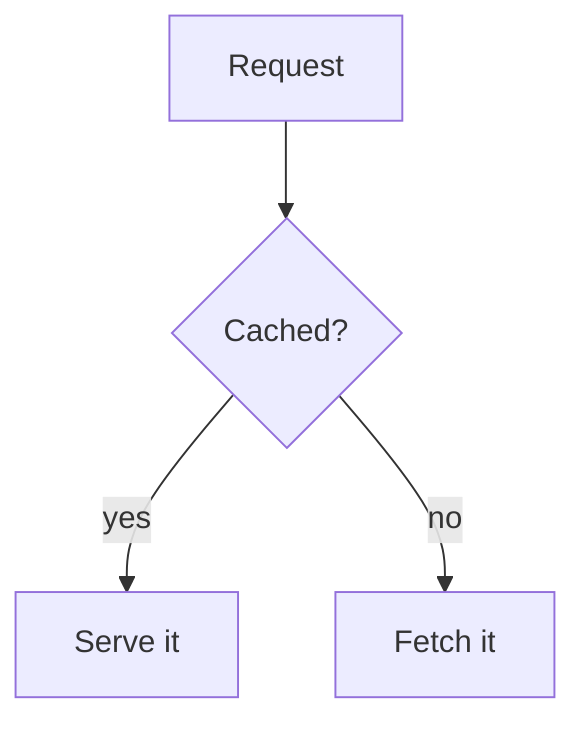

# Hypermedia

A ferret explains with more than words when words are not enough: a Mermaid diagram of a flow, an
interactive chart of numbers, an SVG drawing, a static HTML fragment, or a video, recording, PDF or
picture it made or found, rendered inline in the Chat transcript. **Hypermedia** is the per-ferret switch that tells a ferret it
may — and should, when an idea is not straightforward — communicate that way.

This page is the contract for the switch, the instruction it injects, and the guide an agent reads to
write the markup (`fy render guide`, `fy render check`). A message is Markdown with rich parts
(DurianMarkdown 0.7.0: the `terminal`, `filetree`, `editor`, `tierlist`, `alignment`, `mermaid` and `animation` fences,
`:::tabs` and `:::accordion`, and `:::human` and `:::llm` text); charts, pictures, media, maps and
live tasks are the `fy-render` fence, whose grammar, caps, sinks and declared
gaps are owned by [docs/fy-render.md](fy-render.md). **The teaching names only what the app draws today**: the
prompt and this guide must not present a part whose renderer is not drawing, because it would show as text. Two Durian
parts are deliberately NOT taught: a Durian `chart` fence is held as plain code (r12 H4 review: a chart's formulas have no
bound on their work), so a chart is the `fy-render` chart; and the parts of Durian 0.7.0's folders (`diff`, `graph`, `log`, `http`, ...) are held
as plain code too until a unit reviews and draws each (the `codewalk` was held for its HTML notes and is drawn since U1). `mermaid` is no
longer a Durian part: it is our own host block, kept so an old message's diagram still draws (decision D2), and keeps its steps: a diagram with at least two `%% @step <title>` lines is drawn one step at a time, as Durian 0.6.2 did (the title is the caption; Back, a slider and Next move between steps; step k is the head and every line up to the end of step k). `tests/unit/app/hypermedia/teaching-examples.test.tsx` fails the change that teaches a part the app does not draw:
every example of the guide must pass `fy render check` and draw, or be one it names as shown as code.
**Interim (r12 H11a, until the parser runs off the main thread):** an `animation` fence and the `:::tabs` and
`:::accordion` containers are shown as code too, their source as written, and the guide says so; and a message over the
pre-parse limits is not parsed at all: it is shown as plain text under the note "shown as plain text"
(`app/hypermedia/limits.ts`, `plain-fallback.tsx`). References (`@file`, `:agent`, …) stay owned by
[docs/reference-standard.md](reference-standard.md); a media `src: @path` uses the same `@path` form
and the same filesystem proof.

## The switch

| Fact                    | Where                                                                                         |
| ----------------------- | --------------------------------------------------------------------------------------------- |
| A ferret's switch       | `config.hypermedia` on its session document; **absent means the mode's default**              |
| What a launch is handed | `FY_HYPERMEDIA=1` or `0` in the pane environment                                              |
| Who reads it            | the runtime wrapper, which appends the instruction to the system prompt iff it is `1`         |
| Changing it             | `PATCH /v1/ferrets/:ferretId/hypermedia {enabled}` — `operator`                               |
| The UI                  | Info › Runtime "Hypermedia" row, Actions › "Hypermedia" toggle, an icon on the session header |

- **The default follows the mode.** An **interactive** ferret — one a person is talking to — is on by default: the start and the adopt record `hypermedia: true`. A ferret that runs **auto** (a worker, and the background helpers: wardens, learning miners) is **off** by default, because nobody is reading its chat to look at a picture and the instruction is context it pays for every turn. The start of an auto ferret records `hypermedia: false`. Only the owner's explicit switch overrides the default, in either direction, and `sessionHypermediaEnabled` in `packages/protocol` is the one place that resolves it for the daemon and the PWA.
- **A ferret that existed before the switch** has no `config.hypermedia` and no stored variable, so it reads as its mode's default: an existing interactive ferret is instructed at its next launch (restart, resume or revive) unless the owner turns it off first, and an existing auto ferret is **not** instructed at its next launch unless the owner explicitly turned it on.
- **A change takes effect at the next launch, and the answer says so.** A running ferret's
  environment and its system prompt were fixed when it started, so the switch never re-instructs a
  running ferret and never sends it a message — unlike passive learning, there is nothing here worth
  a turn. The PATCH answer's `note` names whether a restart is needed.

### Delivered as system instructions, per ferret

Every Ferretry instruction is in the **appended system prompt** — Claude's `--append-system-prompt`,
Codex's `developer_instructions` — because a harness weighs that far above a tools server's MCP
`initialize` instructions, which an agent can ignore. (Hypermedia used to ride those; it no longer does,
and the tools server now says one line.)

A runtime's wrapper is materialised once and serves every ferret launched on it, so a static launch
argument could not differ per ferret. The wrapper therefore **composes the one value at exec time**
(`packages/fleet/src/lib/wrappers.ts`): the person's own appended instruction, then Ferretry's tools,
settings rules and notify rule (always on), then each per-ferret section whose switch the daemon set to `1` in that ferret's launch
environment, in this order: hypermedia (`FY_HYPERMEDIA`), Pack mode (`FY_PACK`,
[pack-mode.md](pack-mode.md)), lessons (`FY_LEARNING_PASSIVE`, [lessons.md](lessons.md)). A restart,
migration, resume or revive runs the same wrapper with the same stored environment and the session's
recorded mode, so it keeps them; a switch the store never recorded is derived from the session's record
at each launch rather than read as off (`LaunchEnvironmentStore`). A wrapper run by hand, where nothing
set the switches, carries no section.

**A resumed conversation hears the new sections.** Claude Code records a conversation's system prompt at
its first request and, by default, replays that record on every later request and `--resume` even when a
later launch passes different text (`--system-prompt-snapshot`). Every Restart, migration, revive and
import relaunches into the SAME conversation, so a ferret started before a section existed — or with its
switch off — was never told, and "takes effect at the next restart" was false. A Claude agent runtime's
wrapper therefore passes `--system-prompt-snapshot=off` wherever the installed Claude lists that flag in
its `--help` (an older one would refuse a flag it does not know). Codex reads `developer_instructions`
afresh at every launch.

**A ferret can check.** `fy instructions` (or the `instructions` MCP tool) reports which sections this
ferret launched with, read from the same variables the wrapper read, and for each one that is off, where
the owner turns it on: the ferret's Actions › Hypermedia / Pack mode / Passive learning, effective from its
next restart. A ferret should check before telling the owner a section is missing.

## The injected instruction

Exactly this, from `HYPERMEDIA_INSTRUCTION` in `packages/plugins/runtimes/daemon/lib/account/fixed-layer.ts` (with the
binary's name for `fy`). It is in every turn's context, so it is at most 20 lines: it names the part fences, the
`fy-render` fence and its types and every reference sigil once, and every spec is one `fy render guide <part>` away,
printed from the [guide below](#guide-for-agents). `fy render check <file|->` is the doccheck an agent can run on a
message before sending it; nothing runs it for the agent. Its second line is the owner's explainer rule (2026-11-04: _"for explainers, make sure its ADHD Firendly
(make sure you say that) and user hypermeida to walk user through things"_, _"give example to illustrate your
points etc"_). Change it there and here together.

The last line below says where a block draws, and it agrees with the surface table in
[fy-render.md](fy-render.md#where-a-block-renders-and-where-it-cannot): a chat message and that ferret's Queue panel
(closed, top-level fences). The agenda lends no `fy-render` door, a task's own text has no fence reading, and the
Board, PR text and the standalone All-queues page show a block as code.

````text
Hypermedia: to teach, explain or compare anything not simple, show it, not just say it. Inline: never publish a page or link unless asked.
Explainers are ADHD-friendly: answer first, one idea per line, plain words, bold only the key point, an example per point. Make it interactive: a visual the reader changes (sliders, toggles) that redraws live, no steppers; gentle motion (prefers-reduced-motion).
Write Markdown. Parts are fences: ```terminal, ```filetree, ```editor, ```tierlist, ```alignment, ```mermaid, ```animation (`3d` after it: 3D); `@step <caption>` lines give a part steps (mermaid: `%% @step <caption>`); :::tabs and :::accordion; `:::human` is for people, `:::llm` after a part for another agent.
- mermaid: flowchart TB, sequenceDiagram, …: top-down, short labels; auto-themed: no %%{init}%% or colours.
- Charts, svg, interactive html, maps, media, live tasks: a fence whose info string is exactly fy-render: `type: chart|svg|html|map|image|video|audio|pdf|lottie|task|board`, `alt: <one line>`, `---`, then the payload.
- chart (fy-render only; a part named chart is shown as code): YAML {kind: bar|line|area|pie|…, x: […], series: [{name, data}]}; no colours.
References are plain text, never links: `:agent @file &F12 ^A3 /skill $skill %terminal:dev %browser:app`.
Every spec: `fy render guide <part>`. Before sending, run `fy render check <file|->`: prints `line N: …` per problem; exit 1 on error.
Draws in chat and the ferret's Queue panel; agenda, tasks, Board, PRs, All queues show code; never in files, docs, commits.
````

## Guide for agents

`fy render guide [topic]` prints this section and nothing else: the `### overview` body when no topic is named, or that topic's `###` body when one is. `image`, `video`, `audio` and `pdf` share the `### media` section, `task` and `board` share `### task`, `tabs` also answers `accordion`, and `human` also answers `llm`. `fy render check <file|->` is the doccheck: run it on a message before you send it. The CLI ships a byte-exact copy of this whole section in the binary (`RENDER_GUIDE_SECTION` in `packages/plugins/conversation/cli/reading/guide-text.ts`), written from this section by `tests/support/guide-text/generate.ts`, and `tests/unit/cli/guide-drift.test.ts` fails the commit that lets the copy disagree with it — so this section is the one owner of the text: edit it here, then run the generator.

Two shapes are deliberately absent from this section. An example fence of the `fy-render` kind, because the copy ships in the CLI's TypeScript source, where `no-fy-render-in-docs.sh` refuses a fence opener. And the per-type detail of `fy-render`: [fy-render.md](fy-render.md) holds the contract, and where the two disagree the contract wins and this section is wrong.

### overview

A message is Markdown (GitHub flavour: headings, lists, tables, task lists, code, links) with rich parts. A part is a fence named for it: `terminal`, `filetree`, `editor`, `tierlist`, `alignment`, `mermaid`, `animation`. Prose parts are containers, a line `:::tabs` or `:::accordion` closed by a line `:::`. A line `:::human` closed by a line `:::` is text for people, and `:::llm` after a part is the text another agent reads. Any other fence (`ts`, `diff`, `sh`) is plain code — and so is a `chart` fence, which the app does not draw: a chart is an `fy-render` block (below). For now an `animation` fence and a `:::tabs` or `:::accordion` container are shown as code too, their source as written: use them only where the source is the point. A message over the pre-parse limits is shown as plain text. A part with a mistake in it is shown as its source with the problem named, so check that it drew.

Charts, pictures, media, maps, live tasks and static or interactive pages are a different fence: its info string is exactly `fy-render`, line 1 `type: <type>`, line 2 `alt: <one-line description>`, then a line `---`, then the payload. Types: `chart`, `svg`, `html`, `map`, `image`, `video`, `audio`, `pdf`, `lottie`, `task`, `board`. A broken block renders as an ordinary code fence with no warning, so run `fy render check` on the message first.

Raw HTML in Markdown is shown as text. A Markdown image is not drawn (use an `image` block); a link may go to `https://`, `mailto:` or a heading of the same message, and nothing else. A message has no front matter: a first line `---` is just a line. A message over 300,000 bytes is shown as text. Never write any of this into files, docs, commits or PRs: it is for chat messages and agenda items only.

Reference things as plain text, never as links: see `### references`. For an explainer, show the idea: a `mermaid` flow, an `animation`, a `chart`, a `tierlist` or `alignment` grid, an interactive `html` page, a `terminal` session, a `filetree` — and keep the words short.

### terminal

A shell session. A line starting `$ ` (or `% `, or `# ` for root) is a command; every other line is its output, shown as it is. Each command is one step. Info string: ` ```terminal title="two words" `. `console` and `shellsession` mean the same part. A ` ```sh ` block is plain code and stays still.

Write `@step <title>` lines to set the steps yourself (then every line sits under a step; at least two steps, or none).

```terminal title="run the tests"
$ bun test
12 pass
$ git push
Everything up-to-date
```

### filetree

Two spaces per level; a name ending in `/` is a folder. A word in brackets after a name is a mark from a fixed list: `(new)`, `(changed)`, `(removed)`, `(generated)`, `(conflict)`, and for folders `(open)` or `(closed)`. `# text` after a name is a note; a line `...` stands for entries left out. `@step <title>` lines show the tree before and after a change.

```filetree
@step Before
app/
  main.ts
@step After
app/
  main.ts  (changed)
  util.ts  (new)  # shared helpers
```

### editor

A file tree and one file pane. A message has no repository, so write every file yourself: `@file <path>` makes a file up, right here; its lines follow; `(open)` after the path marks the file shown first. `@step <title>` is an edit: `@@ <path>` picks the file, then each line starts with `+` (added), `-` (removed) or a space (kept), followed by the file's line exactly as written, its own indentation included. A single `@step` is fine here: the files as they are come first.

```editor
@file src/greet.ts (open)
export function greet(name: string) {
  return 'Hi ' + name;
}
@step Add an exclamation mark
@@ src/greet.ts
-  return 'Hi ' + name;
+  return 'Hi ' + name + '!';
```

### chart

An `fy-render` block of `type: chart`. The payload is JSON/YAML {kind: bar, x: [Mon, Tue], y: {format: money}, series: [{name: Cost, data: [2, 3]}]}; kind line|bar|area|pie|doughnut|scatter|radar; format number|percent|money|duration|bytes; stacked; frames: [{label, series}] steps. No colours: tone accent|good|warn|bad|muted|1-8.

Say what the chart says; the reader's theme paints it. `title:` is optional; `y` (and a scatter's `x`) take `{label, format, currency, min, max}` — `money` takes an ISO 4217 `currency`, default USD, `duration` takes seconds, `percent` takes the number itself. `stacked:` on line, area and bar; `horizontal:` on bar; a series `kind: line` draws a line over bars; `null` in `data` is a gap; scatter data is `[[x, y], …]` on a numeric x axis. The reader gets tooltips, a legend they can toggle, zoom on line and area, and `frames` steps with Previous/Next and a slider; the numbers reach a screen reader as a table. Any key the language does not name — `color:` included — makes the block fall back to its source. Caps: 64 KiB, 12 series, 500 points a series, 500 labels, 30 frames.

### mermaid

A fence named `mermaid`. The body is Mermaid source (flowchart TB, sequenceDiagram, …): top-down, short labels. It is auto-themed: `%%{init}%%`, front matter and `theme`/`themeVariables`/`themeCSS` are ignored, and `style`/`classDef` colours still apply and fight the reader's theme — leave colours out. ≤ 20,000 characters. A wide left-to-right flowchart is redrawn top-down on a phone by itself, and the reader can scroll it sideways. A diagram that does not parse becomes a plain code fence. A line `%% @step <title>` (a Mermaid comment) makes the diagram build up: step k draws every line up to the end of its step; at least two steps, or none.



### animation

For now the app shows an `animation` fence as code (its source, as written), not as the animation. One engine: a stage of entities, connectors and steps. The lines before the first `@step` set the stage; each `@step <caption>` is a sentence the reader sees, followed by the changes that happen in it, one per line; step k shows the setup plus steps 1 to k. At least two steps. Add `3d` after the fence name to open the scene in 3D; the reader can switch either way, and a browser with no 3D (or that loses it) shows the flat view.

Things: `box`, `circle`, `pill`, `cylinder`, `cloud`, `person`, `diamond`, `text`, `dot`; frames `group "label" layout=row|column|grid|tree|graph`; data `array a: 5 2 8`, `list`, `stack`, `queue`; `token t "req" at api`. Write `<kind> <id> "label" [in <container>]`; ids are letters, digits, `-` `_` `.`, labels are in double quotes. Connectors: `a -> b`, `a --> b` (dashed), `a -- b`, `a <-> b`, with a label last: `app -> db "writes"`.

In a step: `add <thing>`, `remove <id>`, `move <id> to <container>`, `swap a b`, `set <id> tone=warn`, `highlight <id>`, `say <id>: text`, `send "GET /" a -> b` (one hop per step), `zoom into <id>`, `camera <id>`. No colours, pixels or times: layouts place things, `tone=` is a role (plain, acc, good, warn, hot, muted), and the engine times the motion. Caps: 300 things, 200 steps. An animation with one step, an unknown word or a stage past the caps is shown as source with the problem named.

```animation
pill router "router"
group s1 "shard 1" layout=column
group s2 "shard 2" layout=column
pill k3 "users 201-300" in s2
router -> s1
router -> s2
@step The router sends each request to the shard that holds the key.
send "user 250" router -> s2
@step A third shard joins and takes a range.
add group s3 "shard 3" layout=column
router -> s3
move k3 to s3
```

```animation 3d
box web "web"
cylinder db "database"
web -> db
@step The web tier writes to the database.
send "INSERT" web -> db
@step The database answers.
send "ok" db -> web
```

### tierlist

A ranking in rows, best first, one line per tier: the tier's name, a colon, then its items separated by commas. Tiers are `S`, `A`, `B`, `C`, `D` unless a first line `tiers: Must [good], Should [c6], Could, Won't [bad]` names others (colour `c1`–`c8`, `good`, `warn` or `bad`). A short note goes in brackets after an item; an item with a comma in its name goes in quotes. Each item sits in one tier, once. `title="…"` on the fence names the list.

```tierlist title="Databases for a small team"
S: Postgres (does almost everything), SQLite (no server to run)
A: MySQL, "Redis, as a cache" (fast, but memory is dear)
D: A spreadsheet
```

### alignment

Two axes with a name at each end, drawn as a 2x2 or 3x3 grid. Line `x: low effort .. high effort`, line `y: high impact .. low impact` (two names or three, the same number on both). An item goes in a cell, `low effort / high impact "Do first": Fix the typo, Cleanup`, or at a point from 0 to 1, `Speed up the build @ 0.66, 0.2` (the first name of an axis is 0). The column comes first in a cell name. Each item is placed once.

```alignment title="Which task first?"
x: low effort .. high effort
y: high impact .. low impact
low effort / high impact "Do first": Fix the typo, Cleanup
Speed up the build @ 0.66, 0.2
```

### tabs

For now the app shows a `:::tabs` or `:::accordion` container as code (its source, as written), not as tabs or rows. `:::tabs` holds prose in tabs and `:::accordion` in rows: every heading at the highest level used inside starts one tab or row, and the container is closed by a line `:::`. Containers do not nest and hold no other container; they may hold fenced parts. Keep them for parallel choices (two languages, two options), not for a story that reads top to bottom.

```md
:::tabs

#### npm

Run `npm install`.

#### pip

Run `pip install`.
:::
```

```md
:::accordion

#### Why steps?

One idea at a time.

#### Why a title?

The reader sees it under the part.
:::
```

### human

`:::human` text is shown to people, and `:::llm` after a part or `:::human` is the text another agent reads instead of it. The reader sees an `:::llm` text too, collapsed under "LLM-only text", so write nothing there you would not say to them. A part whose own text is over about 400 tokens should have one.

### references

A reference is a plain token in your text: `:agent` a fleet agent's session, `@path` a file (`@src/api.ts`, `@src/api.ts:120`, `@src/api.ts:120-140`), `&F12` a task, `^A3` an agenda item, `/skill` or `$skill` a skill, `%terminal:dev` and `%browser:app` a live terminal or page by its name. Write them as bare words in prose; the reader's app proves each one and turns it into a link, and one that does not exist stays plain text. A Markdown link that imitates a reference is plain text. Inside a code span a reference is shown as written.

### svg

One self-contained `<svg>…</svg>` (CSS animation welcome). No `<script>` or `on*` handler, no `<foreignObject>`, `<use>`, `<!DOCTYPE>` or `<!ENTITY>`, and no external reference — no web font, remote `<image>`, stylesheet, filter or mask: none of it loads in the `` sink an SVG renders through. Give the root a `viewBox`, with `width`/`height` in plain numbers, `px`, or `%` of the viewBox. Caps: 100 KiB, 500 elements, 32 filter primitives, 8192 per axis, 16,777,216 pixels. Colours are yours — pick marks that read on light and dark, or set a background rectangle — and give text a real `font-family`.

### html

A fragment with inline CSS — tables, lists, `<details>`/`<summary>`, code, inline SVG, `<style>` — drawn straight into the message; nothing in it runs. Add a `<script>` or `on…=` handler only when the reader must do something: the block then runs as a live page in an isolated frame, marked "interactive" — one self-contained page with inline `<style>` and `<script>`, loading nothing from the network (no fetch, XHR, WebSocket, no CDN), no storage, no forms, no popups, never navigating, and no long loops (it stops after five seconds unresponsive or ten minutes). ≤ 200 KiB. The fragment's styles cannot reach the app and the app's cannot reach it.

**Interactive means a visualization the reader changes.** Draw something — bars, a curve, a grid, a diagram — and give it parameters (sliders, toggles, a select, segmented buttons); every change redraws it at once. Never a stepper, a slideshow, a quiz or Next/Back pages: a sequence is prose.

**It looks native when it uses the app's theme.** The page sits on the chat or Queue-panel surface, so leave its background transparent and set no colour of your own unless the colour is the content (a swatch). Every colour comes from a theme token; light, dark and a theme switch while it runs follow by themselves.

- Tokens, as `var(--name)`, the same in a static fragment: ink `--fg` `--fg-soft` `--muted` `--faint`; surfaces `--bg` `--surface` `--surface-2` `--surface-3`; lines `--border` `--border-soft` `--border-strong`; accent `--accent` `--accent-soft` `--accent-fg`; status `--ok` `--warn` `--err` and `--ok-bg` `--warn-bg` `--err-bg`; series `--viz-1` … `--viz-8`; type `--font-body` `--font-mono` `--text-xs` `--text-sm` `--text-base` `--text-lg`; shape `--radius-sm` `--radius-md` `--radius-pill`; space `--gap-xs` `--gap-sm` `--gap-md`.
- Plain `<button>`, `<input>`, `<select>`, `<table>`, headings and text are already styled in a live page. Classes add the rest, live or static: `fy-btn` (`fy-btn--primary`, `fy-btn--quiet`; `aria-pressed="true"` marks one on), `fy-segmented` (a row of `fy-btn`), `fy-range` (a slider), `fy-toggle` (`<label class="fy-toggle"><input type="checkbox"> Label</label>`), `fy-input`, `fy-select`, `fy-field` (`<label class="fy-field">Rate <input class="fy-range" type="range"> <output>3</output></label>`), `fy-card`, `fy-row`, `fy-stack`, `fy-grid`, `fy-muted`, `fy-num`, `fy-chip`, `fy-stat` (`<div class="fy-stat">Cost <b>$42</b></div>`), `fy-table`, `fy-legend` with `fy-swatch`.
- Bars without a library: `fy-bars` holds `fy-bar` elements, each `style="--v:40"` (0–100, its height in percent) with optional `data-value` and `data-label`; `fy-meter` with `style="--v:70"` is one horizontal bar. `data-tone` is `1`–`8` (the series) or `accent`, `good`, `warn`, `bad`, `muted`, on a bar, swatch, meter, chip, or an inline-SVG shape (it sets `fill`, or `stroke` on `fill="none"`).
- Size: the frame grows to the page's height, up to 1200px, and never scrolls inside. Nothing may be wider than the column — a phone is about 360px — so let rows wrap (`fy-row` does) and give an SVG a `viewBox` with `width="100%"`. Fonts the app downloads are not available inside, so `--font-body` falls back to the reader's installed ones.

A slider that redraws bars:

```html
<div class="fy-stack">
  <label class="fy-field"
    >Growth <input class="fy-range" id="g" type="range" min="0" max="50" value="20" /> <output id="o"></output
  ></label>
  <div class="fy-bars" id="bars"></div>
  <div class="fy-legend">
    <span><i class="fy-swatch"></i>Revenue, year 1 = 1.00</span>
  </div>
</div>
<script>
  const g = document.getElementById('g'),
    o = document.getElementById('o'),
    bars = document.getElementById('bars');
  function draw() {
    const values = [1, 2, 3, 4, 5].map(year => Math.pow(1 + g.value / 100, year - 1));
    const top = Math.max(...values);
    o.textContent = g.value + '%';
    bars.innerHTML = values
      .map(
        (v, i) =>
          `<div class="fy-bar" style="--v:${(v / top) * 100}" data-value="${v.toFixed(2)}" data-label="Y${i + 1}"></div>`,
      )
      .join('');
  }
  g.addEventListener('input', draw);
  draw();
</script>
```

### map

JSON/YAML {center: [lat, lng], zoom, markers: [{at, label, popup}], lines: [{points}], polygons, geojson}; real places.

`center` is `[lat, lng]`; omit it to fit the view to everything drawn. `zoom` is 0–18 (with a fit, the closest the fit may zoom). Markers carry `at`, `label` and `popup`; `lines` are routes (`points: [[lat, lng], …]`, `label`); `polygons` need three points a ring; `geojson` takes Point, LineString, Polygon and their `Multi*`/Feature/Collection forms. Colours: `red`, `blue`, `green`, `amber`, `purple` or `#hex`. An interactive map with OpenStreetMap tiles as its one remote load: pan, zoom, tap a marker for its popup. Caps: 32 KiB, 100 markers, 50 lines+polygons, 2,000 vertices; a refusal falls back to a coordinates list.

### media

save files you make into $FY_MEDIA_DIR and put `src: media:<file name>` before `---`, with no payload; `src: @workspace/path` and `src: https://…` also work.

That is `image`, `video`, `audio` and `pdf` — they name bytes instead of carrying them, and nothing follows the `---`. `media:<file>` is the one for anything you MADE: `$FY_MEDIA_DIR` is your session's media folder, outside every repository, so no ignore rules decide whether it can be shown; name the file by its path inside that folder. `src: @workspace/path` is written as an `@file` reference without a line, read with the reader's access — gitignored and protected files are never served, at most 1 MiB. For `src: https://…`, video and audio play directly; an image must come from a host that allows cross-origin reads (at most 2 MiB) or becomes a link; a pdf is always a link. `http:`, `data:` and `blob:` are refused. Extensions: image png/jpg/jpeg/gif/webp, video mp4/m4v/webm/ogv/mov, audio mp3/m4a/aac/wav/ogg/oga/opus/weba/flac, pdf. An `image` may instead be inline — `mime: image/png|jpeg|gif|webp` with a base64 payload, still, matching the declared type, ≤ 2 MiB decoded — `src:` or `mime:`, never both.

### task

`task` and `board` point at tasks on the board and show them live; they draw no picture and carry no bytes. `task`: the payload is one reference, `&F12`. `board`: references one per line or separated by spaces (at most 12, none twice), or a single line `parent: &F12` to show that task's children. Either form draws a framed mini board grouped by lane. The reader sees the real board task — title, lane, progress, its PRs — and it redraws by itself when the task moves; you write no title or status, so there is nothing to keep true. Prefer one block to pasting a status that goes stale. A task that does not exist or cannot be read shows as a quiet note, never a link. Chat messages and that ferret's Queue panel only: an agenda item, a task description, the Board, PR text and the standalone All-queues page show the block as code. Caps: 2 KiB, 12 listed tasks, 24 children shown. A repeated or non-task reference, a `parent:` mixed with a list, or `parent:` on a `task` makes the block a plain code fence.

### lottie

A Lottie animation as JSON — the one animated type, with Pause/Play. No expressions: a string-valued `"x"` key anywhere is refused; export without expressions. No remote assets: embed images as `data:` URIs or leave them out. Caps: 1 MiB, 500 layers, 64 levels deep. It plays while on screen, starts paused under reduced motion, and stops after two minutes with Replay.

---

## The supported forms

Every form is an `fy-render` fence (grammar: [fy-render.md § The grammar](fy-render.md#the-grammar)).
A block the grammar refuses renders as an ordinary escaped code fence, so a malformed block never
breaks the transcript. **An illustration never chooses its own colours.** A `chart` series asks for a
`tone` (`accent`, `good`, `warn`, `bad`, `muted`) or a palette slot `1`–`8`, and a Mermaid diagram is
painted from the same theme tokens; the reader's theme decides what each looks like, and a theme switch
repaints them. A `chart` that names a colour is refused, and a Mermaid `%%{init}%%` that sets `theme`,
`themeVariables` or `themeCSS` is ignored ([fy-render.md § Charts](fy-render.md#charts)).

**An interactive `html` page looks like the app.** It draws in a chat message and in that ferret's Queue
panel (the agenda, tasks, the Board, PR text, the standalone All-queues page and the shell's `Markdown` show an
`fy-render` block as code). It is transparent — it sits on the
chat column's own surface — and gets the app's theme tokens (`var(--fg)`, `var(--accent)`, `var(--viz-1)` …, light and dark,
following a theme switch live) and a small component kit (`.fy-btn`, `.fy-range`, `.fy-toggle`,
`.fy-bars`, `.fy-table`, …) inside its sandbox. It grows to its own height and never scrolls inside
itself inline. Interactive means a visualization the reader changes and it redraws, never a stepper.
`fy render guide html` teaches it; the contract is [fy-render.md § The interactive `html` frame](fy-render.md#the-interactive-html-frame).

A block renders by itself once it is near the screen — there is no Render button any more
([fy-render.md § Inline by default](fy-render.md#inline-by-default--the-owners-decision)).

| `type:`   | Payload / header                                  | Renders as                                                                                       |
| --------- | ------------------------------------------------- | ------------------------------------------------------------------------------------------------ |
| `mermaid` | Mermaid source                                    | a diagram, compiled in the sandbox frame, painted in the reader's theme tokens                   |
| `chart`   | small JSON/YAML in the chart language             | an interactive Chart.js chart in the page, in the theme's colours; the source fence if refused   |
| `map`     | small JSON/YAML: centre, markers, lines, polygons | an inline interactive map (Leaflet, OpenStreetMap tiles); a coordinates list if it cannot draw   |
| `svg`     | one `<svg>` document                              | a picture through the measured `` sink — never inline SVG                                   |
| `html`    | one self-contained fragment                       | no script: sanitized markup in a closed shadow root; with script: a live page in an opaque frame |
| `task`    | one task reference, `&F12`                        | the board's own task, live: its lane, progress and PRs; a quiet note if it cannot be read        |
| `board`   | task references, or `parent: &F12`                | a mini board of those tasks, or of a task's children, either way grouped by lane, live           |
| `image`   | `src:` — or `mime:` + base64 inline               | a picture; an https image needs CORS from its host, else a link row                              |
| `video`   | `src:`                                            | the browser's native player (https plays directly)                                               |
| `audio`   | `src:`                                            | the browser's native player (https plays directly)                                               |
| `pdf`     | `src:`                                            | a file row with Open / Download; an https PDF is a link (no in-frame viewer)                     |

`src:` is one of three things, and nothing else:

- **`media:<file>`** — a file in the session's MEDIA folder, `$FY_MEDIA_DIR` in the agent's pane
  (`state/sessions/<id>/media` under `FY_HOME`). It is where an agent puts what it MADE to show the
  person: outside any repository, so no ignore rule decides whether it can be shown, and read through
  the same route and grant as a workspace file (`scope=media`), never secrets.

- **`@path`** — a file in the ferret's workspace, written and resolved exactly as an `@file`
  reference is: session-relative, `./`-relative, or absolute inside the session's folder. It is read
  through the session filesystem route **as the reader**, so the reader's own grants decide it
  ([grants.md](grants.md) — `filesystem` _use_), the same as opening the file in the workspace. The
  bytes become a short-lived object URL; no daemon URL or credential ever reaches a media element.
  A workspace file is capped at 1 MiB, the daemon's per-file view limit; a larger one shows a
  "too large" row.
- **`https://…`** — a link the reader's browser fetches as soon as the block is near the screen.

A file that is missing, unreadable, over its cap or denied to this reader renders a file row that
says which — and for a file the daemon will not serve, WHICH RULE refused it (the ignore file, line
and pattern, a Git failure, or the denied name) — never a broken player and never the denied bytes.

## Security

The renderer side is reviewed against [grants.md](grants.md) and the PWA content security policy in
[fy-render.md](fy-render.md) and the PR that introduces each renderer. The invariants this page
depends on:

- **The switch grants nothing.** It changes what a ferret is _told_, not what any caller may do. The
  PATCH route is an `operator` write to a session's own configuration, like rename.
- **No new path to a file.** A workspace `src:` goes through the same session filesystem route and the
  same grant check an `@file` click does; the transcript never holds a daemon URL, token or path the
  reader could not already open.
- **Agent-authored HTML runs only inside an opaque-origin frame** with no access to the app, the
  daemon, tokens or storage. What that frame can and cannot reach is stated in fy-render.md, including
  the residuals a browser-only sandbox cannot close.
